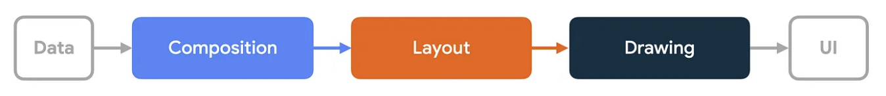

# Compose 的重组、布局、绘制执行位置

本文档详细说明 Compose 中重组（Recomposition）、布局（Layout）和绘制（Draw）三个阶段的执行位置和线程模型。

## 概述
Compose 的渲染流程分为三个阶段：

1. **构图（Composition）** - 展示什么界面。Compose 运行可组合函数，并创建用户界面的描述。

2. **布局（Layout）** - 界面放置位置 。该阶段包括两个步骤：测量和放置。布局元素测量并放置自己及其子元素在二维坐标中，针对布局树中的每个节点。
3. **绘制（Draw）** - 如何渲染。UI 元素会绘制到画布上，通常是设备屏幕。

这些阶段的顺序通常相同，使数据能够从构图到布局再到绘图，单向流动，从而生成画面（也称为单向数据流 ）。BoxWithConstraints、LazyColumn 和 LazyRow 是显著的例外，其子节点的组合取决于父的布局阶段。

但为了优化性能、Compose 不会为对每一帧都执行所有阶段; 如果 Compose 可以重用之前的结果，它会跳过运行可组合函数，如果 Compose UI 不需要，也不会重新布局或重新绘制整棵树。Compose 只完成更新界面所需的最低工作量。这种优化之所以可能，是因为 Compose 跟踪不同阶段内的状态读取。

## 1. 重组（Composition）

### 执行位置

重组发生在 `Recomposer.runRecomposeAndApplyChanges()` 方法中：

```kotlin
// compose/runtime/runtime/src/commonMain/kotlin/androidx/compose/runtime/Recomposer.kt
// 在 withFrameNanos 中执行重组
trace("Recomposer:recompose") {
    // 执行重组
    toRecompose.fastForEach { composition ->
        performRecompose(composition, modifiedValues)
    }
}
```

### 线程模型

**在 Android 平台上：**
- **主线程（UI 线程）**：重组默认在主线程执行
- 通过 `AndroidUiDispatcher.CurrentThread` 调度
- 在 `WindowRecomposer.android.kt` 中配置：

```kotlin
// compose/ui/ui/src/androidMain/kotlin/androidx/compose/ui/platform/WindowRecomposer.android.kt
val baseContext = AndroidUiDispatcher.CurrentThread + coroutineContext
val recomposer = Recomposer(contextWithClockAndMotionScale)
```

**触发时机：**
- 当 `MutableState` 的值发生变化时
- 通过 `Snapshot.sendApplyNotifications()` 通知
- 在每一帧的 `withFrameNanos` 回调中执行

### 执行流程

1. **状态变化检测**：`Snapshot.registerApplyObserver` 检测到状态变化
2. **标记需要重组**：将 Composition 添加到 `compositionInvalidations`
3. **执行重组**：在下一帧的 `withFrameNanos` 中调用 `performRecompose()`
4. **应用更改**：将重组结果应用到 UI 树

## 2. 布局（Layout）

### 执行位置

布局发生在 `measureAndLayout()` 方法中：

```kotlin
// compose/ui/ui/src/androidMain/kotlin/androidx/compose/ui/platform/AndroidComposeView.android.kt
override fun measureAndLayout(sendPointerUpdate: Boolean) {
    measureAndLayoutDelegate.measureAndLayout(resend)
}
```

### 线程模型

**在 Android 平台上：**
- **主线程（UI 线程）**：布局必须在主线程执行
- 通过 `AndroidComposeView.dispatchDraw()` 调用
- `dispatchDraw()` 是 Android View 系统的方法，由系统在主线程调用

### 执行流程

1. **触发时机**：
   - 重组完成后，如果布局需要更新
   - View 的 `invalidate()` 被调用时
   - 在 `dispatchDraw()` 中调用 `measureAndLayout()`

2. **测量阶段**：
   ```kotlin
   // 测量所有需要测量的 LayoutNode
   measureAndLayoutDelegate.measureAndLayout()
   ```

3. **布局阶段**：
   ```kotlin
   // 定位所有需要布局的 LayoutNode
   measureAndLayoutDelegate.dispatchOnPositionedCallbacks()
   ```

### 代码位置

```kotlin
// compose/ui/ui/src/androidMain/kotlin/androidx/compose/ui/platform/AndroidComposeView.android.kt
@OptIn(ExperimentalComposeUiApi::class)
override fun dispatchDraw(canvas: android.graphics.Canvas) {
    // 在绘制之前先执行布局
    measureAndLayout()
    Snapshot.notifyObjectsInitialized()
    
    // 然后执行绘制
    isDrawingContent = true
    // ... 绘制代码
}
```

## 3. 绘制（Draw）

### 执行位置

绘制发生在 `dispatchDraw()` 方法中：

```kotlin
// compose/ui/ui/src/androidMain/kotlin/androidx/compose/ui/platform/AndroidComposeView.android.kt
override fun dispatchDraw(canvas: android.graphics.Canvas) {
    measureAndLayout()
    Snapshot.notifyObjectsInitialized()
    
    isDrawingContent = true
    canvasHolder.drawInto(canvas) {
        root.draw(
            canvas = this,
            graphicsLayer = null
        )
    }
    isDrawingContent = false
}
```

### 线程模型

**在 Android 平台上：**
- **主线程（UI 线程）**：绘制必须在主线程执行
- `dispatchDraw()` 是 Android View 系统的方法
- 由 Android 的 `Choreographer` 调度，在每一帧的主线程回调中执行

### 执行流程

1. **准备阶段**：
   - 确保布局已完成（调用 `measureAndLayout()`）
   - 通知快照对象已初始化

2. **绘制阶段**：
   ```kotlin
   root.draw(canvas = this, graphicsLayer = null)
   ```
   - 从根节点开始递归绘制整个 UI 树
   - 每个 `LayoutNode` 的 `DrawModifierNode` 会被调用

3. **后处理**：
   - 更新脏图层（dirty layers）
   - 清理临时状态

## 完整执行顺序（Android 平台）

在 Android 上，一个完整的渲染帧的执行顺序如下：

```
1. Choreographer 触发 VSYNC
   ↓
2. AndroidComposeView.dispatchDraw() 被调用（主线程）
   ↓
3. measureAndLayout() - 布局阶段（主线程）
   ↓
4. Snapshot.sendApplyNotifications() - 通知状态变化
   ↓
5. Recomposer.runRecomposeAndApplyChanges() - 重组阶段（主线程）
   ↓
6. root.draw() - 绘制阶段（主线程）
   ↓
7. 帧完成，等待下一个 VSYNC
```

## 跨平台差异

### Desktop (Skiko)

在 Desktop 平台上，执行顺序类似但略有不同：

```kotlin
// compose/ui/ui/src/skikoMain/kotlin/androidx/compose/ui/scene/BaseComposeScene.skiko.kt
override fun render(canvas: Canvas, nanoTime: Long) {
    // 1. 执行 Effects
    recomposer.performScheduledEffects()
    
    // 2. 执行重组
    recomposer.performScheduledRecomposerTasks()
    frameClock.sendFrame(nanoTime)
    
    // 3. 布局
    doMeasureAndLayout()
    
    // 4. 通知状态变化
    Snapshot.sendApplyNotifications()
    
    // 5. 绘制
    draw(canvas)
}
```

### Web

在 Web 平台上，执行流程类似，但通过浏览器的渲染循环触发。

## 关键要点

1. **所有阶段都在主线程执行**：重组、布局、绘制都在主线程（UI 线程）执行
2. **顺序固定**：重组 → 布局 → 绘制，这个顺序是固定的
3. **帧同步**：所有操作都在每一帧的 `dispatchDraw()` 或 `render()` 中完成
4. **状态驱动**：重组由状态变化触发，布局和绘制由重组结果触发

## 相关代码位置

- **重组**：
  - `compose/runtime/runtime/src/commonMain/kotlin/androidx/compose/runtime/Recomposer.kt`
  - `compose/ui/ui/src/androidMain/kotlin/androidx/compose/ui/platform/WindowRecomposer.android.kt`

- **布局**：
  - `compose/ui/ui/src/androidMain/kotlin/androidx/compose/ui/platform/AndroidComposeView.android.kt`
  - `compose/ui/ui/src/commonMain/kotlin/androidx/compose/ui/node/LayoutNode.kt`

- **绘制**：
  - `compose/ui/ui/src/androidMain/kotlin/androidx/compose/ui/platform/AndroidComposeView.android.kt`
  - `compose/ui/ui/src/commonMain/kotlin/androidx/compose/ui/node/NodeCoordinator.kt`
