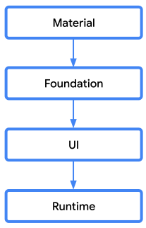
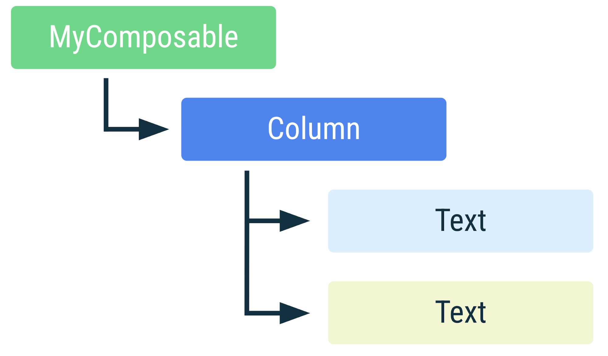

# Jetpack Compose

解绑 UI 工具包：

google 团队每次修复一个问题或者发布新功能，老旧的设备都无法立即使用到，开发者甚至需要几年时间等待老的设备淘汰掉。

[改变原有 UI 设计中的问题：](https://zhuanlan.zhihu.com/p/351794462)
    例如，所有视图的基类 View.java 的拥有近 3W 行的代码量。(ViewGroup近1W行，TextView 1.6W)
    Button 继承自 TextView, TextView 有很多功能，导致 Button 中的文字具有 TextView 具有可选中、可编辑。


    编写自定义 View 有点令人生畏，View 系统是如此复杂，想要处理好各种逻辑并提供一套优秀的 API 并不简单。
        - 各种设置
        - 需要再 attr.xml 中添加 xml 自定义属性
        - 编写一套默认主题的样式
        - 处理布局和触摸事件
    Fragment 适合于一个可替换的块，更粗粒度的方式具有声明周期的模型。
    但是应有开发随着时间推移会发生变化，有时候 View 更合适，有时候 Framgment 更合适，然而从一个抽象模型切换到另一个抽象模型带来非常高的工程成本。


[Over the last several years, the entire industry has started shifting to a declarative UI model, which greatly simplifies the engineering associated with building and updating user interfaces. ](https://developer.android.com/jetpack/compose/mental-model)

声明式 UI 和命令式 UI 的核心区别是描述 `是什么` 而不是 `如何做`。

- 无状态：UI 不包含当前状态，而是从用户数据中获取。

历史上，Android 视图层次结构可以表示为一个 UI 组件的树。由于用户交互等因素导致应用状态变化时，需要更新视图层次结构以显示当前数据。更新 UI 最常见的方法是使用 findViewById() 等函数遍历树，并通过调用 button.setText(String) 、 container.addChild(View) 或 img.setImageBitmap(Bitmap) 等方法来更改节点。这些方法会改变组件的内部状态。

在过去的几年里，整个行业开始转向声明式 UI 模型。这种模型简化了构建和更新用户界面的工程工作。该技术通过概念上从零开始重新生成整个屏幕，然后仅应用必要的更改来工作。这种方法避免了手动更新有状态视图层次结构的复杂性。Compose 是一个声明式 UI 框架。


## Compose 构成

Compose 是重新设计的 UI 工具包，整个 UI 被分成了几个仓库，这样设计的主要目的是为了更好地模块化和解耦。同时也方便开发者根据自身需要实现其自定义 UI。

1. 编译器插件：alias(libs.plugins.composeCompiler)
2. 运行时：compose.runtime - 最底层的基础，提供Compose编程模型、状态管理（如 mutableStateOf, remember）等核心运行时能力
3. UI 核心 ：compose.ui - 提供UI工具包的基础：布局、绘制、测量、输入等。此外还有 preview，graphics 等。
4. UI 基础 ：compose.foundation - 最基本的 UI 组件，例如 BaseText、 Imag、Row、Column、Box
5. 风格化组件：compose.material - 实现了 Material Design 规范的 UI 组件，例如 Button、Card、TextField 等。


## 分包

[分成了四层](https://developer.android.com/develop/ui/compose/layering?hl=en)



- animation 对 runtime、ui、foundation 都有依赖。

每一层都建立在较低的层之上

关于 runtime 的独立性，Jack Wharton 的博客：https://jakewharton.com/a-jetpack-compose-by-any-other-name/
关于 compose 移植， Jack Wharton 的分享：https://www.bilibili.com/video/BV1ky411e7ox?spm_id_from=888.80997.embed_other.whitelist&t=16.366395&bvid=BV1ky411e7ox


- runtime 是独立平台、甚至跟 UI 构建独立的，如何创建一个 Runtime?
- 如何向 runtime 添加和删除元素？
- 状态变化时，如何传递到 runtime 导致数据变化？asXXXState()
- 状态树和UI 树的抽象 UI 是什么？
- 何时更新状态树、何时更新 UI 树？
- 如何将 UI 树绘制到 系统？


[Compose 和其它 UI 框架的设计对比](https://xie.infoq.cn/article/df4091297360fcc8395d8d8dc)


> 错误处理

```shell
> Task :internal-testutils-xctest:cinteropCMPTestUtilsIosArm64 FAILED
Print: Entry, ":CFBundleShortVersionString", Does Not Exist
xcrun: error: unable to find utility "xcodebuild", not a developer tool or in PATH
Exception in thread "main" org.jetbrains.kotlin.konan.MissingXcodeException: An error occurred during an xcrun execution. Make sure that Xcode and its command line tools are properly installed.
Failed command: /usr/bin/xcrun xcodebuild -version
Try running this command in Terminal and fix the errors by making Xcode (and its command line tools) configuration correct.
        at org.jetbrains.kotlin.konan.target.CurrentXcode.xcrun(Xcode.kt:147)
        at org.jetbrains.kotlin.konan.target.CurrentXcode.getXcodebuildVersion$kotlin_native_utils(Xcode.kt:120)
        at org.jetbrains.kotlin.konan.target.CurrentXcode$version$2.invoke(Xcode.kt:132)
        at org.jetbrains.kotlin.konan.target.CurrentXcode$version$2.invoke(Xcode.kt:128)
```

1. 第一步：检查 xcrun 能否找到 xcodebuild
```shell
xcrun -find xcodebuild
```
如果报错，说明 xcrun 的配置确实是坏的。

2. 第二步：检查当前的开发者路径
```shell
xcode-select -p
```
如果输出是 /Library/Developer/CommandLineTools，这就是问题所在。

3. 第三步：修复（切换到完整的 Xcode） 你需要将路径指向你的主 Xcode 安装包。通常是
```shell
sudo xcode-select -s /Applications/Xcode.app/Contents/Developer
```
然后再运行 xcrun -find xcodebuild，你会发现它现在能返回结果了。

```shell
Execution failed for task ':compose:ui:ui-uikit:commonizeCInterop'.
> Process 'command '/Applications/Android Studio.app/Contents/jbr/Contents/Home/bin/java'' finished with non-zero exit value 1

```
gradle/libs.versions.toml 中 kotlin 升级到 2.2.21，否则报错：Unresolved classifier: platform/Metal/MTLLogicalToPhysicalColorAttachmentMap


[When you build your Compose Multiplatform application for Android, you use the Jetpack Compose artifacts published by Google. For example, if you add compose.material3 to your dependencies, your project will use androidx.compose.material3:material3 in the Android target, and org.jetbrains.compose.material3:material3 in other targets. This is done automatically, based on Gradle Module Metadata in the multiplatform artifacts.](https://kotlinlang.org/docs/multiplatform/compose-multiplatform-and-jetpack-compose.html#libraries-for-compose-multiplatform)


## 可组合项的生命周期

可组合项：@Composable 注解的函数。

**Composition 描述应用的界面，它由运行 composables 生成。Composition 是描述 UI 的 composables 函数的树形结构。**

Compose 首次运行 composables 时，在 composition 初始过程中，它将保存调用的composables 的追踪到一个 Composition 中。之后、当应用程序的状态发生变化时，Compose 会调度一个重组（recomposition）。重组是 Compose 重新执行可能因状态变化而发生变化的 composables，然后更新 Composition 以反映任何变化。

Composition 只能在组合初始化时创建，之后重组过程中只能更新。并且修改 Composition 的唯一方法就是通过重组。

composable 函数可以被执行 0 次或多次。而且每次重组都是这样，无法保证 composable 函数执行的次数。

通常由更改 State<T> 对象来触发重组。 Compose 跟踪这些状态, 并在状态变化时运行 Composition 中读取该特定 State<T> 的所有 composables，以及由它们调用的任何无法跳过的 composables。


> **注意：** composable 的生命周期比 View、Activity 和 Fragment 的生命周期更为简单。当 Composable 需要管理或有更复杂生命周期的外部资源进行交互时，应使用 Effects。

如果某个 composable 被调用多次，则会在 Composition 中放置多个实例。每次调用在 Composition 中都有其独立的生命周期。

```Kotlin
@Composable
fun MyComposable() {
    Column {
        Text("Hello")
        Text("World")
    }
}
```


Figure 2. Representation of MyComposable in the Composition. If a composable is called multiple times, multiple instances are placed in the Composition. An element having a different color is indicative of it being a separate instance.

## Composition 中 composable 的剖析

Composition 中 composable 的实例由其 **call site** 标识。 Compose 编译器认为每个call site都是不同的。从多个 call site 调用 composable 将在 Composition 中创建 composable 的多个实例。

> **关键术语：** call site 是调用 composable 的源代码位置。这会影响它在组合中的位置，从而影响 UI 树。

在重组过程中，如果 composable 相比前一次重组调用了不同的 composables，Compose 将识别哪些 composables 被调用、哪些未被调用，并且对于在两次重组中都被调用的 composables，如果它们的输入没有变化，Compose 将避免重组（调用）它们。


保持身份对于将副作用与它们的 composable 关联起来至关重要，这样它们才能处理正确，而不是每次重组都重新执行。

考虑如下的情况：
```Kotlin
@Composable
fun LoginScreen(showError: Boolean) {
    if (showError) {
        LoginError()
    }
    LoginInput() // This call site affects where LoginInput is placed in Composition
}

@Composable
fun LoginInput() { /* ... */ }

@Composable
fun LoginError() { /* ... */ }
```
