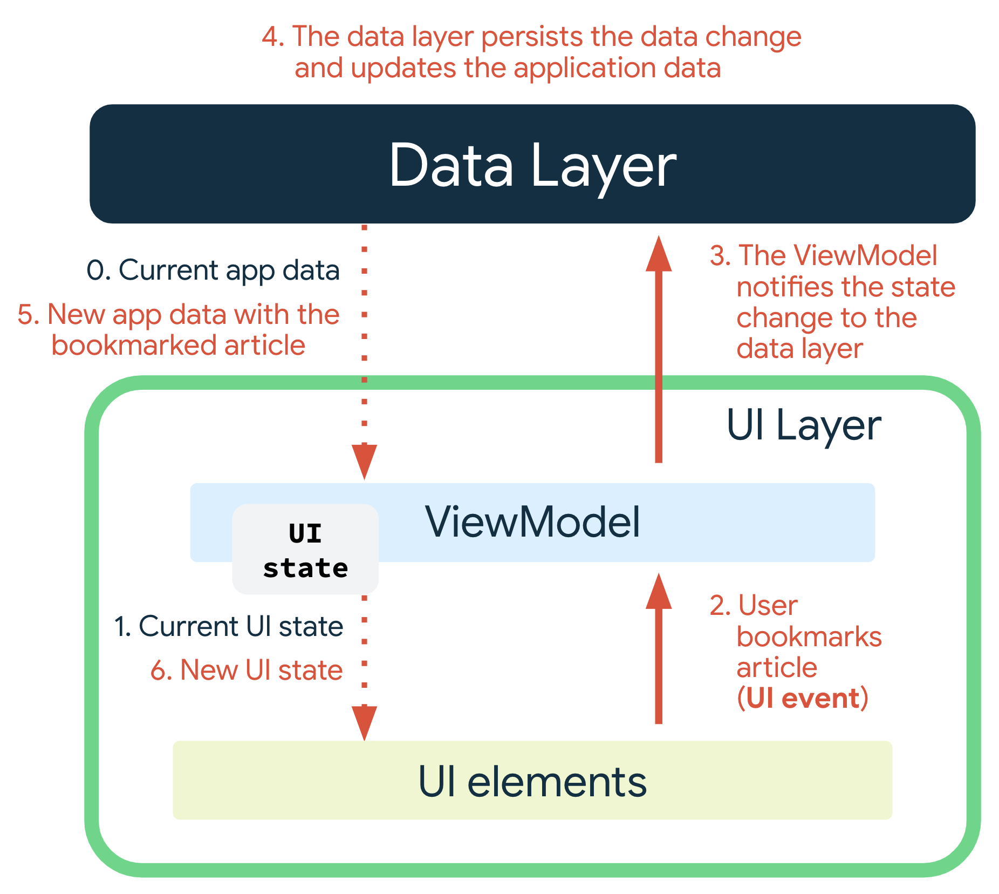

# 应用架构

UI is a result of binding UI elements on the screen with the UI state(**就是数据**).

1. 除非 UI 本身是数据的唯一来源，否则切勿直接修改 UI 中的 UI 状态（ UI state）。违反这一原则会导致同一信息出现多个真实来源，导致数据不一致和细微的错误。

**Key Point**: Only sources or owners of data should be responsible for updating the data they expose.
**关键点**： 只有数据来源或所有者应负责更新他们暴露的数据。

1. 数据结构尽量和 UI 结构保持一致，避免绑定数据 到  UI elements 时导致的复杂性。
    1. 在 ViewModel 中合并和调整组织数据结构，使其满足 UI 的结构需求。

2. 代码嵌套尽量还原 UI 的嵌套关系。
    1. Composable 函数的嵌套关系尽量跟 UI 组件的层级一致。

    2. 列表（Column、Row、List）：代码放置顺序保持和 UI 显示顺序一致。

    3. 相对布局尽量在同一个层级完成。

得到：

1. Dialog 的 Toast 都是在页面之上的另一层 UI 渲染。我们使用 NavStack 来管理页面的层叠关系。遵循上面两条原则：
    1. 栈结构反应的是页面的层叠关系，Dialog 也是一层，也需要一个数据变量才能显示。因此将其放到 NavStack 的数据中是合理的。

    2. 

## State Holder (ViewModel)

状态持有者是“负责产生 UI 状态以及为了产生 UI 状态的逻辑”的类。根据管理的 UI 元素对应的范围不同 状态持有者可有有不同的粒度：小到像底部应用栏这样的单个组件，大到整个屏幕甚至整个导航。

- UI 逻辑要放在 UI，而不是 ViewModel，尤其是涉及 UI 类型如 Context 时。UI 行为逻辑或 UI 逻辑是指如何在屏幕上显示状态变化。例如，利用 Android 资源获取屏幕上显示的正确文本， 当用户点击按钮时，导航到特定屏幕，或者在屏幕上显示用户消息，使用 吐司还是 snackbar。一个可折叠文本组件的展开和收起。

### 带生命周期的方式

1. viewModel 
2. StateFlow<List<T>>.collectAsStateWithLifecycle()
    屏幕可能进入后台、被覆盖、导航离开
比如：

用户按 Home 键，应用进入后台

打开另一个页面，当前页面被压入返回栈

分屏、画中画、弹窗覆盖

导航到其他 destination

这些情况下，界面可能处于 STOPPED。
collectAsStateWithLifecycle() 会在界面不可见时停止收集，避免后台继续收流、继续触发不必要的 UI 更新。

1. 数据状态
    1. 加载中
    2. 成功
    3. 失败：可点击重试
    4. 区分页面和组件。
        页面： 整个页面在加载
        组件： 更新中需要在整个页面之上，例如一个 Post 的提交、点赞、收藏 的接口请求。

### UI event

不要去想 UI 需要做什么动作;要考虑这些动作如何影响 UI 状态。

1. UI 逻辑
2. 