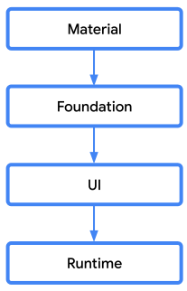
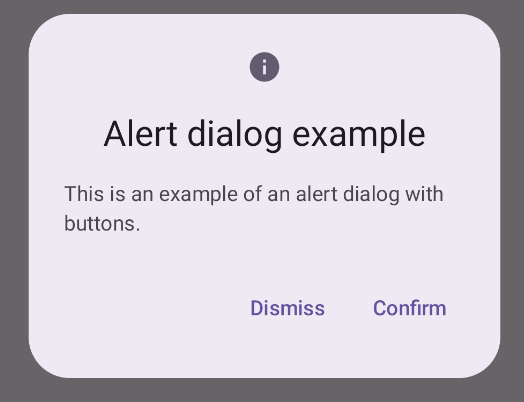
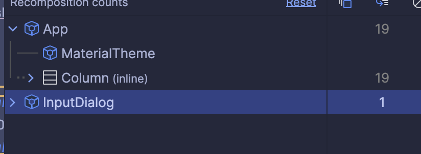

# CMP 中 Dialog 的使用

两个问题讨论一下：

1. 提供哪些组件的封装？TAPD 里[Dialog 使用示例， 及常用几种Dialog 的封装](https://www.tapd.cn/tapd_fe/20377161/story/detail/1120377161001070384)的描述太模糊了，需要明确一下。

    - 一个基础空的 Dialog，提供中间弹出、底部弹出、自适应（有些dialog UI 设计是底部弹出，只给了手机的UI, 但是因为内容较少，在Pad、PC 谁上显示很怪异，改为居中显示）的弹出参数。
    - 提供 Fenbi UI 的 AlertDialog 和 LoadingDialog 的封装。
    - 一个链式显示的 API, 提供多个Dialog 弹出时能依次弹出，而不会覆盖。
    - 引导式 dialog.

    - Sheet。
    - PopMenu
    - 各种 Dialog 的  UI 是否有更好的封装方式。


2. 提供声明式UI的接口还是提供普通接口。


## 背景知识

Compose 仅提供了两个 Dialog 组件，没有提供 View 体系中的各种 Dialog 组件封装，由开发者自己根据需要组合实现。

1. UI 层，提供了基础 `Dialog` 组件，对原有 View 组件 Dialog 的一个封装，可以直接在 Compose 中使用。
2. Material 层，提供了 `AlertDialog` 组件，遵循 Material Design 规范，实现了一个特定 UI 的 Dialog 组件。

CMP 架构分层设计，两个 Dialog 组件由不同层面提供：
{: width="150px" }

原有 Java 体系的 Dialog 组件：
```Java
java.lang.Object
  ↳ android.app.Dialog (最底层核心类)
      ↳ android.app.AlertDialog (标准警告对话框)
          ↳ android.app.DatePickerDialog (日期选择)
          ↳ android.app.TimePickerDialog (时间选择)
          ↳ android.app.ProgressDialog (已废弃，建议用 ProgressBar)

      ↳ androidx.appcompat.app.AppCompatDialog (支持库版本，推荐使用)
          ↳ androidx.appcompat.app.AlertDialog (最常用的 V7 包对话框)

      ↳ com.google.android.material.bottomsheet.BottomSheetDialog (MD 风格底部弹窗)
```


## 一、Dialog 与 AlertDialog 的说明和区别

在 Compose 中，弹窗系列主要有两个核心组件：`Dialog` 和 `AlertDialog`。

### Dialog

`Dialog` 是最底层的弹窗容器，它只负责将内容显示在一个浮动窗口中，不提供任何预设的布局结构。开发者需要完全自行决定弹窗内部的内容和样式。

```kotlin
@Composable
fun Dialog(
    onDismissRequest: () -> Unit,
    properties: DialogProperties = DialogProperties(),
    content: @Composable () -> Unit
)
```

### AlertDialog

`AlertDialog` 是基于 `Dialog` 封装的高层组件，遵循 Material Design 规范，预定义了标题（title）、图标（icon）、正文（text）、确认按钮（confirmButton）、取消按钮（dismissButton）等固定插槽，适合快速构建标准样式的提示弹窗。



```kotlin
@Composable
fun AlertDialog(
    onDismissRequest: () -> Unit,
    confirmButton: @Composable () -> Unit,
    modifier: Modifier = Modifier,
    dismissButton: @Composable (() -> Unit)? = null,
    icon: @Composable (() -> Unit)? = null,
    title: @Composable (() -> Unit)? = null,
    text: @Composable (() -> Unit)? = null,
    shape: Shape = AlertDialogDefaults.shape,
    containerColor: Color = AlertDialogDefaults.containerColor,
    iconContentColor: Color = AlertDialogDefaults.iconContentColor,
    titleContentColor: Color = AlertDialogDefaults.titleContentColor,
    textContentColor: Color = AlertDialogDefaults.textContentColor,
    tonalElevation: Dp = AlertDialogDefaults.TonalElevation,
    properties: DialogProperties = DialogProperties()
)
```


## 1. 如何提供接口？

Compose 的实现想好做到一切截声明方式，我理解这样做的好处。但是我发现有几点问题，需要跟大家讨论以下，看看大家接受那种方式。


### ComposeUI Dailog 的几个问题

#### 1. 声明式函数无法在普通 Kotlin 代码中使用

由于 Compose UI 函数使用 `@Composable` 注解，编译器需要做特殊的参数传递，因此它无法在普通方法中使用。我们有一些代码需要在普通 Kotlin 代码中调用 UI, 例如用户被踢掉的逻辑需要在拦截器中使用。我们需要封装单独 KMP 方法来弹出系统 Dialog。


#### 2. 代码的嵌套逻辑和 UI 嵌套逻辑不一致导致不直观

声明式的 UI 导致 Dialog 的 UI 是嵌套在普通 UI 中的。但是实际展示时在另一个层级中。这在 Dialog 有逻辑需要再弹出 Dialog 的嵌套式更加难受。
```Kotlin
@Composable
fun DialogDemo() {
    var showing by remember { mutableStateOf(DialogType.None) }

    LazyColumn(
        modifier = Modifier.padding(16.dp),
        verticalArrangement = Arrangement.spacedBy(8.dp)
    ) {
        item {
            Text("InputDialog", style = MaterialTheme.typography.titleMedium)
            Spacer(Modifier.height(4.dp))
            DialogButtonGroup(
                onCenter = { showing = DialogType.ConfirmCenter },
                onBottom = { showing = DialogType.ConfirmBottom },
                onAdaptive = { showing = DialogType.ConfirmAdaptive }
            )
        }
    }

    // ConfirmDialog 嵌套在普通的 UI 组件中。
    if (showing) {
        InputDialog(
            title = "确认操作",
            ...
        )
    }
}
```
真实的 UI 嵌套，Dialog 的内容是在整个 Activity 上层的。




下面两个问题应该普通 Dialog 也有，待总结最佳实践。
#### 3. 弹窗状态分散，难以管理

每个Dialog 有各自的 `showXxxDialog`、`showYyyDialog` 等布尔状态，随着弹窗数量增多，状态极易失控，也难以保证同时只有一个弹窗处于显示状态。

```kotlin
// 典型的状态爆炸问题
var showDeleteDialog by remember { mutableStateOf(false) }
var showEditDialog by remember { mutableStateOf(false) }
var showShareDialog by remember { mutableStateOf(false) }
var showLogoutDialog by remember { mutableStateOf(false) }
// ...越来越多
```

#### 4. 跨层级触发困难

当需要从深层子组件触发弹窗时，必须通过逐层回调或共享 ViewModel 传递状态，代码复杂度急剧上升。特别是 Loading 很容易出现这个问题。提供全局的 show 和 dismiss 方法能解决。

### 选择

有几种选择，看一下大家对上面几个问题的想法。


1. 觉得声明式 UI 的方法更好，只是我们的编程思维还没完全转变过来，应该完全使用声明式 UI 的写法。在普通方法中弹出 UI 的拦截器寻找其它方案解决。

2. 使用普通方法来弹出 Dialog，来提供一致的 API。但允许在代码代码使用 Compose 声明式 UI. （我的偏好）

3. 大家完全使用封装的普通方法来弹出 Dialog， 不使用声明式 UI 的写法。（这种应该不太可能，毕竟场景太多了。）


API 设计：
```Kotlin
fun showDialog(content: @Composable () -> Unit, ...): Dialog {

}

返回的 dialog.dissmiss() 来关闭 Dialog.
```

## 2. 提供哪些组件的封装？

- AlertDialog
- LoadingDialog
- 一个链式显示的 API, 提供多个Dialog 弹出时能依次弹出，而不会覆盖。


================================================================================

## 二、AlertDialog 的用法

### 基础用法

```kotlin
@Composable
fun BasicAlertDialogExample() {
    var showDialog by remember { mutableStateOf(false) }

    Button(onClick = { showDialog = true }) {
        Text("打开弹窗")
    }

    if (showDialog) {
        AlertDialog(
            onDismissRequest = { showDialog = false },
            icon = {
                Icon(Icons.Default.Warning, contentDescription = null)
            },
            title = {
                Text("确认删除")
            },
            text = {
                Text("此操作不可撤销，确定要删除该记录吗？")
            },
            confirmButton = {
                TextButton(onClick = {
                    // 执行删除逻辑
                    showDialog = false
                }) {
                    Text("确认")
                }
            },
            dismissButton = {
                TextButton(onClick = { showDialog = false }) {
                    Text("取消")
                }
            }
        )
    }
}
```

### 自定义样式

通过参数可以修改 `AlertDialog` 的容器颜色、形状等外观：

```kotlin
AlertDialog(
    onDismissRequest = { showDialog = false },
    title = { Text("提示") },
    text = { Text("操作已完成") },
    confirmButton = {
        TextButton(onClick = { showDialog = false }) {
            Text("好的")
        }
    },
    shape = RoundedCornerShape(8.dp),
    containerColor = MaterialTheme.colorScheme.surfaceVariant,
    titleContentColor = MaterialTheme.colorScheme.onSurface,
    textContentColor = MaterialTheme.colorScheme.onSurfaceVariant
)
```

### 状态管理建议

弹窗的显示状态应由外部的 ViewModel 或 State 统一管理，避免在 Composable 内部持有业务状态：

```kotlin
// ViewModel
class MyViewModel : ViewModel() {
    var showDeleteDialog by mutableStateOf(false)
        private set

    fun requestDelete() { showDeleteDialog = true }
    fun dismissDeleteDialog() { showDeleteDialog = false }
    fun confirmDelete() {
        // 执行删除
        showDeleteDialog = false
    }
}

// UI
@Composable
fun MyScreen(viewModel: MyViewModel = viewModel()) {
    if (viewModel.showDeleteDialog) {
        AlertDialog(
            onDismissRequest = viewModel::dismissDeleteDialog,
            title = { Text("确认删除") },
            text = { Text("确定要删除吗？") },
            confirmButton = {
                TextButton(onClick = viewModel::confirmDelete) { Text("确认") }
            },
            dismissButton = {
                TextButton(onClick = viewModel::dismissDeleteDialog) { Text("取消") }
            }
        )
    }
}
```

---

## 三、基础 Dialog 的用法

`Dialog` 不限制内部布局，适合需要完全自定义内容的场景，例如表单弹窗、选择器弹窗等。

### 基础用法

```kotlin
@Composable
fun BasicDialogExample() {
    var showDialog by remember { mutableStateOf(false) }

    Button(onClick = { showDialog = true }) {
        Text("打开自定义弹窗")
    }

    if (showDialog) {
        Dialog(onDismissRequest = { showDialog = false }) {
            // 自行提供 Surface 作为弹窗背景
            Surface(
                shape = RoundedCornerShape(16.dp),
                color = MaterialTheme.colorScheme.surface,
                tonalElevation = 6.dp
            ) {
                Column(
                    modifier = Modifier.padding(24.dp),
                    verticalArrangement = Arrangement.spacedBy(16.dp)
                ) {
                    Text(
                        text = "自定义标题",
                        style = MaterialTheme.typography.headlineSmall
                    )
                    Text("这里是正文内容，可以放置任意 Composable。")
                    Row(
                        modifier = Modifier.fillMaxWidth(),
                        horizontalArrangement = Arrangement.End
                    ) {
                        TextButton(onClick = { showDialog = false }) {
                            Text("关闭")
                        }
                    }
                }
            }
        }
    }
}
```

### DialogProperties 配置

`DialogProperties` 控制弹窗的行为属性：

```kotlin
Dialog(
    onDismissRequest = { showDialog = false },
    properties = DialogProperties(
        dismissOnBackPress = true,       // 按返回键关闭
        dismissOnClickOutside = true,    // 点击外部关闭
        usePlatformDefaultWidth = false  // 禁用平台默认宽度限制，可自定义宽度
    )
) {
    // 内容
}
```

> 在 CMP（Compose Multiplatform）中，`usePlatformDefaultWidth = false` 配合 `Modifier.fillMaxWidth(0.9f)` 可以精确控制弹窗宽度，跨平台表现一致。

### 带输入框的表单弹窗

```kotlin
@Composable
fun InputDialog(
    onDismiss: () -> Unit,
    onConfirm: (String) -> Unit
) {
    var inputText by remember { mutableStateOf("") }

    Dialog(onDismissRequest = onDismiss) {
        Surface(
            shape = RoundedCornerShape(12.dp),
            tonalElevation = 8.dp
        ) {
            Column(modifier = Modifier.padding(20.dp)) {
                Text("请输入名称", style = MaterialTheme.typography.titleMedium)
                Spacer(Modifier.height(12.dp))
                OutlinedTextField(
                    value = inputText,
                    onValueChange = { inputText = it },
                    label = { Text("名称") },
                    singleLine = true,
                    modifier = Modifier.fillMaxWidth()
                )
                Spacer(Modifier.height(16.dp))
                Row(
                    modifier = Modifier.fillMaxWidth(),
                    horizontalArrangement = Arrangement.End,
                    verticalAlignment = Alignment.CenterVertically
                ) {
                    TextButton(onClick = onDismiss) { Text("取消") }
                    Spacer(Modifier.width(8.dp))
                    Button(
                        onClick = { onConfirm(inputText) },
                        enabled = inputText.isNotBlank()
                    ) { Text("确认") }
                }
            }
        }
    }
}
```


### 6. 动画与生命周期不可控

Compose `Dialog` 本身不提供进出场动画的标准 API，直接使用时弹出/关闭的动效生硬，需要额外封装 `AnimatedVisibility` 等方案。

---

## 五、使用自定义方式封装 Dialog

针对上述问题，推荐通过封装一个统一的 `DialogHost` + 状态管理层来规范弹窗使用。

### 5.1 定义 DialogState

用 sealed class 描述所有弹窗类型，统一管理显示状态：

```kotlin
sealed class DialogState {
    data object None : DialogState()
    data class Confirm(
        val title: String,
        val message: String,
        val onConfirm: () -> Unit
    ) : DialogState()
    data class Input(
        val hint: String,
        val onConfirm: (String) -> Unit
    ) : DialogState()
    // 按需扩展更多弹窗类型
}
```

### 5.2 在 ViewModel 中持有弹窗状态

```kotlin
class MainViewModel : ViewModel() {
    var dialogState: DialogState by mutableStateOf(DialogState.None)
        private set

    fun showConfirmDialog(title: String, message: String, onConfirm: () -> Unit) {
        dialogState = DialogState.Confirm(title, message, onConfirm)
    }

    fun showInputDialog(hint: String, onConfirm: (String) -> Unit) {
        dialogState = DialogState.Input(hint, onConfirm)
    }

    fun dismissDialog() {
        dialogState = DialogState.None
    }
}
```

### 5.3 实现 DialogHost

在页面顶层放置统一的弹窗渲染入口：

```kotlin
@Composable
fun DialogHost(
    state: DialogState,
    onDismiss: () -> Unit
) {
    when (state) {
        is DialogState.None -> Unit
        is DialogState.Confirm -> ConfirmDialog(
            title = state.title,
            message = state.message,
            onConfirm = {
                state.onConfirm()
                onDismiss()
            },
            onDismiss = onDismiss
        )
        is DialogState.Input -> InputDialog(
            hint = state.hint,
            onConfirm = {
                state.onConfirm(it)
                onDismiss()
            },
            onDismiss = onDismiss
        )
    }
}
```

### 5.4 封装带动画的基础 Dialog 容器

解决动画生硬和平台宽度不一致的问题：

```kotlin
@Composable
fun AppDialog(
    onDismissRequest: () -> Unit,
    content: @Composable ColumnScope.() -> Unit
) {
    Dialog(
        onDismissRequest = onDismissRequest,
        properties = DialogProperties(usePlatformDefaultWidth = false)
    ) {
        AnimatedVisibility(
            visible = true,
            enter = fadeIn() + scaleIn(initialScale = 0.9f),
            exit = fadeOut() + scaleOut(targetScale = 0.9f)
        ) {
            Surface(
                modifier = Modifier
                    .fillMaxWidth(0.88f)
                    .wrapContentHeight(),
                shape = RoundedCornerShape(16.dp),
                color = MaterialTheme.colorScheme.surface,
                tonalElevation = 6.dp
            ) {
                Column(
                    modifier = Modifier.padding(24.dp),
                    content = content
                )
            }
        }
    }
}
```

### 5.5 在页面中组合使用

```kotlin
@Composable
fun MainScreen(viewModel: MainViewModel = viewModel()) {
    // 顶层放置 DialogHost
    DialogHost(
        state = viewModel.dialogState,
        onDismiss = viewModel::dismissDialog
    )

    // 页面主体内容
    Column {
        Button(onClick = {
            viewModel.showConfirmDialog(
                title = "确认退出",
                message = "确定要退出登录吗？",
                onConfirm = { /* 执行退出 */ }
            )
        }) {
            Text("退出登录")
        }

        Button(onClick = {
            viewModel.showInputDialog(
                hint = "请输入备注",
                onConfirm = { text -> /* 处理输入 */ }
            )
        }) {
            Text("添加备注")
        }
    }
}
```

### 5.6 方案优势总结

| 问题 | 解决方案 |
|------|----------|
| 状态分散 | 单一 `dialogState` 统一持有，同一时刻只显示一个弹窗 |
| 业务耦合 | 弹窗内容抽离为独立 Composable，页面只负责触发 |
| 跨层级触发 | 通过 ViewModel 共享状态，任意层级均可触发 |
| 平台宽度差异 | `usePlatformDefaultWidth = false` + 固定比例宽度 |
| 动画生硬 | `AnimatedVisibility` 统一管理进出场动画 |
| 类型扩展 | `sealed class` 按需添加新弹窗类型，不影响已有逻辑 |
