# CMP
是否要同步进度：NO

为什么要跨端：
1. 人力成本高昂：多一个开发平台，就多一套开发团队，人力成本成倍增加。现在增加鸿蒙开发团队，恭喜根本无法承受增加的人力成本。
2. 多端一致性难以保障：各个段自己实现，UI、交互、逻辑 都会有差异，难以保证多个平台实现的一致性。
3. 重复基础建设：各个平台都需要实现路由、网络请求、图片缓存、状态管理、生命周期管理等基础设施，浪费大量时间。


跨端目标：
1. 三端复用
2. 原生体验
3. 原生的基础技术也都支持：动态化、热修复、热加载、易调试。
4. 跟原生方案一样的监控体系：bugly、日志、

## 跨端比较

作为安卓开发者，CMP 基本是我偏好性的选择了。但抛开我们已经掌握 Kotlin 的惰性选择（不愿意完全重新学新的开发平台：语言+UI+库）大家可能还是想问为什么要选择 CMP? 特别是在 CMP 远没有其它跨端开发生态成熟的情况下，为什么要选择这么一个如此生态如此成熟的方案？RN、Flutter 的开发生态明明坑更少、库更多、使用的更多，为什么要冒险去用一个尚未完全形成生态的方案？另一个原因可能是，给伙伴还有隔壁组一个你选择 CMP 的合理解释，他们也能接受使用 CMP。

首先看一下哪些可供选择，接下来作为详细的比较，目前主流的跨端方案主要有：
- RN    最成熟
- Flutter 成熟
- CMP  安卓、IOS、桌面 已经稳定、鸿蒙没有官方支持，只有国内大厂的开源版本。未来会有 OpenHarmony 社区版本。

另外一个需要提一下的是 SwiftUI，25 年6月刚成立工作组，而且只有安卓工作组。目前还没有出一个 alpha 版，能不能搞成还不一定，完全不在选择范围内。

先来看一下大厂的选择：

| 团队    |  项目名     |    范围     |   复用端  |  落地应用    |
|--------|------------|------------|----------|-------------|    
| 支付宝  |  MyKMP     |  KMP + CMP（自定义了一套 AntUI 库，没有使用 MeterialDesign）|   三端    |   支付宝     |
| 腾讯视频| ovCompose  |  KMP + CMP|   三端    |   腾讯视频，KuiklyBase基础能力已在腾讯视频、QQ浏览器、腾讯体育等10+款APP广泛落地。   |
| QQ     | NTCompose  |  KMP + UI（服用 Compose runtime, 仿照 compose 的分层，完全定制上层）鸿蒙上渲染使用 Native 渲染，去掉skia |  六端（PC+Web+小程序）     |    QQ      |
| 字节   | ByteKmp    |  UI + KMP  | 安卓+鸿蒙，在推IOS跨端 |   抖音、西瓜、短句、头条、剪映、懂车帝、豆包等 10+ |
| 快手   |   -        |  KMP       |   三端  刚开始实践,但走了 UI 映射方案（具体还不清楚）  |   快手  |
| B站    |  -         | KMP（CMP应该也在推，看到有实践，24年的分享） |  三端     |    bilibili  |

发现一个现象：首先考虑 CMP 方案的都是之前没有接入RN、Flutter 的团队。这可能有之前两个团队还能养得起、在增加一个团队实在撑不住的原因。不接入原因是这些应用也是因为 RN、Flutter 满足不了其性能需求，宁原 IOS 和 安卓都重复开发也不没有接入跨端。**另一个很大的原因，好几家都提到，之前安卓已经积累了大量的 Compose 和 MVI 代码，使用此方案复用之前的代码，极大的减少支持鸿蒙带来的工作量。但是我们的项目目前还没接入 Compose，所以可以利用的老代码量应该少得可怜**。


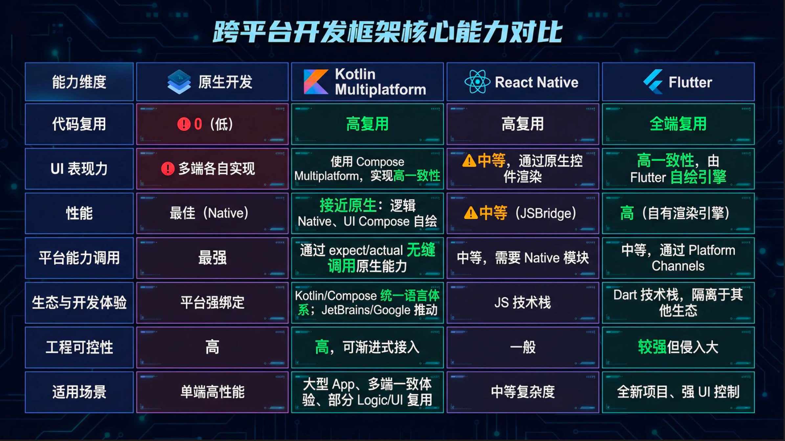

是否是一个明智的选择，而不是一个拍脑袋的决定？是否有前景？是否生态成熟？设计是否优秀？技术风险是否大？性能如何？这些都是需要考虑的方面。
也想了解清楚，CMP 技术路线是否优秀。出现垃圾设计、使用不便、到处骂娘的坑点。有没有说未来被废弃的可能性。

2 是这个跨平台技术方案是否有重大缺陷导致无法推进的风险。

补充两点：
- 生态：虽然生态不如 RN、Flutter 成熟，但也完全走通了全部，不至于说实施途中遇到困难无法推进的情况。
- 人才储备：安卓平台生态成熟，背靠安卓生态，人才储备充足。
- 废弃风险：1 是这个跨平台是否有被废弃的风险：我认为基本不可能，Compose 成为安卓官方主推的 UI 框架，没有任何被废弃的可能。而 CMP 需要一个 UI 框架很好的补充了生态，而且有了支付宝、腾讯视频、字节等大厂的广泛使用，已成生态趋势，可以说是前景广阔。
- 技术风险：虽然没有官方的支持，但有支付宝、腾讯视频、字节等大厂的广泛使用， 26 年也都陆续表示会开源，而且 openHarmony 社区也会出社区办共建生态，技术风险不太大。
- Skia 裁剪到几兆，能接受RN，Flutter， CMP 增加的包体积更少，几个大厂有在尝试跳过 Skia 直接像安卓一样使用 Compose 直接调用原生 API 渲染，包体积影响只会更小。
- 实现更加优秀：API 设计更加符合工程学设计，使用更加便利，性能更好。有个对比各个平台的 API，可以看出 Compose 是写 UI 是最简洁的。另一方面是模块化更好，分层设计更加清晰，易于测试和优化。这也是为什么 Jetbrain 只需改部分代码就能实现跨平台的 Compose 的原因，跟踪版本发布可以发现最新版本同步很快。还有大厂的针对鸿蒙快速适配也再次证明了分层实现的优秀之处。


Kuikly 展示了一个跨端的流行趋势:
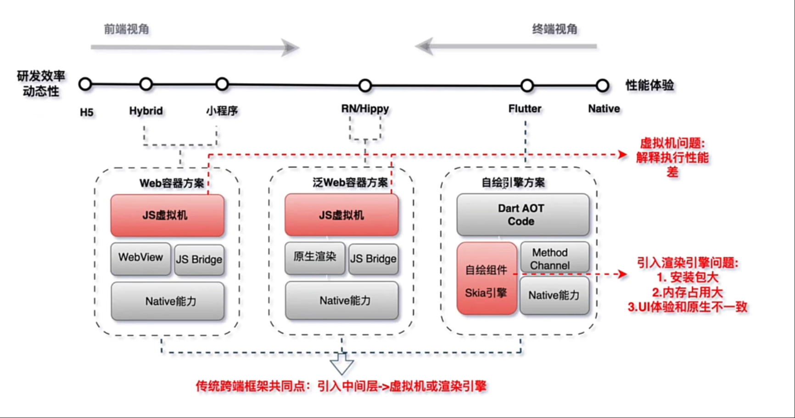

API 最简洁，符合工程学设计。让好的实践最便利，让可能有副作用的用法变使用增加点不便，减少使用。

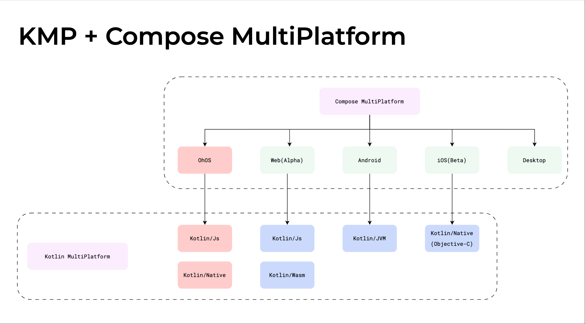

```
KMP      JVM         Native          JS (Runtime 或 Wasm）

OS     Android    IOS   HarmonyOS  |   MacOS   Linux   Windows  

稳定：  Androd/JVM    IOS/Native   Desktop(Mac、Linux、Windows)/JVM    JS Runtime

CMP     JVM          Native         JVM
```
CMP 的绘制除了安卓端是调用原生 API，再由原生 API 调用 skia 外，IOS、桌面端都是直接调用 skia 进行绘制的，因此多一个 skia 库的包体积。


CMP 在鸿蒙平台的实现主要方式是 Kotlin-Js 和 Kotlin-Native。目前主流是 Kotlin-Native 方式，之前腾讯视频、B站使用过 Kotlin-Js 方式，后来也转到 Kotlin-Native 上来了。选择 Kotlin-Native 方式的主要有三个原因。

1. 性能更好，想要实现原生性能，Kotlin-Native 是更好选择。
2. ArkTS 运行时运行 js 存在问题（后面整体说明）。
3. 鸿蒙也提供了一套 C++ UI API。通过 Native 程序也可以实现原生 UI。
4. JS 运行时是单线程，Kotlin 的协程在 JS 运行时中运行在单线程，无法真正实现高效，而且会阻塞主线程。

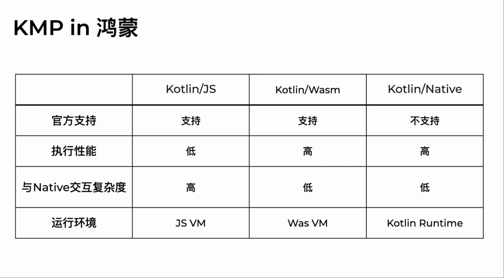
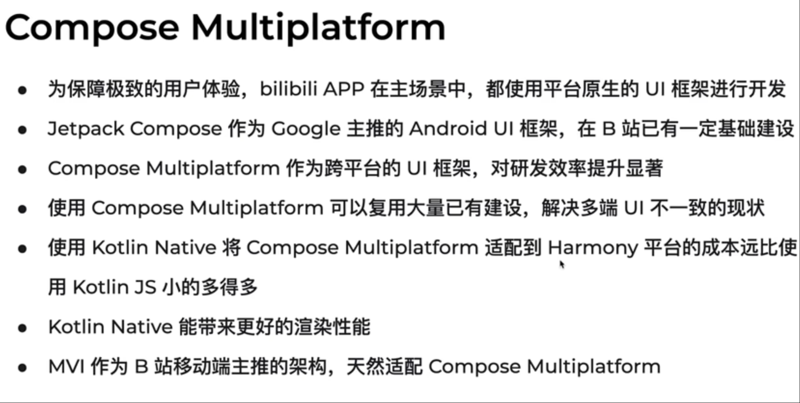
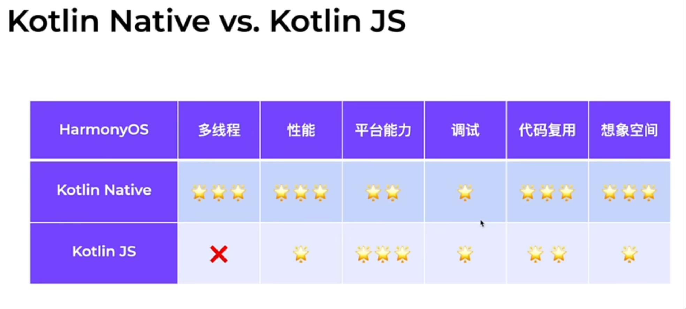
Kotlin-js 鸿蒙上存在的问题：
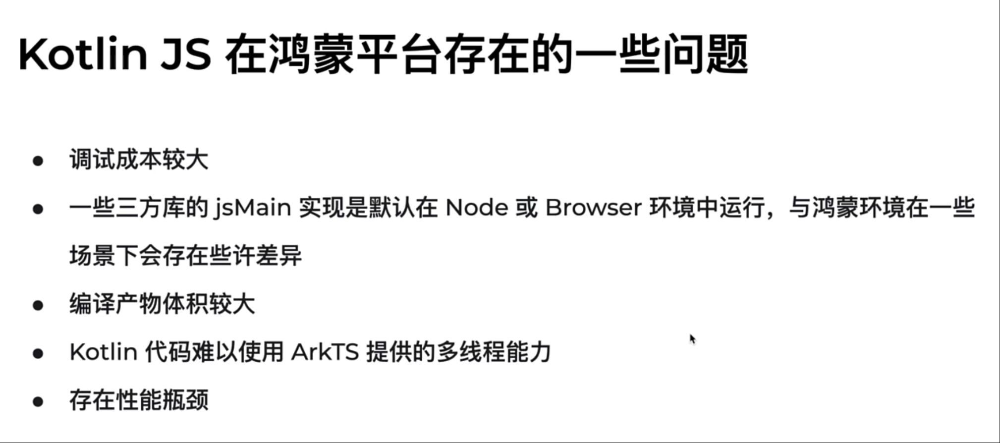
1. 断点调试：kotlin-js 由Kotlin 转为 js 代码，DevEcho 支持 js 断点调试，但 Kotlin 和 js 的映射关系丢失，无法定位。使用了 Coroutines 后，生成的 js 代码更加复杂晦涩。

2. ArkTS 运行时不再是TS兼容的运行时。ArkTS 不是 TS 的超集，没有完全兼容 TS 的语法和特性，因此 Kotlin-Js 方式无法很好在 ArkTS 运行时上运行，而且大量问题无法在编码期间运行，直到运行时才出现崩溃。如果是 Wasm 方案，Wasm 标准是 32 虚拟机，地址是 32 位，调用 Native 系统是 64 位地址空间，需要适配。使用 Wasm 方案需要移植 Wasm 虚拟机，增加复杂度和包体积。

3. Coroutines 在单线程中运行，无法发挥协程的优势。由于 Courotines 运行在单线程中，和可能运行长时任务导致主线程阻塞引发问题。如果使用 ArkTS 提供的多线程能力，需要掌握两套并发模型（也非常难用），带来巨大心智负担。

4. 性能问题。js 性能较差。
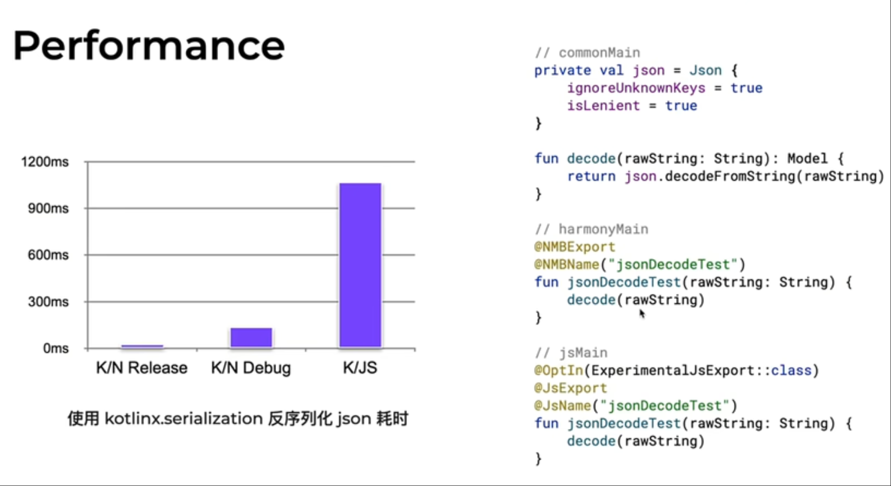
5. Js 导致更多的内容需要调用平台实现，导致 common main 中的代码量减少，复用率降低。

## 我们的困境

腾讯视频 2022 年开始大量使用 Kotlin + Compose, 2023 年开始使用 CMP 做 安卓+IOS 跨端开发。2024 年将跨端带到鸿蒙。字节也是因为安卓端大量使用了 Compose，为了复用现有代码，才开始考虑使用 CMP 做鸿蒙跨端开发。

KMP 只支持将 Kotlin编译为 多平台，而且调用的库页必须是多平台的，因此像 Java 代码、OKHttp、Retrofit 等代码都不能迁移到复用，需要重新实现。现在项目中根本没有 Compose， UI 都是原生 View 和 XML 也无法复用。因此目前哪些模块做跨平台就是完全重写这个模块。理想情况是 Kotlin 逻辑能够复用，但现实是 Compose 代码要使用状态更新 UI，除了一些片段函数，基本不可能成模块、类的复用。所以做跨平台的成本很高，但也是一个重新理清业务，梳理代码、反思编程模式、调整架构的好时机。

为什么成本如此高昂，为什么没有模块能够复用？

Kotlin 推荐的晚、Compose 推进的晚.

我们的现状、**技术储备不足**。完全没有 Compose 的真实业务的经验，可能还有人完全没有学习 Compose，更不用提系统性、深入的掌握 Compose。没有深厚的技术能力以应对当前 Compose 没有官方支持，使用不广泛，生态不足的情况。这也是我们最大风险点。没有对技术的前瞻性，不但没有推动 Compose 的使用，甚至是阻碍使用的。那你可能会说，你这就是马后炮，事后诸葛亮，现在 Compose 广泛被使用了你说前瞻性了，当时谁也不知道 Compose 能否成功，也不知道 Compose 能做跨平台。我的反驳是，我一直在提 Compose 的使用，硬说马后炮我也不拒绝。我不是架构师，也不负责项目的规划。只负责模块的实现，考虑的首要是模块的技术。不在其位，不谋其政。我们需要对技术有前瞻性的的人，让项目更顺利前进。

一直在说需要基础储备，但在必然使用的技术上的迟迟不肯接入，显然是避重就轻、

17 年安卓官宣支持 Kotlin，2019.05 "Kotlin-first"。我们是什么时候用上 Kotlin 的？ 2022-08规划、2022-10 实施，2023-03 才切过来。

Compose 20 年出 alpha 版，21 年出稳定版。23 年已经开始主推，24 已经是主流方案。至今我们还没用到业务里。26 年初还没用上，距离出稳定版已经五年了~。

那前瞻来讨论都讨论偏离了。在官方刚开始支持 Kotlin 和 Compose 预览版的时候储备才算前瞻；在 Kotlin 称为 fist-language、Compose 已经 Release 投入算是跟随潮流。现在恐怕是吃剩饭。

带来的问题显而易见、我想想要使用这个技术的时候难以接入，而且越晚接入积累的老代码越多，可复用的新技术越少，迁移成本越大。

另一方面也打消了大家的积极性、对感兴趣的技术得不到应用。主张的观点得到太多的否决。缺乏实际应用常见得不到锻炼机会。

第三就是大家的技术都在别人处理好的解决方案，没有了不得不解决问题的机会，没有了称为第一个决绝问题被社区认可的激励。也降低了称为技术领导者的可能性。


## 将 Compose 移植到鸿蒙需要做的工作：

1. 语言：✅ ovCompose 可复用
Kotlin 编译器移植：Kotlin native 增加 hormony target. 
kotlinMultiplatform gradle plugin : org.jetbrains.kotlin.multiplatform 

2. compose：
gradle plugin:
composeMultiplatform: org.jetbrains.compose
androidLiberary: androidx.compose.compiler:compiler


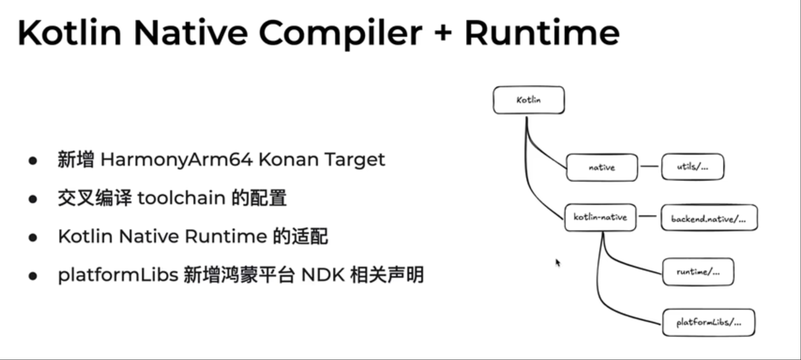
2. 标准库移植
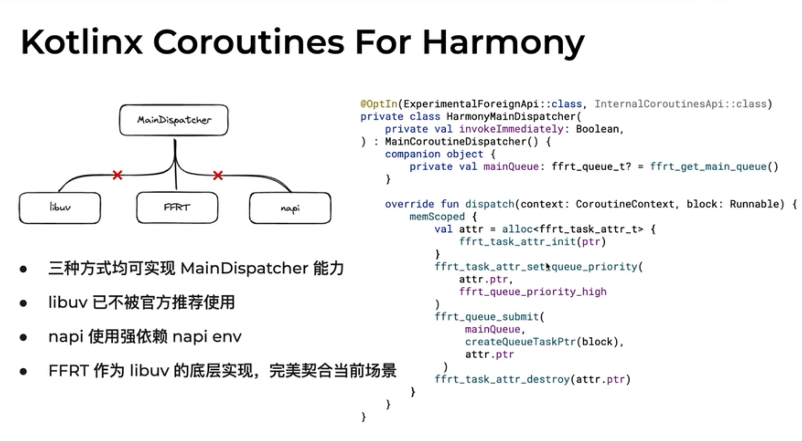
2. Compose Compiler 插件移植
3. Compose Runtime 移植
4. Compose UI 移植
5. gradle 插件移植


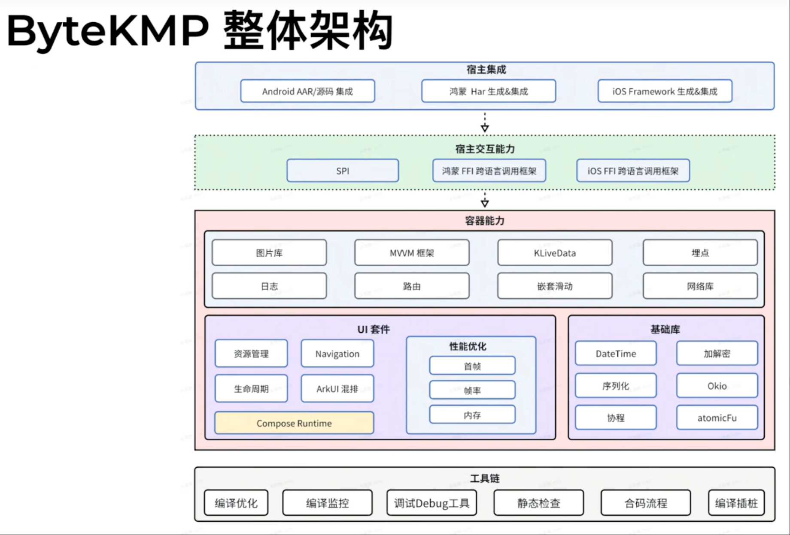
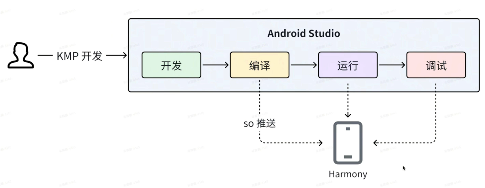
AS 断点调试鸿蒙端 KMP 代码。

## 选择

暂时使用 ovCompose, 打通多端链路后 26 年看 OpenHarmony 社区版、字节、支付宝的开源情况。选择使用 Jetpack Compose API 分支CMP + KMP  既然做跨端了，就将复用最大化。不止复用逻辑，而且复用 UI。版本，后继有迁移其它版本、再做迁移和成本应该不大。

## 跨端目标复用范围和平台

既然做跨端了，目标是复用最大化，安卓、鸿蒙、IOS 三端实现复用。，不能像B站快手那样之只复用业务层。目标是跟腾讯和字节一样，UI 和 逻辑都能复用，因此需要采用 CMP + KMP 方案。


## 如何接入

渐进式迁移，充分保证应用稳定性、不损失开发效率、让迁移过程平滑进行。

基于公司和项目现状：

公司：没有新人力投入
项目：老代码太多，没有可以直接复用的模块。
技术：没有基础储备、没有 Compose 项目应用经验、没有复用代码积累。
生态：安卓和IOS 已经 Release, 但跨端刚起步生态不够成熟。鸿蒙没有官方支持，只有国内大厂的开源版本。

因此不能大规模、一次性迁移，需要渐进式迁移。先在安卓和鸿蒙接入 CMP + KMP，IOS 继续使用 Native 开发。等积累了一定经验、技术储备后再考虑 IOS 迁移到跨端开发。

因此我将整个渐进式迁移分成了四个阶段。
```
+------------------------------+
|安卓+鸿蒙+IOS 实现一个简单跨端模块 |   <- 第一阶段
+------------------------------+
            |
            v
+-----------------------------+
| 新功能跨端，老模块继续原生开发， |
| 移植一个核心模块跨端走通全部链路 |   <- 第二阶段
+-----------------------------+
            |
            v
+-----------------------------+
|    IOS 人员掌握跨端技术栈      |   <- 第三阶段
+-----------------------------+
            |
            v
+-----------------------------+
|   移植老模块到跨端开发         |   <- 第四阶段
+-----------------------------+
```
1. 先用一个简单模块迁移，走通安卓、IOS、鸿蒙 三端开发和核心复用基础设施：互调用、路由、网络、WebView、图片缓存等。

2. 此后安卓和鸿蒙新功能可以走跨端开发，逐渐积累基础设施。老模块继续使用原生开发。 同时跨端实现一个核心模块（题库、直播课？）走通全部链路。

3. 此后 让 IOS 也迁移到混合开发，给出一段时间掌握跨端技术栈，也迁移到跨端开发上面来。

4. 所有人员都掌握了块段技术栈后，部分人员开发新功能。混合开发节省的部分人力来持续将老模块迁移到跨端开发。

> 计划时间节点

26.3  之前完成调研
26.6  完成第一阶段
26.9  完成第二阶段
26.12 完成第三阶段
27~   持续第四阶段


## 跨端开发需解决问题

可以将依赖分成两类，1，基础设施必须优先处理，在第一个阶段就需要解决完。2，迁移过程中逐渐解决。

核心必须处理：

- Kotlin 和安卓（基本没问题）、IOS（Swift/OC）、鸿蒙端(C++/ArkTs，有些系统能力可能没提供 C++API,h还是要调 ArkTS )互调用。
    1. 安卓：KMP 在安卓上编译为 JVM字节码，可以和安卓 Java 无缝互调用。
    2. IOS: Swift 程序本身编译成 Native 程序执行、Kotlin 也编译成 Native 程序，也可以无缝互调用。
    3. 鸿蒙：ArkTS 编译成 Js 字节吗，运行在 js 运行时里，而鸿蒙平台的 CMP 目前开源的 ovCompose、以及将来 OpenHarmony 都走了 Native 路线（看到国内有大厂有做将使用编译为 js字节码的路线、忘记哪个了）。Native 和 运行时中的代码互调用就不太方便。
    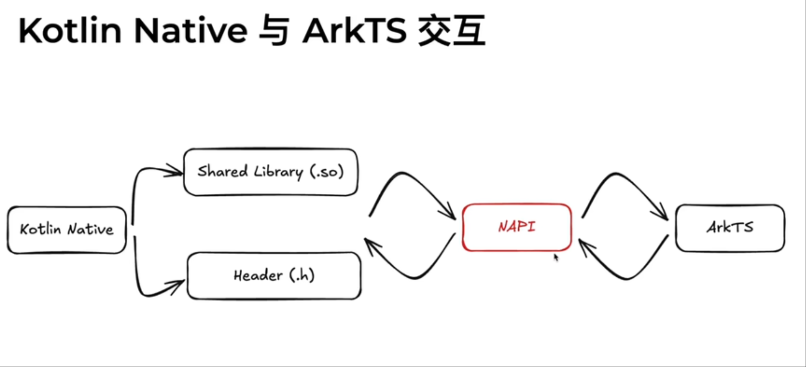
    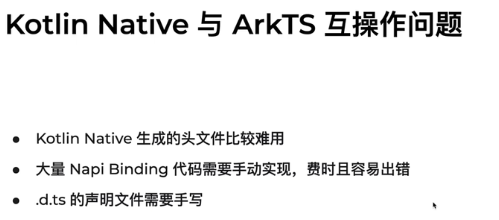
    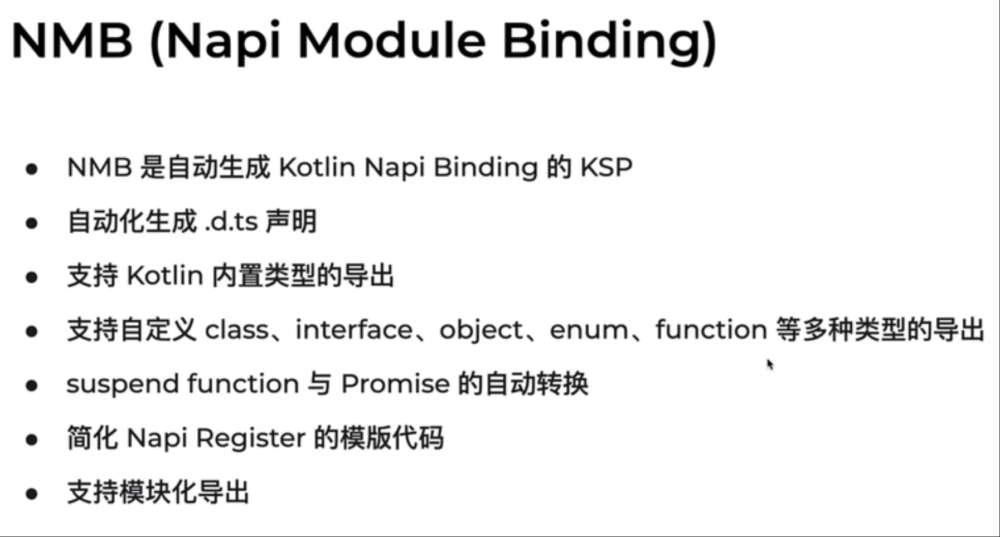

- ViewModel、导航、生命周期管理。
- 路由：router
- 网络请求：kotlinx-serialization + ktor
- 图片加载和缓存，svga 动图
- loger
- WebView: https://github.com/KevinnZou/compose-webview-multiplatform 未支持鸿蒙
- 音视频播放

开发中逐渐解决：

- 三方库复用
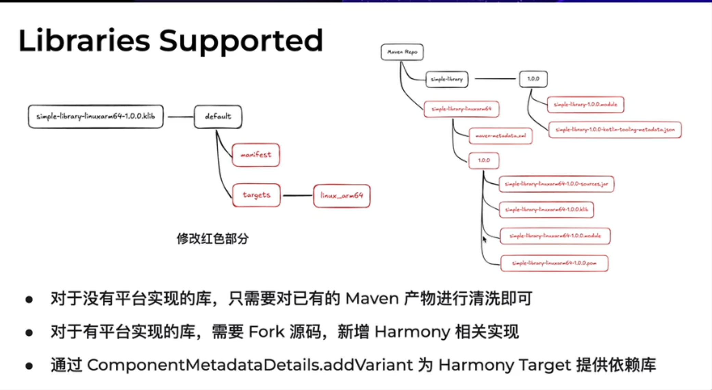
- IM、
- 腾讯云上传 SDK。
- 分享

哪里寻找库
https://klibs.io/
https://github.com/terrakok/kmp-awesome

ovCompose 库
https://github.com/Tencent-TDS/KuiklyBase-platform/blob/main/README-zh_CN.md
https://github.com/Tencent-TDS/KuiklyBase-components

## 已知问题：

-  版本:26.2.2日
              google      jetbrain                       ovCompose                     gwy
    Kotlin                 2.3.0(Dec 16, 2025)      2.0.21-KBA-009(Oct 10, 2024)      2.2.21 
    compose   1.10.0       1.10.0                   1.6.1-KBA-007                      -
 
- 选择 ovCompose 的问题：
    - 只支持了 Mac 编译，ovCompose 不支持 Linux 编译，只编译了 Linux 的
    - 只支持了 Android、IOS、鸿蒙。没有桌面和 Web.

- 使用 Skia 作为渲染引擎，Flutter 所碰到的坑都会再踩一遍。
- 崩溃符号解析。
- 能否直接调试？
    快手在在 XCode kotlin 上支持 IOS 和 鸿蒙断点调试，但有 bug 修复。鸿蒙做 lldb 11 的改造。
    原生平台的 Profile可用，CPU 工具需要建设。
6. 断点调试
7. 崩溃符号化
8. 性能定位

一些问题：
混合嵌套：不透明还好，半透明，背景变动就会成为问题。挖洞、原生渲染。
文字渲染异常：

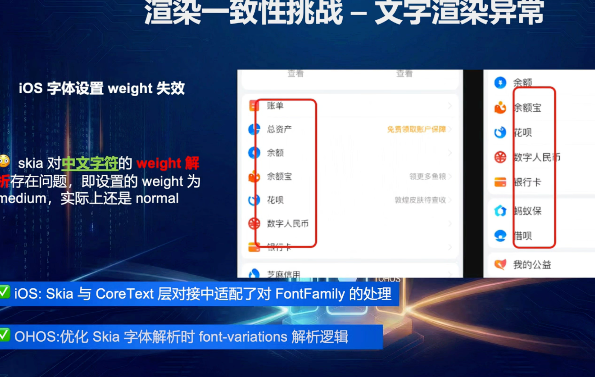

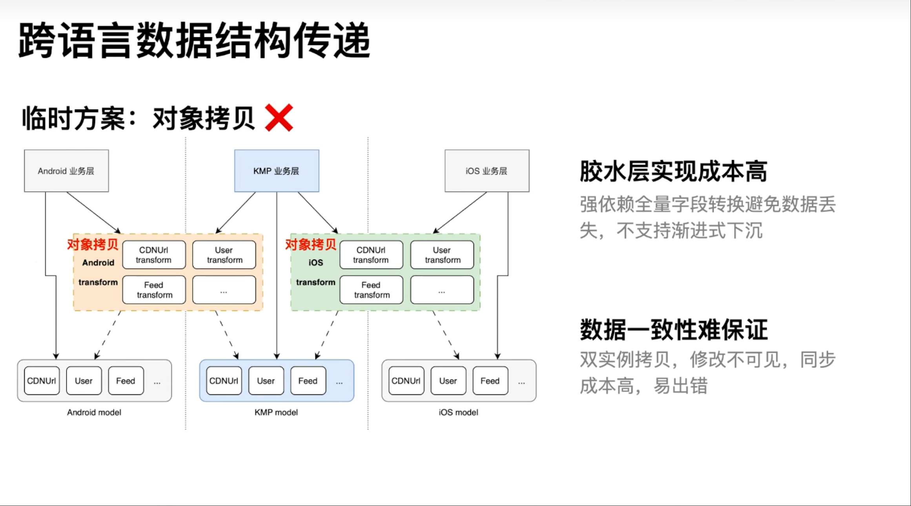
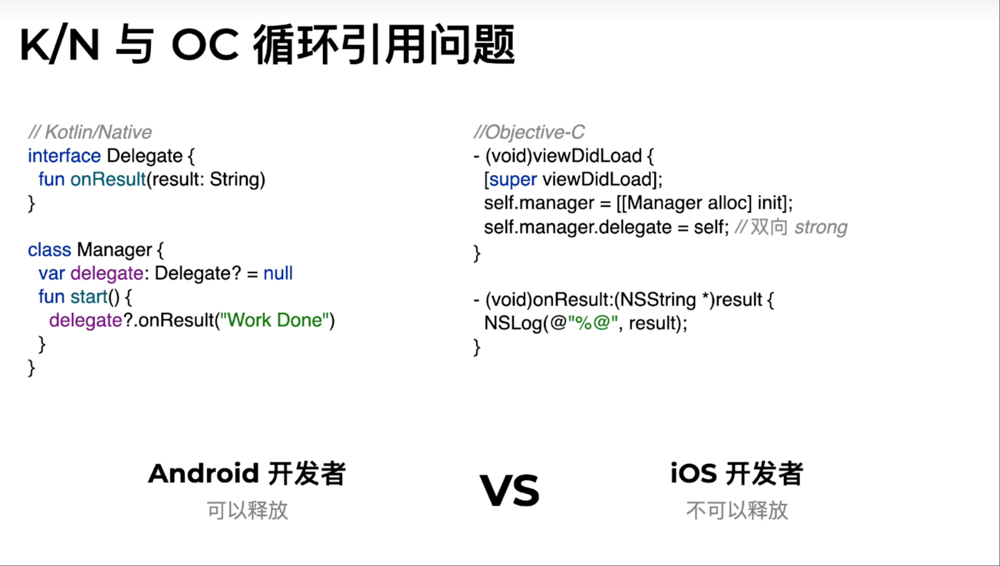
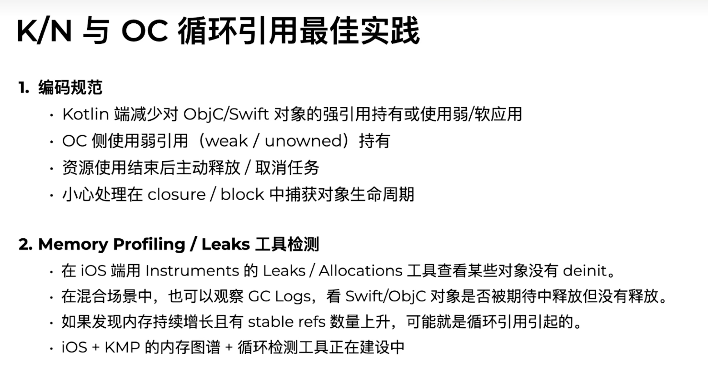
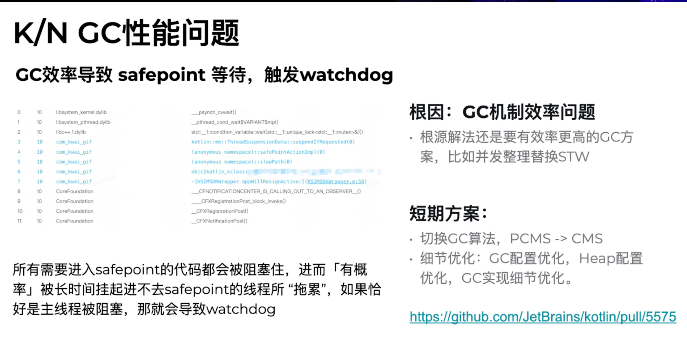
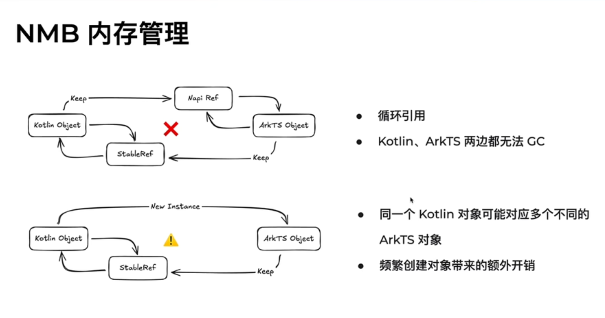
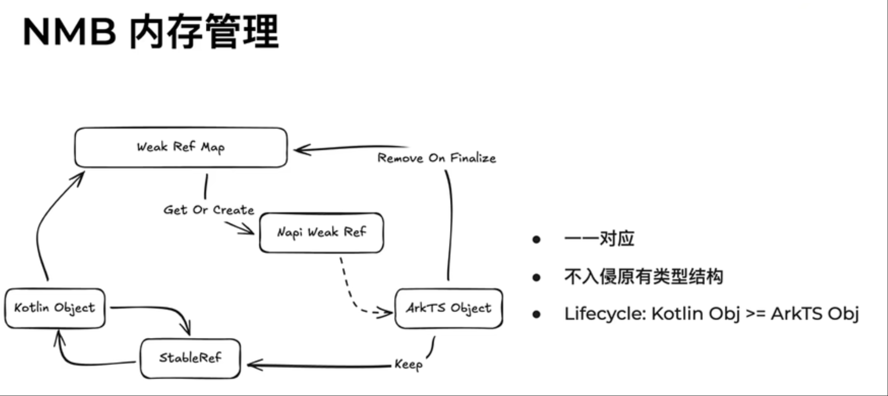
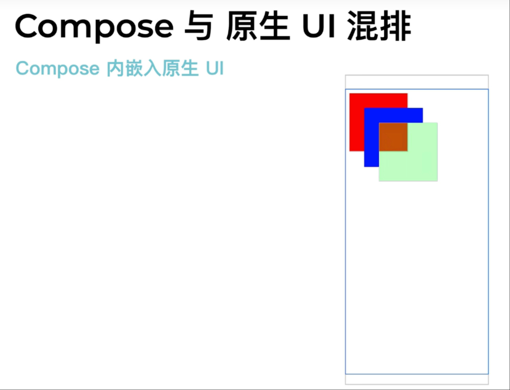
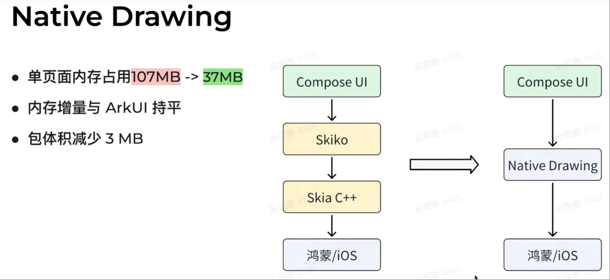
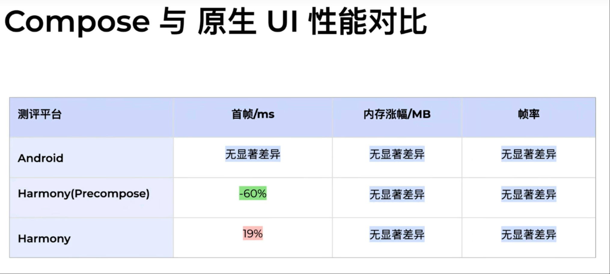
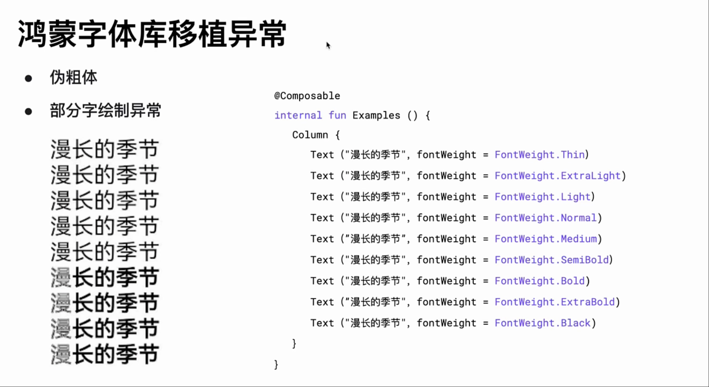鸿蒙系统使用可变字体，Skia 支持，但是 Compose 还不支持。

优化方向：

包体积：减少符号导出。SKIA 裁剪。

互调用：
           安卓           IOS          鸿蒙
原生        JVM          Native    JS runtime/Native(提供了丰富的C/C++API，甚至 UI)
CMP        JVM          Native       Native
Fluter    Dart VM       Dart VM      Dart VM
RN        JS 运行时


1. 在同一平台上，运行类型不同会导致互调用极其麻烦。因为对象是隔离的，牵涉到序列化/反序列化。
2. 

层级                   支付宝：
工具/三方库           ArkCompose 的预览支持（应该是预览的时候混排也能预览）。
                    AI Coding 支持。
                    DevEcho 和 XCode 支持KN 调试。
                    测试框架支持跨端。
                    热修

CMP             渲染增强。
                UI 层优化，使用了原生渲染。

Kotlin/编译器    编译混淆、编译提效（KN的编译较慢）、Lint 检查、性能分析、包大小统计。

## 复用粒度

1. 整个模块复用
2. 复用页面
3. 复用组件
3. 复用类、函数、工具

## 项目改造

CMP 对 Kotlin 和 AGP 版本有要求，需要研究下现有项目的兼容性。

Compose
    KMP 和现有代码融合， module依赖， 代码结构， activity嵌入、UI嵌入
    KMP 需要改版的库整理
    KMP 退化到 Android Compose。（开弓没有回头箭）
    KMP 鸿蒙支持

### 项目配置


Gradle 9.0 的问题
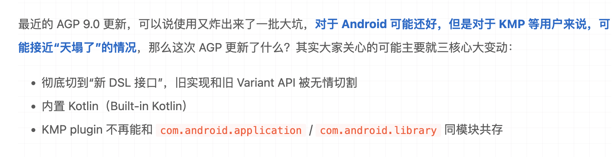


就是安卓的 gradle 插件和多平台的 gradle 插件不能用于统一模块。这正好是符合我们配置的：

只能用于安卓模块：
- com.android.application
- com.android.library

多平台模块：
- org.jetbrains.kotlin.multiplatform
- org.jetbrains.compose

安卓和多平台复用：compose compiler
- org.jetbrains.kotlin.plugin.compose 

内置 kotlin 不再需要：
- org.jetbrains.kotlin.android


## IOS 项目集成

在 iosApp/iosApp.xcodeproj/project.pbxproj 中有一个 Run Script 构建阶段。