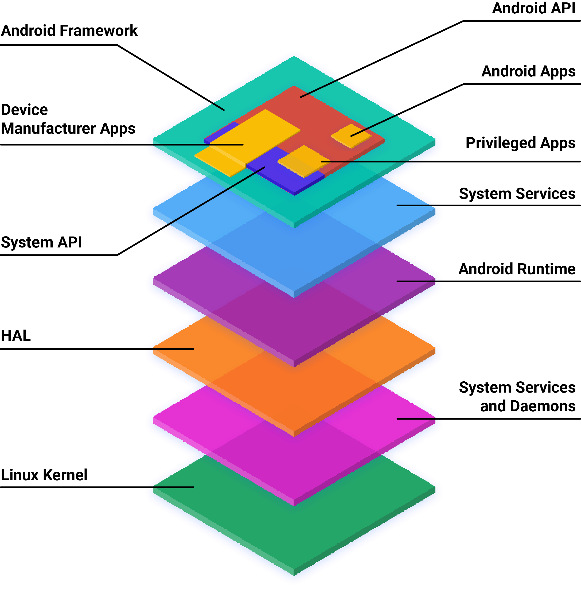
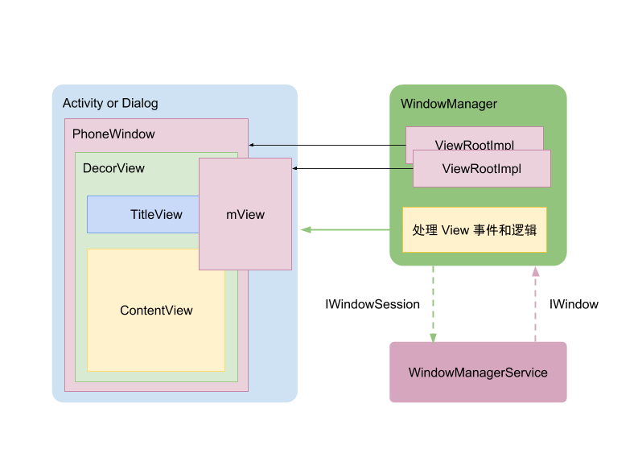
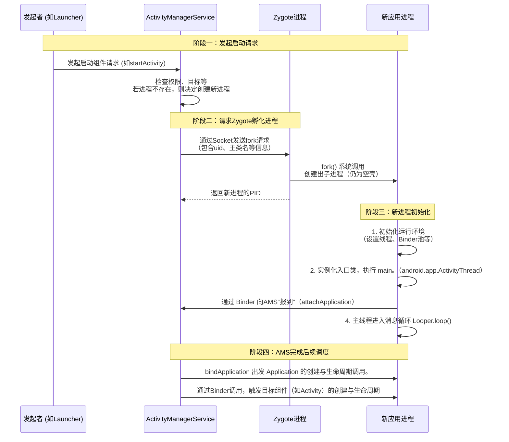

# 架构

用户空间的应用启动分两部分：
1. init 启动 native 服务（ServiceManager、SurfaceFlinger、Zygote 等）

2. Zygote 启动 Java 层应用和服务。

这和桌面 Linux 的启动方式有很大不同，桌面 Linux 通常使用 systemd 或 init 脚本启动各种服务和桌面进程。
而且新进程的启动方式也不同，Linux 系统上任意进程只要有资源配额（ulimit、cgroup 限额没超）就可以创建新进程。但在 Android 上，只有 init 进程、Zygote 进程直接有权限 fork 出新的进程才能创建新进程。init 程序启动哪些进程在打包成系统之前就确定好了。而 Java 层应用启动有强约束，只能通过 Zygote / AMS 启动。具体是：向 ActivityManagerService（AMS）发消息。AMS 再请求 Zygote fork() 出一个新进程；

3. Activity 相当于一个窗口，它包含了一个显示的 Window。

```
PhoneWindow (Window的唯一实现)
    └── DecorView (顶级View，通过 getDecorView() 获取)
          ├── 系统装饰部分 (标题栏、ActionBar，并非总有)
          └── **mContentParent (一个 FrameLayout，真正的“内容容器”)**
                └── 您通过 setContentView(R.layout.your_layout) 设置的布局
```

## AOSP architecture

The software stack for AOSP contains the following layers:




HAL：硬件抽象层。有些应用程序需要硬件支持，比如显示器、相机、蓝牙等。这些硬件需要供应商提供 HAL 实现，应用层通过 HAL 接口与硬件进行交互。

## 系统服务

系统为何需要的服务，而不是系统查询能力就行？为何设计 ServiceManager ？

我的理解是，当一种资源需要被多个进程使用而产生竞争（例如多媒体设备、显示器）或者多个进程都需要同一功能时，就需要将他们抽离成一个管理器或者共享进程。这就是抽象的服务。

init 
    servicemanager
    surfaceflinger
    zygote
        SystemServer
    media
    logd
    ...

- servicemanager 是系统提供的总服务管理进程。任何服务都需要在此注册才能被其它进程使用。任何进程想要使用某种服务都需要在此查询到一个句柄才能和服务进一步使用服务。② ServiceManager 的另一个设计原因是，Binder 通信本身被设计成了通过一个 manager 管理的架构。使用 Binder 通信的进程必须通过 manager 查询。

- surfaceflinger 用户管理用户显示窗口合成和显示。

- zygote 是一个预热的安卓程序运行时。安卓应用 运行在 art 虚拟机中，并且依赖大量的 Android Framwok 代码。每个进程从头加载运行这些内容重复且耗时。既然每个应用都用到，因此设计了 zygote 进程。zygote 其实代表了进程加载安卓 Java 应用程序前的一个状态: 虚拟机和android framwork 代码都已运行。需要运行新程序只需要 fork 一个新进程、然后只加载应用的 java 代码即可。

## Service

### ServiceManager

ServiceManager 负责管理系统中的所有服务。ServiceManager 在系统启动时初始化，并作为一个独立的进程运行。

ServiceManager 负责启动，配置在 init.rc 文件中。
```
# frameworks/native/cmds/servicemanager/servicemanager.rc
service servicemanager /system/bin/servicemanager
    class core animation
    user system
    group system readproc
    critical
    file /dev/kmsg w
    onrestart setprop servicemanager.ready false
    onrestart restart --only-if-running apexd
    onrestart restart audioserver
    onrestart restart gatekeeperd
    onrestart class_restart --only-enabled main
    onrestart class_restart --only-enabled hal
    onrestart class_restart --only-enabled early_hal
    task_profiles ProcessCapacityHigh
    shutdown critical
```
```
    # Start essential services.
    start servicemanager
    start hwservicemanager
    start vndservicemanager
```

```C
aosp/frameworks/native/cmds/servicemanager/main.cpp

讲解一下这段代码，分析 Binder 的 Manager 注册流程：
int main(int argc, char** argv) {
    ...
    // 为 ServiceManager 进程自身 初始化了 Binder 环境。它打开 Binder 驱动（如 /dev/binder），完成内存映射，设置线程池。这是任何进程进行 Binder 通信的前提。
    sp<ProcessState> ps = ProcessState::initWithDriver(driver);
    ps->setThreadPoolMaxThreadCount(0);
    ps->setCallRestriction(ProcessState::CallRestriction::FATAL_IF_NOT_ONEWAY);

    // 防止 binder 线程被设置为低优先级后台任务。
    IPCThreadState::self()->disableBackgroundScheduling(true);

    sp<ServiceManager> manager = sp<ServiceManager>::make(std::make_unique<Access>());
    manager->setRequestingSid(true);
    // ServiceManager 把自己（manager 对象）作为一个普通的服务添加到 ServiceManager 中，这里只是在当前 mNameToService map 中添加 Service，并未向 Binder 驱动注册。
    // 当其他进程通过 getService("manager") 查询时，能拿到 ServiceManager 这个 Binder 对象的引用。
    // 拿到这个引用后，其他进程就可以调用 ServiceManager 提供的 addService、getService 等接口来注册或查询其他服务。这是整个系统服务架构的基石。
    if (!manager->addService("manager", manager, false /*allowIsolated*/, IServiceManager::DUMP_FLAG_PRIORITY_DEFAULT).isOk()) {
        LOG(ERROR) << "Could not self register servicemanager";
    }

    // 
    IPCThreadState::self()->setTheContextObject(manager);
    // 这是 Manager 注册流程的第二个，也是最核心的关键点。这行代码调用了 Binder 驱动的 ioctl，命令驱动将当前进程（ServiceManager）设置为整个 Binder 系统的“上下文管理者”（Context Manager）。
    // 在 Binder 驱动中，这个角色是唯一且全局的。
    // 驱动会将所有对服务句柄为0的 Binder 请求，自动路由到被设为上下文管理者的进程（即 ServiceManager）。这就是为什么客户端查询服务时，可以通过 BINDER_SERVICE_MANAGER 这个特殊的句柄（它就是0）找到 ServiceManager 的根本原因。
    if (!ps->becomeContextManager()) {
        LOG(FATAL) << "Could not become context manager";
    }

    sp<Looper> looper = Looper::prepare(false /*allowNonCallbacks*/);

    sp<BinderCallback> binderCallback = BinderCallback::setupTo(looper);
    ClientCallbackCallback::setupTo(looper, manager, binderCallback);

#ifndef VENDORSERVICEMANAGER
    if (!SetProperty("servicemanager.ready", "true")) {
        LOG(ERROR) << "Failed to set servicemanager ready property";
    }
#endif

    // 进入事件循环，等待服务
    // Looper::prepare 和 looper->pollAll(-1)：在完成自我注册和身份设定后，ServiceManager 进入一个无限事件循环。它使用 Looper 来监听 Binder 驱动文件描述符上的事件。
    // BinderCallback::setupTo：这里注册了一个回调。当 Binder 驱动有新的请求到达（比如有进程要注册或查询服务）时，这个回调会被触发，最终调用到 ServiceManager 对象的 onTransact 方法来处理具体的 ADD_SERVICE、GET_SERVICE 等事务。
    while(true) {
        looper->pollAll(-1);
    }

    // should not be reached
    return EXIT_FAILURE;
}
```

理解 ServiceManager 的启动，关键在于理解它完成的两个紧密关联的“注册”：

1. 业务逻辑注册：作为一个Binder服务对象，以 "manager” 为名，注册到自己内部的服务目录中。这使得其他进程可以通过名字找到它。

2. 驱动层注册：通过 becomeContextManager()，在 Binder 驱动层将自己注册为全局的上下文管理者。这使得所有对服务句柄0的请求都被驱动层定向到它。

两者结合，才使得 ServiceManager 成为 Android 系统中那个独一无二的、所有服务寻址必经的“交通枢纽”。


### SystemServer

其它进程在 注册 Service 之前，自身本质是一个 Binder 客户端，它需要链接 ServiceManager，而 ServiceManager 的句柄是固定的 0，因此解决了先有蛋还是先有鸡的问题，固定的 0 号句柄总是能找到 ServiceManager。整个过程不依赖任何已知服务。

```Java
SystemServer 中调用 ServiceManager 的 addService 添加。
frameworks/base/core/java/android/os/ServiceManager.java
-> frameworks/base/core/java/android/os/ServiceManagerProxy.java

private native IBinder getNativeServiceManager();

```

Java_android_os_ServiceManagerProxy_getNativeServiceManager native 调用返回的是 `android.os.BinderProxy` 对象，它持有 BackendUnifiedServiceManager 的引用。

```C++
sp<BackendUnifiedServiceManager> getBackendUnifiedServiceManager() {
    std::call_once(gUSmOnce, []() {
#if defined(__BIONIC__) && !defined(__ANDROID_VNDK__)
        /* wait for service manager */
        if (hasOutOfProcessServiceManager()) {
            using std::literals::chrono_literals::operator""s;
            using android::base::WaitForProperty;
            while (!WaitForProperty("servicemanager.ready", "true", 1s)) {
                ALOGE("Waited for servicemanager.ready for a second, waiting another...");
            }
        }
#endif

        sp<AidlServiceManager> sm = nullptr;
        while (hasOutOfProcessServiceManager() && sm == nullptr) {
            sm = interface_cast<AidlServiceManager>(
                    ProcessState::self()->getContextObject(nullptr));
            if (sm == nullptr) {
                ALOGE("Waiting 1s on context object on %s.",
                      ProcessState::self()->getDriverName().c_str());
                sleep(1);
            }
        }

        gUnifiedServiceManager = sp<BackendUnifiedServiceManager>::make(sm);
    });

    return gUnifiedServiceManager;
}
```

BackendUnifiedServiceManager 内部持有 AIDL 接口生成的 AidlServiceManager。AidlServiceManager 的 

初始化进程的Binder基础
任何进程要进行Binder通信，必须先初始化自己的环境。这是通过全局单例 ProcessState 完成的：

```C
// frameworks/native/libs/binder/ProcessState.cpp
sp<ProcessState> ProcessState::self()
{
    static sp<ProcessState> gProcess;
    if (gProcess == nullptr) {
        gProcess = new ProcessState(kDefaultBinderDriver);
    }
    return gProcess;
}

sp<IBinder> ProcessState::getContextObject(const sp<IBinder>& /*caller*/)
{
    sp<IBinder> context = getStrongProxyForHandle(0);

    if (context) {
        // The root object is special since we get it directly from the driver, it is never
        // written by Parcell::writeStrongBinder.
        internal::Stability::markCompilationUnit(context.get());
    } else {
        ALOGW("Not able to get context object on %s.", mDriverName.c_str());
    }

    return context;
}

```
在构造函数中，它会打开 /dev/binder 驱动，进行内存映射 (mmap)，为Binder通信准备好内核缓冲区。


获取“上下文管理者”的Binder代理
初始化后，进程通过以下关键调用获取 ServiceManager 的代理接口：

```C
// frameworks/native/libs/binder/IServiceManager.cpp
sp<IServiceManager> defaultServiceManager()
{
    if (gDefaultServiceManager != nullptr) return gDefaultServiceManager;
    {
        AutoMutex _l(gDefaultServiceManagerLock);
        while (gDefaultServiceManager == nullptr) {
            // 关键调用：获取一个指向“上下文管理者”的Binder代理对象
            gDefaultServiceManager = interface_cast<IServiceManager>(
                ProcessState::self()->getContextObject(nullptr)
            );
            if (gDefaultServiceManager == nullptr) sleep(1);
        }
    }
    return gDefaultServiceManager;
}
// ProcessState::getContextObject(nullptr) 是这里的魔法起点。它的实现是：

sp<IBinder> ProcessState::getContextObject(const sp<IBinder>& /*caller*/)
{
    return getStrongProxyForHandle(0); // 注意这里的句柄是 0
}


sp<IBinder> ProcessState::getStrongProxyForHandle(int32_t handle)
{
    ...
            sp<BpBinder> b = BpBinder::PrivateAccessor::create(handle, &postTask);
    ...
}

// frameworks/native/libs/binder/include/binder/BpBinder.h
static sp<BpBinder> create(int32_t handle, std::function<void()>* postTask) {
    return BpBinder::create(handle, postTask);
}

sp<BpBinder> BpBinder::create(int32_t handle, std::function<void()>* postTask) {
    ...
    return sp<BpBinder>::make(BinderHandle{handle}, trackedUid);
}

// frameworks/native/libs/binder/include/binder/BpBinder.h
struct BinderHandle {
    int32_t handle; // <---- 0
};
```

getStrongProxyForHandle(0) 创建了一个 BpHwBinder  对象，这个对象内部持有一个值为 0 的Binder句柄。

3. 驱动层的固定路由

BpHwBinder 是客户端代理，当调用其 transact() 方法时，最终会将请求（包括句柄 0 和数据）通过 ioctl 发送给Binder驱动。

驱动内部有一个固定规则：所有目标句柄为 0 的Binder事务，都会被自动重定向到那个通过 ioctl(BINDER_SET_CONTEXT_MGR) 将自己注册为“上下文管理者”的进程（即 ServiceManager 进程）。

这就是为什么普通进程在没有任何预先知道的Binder引用的情况下，也能找到 ServiceManager 的原因。句柄 0 是一个在驱动层硬编码的“特殊地址”。

4. 封装为IServiceManager接口
interface_cast<IServiceManager>(...) 这个模板函数（实际上是 IInterface::asInterface）会检查传入的 IBinder 对象，发现它是一个远程代理 (BpBinder)，于是创建并返回一个 BpServiceManager 对象。

BpServiceManager 继承自 IServiceManager，它内部持有了那个指向句柄 0 的 BpBinder 成员。

当客户端调用 BpServiceManager::addService(const String16& name, const sp<IBinder>& service) 时，它会将操作码、服务名、服务对象打包，调用其内部 BpBinder 的 transact() 方法，从而发往句柄 0，最终被驱动路由到 ServiceManager 进程。


> SystemService 进程的双重角色：

- 对于 ServiceManager 而言：它是客户端。它通过 defaultServiceManager()->addService() 来注册自己提供的服务（例如 ActivityManagerService）。

- 对于其他 App 进程而言：它又是服务器。当 App 通过 getService 拿到它的 Binder 引用后，就可以调用它的业务方法。


### 应用进程


## Graphics


各种渲染 -> Surface(生产方) ---> SurfaceFlinger(消费方) -> 显示硬件

- Surface 和 Window 不是绑定关系，Surface 物理绘图表面。例如每个 SurfaceView 都有一个 Surface。Window 是逻辑概念，是应用程序的一个窗口，可以包含多个 Surface。

- TextureView：不创建独立 Surface，而是作为 View 层次的一部分共享主 Surface

```
应用进程
├── Activity 1 → Window 1 → Surface 1 (独立)
├── Activity 2 → Window 2 → Surface 2 (独立) 
├── Dialog 1 → Window 3 → Surface 3 (独立)
└── Toast → Window 4 → Surface 4 (独立)
    ↓
SurfaceFlinger (系统服务)
    ↓
显示屏
```

### VSync 

VSYNC 全称为 Vertical Synchronization，垂直同步信号。它是显示控制器在显示完一帧数据后，向图形处理单元（GPU）发送的一个信号，表示可以开始下一帧数据的填充。

1. 内核图形驱动执行中断处理，驱动将事件传到 Hardware Composer (HWC) HAL 回调路径，内核中断是如何传递到 HWC 的？

2. SurfaceFlinger + HWC HAL：接收到 per-display VSYNC 回调 (注册监听 poll() / epoll() vblank)，写入 DispSync，预测下一帧节奏，安排合成线程和应用帧调度

3. 应用使用 DisplayEventReceiver 在主线程 Looper 里监听这个 FD（Looper.addFd()）。当 socket 有数据可读，唤醒主线程，在 onVsync()/handleMessage() 内部回调到 Choreographer.doFrame.


- 重点：每帧 VSYNC 不走 Binder（避免过高开销），而是使用已建立的轻量级本地 socket (BitTube)；Binder 只用于建立通道与管理生命周期。


### VSync 与 Buffer 切换时机

时间线：

1. 硬件 VSYNC（vblank 中断）本质表示：上一帧最后一行像素已经扫描完，显示控制器进入垂直消隐区（Vertical Blank Interval）的开始。

2. front/back buffer 的切换（page flip 指针生效、plane/CRTC 重新指向新缓冲）通常被安排在这段垂直消隐区内，在下一帧真正开始扫描之前。换句话说：你在上一帧显示期间提前“预约”了 page flip，它在 VSYNC 边界生效。

3. 软件里看到的“vsync 回调”常是经过预测/延迟的节拍事件，它代表“请开始准备下一帧”，而不是“刚刚完成了 page flip”。

4. 如果应用没准备好新缓冲，VSYNC 仍会按时发生，只是没有新的 page flip，旧 front buffer 会继续被扫描一帧（出现重复帧）。

5. VRR（可变刷新率）下 VSYNC 间隔可以变化；page flip 仍在扫描启动前那一刻完成（逻辑保持不变，只是周期变量）。

- Vertical Active： 正在逐行读取 front buffer 并发送像素的时间段。
- Vertical Blank (VBlank)：一帧扫描结束与下一帧开始之间的间隔；此时不会往屏幕输出新像素，是做模式切换、page flip 的窗口。

### SurfaceFlinger

绘制 vs 操控事件：两条独立但相关的链路

1. 整体调用链（从系统到 View）
    - 系统合成器 / VSYNC 信号到来
    - Choreographer 回调 doFrame()
    - ViewRootImpl 发起绘制：performTraversals()
    - 三大流程：measure() → layout() → draw()
    - 从根 DecorView 开始，递归调用各子 View 的 measure/layout/draw

```
系统 VSYNC / Choreographer
          │
          ▼
    ViewRootImpl (连接 Window 和 View 树)
          │  performTraversals()
          │
          ├─► measure() 布局测量阶段
          │     │
          │     └─► 递归调用每个 View 的 onMeasure()
          │
          ├─► layout() 布局放置阶段
          │     │
          │     └─► 递归调用每个 View 的 onLayout()
          │
          └─► draw() 绘制阶段
                │
                └─► 根 View (DecorView).draw(canvas)
                        │
                        ├─► drawBackground()
                        ├─► onDraw(canvas)  // 自定义内容
                        ├─► dispatchDraw(canvas) // 绘制子 View
                        │        │
                        │        └─► child.draw(canvas) ...
                        └─► onDrawForeground()
```

2. 操控事件（触摸）是如何传递到 View 中的？

以触摸事件为例：
    - 硬件触摸 → 内核 → Input 系统
    - InputDispatcher 将事件发送到当前 Activity 所在的窗口
    - 最终进入 ViewRootImpl.dispatchInputEvent
    - 分发到 View 树：从 DecorView 开始
    - 通过 dispatchTouchEvent → onInterceptTouchEvent → onTouchEvent 机制，自上而下查找合适的 View 处理.
```
硬件触摸
   │
   ▼
系统 InputDispatcher
   │
   ▼
Window / ViewRootImpl
   │
   ▼
DecorView.dispatchTouchEvent(ev)
   │
   ├─► ViewGroup.dispatchTouchEvent(ev)
   │       │
   │       ├─► onInterceptTouchEvent(ev)? 拦截吗
   │       │      ├─ 拦截: 自己 .onTouchEvent(ev)
   │       │      └─ 不拦截: 分发给子 View
   │       │
   │       └─► child.dispatchTouchEvent(ev)
   │                 │
   │                 └─► child.onTouchEvent(ev)
   │
   └─ 如果所有子 View 都不处理，事件会往回冒泡：
           父 View.onTouchEvent(ev)
           再到 DecorView / Activity (onTouchEvent 等)

```

- DecorView is the root View of an Activity window. It is a subclass of FrameLayout and is the top of the View tree (title bar + content view).
- ViewRootImpl is not a View. It is a bridge object between:
the Window / WindowManager / Surface (system side)
and the root View (DecorView) (app side)

DecorView 被设置到 ViewRootImpl 中，是在 WindowManagerGlobal.addView(...) 调用 ViewRootImpl.setView(...) 的时候完成的。

在标准 Activity 流程里，大致顺序是：

- Activity 创建 PhoneWindow，并在 setContentView(...) 等过程中通过 PhoneWindow.setContentView 确保 DecorView 已经创建好。
- Activity / Window 调用 WindowManager.addView(decorView, params) 把这个 DecorView 加到窗口系统。
- WindowManager 的实现类 WindowManagerImpl 把调用转发到 WindowManagerGlobal.addView(view, params, ...)。
- WindowManagerGlobal.addView(...) 里创建 ViewRootImpl，然后调用 root.setView(view, wparams, panelParentView)，这一步把 DecorView 作为根 View 绑到 ViewRootImpl 上。




## WindowManagerService 与 ActivityManagerService 的关系和职责

一、核心职责对比

ActivityManagerService (AMS) 管理应用生命周期和进程

- 进程管理：通过 Zygote fork 新进程，管理进程优先级、OOM 调整、进程回收
- 四大组件生命周期：Activity、Service、BroadcastReceiver、ContentProvider 的启动/停止/销毁
- Activity 栈管理：管理 Task/Stack，控制 Activity 跳转、返回、切换
- Intent 路由：解析 Intent 并分发到对应组件
应用权限检查：在组件启动时检查权限

WindowManagerService (WMS) 管理窗口显示和布局

- 窗口创建与销毁：为每个 Activity/Dialog/Toast 等创建 Window 对象
- 窗口层级（Z-order）管理：决定哪个窗口在上层显示
- 窗口布局计算：确定窗口位置、大小、旋转
- 输入事件分发：将触摸/按键事件分发到正确的窗口
- 动画协调：窗口切换动画（如 Activity 转场）
- Surface 分配：为窗口分配绘图表面，与 SurfaceFlinger 交互

```
用户操作（点击图标启动 App）
         │
         ▼
   Launcher.startActivity(intent)
         │
         ▼
   ┌─────────────────────────────────┐
   │  ActivityManagerService (AMS)   │
   ├─────────────────────────────────┤
   │ 1. 解析 Intent                  │
   │ 2. 检查权限、Task 栈            │
   │ 3. 决定是否需要创建新进程       │
   │ 4. 通知 Zygote fork 进程        │
   │ 5. 调用 Activity.onCreate()     │
   │ 6. 触发 Activity.onResume()     │
   └──────────┬──────────────────────┘
              │ 告知 WMS："Activity X 要显示了"
              ▼
   ┌─────────────────────────────────┐
   │  WindowManagerService (WMS)     │
   ├─────────────────────────────────┤
   │ 1. 为 Activity 创建 Window      │
   │ 2. 计算窗口位置和大小           │
   │ 3. 分配 Surface                 │
   │ 4. 设置 Z-order（窗口层级）     │
   │ 5. 准备输入事件通道             │
   │ 6. 触发窗口动画                 │
   └──────────┬──────────────────────┘
              │ 将 Surface 提交给合成器
              ▼
   ┌─────────────────────────────────┐
   │      SurfaceFlinger             │
   │  合成所有 Surface 并显示到屏幕     │
   └─────────────────────────────────┘
```

Android 图形化系统相关的主要系统进程有：

- BootAnimation：负责开机动画显示。
- SurfaceFlinger：负责所有窗口和 Surface 的合成与最终显示，是图形系统的核心服务。
- ServiceManager：服务目录的管理者。负责系统服务的注册、查询和生命周期管理。 SystemServer 启动后会注册各种系统服务到 ServiceManager，应用进程通过 Binder 调用这些服务。

- Zygote：负责 fork 出所有 Java 应用和 SystemServer 进程。
- SystemServer：托管大部分系统服务（包括 WMS、IMS、AMS 等，他们是 SystemServer 进程中的服务，不再是单独进程）。
    - WindowManagerService (WMS)：管理窗口的创建、布局、层级和显示。
    - InputManagerService (IMS)：负责输入事件（触摸、按键等）的读取和分发。
    - ActivityManagerService (AMS)：管理应用进程和四大组件的生命周期。
    - MediaServer：负责音视频编解码、拍照、录音等多媒体相关服务。
    - SensorService：管理传感器数据（如加速度、陀螺仪等）。


```
            +-------------------+
            |      init         |
            +---------+---------+
                      |
                 启动 Zygote
                      v
+---------------+---------+----------------+
| SurfaceFlinger| Zygote  | ServiceManager |
+---------------+---------+----------------+
                      |
                      v
            +-------------------+
            |      Zygote       |
            | fork SystemServer |
            +---------+---------+
                      |
                      v
            +-------------------+
            |   SystemServer    |
            | start AMS/WMS/IMS |
            +----+------+-------+
                 |      |
     Binder      |      | Binder
                 v      v
+----------------+------+------------------+
|                  AMS                     |
|  - 管理应用/Activity 生命周期            |
|  - 请求 Zygote fork 应用                 |
+-----------+------------------------------+
            |
   startActivity / 任务栈变更
            | Binder: 通知显示需求(可见/焦点)
            v
+----------------+-------------------------+
|                  WMS                     |
|  - 创建/销毁窗口、布局、层级             |
|  - 分配 Surface，建立 InputChannel       |
|  - 向 IMS注册/更新窗口输入信息           |
+-----------+---------------+--------------+
            |               |
   Surface  |               | 输入窗口元数据
 BufferQueue|               | (焦点/触摸区域/flags)
            v               v
+-----------+---------------+--------------+
|            SurfaceFlinger                 |
|  - 合成各 Surface 并显示                   |
+-------------------------------------------+

              ▲
              | 查询窗口信息(焦点/触摸目标)
              |
+-------------------------------------------+
|                  IMS (InputDispatcher)    |
|  - 从 InputReader 获取事件                 |
|  - 依据 WMS 提供的窗口信息选路             |
|  - 通过 InputChannel 直接发到应用进程      |
+-------------------------------------------+

应用进程 (App)
- 接收 InputChannel 事件 → ViewRootImpl
- 通过 WindowManager.addView → 与 WMS 建立窗口
- 通过 Surface 提交缓冲 → 由 SurfaceFlinger 合成
```



- ApplicationThread 实现了 IApplicationThread.Stub 接口，AMS 通过 Binder 调用 ApplicationThread 的方法来通知应用进程执行各种操作（如创建 Activity、Service 等）。
- ApplicationThread 主要负责接收 AMS 的命令，通过 Handler 将这些命令转发给（主线程） ActivityThread 进行处理。

app_main.cpp 是 JVM 启动入口，用于启动 JVM 虚拟机。它被编译为 app_process 或者 app_process64 可执行文件。

```C++
// frameworks/base/cmds/app_process/app_main.cpp
    if (zygote) {
        // Sygote 模式，Zygote、SystemServer、普通应用进程都走这里。
        runtime.start("com.android.internal.os.ZygoteInit", args, zygote);
    } else if (!className.empty()) {
        // 非 Zygote 模式，直接启动指定的 Java 类。框架提供的命令行工具（通过 app_process 启动的 am、pm、其他命令行 Java 工具）。
        // 测试/调试工具或由脚本直接 exec 的 Java 程序（adb shell 用的某些工具）。
        runtime.start("com.android.internal.os.RuntimeInit", args, zygote);
    } else {
        fprintf(stderr, "Error: no class name or --zygote supplied.\n");
        app_usage();
        LOG_ALWAYS_FATAL("app_process: no class name or --zygote supplied.");
    
```

- app_process 是 Android 上启动 ART/VM 的本地可执行入口，作用类似传统 JVM 的 java 命令 —— 它负责启动虚拟机、设置运行时环境并调用 Java 入口类（RuntimeInit 或 ZygoteInit）。

- `app_main.cpp` 总共也就几百行代码，出去参数处理，就这两行核心，就是使用 Java 运行时执行 Java 类。可见 Android Framework 的大部分逻辑都在 Java 层实现。


## S


## SystemServer 启动

ServiceManager: 单独的服务管理进程。

SystemServer: 系统服务进程，内部有很多服务 SystemService, 例如 AMS,

这些服务需要继承 IXXX.Stub, 然后通过：
1. LocalServices.addService(Class<T>, new LocalService()) 在本地记录。
2. ServiceManager.addService(String name, Binder binder) 注册到 ServiceManager。**特别说明的是：这里的 ServiceManager 也是一个 Binder 客户端，真正的 ServiceManager 是一个独立的进程。**

ActivityManagerService extends IActivityManager.Stub

ActivityManagerService 中管理了很多 Service。
其中的注册 start()、initPowerManagement()、setSystemProcess() 等方法都是在 注册不同的 service.


https://blog.csdn.net/welljrj/article/details/105581669
