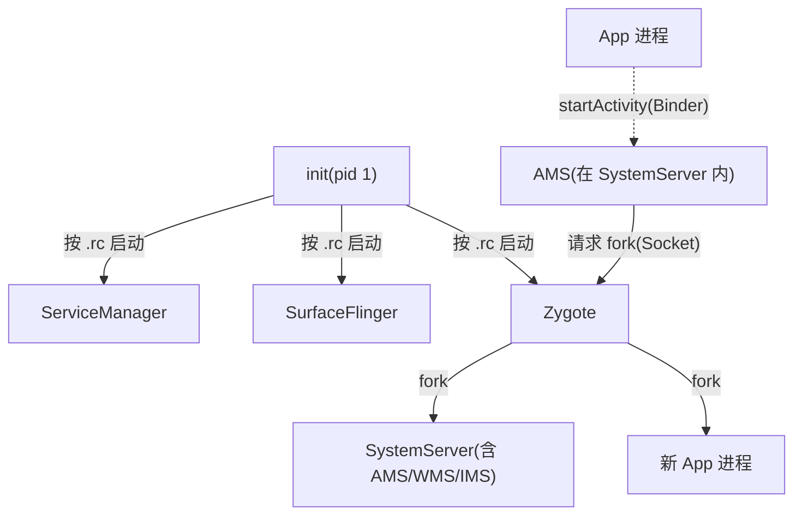
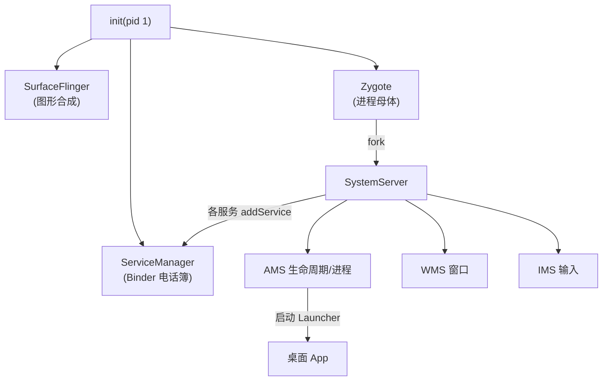
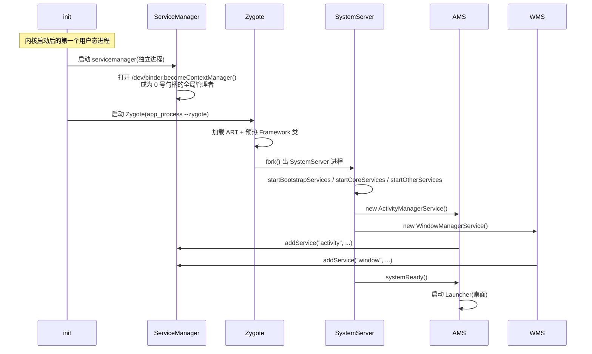
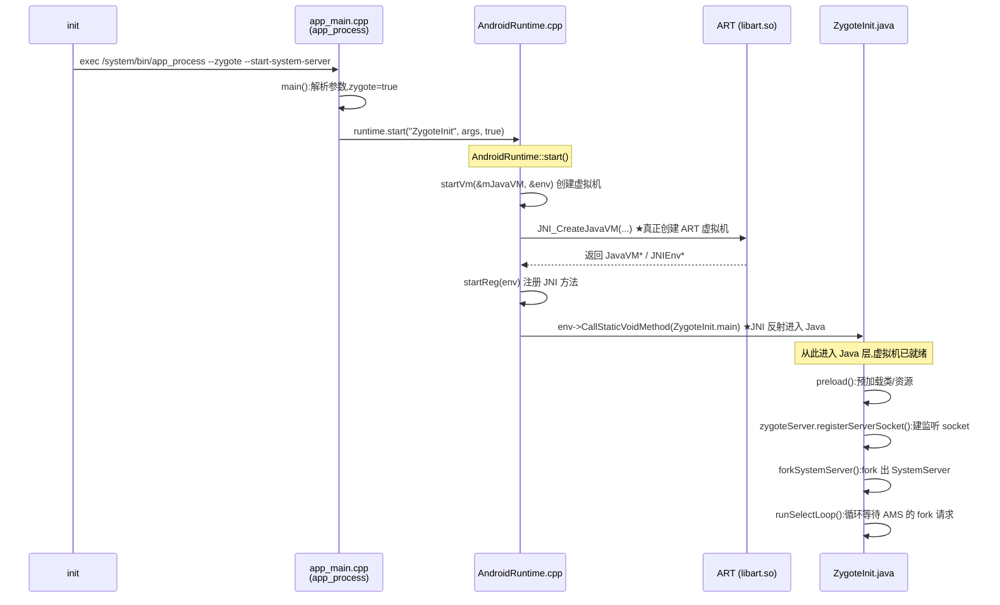
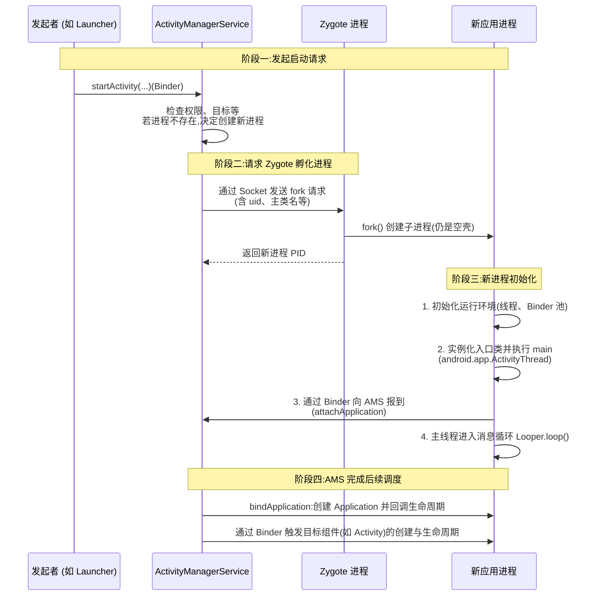

# Android(AOSP)系统架构

## 0. 导读

本文写给**不懂 Android Framework、但想快速看懂系统代码的人**。目标是让你在读源码之前,先建立一张"地图":系统由哪些核心进程/服务组成、它们各自在哪、开机时按什么顺序被拉起来、一个 App 从点击图标到显示画面经过了谁。

### 一句话心智模型

> Android 系统 = 一堆**跑在不同进程里的服务**,靠 **Binder** 互相调用;所有服务的"电话簿"是 **ServiceManager**;所有 Java 进程都由 **Zygote** fork 出来;开机由 **init** 点火。

### 一分钟速览(记住这 4 个结论)

1. **进程不能随便创建**。桌面 Linux 里任何进程都能 `fork`;Android 里 Java 进程只能由 **Zygote** 孵化,而"要不要孵化"由 **AMS** 决定。
2. **进程间通信几乎全走 Binder**。跨进程调用一个服务的方法,底层都是 Binder。要找到某个服务,先问 **ServiceManager**。
3. **大部分 Framework 逻辑在 Java 层**。Native 层(C++)主要负责启动虚拟机、Binder 驱动、图形合成(SurfaceFlinger)等底层;`app_main.cpp` 核心就两行——启动 ART 跑一个 Java 类。
4. **系统服务大多不是独立进程**,而是挤在一个叫 **SystemServer** 的进程里(AMS/WMS/IMS 等都是它内部的对象)。只有少数(ServiceManager、SurfaceFlinger、Zygote 等)是独立进程。

---

## 1. 分层架构总览

AOSP 软件栈自底向上分为若干层:


| 层 | 职责 | 举例 |
|---|---|---|
| 应用层 (System/User Apps) | 用户可见的应用 | Launcher、设置、你的 App |
| Java API Framework | 给应用用的 Java 接口,封装系统能力 | Activity、View、`WindowManager` 等 |
| Native 库 / ART 运行时 | C/C++ 库与 Java 虚拟机 | libc、SurfaceFlinger、ART |
| HAL(硬件抽象层) | 屏蔽硬件差异的标准接口 | 相机 HAL、音频 HAL、传感器 HAL |
| Linux 内核 | 进程调度、内存、驱动、Binder 驱动 | Binder、匿名共享内存(ashmem) |

> **HAL 是什么**:有些应用需要硬件支持(显示器、相机、蓝牙等)。硬件由各厂商提供,接口千差万别。HAL 定义一套标准接口,厂商按接口实现;上层只依赖接口,不关心具体硬件,从而做到"一份 Framework 跑在不同硬件上"。

---

## 2. 核心组件速查表 ★

先给一张"谁是谁、在哪个进程、代码在哪"的总表。后面每节会展开。路径以 AOSP 标准目录为准(以你本机的 `aosp/` 检出为准,不同 Android 版本略有差异)。

| 组件 | 一句话职责 | 所在进程 | 源码位置 |
|---|---|---|---|
| **init** | 系统第一个用户态进程,按 `.rc` 脚本拉起 native 服务和 Zygote | init(pid 1) | `system/core/init/` |
| **ServiceManager** | 系统服务的"电话簿",所有服务在此注册/查询,Binder 寻址枢纽 | 独立进程 | `frameworks/native/cmds/servicemanager/main.cpp` |
| **SurfaceFlinger** | 把各窗口的 Surface 合成后送显示屏 | 独立进程 | `frameworks/native/services/surfaceflinger/` |
| **Zygote** | 预热好 ART + Framework 的"进程母体",fork 出所有 Java 进程 | 独立进程 | `frameworks/base/core/java/com/android/internal/os/ZygoteInit.java` |
| **app_process** | 启动 ART 虚拟机的 native 入口(相当于 `java` 命令) | 每个 Java 进程启动时 | `frameworks/base/cmds/app_process/app_main.cpp` |
| **SystemServer** | 系统服务容器进程,内部托管 AMS/WMS/IMS 等 | 独立进程(由 Zygote fork) | `frameworks/base/services/java/com/android/server/SystemServer.java` |
| **AMS**(ActivityManagerService) | 管理四大组件生命周期、进程、任务栈;决定何时让 Zygote fork 应用 | SystemServer 内 | `frameworks/base/services/core/java/com/android/server/am/ActivityManagerService.java` |
| **WMS**(WindowManagerService) | 管理窗口的创建/布局/层级,分配 Surface,建立输入通道 | SystemServer 内 | `frameworks/base/services/core/java/com/android/server/wm/WindowManagerService.java` |
| **IMS**(InputManagerService) | 读取并分发输入事件(触摸、按键) | SystemServer 内 | `frameworks/base/services/core/java/com/android/server/input/InputManagerService.java` |
| **ActivityThread** | 应用进程主线程入口,承载消息循环与组件调度 | 每个 App 进程 | `frameworks/base/core/java/android/app/ActivityThread.java` |
| **ApplicationThread** | `ActivityThread` 内的 Binder 端,接收 AMS 的命令 | 每个 App 进程 | `ActivityThread.java`(内部类) |
| **ViewRootImpl** | 连接 Window/Surface(系统侧)与 View 树(应用侧)的桥梁,驱动绘制 | 每个 App 进程 | `frameworks/base/core/java/android/view/ViewRootImpl.java` |
| **Choreographer** | 接收 VSync,统一编排每帧的输入/动画/绘制 | 每个 App 进程 | `frameworks/base/core/java/android/view/Choreographer.java` |
| **ProcessState / IPCThreadState** | 每个进程的 Binder 运行环境(打开驱动、线程池) | 所有用 Binder 的进程 | `frameworks/native/libs/binder/ProcessState.cpp` / `IPCThreadState.cpp` |

---

## 3. 进程模型:在 Android 上,谁能创建进程?

这是 Android 与桌面 Linux 最大的不同之一。

**桌面 Linux**:任何进程只要资源配额没超(ulimit、cgroup),都能 `fork` 出新进程;服务通常由 `systemd`/init 脚本拉起。

**Android**:Java 层进程的创建被强约束,只有两条合法路径:

1. **init 直接启动**:哪些 native 进程在打包成系统镜像前就写死在 `.rc` 脚本里(如 ServiceManager、SurfaceFlinger、Zygote)。
2. **Zygote fork**:所有 Java 进程(SystemServer、每个 App)都是 Zygote fork 出来的。App 不能自己 fork——它要启动新组件时,是**向 AMS 发 Binder 请求,AMS 再让 Zygote fork**。



### 为什么要有 Zygote?——"预热"原理

Android 应用跑在 ART 虚拟机里,并依赖大量 Framework 代码。如果每个 App 都从零加载虚拟机+Framework,既重复又慢。

Zygote 的做法:**开机时先把 ART 和 Framework 公共代码加载好,停在"万事俱备、只差业务代码"的状态**。启动新 App 时只需 `fork` 一份(依赖写时复制 Copy-on-Write,内存几乎零拷贝),再加载 App 自己的 Java 代码即可。Zygote 本质就是"Java 应用启动前的公共快照"。

---

## 4. 系统启动全流程 ★

### 4.1 启动架构图



### 4.2 启动时序图



### 4.3 分阶段讲解 + 源码位置

用户空间的应用启动分两大部分,这也是与桌面 Linux 的根本区别:

**阶段一:init 启动 native 服务**(`system/core/init/`,脚本 `*.rc`)
init 读取 `.rc` 脚本,拉起 ServiceManager、SurfaceFlinger、Zygote 等。例如 ServiceManager 的启动配置:

```
# frameworks/native/cmds/servicemanager/servicemanager.rc
service servicemanager /system/bin/servicemanager
    class core animation
    user system
    group system readproc
    critical
    file /dev/kmsg w
    onrestart setprop servicemanager.ready false
    onrestart restart --only-if-running apexd
    onrestart restart audioserver
    onrestart restart gatekeeperd
    onrestart class_restart --only-enabled main
    onrestart class_restart --only-enabled hal
    onrestart class_restart --only-enabled early_hal
    task_profiles ProcessCapacityHigh
    shutdown critical
```
```
    # Start essential services.
    start servicemanager
    start hwservicemanager
    start vndservicemanager
```

**阶段二:Zygote 启动 Java 层服务与应用**
Zygote fork 出 **SystemServer**,SystemServer 分三批启动系统服务(`SystemServer.java` 的 `startBootstrapServices` / `startCoreServices` / `startOtherServices`),并把它们注册进 ServiceManager。最后 `AMS.systemReady()` 拉起 Launcher,进入桌面。

> App 的启动同理:不是自己创建进程,而是**向 AMS 发消息 → AMS 请求 Zygote fork**(见第 7 节)。

### 4.4 Zygote 如何启动 ART 虚拟机 ★

前面反复说"Zygote 预热好 ART",但 **ART 虚拟机到底是在哪一步、由谁创建出来的**?这一节把从 init 拉起 `app_process`,到 ART 虚拟机建成、再回到 Java 层 `ZygoteInit.main()` 的完整链路,逐步标出**文件与函数位置**。

#### 一图看清整条链



#### 分步讲解 + 代码位置

**① init 用 `app_process` 拉起 Zygote**
Zygote 不是一个独立可执行文件,它就是**带 `--zygote` 参数运行的 `app_process`**。启动配置在 `.rc` 脚本:

```
# frameworks/base/cmds/app_process/app_main.cpp 被编译为 /system/bin/app_process(64)
# 由 init 的 zygote .rc 启动(64 位设备示例):
# system/core/rootdir/init.zygote64.rc
service zygote /system/bin/app_process64 -Xzygote /system/bin --zygote --start-system-server
    class main
    socket zygote stream 660 root system   # ← 后面 AMS 就是通过这个 socket 请求 fork
    ...
```

**② `app_main.cpp::main()` —— native 入口,决定跑哪个 Java 类**
`AppRuntime`(继承自 `AndroidRuntime`)在此构造。解析到 `--zygote` 后,调用 `runtime.start(...)`,把入口类定为 `ZygoteInit`(见第 7 节那两条分支)。

```cpp
// frameworks/base/cmds/app_process/app_main.cpp
AppRuntime runtime(argv[0], computeArgBlockSize(argc, argv));
// ...解析参数,zygote / startSystemServer 置位...
if (zygote) {
    runtime.start("com.android.internal.os.ZygoteInit", args, zygote);
}
```

**③ `AndroidRuntime::start()` —— 创建虚拟机的总入口**
这是关键的 native 函数。它做三件事:**创建 ART 虚拟机 → 注册 JNI → 反射调用 Java 入口类的 `main`**。

```cpp
// frameworks/base/core/jni/AndroidRuntime.cpp
void AndroidRuntime::start(const char* className, const Vector<String8>& options, bool zygote) {
    JniInvocation jni_invocation;
    jni_invocation.Init(NULL);                 // 加载 libart.so(选择 ART 实现)
    JNIEnv* env;

    // 1) 创建并启动 ART 虚拟机
    if (startVm(&mJavaVM, &env, zygote, primary_zygote) != 0) {
        return;                                // 失败直接返回
    }
    onVmCreated(env);

    // 2) 注册所有 Framework 的 JNI 方法(register_android_xxx)
    if (startReg(env) < 0) {
        ALOGE("Unable to register all android natives\n");
        return;
    }

    // 3) 通过 JNI 反射,调用目标 Java 类的 static main(String[])
    //    className 此处 = "com.android.internal.os.ZygoteInit"
    jclass startClass = env->FindClass(slashClassName);        // 把 . 换成 /
    jmethodID startMeth = env->GetStaticMethodID(startClass, "main",
                              "([Ljava/lang/String;)V");
    env->CallStaticVoidMethod(startClass, startMeth, strArray); // ★进入 Java 世界
    // CallStaticVoidMethod 会一直阻塞在 ZygoteInit.main 里(内部有 select 循环),
    // 正常情况下不会返回。
}
```

**④ `AndroidRuntime::startVm()` —— 真正把 ART 建起来**
`startVm` 组装一大堆虚拟机参数(堆大小 `-Xms/-Xmx`、GC 策略、`-Xzygote`、JIT/AOT 开关、image 路径等),最后调用标准 JNI 接口 `JNI_CreateJavaVM`。**ART 虚拟机就是在 `JNI_CreateJavaVM` 这一刻被创建的**。

```cpp
// frameworks/base/core/jni/AndroidRuntime.cpp
int AndroidRuntime::startVm(JavaVM** pJavaVM, JNIEnv** pEnv, bool zygote, bool primary_zygote) {
    JavaVMInitArgs initArgs;
    // ...addOption() 把 dalvik.vm.* 系统属性翻译成一长串 VM 参数...
    // -Xms/-Xmx 堆、-Xzygote、GC、JIT、-Ximage:boot.art 等

    // ★ 标准 JNI 接口,实现在 libart.so;此调用完成后 ART 虚拟机就绪
    if (JNI_CreateJavaVM(pJavaVM, pEnv, &initArgs) < 0) {
        ALOGE("JNI_CreateJavaVM failed\n");
        return -1;
    }
    return 0;
}
```

> `JNI_CreateJavaVM` 是 ART 提供的实现(`art/runtime/jni/java_vm_ext.cc`)，创建一个 JavaVM 实例，就是运行 Java 的虚拟机。

**⑤ 回到 Java:`ZygoteInit.main()` —— 预热并进入等待循环**
`CallStaticVoidMethod` 反射进入 Java 后,虚拟机已经跑起来了。`ZygoteInit.main()` 完成 Zygote 的"预热 + 待命":

```java
// frameworks/base/core/java/com/android/internal/os/ZygoteInit.java
public static void main(String[] argv) {
    ZygoteServer zygoteServer = null;
    // ...
    // 1) 预加载:类、资源、共享库、WebView 等,让 fork 出来的子进程直接复用(CoW 省内存)
    if (!enableLazyPreload) {
        preload(bootTimingsTraceLog);   // → preloadClasses()/preloadResources()...
    }
    // 2) 建立监听 socket(名字 "zygote"),后续 AMS 通过它请求 fork 应用
    zygoteServer = new ZygoteServer(isPrimaryZygote);
    // 3) 如启动参数带 --start-system-server,先 fork 出 SystemServer 进程
    if (startSystemServer) {
        Runnable r = forkSystemServer(abiList, zygoteSocketName, zygoteServer);
        if (r != null) { r.run(); return; }   // 子进程(SystemServer)在这里跑起自己的 main
    }
    // 4) 父进程(Zygote 本体)进入 select 循环,阻塞等待 fork 请求
    caller = zygoteServer.runSelectLoop(abiList);
    // ...
}
```

**关键点小结**:
- **虚拟机创建发生在 native 层**(`AndroidRuntime::startVm` → `JNI_CreateJavaVM`),Java 代码(`ZygoteInit`)是在虚拟机建好之后才被 JNI 反射调进去的。
- **`-Xzygote` 参数**让这个虚拟机以"母体"模式启动,为后续大量 fork 做好准备(禁用某些即时优化、便于 CoW)。
- **fork 出来的子进程不再重新创建虚拟机**——它们继承了 Zygote 已建好的虚拟机与预加载好的类,所以启动极快。这正是 Zygote 存在的意义。

#### 这条链涉及的文件速查

| 步骤 | 文件 | 关键函数 |
|---|---|---|
| Zygote 启动配置 | `system/core/rootdir/init.zygote64.rc`(及 32/64 变体) | `service zygote ... --zygote` |
| native 入口 | `frameworks/base/cmds/app_process/app_main.cpp` | `main()` → `runtime.start(...)` |
| 创建 VM 总入口 | `frameworks/base/core/jni/AndroidRuntime.cpp` | `AndroidRuntime::start()` |
| 真正建 VM | 同上 | `AndroidRuntime::startVm()` → `JNI_CreateJavaVM()` |
| 回到 Java | `frameworks/base/core/java/com/android/internal/os/ZygoteInit.java` | `main()` / `preload()` / `forkSystemServer()` / `runSelectLoop()` |

---

## 5. Binder 与 ServiceManager:系统的寻址枢纽

### 5.1 为什么需要"服务"和 ServiceManager?

当一种资源要被多个进程共享、会产生竞争(如显示器、多媒体设备),或者多个进程需要同一功能时,就把它抽离成一个独立的"管理器/共享进程"——这就是**系统服务**。

那么进程怎么找到某个服务?靠 **ServiceManager**:

- 它是系统的**总服务目录**。任何服务必须先在此**注册**(`addService`)才能被别人用;任何进程要用某服务,必须先在此**查询**(`getService`)拿到一个 Binder 句柄。
- 更底层的原因:**Binder 通信本身就被设计成"必经一个 manager"的架构**。用 Binder 的进程都要通过它寻址。

### 5.2 ServiceManager 启动时做的两件"注册"

源码:`frameworks/native/cmds/servicemanager/main.cpp`

```cpp
int main(int argc, char** argv) {
    // 为 ServiceManager 进程自身初始化 Binder 环境:
    // 打开 Binder 驱动(/dev/binder)、内存映射、设置线程池。
    // 这是任何进程做 Binder 通信的前提。
    sp<ProcessState> ps = ProcessState::initWithDriver(driver);
    ps->setThreadPoolMaxThreadCount(0);
    ps->setCallRestriction(ProcessState::CallRestriction::FATAL_IF_NOT_ONEWAY);

    // 防止 binder 线程被设为低优先级后台任务
    IPCThreadState::self()->disableBackgroundScheduling(true);

    sp<ServiceManager> manager = sp<ServiceManager>::make(std::make_unique<Access>());
    manager->setRequestingSid(true);

    // 【注册一:业务逻辑注册】把自己以 "manager" 为名加入内部服务目录
    // (只是加入本地 mNameToService map,并未向 Binder 驱动注册)。
    // 别人通过 getService("manager") 就能拿到 ServiceManager 的 Binder 引用,
    // 进而调用它的 addService/getService。这是整个服务架构的基石。
    if (!manager->addService("manager", manager, false, IServiceManager::DUMP_FLAG_PRIORITY_DEFAULT).isOk()) {
        LOG(ERROR) << "Could not self register servicemanager";
    }

    IPCThreadState::self()->setTheContextObject(manager);

    // 【注册二:驱动层注册】通过 ioctl 让 Binder 驱动把当前进程设为
    // 全局唯一的"上下文管理者"(Context Manager)。
    // 之后所有目标句柄为 0 的 Binder 请求,驱动都会自动路由到本进程。
    // 这就是客户端能用固定句柄 0 找到 ServiceManager 的根本原因。
    if (!ps->becomeContextManager()) {
        LOG(FATAL) << "Could not become context manager";
    }

    sp<Looper> looper = Looper::prepare(false);
    sp<BinderCallback> binderCallback = BinderCallback::setupTo(looper);
    ClientCallbackCallback::setupTo(looper, manager, binderCallback);

#ifndef VENDORSERVICEMANAGER
    if (!SetProperty("servicemanager.ready", "true")) {
        LOG(ERROR) << "Failed to set servicemanager ready property";
    }
#endif

    // 进入事件循环,监听 Binder 驱动 FD。有请求(注册/查询)到达时,
    // 回调最终走到 ServiceManager 的 onTransact,处理 ADD_SERVICE/GET_SERVICE。
    while (true) {
        looper->pollAll(-1);
    }
    return EXIT_FAILURE;  // 正常不会到这
}
```

理解 ServiceManager 启动,关键就是这两个"注册":

1. **业务逻辑注册**:作为 Binder 服务对象,以 `"manager"` 为名注册进自己的目录,别人可按名字找到它。
2. **驱动层注册**:通过 `becomeContextManager()` 在 Binder 驱动层把自己登记为**全局唯一的上下文管理者**,让所有"句柄 0"的请求都定向到它。

两者结合,ServiceManager 才成为系统里那个独一无二、所有服务寻址必经的"交通枢纽"。

### 5.3 先有鸡还是先有蛋?——句柄 0 的寻址链

普通进程还没连上任何服务时,怎么找到 ServiceManager?答案:**句柄 0 是驱动层硬编码的特殊地址,永远指向上下文管理者**。整条链路如下。

**① 初始化本进程的 Binder 环境**(`ProcessState`,全局单例)
```cpp
// frameworks/native/libs/binder/ProcessState.cpp
sp<ProcessState> ProcessState::self() {
    static sp<ProcessState> gProcess;
    if (gProcess == nullptr) {
        gProcess = new ProcessState(kDefaultBinderDriver);
    }
    return gProcess;
}
```
构造函数里会打开 `/dev/binder`、做 `mmap` 内存映射,为通信准备好内核缓冲区。

**② 获取"上下文管理者"的代理**(`defaultServiceManager`)
```cpp
// frameworks/native/libs/binder/IServiceManager.cpp
sp<IServiceManager> defaultServiceManager() {
    if (gDefaultServiceManager != nullptr) return gDefaultServiceManager;
    {
        AutoMutex _l(gDefaultServiceManagerLock);
        while (gDefaultServiceManager == nullptr) {
            // 关键:获取指向"上下文管理者"的 Binder 代理
            gDefaultServiceManager = interface_cast<IServiceManager>(
                ProcessState::self()->getContextObject(nullptr));
            if (gDefaultServiceManager == nullptr) sleep(1);
        }
    }
    return gDefaultServiceManager;
}

sp<IBinder> ProcessState::getContextObject(const sp<IBinder>& /*caller*/) {
    return getStrongProxyForHandle(0);  // 注意句柄是 0
}
```

**③ 句柄 0 被包装成 BpBinder**
```cpp
sp<IBinder> ProcessState::getStrongProxyForHandle(int32_t handle) {
    ...
    sp<BpBinder> b = BpBinder::PrivateAccessor::create(handle, &postTask);
    ...
}
// BpBinder 内部持有 BinderHandle{ handle = 0 }
```

**④ 驱动层的固定路由**
`BpBinder` 是客户端代理,调用 `transact()` 时通过 `ioctl` 把请求(含句柄 0 和数据)发给 Binder 驱动。驱动的固定规则:**所有目标句柄为 0 的事务,自动重定向到那个 `becomeContextManager()` 的进程(即 ServiceManager)**。所以普通进程无需任何预置引用就能找到它。

**⑤ 封装成 IServiceManager 接口**
`interface_cast<IServiceManager>(...)`(即 `IInterface::asInterface`)发现传入的是远程代理 `BpBinder`,于是返回一个 `BpServiceManager`。之后客户端调用 `addService`/`getService`,内部把操作码+参数打包,通过持有的"句柄 0 BpBinder" `transact()` 出去,被驱动路由到 ServiceManager 进程处理。

### 5.4 SystemServer 的双重角色

- **对 ServiceManager 而言,它是客户端**:通过 `defaultServiceManager()->addService()` 把自己提供的服务(如 AMS)注册进去。
- **对其他 App 而言,它是服务端**:App 通过 `getService` 拿到它的 Binder 引用后,就能调用它的业务方法。

> Java 层的 `android.os.ServiceManager` 只是个门面。`getNativeServiceManager()` 这个 native 方法返回的是 `android.os.BinderProxy`,内部持有 native 的 `BackendUnifiedServiceManager`,再包着 AIDL 生成的 `AidlServiceManager`。真正的 ServiceManager 是那个独立进程。
> 相关源码:`frameworks/base/core/java/android/os/ServiceManager.java`、`ServiceManagerProxy`;native 侧 `getBackendUnifiedServiceManager()` 会先 `WaitForProperty("servicemanager.ready", "true")` 等待其就绪。

---

## 6. SystemServer 与系统服务

**ServiceManager** 是单独的服务管理进程;**SystemServer** 是"系统服务容器"进程,内部塞了很多服务(AMS、WMS、IMS……)。这些服务不是独立进程,而是同一个 SystemServer 进程里的对象。

### 6.1 一个系统服务是怎么"上线"的

每个系统服务通常继承 `IXXX.Stub`(AIDL 生成的 Binder 服务端桩),然后走两步注册:

1. `LocalServices.addService(Class<T>, impl)` —— 在**本进程内**登记,供 SystemServer 内其他服务直接调用(不走 Binder,快)。
2. `ServiceManager.addService(String name, IBinder binder)` —— 注册到 **ServiceManager**,供**跨进程**的 App 查询调用。
   - 注意:这里 Java 侧的 `ServiceManager` 也是个 Binder 客户端,真正的 ServiceManager 在独立进程。

以 AMS 为例:`ActivityManagerService extends IActivityManager.Stub`,其内部又管理了很多子服务;`start()`、`initPowerManagement()`、`setSystemProcess()` 等方法就是在注册不同的 service。

### 6.2 AMS / WMS / IMS 职责对比

**ActivityManagerService(AMS)—— 管应用生命周期和进程**
- 进程管理:通过 Zygote fork 新进程,管进程优先级、OOM 调整、进程回收
- 四大组件生命周期:Activity / Service / BroadcastReceiver / ContentProvider 的启动/停止/销毁
- 任务栈管理:管理 Task/Stack,控制 Activity 跳转、返回、切换
- Intent 路由:解析 Intent 并分发到对应组件
- 权限检查:组件启动时校验权限

**WindowManagerService(WMS)—— 管窗口显示和布局**
- 窗口创建/销毁:为每个 Activity/Dialog/Toast 创建 Window
- 层级(Z-order)管理:决定谁在上层
- 布局计算:窗口位置、大小、旋转
- 输入分发协调:把触摸/按键送到正确窗口(与 IMS 协作)
- 动画协调:窗口切换/转场动画
- Surface 分配:为窗口分配绘图表面,与 SurfaceFlinger 交互

**InputManagerService(IMS)—— 管输入**
- 从 `InputReader` 读取硬件输入事件
- `InputDispatcher` 依据 WMS 提供的窗口信息选路,通过 `InputChannel` 直接发到目标 App 进程

### 6.3 从"点击图标"到"显示"——AMS/WMS/SurfaceFlinger 协作

```
用户操作(点击图标启动 App)
         │
         ▼
   Launcher.startActivity(intent)
         │
         ▼
   ┌─────────────────────────────────┐
   │  ActivityManagerService (AMS)   │
   ├─────────────────────────────────┤
   │ 1. 解析 Intent                  │
   │ 2. 检查权限、Task 栈            │
   │ 3. 决定是否需要创建新进程       │
   │ 4. 通知 Zygote fork 进程        │
   │ 5. 调用 Activity.onCreate()     │
   │ 6. 触发 Activity.onResume()     │
   └──────────┬──────────────────────┘
              │ 告知 WMS:"Activity X 要显示了"
              ▼
   ┌─────────────────────────────────┐
   │  WindowManagerService (WMS)     │
   ├─────────────────────────────────┤
   │ 1. 为 Activity 创建 Window      │
   │ 2. 计算窗口位置和大小           │
   │ 3. 分配 Surface                 │
   │ 4. 设置 Z-order(窗口层级)     │
   │ 5. 准备输入事件通道             │
   │ 6. 触发窗口动画                 │
   └──────────┬──────────────────────┘
              │ 将 Surface 提交给合成器
              ▼
   ┌─────────────────────────────────┐
   │      SurfaceFlinger             │
   │  合成所有 Surface 并显示到屏幕     │
   └─────────────────────────────────┘
```

下面这张大图把四个角色的数据流(Binder 控制流 vs Surface/输入数据流)画全了:

```
            +-------------------+
            |      init         |
            +---------+---------+
                      |
                 启动 Zygote
                      v
+---------------+---------+----------------+
| SurfaceFlinger| Zygote  | ServiceManager |
+---------------+---------+----------------+
                      |
                      v
            +-------------------+
            |      Zygote       |
            | fork SystemServer |
            +---------+---------+
                      |
                      v
            +-------------------+
            |   SystemServer    |
            | start AMS/WMS/IMS |
            +----+------+-------+
                 |      |
     Binder      |      | Binder
                 v      v
+----------------+------+------------------+
|                  AMS                     |
|  - 管理应用/Activity 生命周期            |
|  - 请求 Zygote fork 应用                 |
+-----------+------------------------------+
            |
   startActivity / 任务栈变更
            | Binder: 通知显示需求(可见/焦点)
            v
+----------------+-------------------------+
|                  WMS                     |
|  - 创建/销毁窗口、布局、层级             |
|  - 分配 Surface,建立 InputChannel       |
|  - 向 IMS 注册/更新窗口输入信息          |
+-----------+---------------+--------------+
            |               |
   Surface  |               | 输入窗口元数据
 BufferQueue|               | (焦点/触摸区域/flags)
            v               v
+-----------+---------------+--------------+
|            SurfaceFlinger                 |
|  - 合成各 Surface 并显示                   |
+-------------------------------------------+

              ▲
              | 查询窗口信息(焦点/触摸目标)
              |
+-------------------------------------------+
|                  IMS (InputDispatcher)    |
|  - 从 InputReader 获取事件                 |
|  - 依据 WMS 提供的窗口信息选路             |
|  - 通过 InputChannel 直接发到应用进程      |
+-------------------------------------------+

应用进程 (App)
- 接收 InputChannel 事件 → ViewRootImpl
- 通过 WindowManager.addView → 与 WMS 建立窗口
- 通过 Surface 提交缓冲 → 由 SurfaceFlinger 合成
```

> 图形相关的主要系统进程小结:**BootAnimation**(开机动画)、**SurfaceFlinger**(合成/显示核心,独立进程)、**ServiceManager**(服务目录)、**Zygote**(fork 所有 Java 进程)、**SystemServer**(托管 WMS/IMS/AMS/MediaServer/SensorService 等)。

---

## 7. 应用进程的启动 ★

App 不能自己创建进程,整条链是:**Launcher → AMS →(Socket)Zygote fork → 新进程初始化 → 向 AMS 报到 → AMS 回调组件生命周期**。

Zygote 会循环读取SystemServer发来的请求，如果有新请求，
**fork进程后进入ZygoteInit.zygoteInit，调用传进来的类的main方法。** AMS 发送的类是 `android.app.ActivityThread`。




### 关键角色

- **`ActivityThread`**:应用进程主线程入口,`main()` 是 App 的真正起点,内部建立主线程 `Looper` 与消息循环。
- **`ApplicationThread`**:`ActivityThread` 的内部类,实现 `IApplicationThread.Stub`。**AMS 通过 Binder 调用它的方法**来通知应用进程干活(创建 Activity/Service 等);它收到命令后通过 `Handler` 把任务转发给主线程 `ActivityThread` 执行。

Activity 的创建和执行流程

handleLaunchActivity
1. performLaunchActivity: 反射创建 Activity
2. activity.attach() → 创建 PhoneWindow
3. onCreate()(setContentView)
4. handleStartActivity → onStart
5. handleResumeActivity → onResume
6. wm.addView(decor) ← 这里创建 ViewRootImpl

### native 入口:app_main.cpp

`app_main.cpp` 是启动 ART 虚拟机的 native 入口,编译成 `app_process` / `app_process64`,作用相当于传统 JVM 的 `java` 命令。它几百行代码里,核心就这两条分支:

```cpp
// frameworks/base/cmds/app_process/app_main.cpp
if (zygote) {
    // Zygote 模式:Zygote、SystemServer、普通 App 进程都走这里
    runtime.start("com.android.internal.os.ZygoteInit", args, zygote);
} else if (!className.empty()) {
    // 非 Zygote 模式:直接启动指定 Java 类
    // (框架命令行工具 am/pm 等,或调试/脚本 exec 的 Java 程序)
    runtime.start("com.android.internal.os.RuntimeInit", args, zygote);
} else {
    fprintf(stderr, "Error: no class name or --zygote supplied.\n");
    app_usage();
    LOG_ALWAYS_FATAL("app_process: no class name or --zygote supplied.");
}
```

> 由此可见:native 层只负责"起虚拟机 + 跑一个 Java 入口类",**Android Framework 的绝大部分逻辑都在 Java 层实现**。
>
> 想看 `runtime.start(...)` 之后 **ART 虚拟机具体是怎么被创建出来的**(`AndroidRuntime::start` → `startVm` → `JNI_CreateJavaVM` → 回到 `ZygoteInit.main`),见 [4.4 Zygote 如何启动 ART 虚拟机](#44-zygote-如何启动-art-虚拟机-)。

---

## 8. 窗口与 View 体系

### 8.1 Activity / Window / View 的关系

Activity 相当于一个"窗口",它持有一个 `Window`;`Window` 的唯一实现是 `PhoneWindow`;真正的 View 树挂在 `DecorView` 下:

```
PhoneWindow (Window 的唯一实现)
    └── DecorView (顶级 View,通过 getDecorView() 获取)
          ├── 系统装饰部分 (标题栏、ActionBar,并非总有)
          └── mContentParent (一个 FrameLayout,真正的"内容容器")
                └── 你通过 setContentView(R.layout.xxx) 设置的布局
```

- **`DecorView`**:Activity 窗口的根 View,`FrameLayout` 的子类,是 View 树的顶点(标题栏 + 内容视图)。
- **`ViewRootImpl`**:**它不是 View**,而是连接两侧的桥梁——系统侧的 `Window`/`WindowManager`/`Surface` 与应用侧的根 View(`DecorView`)。

### 8.2 DecorView 是如何被绑到 ViewRootImpl 的

绑定发生在 `WindowManagerGlobal.addView(...)` 调用 `ViewRootImpl.setView(...)` 时。标准 Activity 流程大致顺序:

1. Activity 创建 `PhoneWindow`,并在 `setContentView(...)` 过程中通过 `PhoneWindow.setContentView` 确保 `DecorView` 已创建。
2. Activity/Window 调用 `WindowManager.addView(decorView, params)` 把 `DecorView` 加入窗口系统。
3. `WindowManager` 的实现类 `WindowManagerImpl` 把调用转发到 `WindowManagerGlobal.addView(view, params, ...)`。
4. `WindowManagerGlobal.addView(...)` 里创建 `ViewRootImpl`,再调用 `root.setView(view, wparams, panelParentView)`,把 `DecorView` 作为根 View 绑到 `ViewRootImpl`。


### 8.3 渲染管线:一帧是怎么画出来的

VSync 到来后,`Choreographer` 回调 `doFrame()`,`ViewRootImpl` 发起 `performTraversals()`,依次跑 **measure → layout → draw** 三大流程,从根 `DecorView` 递归到每个子 View:

```
系统 VSYNC / Choreographer
          │
          ▼
    ViewRootImpl (连接 Window 和 View 树)
          │  performTraversals()
          │
          ├─► measure() 布局测量阶段
          │     └─► 递归调用每个 View 的 onMeasure()
          │
          ├─► layout() 布局放置阶段
          │     └─► 递归调用每个 View 的 onLayout()
          │
          └─► draw() 绘制阶段
                └─► 根 View (DecorView).draw(canvas)
                        ├─► drawBackground()
                        ├─► onDraw(canvas)         // 自定义内容
                        ├─► dispatchDraw(canvas)    // 绘制子 View
                        │        └─► child.draw(canvas) ...
                        └─► onDrawForeground()
```

---

## 9. 图形合成与 VSync

### 9.1 生产者-消费者模型

```
各种渲染 → Surface(生产方) → SurfaceFlinger(消费方) → 显示硬件
```

- **Surface 与 Window 不是绑定关系**。Surface 是物理绘图表面(如每个 `SurfaceView` 都有一个 Surface);Window 是逻辑概念,一个窗口可包含多个 Surface。
- **`TextureView`** 不创建独立 Surface,而是作为 View 层次的一部分,共享主 Surface。

```
应用进程
├── Activity 1 → Window 1 → Surface 1 (独立)
├── Activity 2 → Window 2 → Surface 2 (独立)
├── Dialog 1 → Window 3 → Surface 3 (独立)
└── Toast → Window 4 → Surface 4 (独立)
    ↓
SurfaceFlinger (系统服务)
    ↓
显示屏
```

### 9.2 VSync 信号链

**VSYNC**(Vertical Synchronization,垂直同步信号):显示控制器显示完一帧后发出的信号,表示可以开始填充下一帧。信号如何一路传到 App:

1. 内核图形驱动执行 vblank 中断处理,事件传到 **HWC(Hardware Composer)HAL** 回调路径。
2. **SurfaceFlinger + HWC HAL** 收到 per-display VSYNC 回调(监听 `poll()`/`epoll()` vblank),写入 `DispSync`,预测下一帧节奏,安排合成线程与应用帧调度。
3. App 用 `DisplayEventReceiver` 在主线程 `Looper` 里监听这个 FD(`Looper.addFd()`)。socket 有数据可读时唤醒主线程,在 `onVsync()`/`handleMessage()` 内回调到 `Choreographer.doFrame`。

> **重点**:每帧 VSYNC **不走 Binder**(避免过高开销),而是用已建立的轻量本地 socket(**BitTube**);Binder 只用于建立通道与管理生命周期。

### 9.3 VSync 与 Buffer 切换时机

1. 硬件 VSYNC(vblank 中断)本质表示:上一帧最后一行像素已扫描完,显示控制器进入垂直消隐区(Vertical Blank Interval)的开始。
2. front/back buffer 的切换(page flip 指针生效、plane/CRTC 重新指向新缓冲)通常安排在这段消隐区内、下一帧真正开始扫描之前。也就是说:你在上一帧显示期间"预约"了 page flip,它在 VSYNC 边界生效。
3. 软件里看到的"vsync 回调"常是经过预测/延迟的节拍事件,代表"请开始准备下一帧",而不是"刚刚完成 page flip"。
4. 如果 App 没准备好新缓冲,VSYNC 仍会按时发生,只是没有新的 page flip,旧 front buffer 会被再扫描一帧(出现重复帧)。
5. VRR(可变刷新率)下 VSYNC 间隔可变;page flip 仍在扫描启动前那一刻完成(逻辑不变,只是周期变量)。

- **Vertical Active**:正在逐行读取 front buffer 并发送像素的时间段。
- **Vertical Blank (VBlank)**:一帧扫描结束与下一帧开始之间的间隔;此时不输出新像素,是做模式切换、page flip 的窗口。

---

## 10. 触摸事件分发

绘制与输入是两条独立但相关的链路。输入链路:**硬件触摸 → 内核 → IMS(InputDispatcher)→ InputChannel → ViewRootImpl → View 树**。

进入 View 树后,通过 `dispatchTouchEvent → onInterceptTouchEvent → onTouchEvent` 机制,自上而下查找合适的 View 处理:

```
硬件触摸
   │
   ▼
系统 InputDispatcher (IMS)
   │
   ▼
Window / ViewRootImpl
   │
   ▼
DecorView.dispatchTouchEvent(ev)
   │
   ├─► ViewGroup.dispatchTouchEvent(ev)
   │       │
   │       ├─► onInterceptTouchEvent(ev)?  是否拦截
   │       │      ├─ 拦截:自己 .onTouchEvent(ev)
   │       │      └─ 不拦截:分发给子 View
   │       │
   │       └─► child.dispatchTouchEvent(ev)
   │                 └─► child.onTouchEvent(ev)
   │
   └─ 如果所有子 View 都不处理,事件往回冒泡:
           父 View.onTouchEvent(ev)
           再到 DecorView / Activity (onTouchEvent 等)
```

---

## 11. 参考资料

- [Android 系统启动流程分析(CSDN)](https://blog.csdn.net/welljrj/article/details/105581669)
