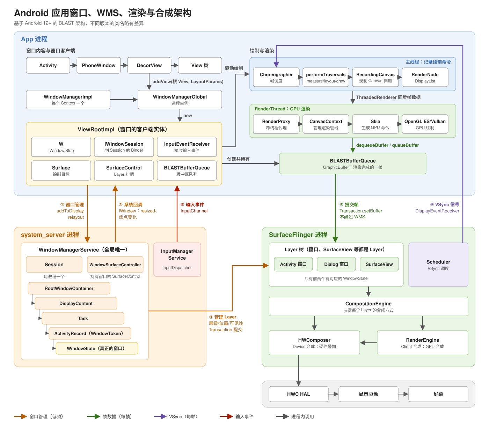

# 图形系统

吐槽点，架构职责不清晰，命名混乱。


## 安卓的实现




## 应用侧


显而易见，但需要说明一下，以便理解窗口系统的设计：窗口的数据帧和合成器在两个独立的进程，两者的抽象对象在各自进程中是自己创建的，应用(客户端)有一套自己的抽象对象。

- 应用侧对窗口管理服务的抽象类是 `WindowManagerGlobal`，它是单例（显而易见，对应的是服务进程的操作入口）对象。用于管理向服务端添加和更改窗口信息。其方法 addView 添加 View 时就会创建一个 `ViewRoomImpl` 用户封装窗口信息。ViewRoomImpl 应该算是 WMG 的内部维护类，创建和销毁都在 WMG 内部完成，不对外暴露。

- ViewRootImpl 用于封装要给窗口信息。叫 `ViewRoot` 是因为它是每个 View 树的根。但其本身不是 View 子类，只实现了 ViewParent 接口。其 vView 指向的是要绘制的最顶级 View, 在 Activity 和 Dialog 中是 DecorView，PopupWindow 则是 PopupLayou。ViewRoomImpl 内部对象 Surface 对象表示一个绘制表面，View 就是绘制在 Surface 背后的图形缓冲区（GraphicBuffer） 里的（这是一个庞大的话题，另起新篇）。


WindowManagerGlobal 和 ViewRoorImpl 用于服务端添加窗口和产生时机的 UI 帧。而应用还需要一些维护窗口信息用于应用窗口操作的类。

混乱的来了，信息维护的类是 PhoneWindow 和 WindowManagerImpl（真是个起名鬼才）。这也是 Activity 中 getWindow() 和 getWindowManager() 获取的对象。但他和上面的 WindowManagerGlobal 职责完全不同，WindowManagerImpl 只是要给代理类，用户将操作传递给 WindowManagerGlobal, 每个 Conntext 创建一个实例。


- Window / PhoneWindow —— 策略模板，不是窗口本身，Window 主要承担这些职责：

- 构造 View 树骨架：PhoneWindow.installDecor()（com/android/internal/policy/PhoneWindow.java:2921）先通过 generateDecor() 创建 DecorView，再通过 generateLayout() 根据主题和 feature 选布局，得到 mContentParent（也就是 android.R.id.content）。
- 持有窗口属性：mWindowAttributes（一个 WindowManager.LayoutParams）。getWindow().setFlags()、setSoftInputMode() 等改的都是它。
- 把事件回调给宿主：Window.Callback（Window.java:355）。Activity 和 Dialog 都实现了它，按键、触摸、菜单、焦点变化都通过它回到 Activity。
- 为“经由它加的窗口”补全参数：adjustLayoutParamsForSubWindow()（Window.java:947），后面会详细讲，这是它和 WindowManagerImpl 连接的关键点。
- 持有自己的 WindowManager：mWindowManager，由 setWindowManager() 创建。


- WindowManagerImpl —— 带上下文的轻量代理。它的 addView 几乎只做两件事：补 token，然后把自己持有的上下文交给 Global。


### 各个类的创建流程

先看各个类的数量和创建时机，一眼就能看出谁是“进程级”、谁是“窗口级”：

| 类 | 数量 | 创建者 | 创建时机 |
| --- | --- | --- | --- |
| `WindowManagerGlobal` | 每进程 1 个（单例） | `WindowManagerGlobal.getInstance()` | 第一个 `WindowManagerImpl` 初始化字段时 |
| `IWindowSession`（`sWindowSession`） | 每进程 1 个 | `WindowManagerGlobal.getWindowSession()` | 第一个 `ViewRootImpl` 构造时 |
| `WindowManagerImpl` | 每个 Context / Window 各 1 个 | `SystemServiceRegistry`、`Window.setWindowManager()` | `getSystemService(WINDOW_SERVICE)`、`Activity.attach()` |
| `PhoneWindow` | 每个 Activity / Dialog 1 个 | `Activity.attach()`、`Dialog` 构造函数 | Activity 创建后，`onCreate` 之前 |
| `DecorView` | 每个 PhoneWindow 1 个 | `PhoneWindow.installDecor()` | 第一次 `setContentView()` / `getDecorView()` |
| `ViewRootImpl` | 每个窗口 1 个 | `WindowManagerGlobal.addView()` | `wm.addView()` 时（Activity 在 `onResume` 之后） |


WindowManagerGlobal 是单例，在第一个调用 getInstance() 被创建的。

```C++
public final class WindowManagerImpl implements WindowManager {
    private final WindowManagerGlobal mGlobal = WindowManagerGlobal.getInstance();
}
```
```
```


Acitivity、Dialog、PopupWindow、Toast 都有自己的 PhoneWindow 和 WindowManagerImpl。以 Activity 启动为例，创建 PhoneWindow 和 WindowManagerImpl 顺序：

```
ActivityThread.handleLaunchActivity()
  └─ performLaunchActivity()
       ├─ ContextImpl appContext = createBaseContextForActivity(r)
       ├─ activity = mInstrumentation.newActivity(...)          // 反射创建 Activity
       ├─ activity.attach(appContext, ..., r.token, ...)
       │    ├─ attachBaseContext(context)
       │    ├─ mWindow = new PhoneWindow(this, window, ...)     // ① 创建 PhoneWindow
       │    ├─ mWindow.setCallback(this)                        // 事件、焦点等回调给 Activity
       │    ├─ mWindow.setWindowManager(
       │    │       (WindowManager) context.getSystemService(Context.WINDOW_SERVICE),
       │    │       mToken, ...)
       │    │    │  // getSystemService 走 SystemServiceRegistry，返回 ContextImpl 级缓存的
       │    │    │  // new WindowManagerImpl(ctx)，此时它的 mParentWindow 为 null
       │    │    └─ mWindowManager = ((WindowManagerImpl) wm).createLocalWindowManager(this)
       │    │         └─ new WindowManagerImpl(mContext, parentWindow = 这个 PhoneWindow, ...)  // ② 
       │    └─ mWindowManager = mWindow.getWindowManager()      // Activity.getWindowManager() 拿到的就是它
       └─ mInstrumentation.callActivityOnCreate()  → onCreate()
            └─ setContentView(layoutResID)
                 └─ PhoneWindow.setContentView()
                      └─ installDecor()
                           ├─ mDecor = generateDecor()          // ③ new DecorView(...)
                           └─ mContentParent = generateLayout(mDecor)
                                // 根据 theme/feature 选系统布局（如 screen_simple.xml）
                                // inflate 到 DecorView 中，找到 id 为 android:id/content 的 FrameLayout
                      └─ mLayoutInflater.inflate(layoutResID, mContentParent)  // 我们的布局挂到 content 下
```


注意到这里：**到 `onCreate` 结束为止，只有 PhoneWindow 和 DecorView，没有 ViewRootImpl，也没有和 WMS 发生窗口相关的交互**。View 树已经有了，但还没“挂”到窗口上。这也是为什么在 `onCreate` 里拿不到 View 宽高（还没 measure），以及 `onCreate` 里在子线程更新 UI 不会崩（`checkThread()` 在 ViewRootImpl 里，此时它还不存在）。

### View 的添加和移除流程

#### 添加

Activity 的 DecorView 是在 resume 阶段添加的：

```
ActivityThread.handleResumeActivity()
  ├─ performResumeActivity()  → onResume()
  └─ if (r.window == null && !a.mFinished && willBeVisible)
       ├─ r.window = a.getWindow()
       ├─ View decor = r.window.getDecorView()
       ├─ decor.setVisibility(View.INVISIBLE)           // 先不可见
       ├─ WindowManager.LayoutParams l = r.window.getAttributes()
       ├─ l.type = TYPE_BASE_APPLICATION
       └─ wm.addView(decor, l)                          // wm = a.getWindowManager()
  ...
  └─ r.activity.makeVisible()  → mDecor.setVisibility(View.VISIBLE)
```

`addView` 一路往下：

```C++
val textView = TextView(this).apply {
    text = "window"
    textSize = 18f
    setTextColor(Color.BLACK)
    setBackgroundColor(Color.WHITE)
}
val parent = WindowManager.LayoutParams(
    WindowManager.LayoutParams.WRAP_CONTENT,
    WindowManager.LayoutParams.WRAP_CONTENT, 0, 0, PixelFormat.TRANSPARENT
)
parent.type = WindowManager.LayoutParams.TYPE_APPLICATION
parent.flags =
    WindowManager.LayoutParams.FLAG_NOT_TOUCH_MODAL or WindowManager.LayoutParams.FLAG_NOT_FOCUSABLE
parent.gravity = Gravity.END or Gravity.BOTTOM
parent.y = 500
parent.x = 100
windowManager.addView(textView, parent)

```

Type 窗口属性
Type 参数表示 Window 的类型，Window 分三种类型，对应着三种层级，如下：

Window 类型层级范围说明应用 Window1 ~ 99对应着一个 Activity子 Window1000 ~ 1999不能单独存在，需要附属在特定的 Window 之中，例如常见的 Dialog、PopupWindow，就是子 Window。系统 Window2000 ~ 2999需要声明权限才能创建的 Window例如 Toast 和 系统状态栏这些都是系统的 Window

子 Window 无法单独存在，必须依赖父级 Window，例如 PopWindow 必须依赖 Activity
Window 分层，在显示时层级高的会覆盖层级低的窗口

Flags窗口的标志
Flags 表示 Window 的属性，它有多选项，通过这些可以通知 Window 显示的特性，例如：


Floags特性FLAG_NOT_FOCUSABLE表示 Window 不需要获取焦点，也不需要各种输入事件，此标记通同时启用 FLAG_NOT_TOUCH_MODAL最终事件会直接传递给下层具有焦点的 Window。FLAG_NOT_TOUCH_MODAL将 Window 区域以外的单击事件传递给底层的 Window，当前 Window 内的单击事件自己处理，一般都要开启此事件，否则其他 Window 无法收到单击事件FLAG_SHOW_WHEN_LOCKED可以将 Window 显示在锁屏的界面上FLAG_TURN_SCREEN_ONWindow 显示时将屏幕点亮


```
WindowManagerImpl.addView(view, params)
  └─ mGlobal.addView(view, params, display, mParentWindow, userId)

WindowManagerGlobal.addView()
  ├─ if (parentWindow != null) parentWindow.adjustLayoutParamsForSubWindow(wparams)
  │     // 给 LayoutParams 填 token：应用窗口填 Activity 的 mAppToken，子窗口填父窗口的 W
  ├─ synchronized (mLock)
  │    ├─ findViewLocked(view)：同一个 View 重复添加 → IllegalStateException
  │    │     （如果是正在销毁的 mDyingViews，则先立即 doDie()）
  │    ├─ root = new ViewRootImpl(view.getContext(), display)      // ④ 创建 ViewRootImpl
  │    ├─ view.setLayoutParams(wparams)
  │    ├─ mViews.add(view); mRoots.add(root); mParams.add(wparams)  // 三个列表下标一一对应
  │    └─ root.setView(view, wparams, panelParentView, userId)
  │          // 失败则把刚加入的三项移除并抛出异常
```

ViewRootImpl 构造函数里准备好与 WMS、渲染相关的成员：

```java
mWindowSession = WindowManagerGlobal.getWindowSession();  // 进程共享的 Session
mWindow = new W(this);              // IWindow.Stub，WMS 回调客户端用（resized、焦点变化等）
mThread = Thread.currentThread();   // checkThread() 比较的就是这个线程
mAttachInfo = new View.AttachInfo(mWindowSession, mWindow, display, this, mHandler, this, context);
mChoreographer = Choreographer.getInstance();
mSurface = new Surface();           // 此时是空壳，relayout 后才有效
mSurfaceControl = new SurfaceControl();
```

`setView()` 是真正和 WMS 打交道的地方：

```
ViewRootImpl.setView(view, attrs, panelParentView, userId)
  ├─ mView = view
  ├─ enableHardwareAcceleration(attrs)        // 创建 ThreadedRenderer，放到 mAttachInfo 里
  ├─ requestLayout()                          // checkThread() + scheduleTraversals()
  │     // 只是向 Choreographer 投递，要等下一个 VSYNC 才执行，所以一定晚于下面的 addToDisplay
  ├─ inputChannel = new InputChannel()
  ├─ res = mWindowSession.addToDisplayAsUser(mWindow, mWindowAttributes, ..., inputChannel, ...)
  │     // Binder → system_server
  │     └─ Session.addToDisplayAsUser() → WMS.addWindow()
  │          ├─ 权限、窗口类型、token 校验
  │          │     token 不合法时返回 ADD_BAD_APP_TOKEN 等错误码
  │          ├─ win = new WindowState(...)    // 服务端的窗口对象，与客户端 ViewRootImpl 对应
  │          ├─ win.openInputChannel(inputChannel)  // 建立输入通道，客户端拿到一端
  │          ├─ win.attach()
  │          ├─ mWindowMap.put(client.asBinder(), win)   // 以 W 的 binder 为 key
  │          └─ win.mToken.addWindow(win)     // 挂到 WindowToken / ActivityRecord 下，进入窗口层级树
  ├─ if (res < ADD_OKAY) 抛出 BadTokenException / InvalidDisplayException 等
  ├─ mInputEventReceiver = new WindowInputEventReceiver(inputChannel, Looper.myLooper())
  └─ view.assignParent(this)                  // DecorView.getParent() == ViewRootImpl
```

接下来第一个 VSYNC 到来，执行第一次 `performTraversals()`：

```
performTraversals()  （第一次，mFirst == true）
  ├─ host.dispatchAttachedToWindow(mAttachInfo, 0)   // 整棵树 onAttachedToWindow()，mAttachInfo 下发给每个 View
  ├─ relayoutWindow()
  │     └─ mWindowSession.relayout(...) → WMS.relayoutWindow()
  │          └─ 创建 SurfaceControl（SurfaceFlinger 中对应一个 Layer）
  │     └─ 创建 BLASTBufferQueue，mSurface 变为有效
  ├─ mAttachInfo.mThreadedRenderer.initialize(mSurface)
  ├─ performMeasure() / performLayout()
  └─ performDraw()     // 后续流程见 draw_frame.html
```

至此 View 才真正显示出来。整个关系可以总结为：

```
Activity
  ├─ mWindow: PhoneWindow
  │     ├─ mDecor: DecorView ──────────────┐
  │     └─ mWindowManager: WindowManagerImpl  │ (同一个)
  └─ mWindowManager ─────────┘               │
                │ 转发                         │
                ▼                              │
        WindowManagerGlobal（进程单例）         │
          mViews  ─────────────────────────────┘
          mRoots  ──→ ViewRootImpl ──mView──→ DecorView
                         ├─ mWindow: W          ←── WMS 回调
                         ├─ mWindowSession      ──→ Session ──→ WMS: WindowState
                         └─ mSurface            ──→ BLASTBufferQueue ──→ SurfaceFlinger: Layer
```

#### Dialog 和 PopupWindow 的添加

两者走的是同一条 `wm.addView()` 路径，区别只在 window 和 token：

- **Dialog**：构造函数中 `new PhoneWindow(mContext)`，`mWindowManager = context.getSystemService(WINDOW_SERVICE)`。如果 context 是 Activity，`Activity.getSystemService()` 会返回 Activity 的 `mWindowManager`，它的 `mParentWindow` 是 Activity 的 PhoneWindow，`adjustLayoutParamsForSubWindow()` 会把 Activity 的 token 填进去。`show()` 时 `mWindowManager.addView(mDecor, l)`。
  用 Application Context 创建 Dialog 时，`mParentWindow` 为 null，token 也为 null，WMS 校验失败，就会报经典的 `BadTokenException: Unable to add window -- token null is not valid; is your activity running?`。
- **PopupWindow**：没有 PhoneWindow，自己创建 `PopupDecorView` 作为根 View，窗口类型是 `TYPE_APPLICATION_PANEL`（子窗口），token 取自 anchor View 的 `getWindowToken()`（即父窗口的 W）。所以 anchor 必须已经 attach 到窗口上，否则同样会 BadToken。

#### 移除

Activity 销毁时：

```
ActivityThread.handleDestroyActivity()
  ├─ performDestroyActivity()  → onDestroy()
  ├─ wm.removeViewImmediate(r.activity.mDecor)
  └─ WindowManagerGlobal.getInstance().closeAll(token, ...)   // 清掉挂在该 token 下的其它窗口（如未关闭的 Dialog）
```

```
WindowManagerImpl.removeView / removeViewImmediate
  └─ mGlobal.removeView(view, immediate)
       └─ removeViewLocked(index, immediate)
            └─ deferred = root.die(immediate)
                 ├─ immediate && !mIsInTraversal → doDie()    // 立即销毁
                 └─ 否则 mHandler.sendEmptyMessage(MSG_DIE)    // 异步销毁，返回 true
            └─ deferred 为 true 时 mDyingViews.add(view)

ViewRootImpl.doDie()
  ├─ checkThread()
  ├─ if (mAdded) dispatchDetachedFromWindow()
  │     ├─ mView.dispatchDetachedFromWindow()     // 整棵树 onDetachedFromWindow()
  │     ├─ destroyHardwareRenderer()             // 销毁 ThreadedRenderer
  │     ├─ mView.assignParent(null); mView = null
  │     ├─ mInputEventReceiver.dispose()
  │     ├─ mWindowSession.remove(mWindow)        // Binder → WMS.removeWindow() → WindowState.removeIfPossible()
  │     └─ mSurface.release()
  ├─ mAdded = false
  └─ WindowManagerGlobal.getInstance().doRemoveView(this)   // 从 mRoots / mParams / mViews / mDyingViews 中移除
```

`removeView()` 是异步的，`removeViewImmediate()` 是同步的。Activity 销毁用 Immediate，因为后面马上要 closeAll 并释放资源。
如果 Activity 已经销毁，但 Dialog 没有 dismiss，`closeAll` 会帮忙移除，并打印 `WindowLeaked` 日志（`has leaked window ... that was originally added here`）。


[Protetto 帮助理解图形架构:一帧从 app 到上屏的  systrace 图示](https://mp.weixin.qq.com/s/qHG4bwqqmxyWfWA9-GXy-w)
