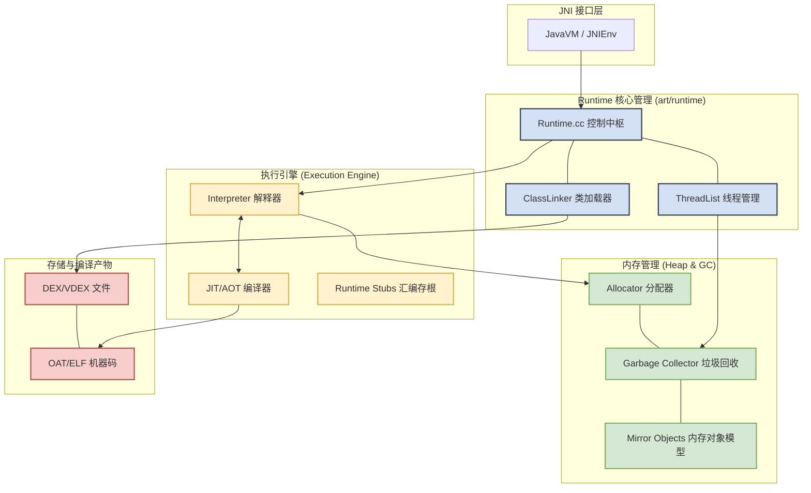

#  Java 虚拟机

JVM 虚拟机本身是一个 Native 程序。之所以称为虚拟机，在于其定义了完整的指令和调用约定，抽象了底层硬件的差异，抽象模型为一台虚拟的计算机。java 程序执行最终还是调用 native 程序完成对应的操作。

Android 最开始用的是 Dalvik，Dalvik 虚拟机是基于 apache 的 java虚拟机，并被改进以适应低内存，低处理器速度的移动设备环境。而 4.4 开始使用 ART 虚拟机。

> Dalvik 虚拟机相比通用虚拟机的差异

| Java虚拟机 |  Dalvik虚拟机 |
| --------- | ------------ |
| `java` 虚拟机基于栈，基于栈的机器必须使用指令来载入和操作栈上数据 | `Dalvik` 虚拟机基于寄存器 |
| `java` 虚拟机运行的是 `java` 字节码。（java 类会被编译成一个或多个字节码 `.class` 文件，打包到 `.jar` 文件中，`java` 虚拟机从相应的  `.jar` 包中读取　`.class` 文件获取字节码） | `Dalvik` 运行的是自己专属的 `.dex` 字节码格式。（`java` 类被编译成 `.class` 文件后，会通过一个 `dx` 工具将所有的 `.class` 文件转换成一个 `.dex` 文件，然后 `dalvik` 虚拟机会从其中读取指令和数据） |
| `JVM` 在运行的时候为按需装载类的字节码 | `Dalvik` 程序包含一个或多个 `.dex` 文件，这个文件包含了程序中所有的类，需要在文件中按需读取。 |

之所以使用 dex 字节码也是因为上面这些改动 jvm 字节码已无法支持，所以进一步改进，将 jvm 字节码转换成 dex 字节码。

**标准对于 JNI_CreateJavaVM 定义模糊，没有规定一个进程创建的数量，但极其罕见且官方不推荐（不像js的 runtime），几乎所有商用 JVM 都是进程与实例 1:1 对应。**

> Dalvik　与　Art（Android Runtime）的区别：

| Dalvik | ART（Android Runtime） |
| ------ | ---------------------- |
| 每次运行时，字节码都需要通过即时编译器（JIT）转换为机器码，会拖慢应用运行效率。 | 首次运行前将字节码编译成机器指令，运行时无需再次编译，运行效率更高。 |
| 占用空间相对更小。 | 占用空间更大（原生代码占用的存储空间更大），属于“空间换时间”。 |
| 解释执行，只有热点代码被编译，执行效率低。 | 一次编译，机器执行效率更高，电池续航表现更好。 |
| 应用启动和运行速度相对较慢。 | 应用启动更快、运行更快，体验更流畅、触感反馈更及时。 |


[Android Native 内存越用越多，会不会触发GC？](https://mp.weixin.qq.com/s/AIRwBlS3D3aPBF6M2qySbw)
[Java虚拟机基础——4内存回收机制](https://cloud.tencent.com/developer/article/1353027)
[ART虚拟机内存分配原理浅析](https://cloud.tencent.com/developer/article/2400064)


# Art 虚拟机

Art 虚拟机包含几个部分：
1. 编译器：AOT (Ahead-Of-Time) 编译器，运行前将 Dex 编译为机器码。
2. 运行时：
    JIT (Just-In-Time) 编译器
    解释器 (Interpreter)。

即便程序已经通过 dex2oat 进行了 AOT（预编译），**在运行时依然需要 JIT**。
这听起来可能有些反直觉——既然已经有机器码了，为什么还要动态编译？这主要是因为 ART 采用的是**“全时段混合编译”**策略，原因如下：

**1. 解决“部分编译”问题（Profile-Guided Optimization）**

现在的 Android 为了兼顾安装速度和存储空间，通常不会在安装时把 APK 里的所有代码都编译成机器码。
- **初次安装**：系统可能只对启动相关的“热点”代码进行 AOT 编译（生成 Profile 文件）。
- **JIT 的角色**：在应用运行过程中，如果用户进入了 AOT 没覆盖到的“冷代码”区域，解释器会接管。此时 JIT 依然会监控这些代码，如果它们变热，JIT 会立即将它们编译成机器码，而不需要等待下一次系统空闲时的 AOT 扫描。

**2. 运行时动态优化（PGO 的闭环）**
JIT 不仅仅是编译工具，它还是一个**“数据收集器”**：
- JIT 在运行时会收集真实的调用轨迹（哪些方法是真正的高频调用）。
- 这些数据会被保存到 .prof（Profile）文件中。
- **重点**：即便某段代码已经有 AOT 机器码，JIT 有时仍会参与分析，以便在下次设备空闲充电时，让 dex2oat 根据这些最新的 Profile 数据生成更优的 AOT 代码。

**3. 处理内联和去优化（Deoptimization）**

虚拟机有时会进行一些**“激进优化”**（比如假设某个接口只有一个实现类并进行内联）。

- 如果在运行时，由于动态加载了新的类，导致之前的优化假设失效，虚拟机必须执行**“去优化”**，回退到解释模式。
- 这时，JIT 必须重新介入，根据新的环境重新编译代码。



```
+-----------------------------------------------------------------------+

|                       JNI 外部接口层 (JNI Interface)                   |
|      (JNI_CreateJavaVM / JNIEnv / HostRuntime.cpp 调用入口)           |
+-------------------+---------------------------------------------------+

                    |
                    v
+-----------------------------------------------------------------------+
|                  ART 核心运行时 (art/runtime)                          |
|                                                                       |
|  [ Runtime.cc ] <----------+------> [ Class Linker ]                  |
|   (全局控制中枢)             |       (类加载/解析/DEX文件链接)           |
|          |                 |               |                          |
|          v                 |               v                          |
|  [ Thread List ]           |       [ Mirror Objects ]                 |
|   (线程管理/调度)            |       (Java 对象在 C++ 层的内存映射)       |
+----------+-----------------+---------------+--------------------------+

           |                                 |
           v                                 v
+-----------------------+         +-------------------------------------+

|   执行引擎 (Execution) |         |     内存管理 (Memory / Heap)        |
|                       |         |                                     |
|  [ Interpreter ]      |         |  [ Allocator ] (对象分配)            |
|   (Mterp 解释执行)     |         |                                     |
|          ^            |         |  [ Garbage Collector ]              |
|          | (热点切换)  | <-----> |   (CC GC / 用户态页故障回收)          |
|          v            |         |                                     |
|  [ JIT / AOT ]        |         |  [ Memory Spaces ]                  |
|   (编译器/优化)         |         |   (Zygote/Image/App 内存分区)       |
+----------+------------+         +-------------------------------------+

           |
           v
+-----------------------------------------------------------------------+
|                      底层存储与文件 (Storage)                          |
|                                                                       |
|   [ .DEX / .VDEX ]  <----------->  [ .OAT / .ELF ]                    |
|    (原始字节码)                     (本地机器码)                       |
+-----------------------------------------------------------------------+

```


初始化：
```C++
// frameworks/base/core/jni/AndroidRuntime.cpp
int AndroidRuntime::startVm(JavaVM** pJavaVM, JNIEnv** pEnv, bool zygote, bool primary_zygote) {
    ...
    JNI_CreateJavaVM(&mJavaVM, (void**)&mEnv, &options);
    ...
}
```

ark 实现 JNI_CreateJavaVM

```C++
```


## JVM 的创建流程

内部会 `Runtime::Create()` → `Runtime::Init()`:初始化堆/GC、`ClassLinker`、加载启动镜像 `boot.art`/`boot.oat` 等。**这一层已属于 ART 内部**,想深入可从 `art/runtime/runtime.cc` 看起;本文到"虚拟机已就绪"为止。

| ART 内部(选修) | `art/runtime/runtime.cc`、`art/runtime/jni/java_vm_ext.cc` | `Runtime::Create/Init`、`JNI_CreateJavaVM` |


- [虚拟机]
    - [虚拟机内存分配](create_object.md)
    - [内存管理](memory_manage.md)