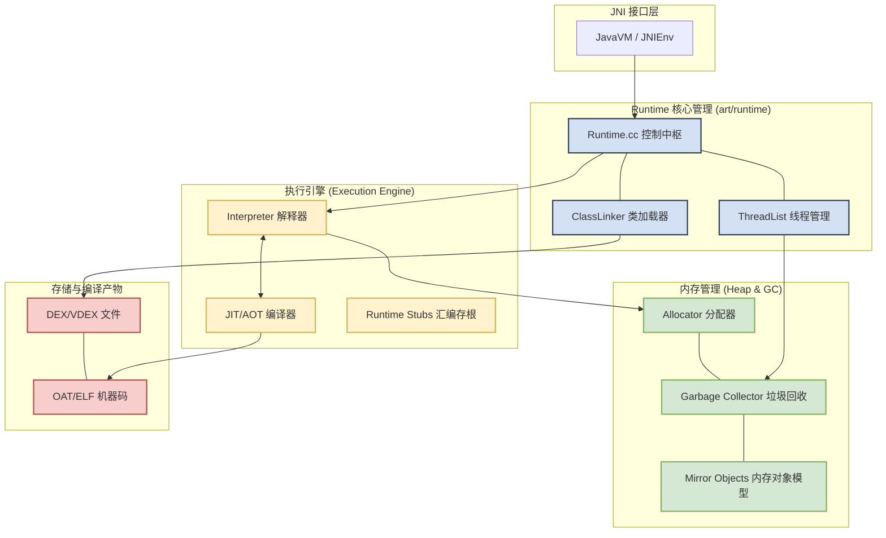
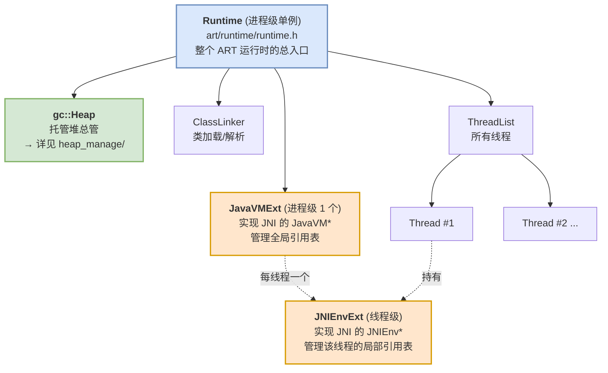

# ART 虚拟机架构

> 目标：搞清楚 ART 由哪几个模块组成、各自负责什么、彼此如何协作。本篇是全局地图。


## 组成模块一览

ART 大致可分为四层：**JNI 接口层 → 核心运行时 → 执行引擎 / 内存管理 → 存储与编译产物**。



| 层 | 模块 | 职责 | 深入 |
|---|---|---|---|
| **JNI 接口层** | `JavaVM` / `JNIEnv` | JNI 规范入口，Native 与 Java 互调、引用管理 | 见下文「运行时门面对象」 |
| 核心运行时 | `Runtime` | 进程级单例，持有并串联所有子系统 | 见下文 |
| | `ClassLinker` | 类的加载、解析、链接（DEX → Class） | 本仓库暂不深入 |
| | `ThreadList` | 所有线程的注册、调度、GC 时的挂起协调 | 本仓库暂不深入 |
| 执行引擎 | `Interpreter` | 逐条解释执行字节码（冷代码、去优化回退） | 本仓库暂不深入 |
| | `JIT / AOT` | 把字节码编译成机器码（详见下文混合编译） | 本仓库暂不深入 |
| **内存管理** | `Heap` / `Allocator` / `GC` / `Mirror` | **对象分配与垃圾回收——本仓库重点** | **[heap_manage/](heap_manage/README.md)** |
| 存储 | DEX/VDEX、OAT/ELF | 字节码与本地机器码的磁盘格式 | 本仓库暂不深入 |

---

## 混合编译：AOT / JIT / 解释器三者共存

ART 的执行引擎不是单一的，而是**「全时段混合编译」**：即便应用已经通过 `dex2oat` 做了 AOT 预编译，运行时依然会用到 JIT 和解释器。原因有三：

**1. 解决「部分编译」问题（Profile-Guided Optimization）**

为兼顾安装速度与存储空间，系统通常不会在安装时编译 APK 里的全部代码：
- **初次安装**：可能只对启动相关的「热点」代码做 AOT，生成 Profile。
- **JIT 的角色**：运行中若进入 AOT 没覆盖的「冷代码」，解释器接管；一旦这些代码变热，JIT 立即将其编译为机器码，无需等下一次系统空闲的 AOT 扫描。

**2. 运行时动态优化（PGO 闭环）**

JIT 同时是「数据收集器」：运行时收集真实调用轨迹，写入 `.prof` 文件；设备空闲充电时，`dex2oat` 依据最新 Profile 生成更优的 AOT 代码。

**3. 处理内联与去优化（Deoptimization）**

虚拟机会做「激进优化」（如假设某接口只有一个实现类并内联）。若运行时动态加载了新类导致假设失效，必须「去优化」回退到解释模式，JIT 再根据新环境重新编译。

> 对比 Dalvik：Dalvik 每次运行都靠 JIT 把字节码转机器码，启动慢、续航差；ART 以 AOT 为主、JIT/解释器为辅，属于「空间换时间」。

---

## 运行时门面对象：`Runtime` / `JavaVM` / `JNIEnv`

在 ART 的 C++ 世界里，几个门面对象决定了「谁持有谁」。初学者最容易把它们搞混，先厘清从属关系：



| 对象 | 数量 | 角色 | 你在什么时候接触它 |
|---|---|---|---|
| **`Runtime`** | 进程 1 个（单例） | ART 运行时总入口，`Runtime::Current()` 随处可取；持有 `Heap`、`ClassLinker`、`ThreadList`、`JavaVMExt` 等所有子系统 | 源码里 `Runtime::Current()->GetHeap()` 是取堆的标准姿势 |
| **`gc::Heap`** | 进程 1 个 | 托管堆的总管，持有全部 `Space` 与 GC 收集器 | 内存管理主角，详见 [heap_manage/](heap_manage/README.md) |
| **`JavaVM`（`JavaVMExt`）** | 进程 1 个 | JNI 规范里的「虚拟机」句柄，管理**全局引用** | NDK 里 `JNI_OnLoad(JavaVM* vm, ...)` 拿到的就是它 |
| **`JNIEnv`（`JNIEnvExt`）** | **每线程 1 个** | JNI 规范里的「线程上下文」句柄，管理该线程的**局部引用** | 每个 native 方法第一个参数 `JNIEnv* env` 就是它 |

两个关键点，理解了能少踩一半 JNI 的坑：

1. **`JavaVM` 全进程唯一，`JNIEnv` 每线程独立。** `JNIEnv*` 不能跨线程传递；换线程要用 `JavaVM->AttachCurrentThread()` 拿当前线程自己的 `JNIEnv*`。
2. **`Runtime` 是「持有」关系的根。** `Heap`、`JavaVMExt` 都是它的成员——这正是 GC 能「掌控全局」的原因：枚举 GC Root 时要同时看线程栈和 JNI 引用表，它们同属一个 `Runtime`。

```cpp
// 源码：art/runtime/runtime.h（节选关键成员，只看数据结构关系）
class Runtime {
  gc::Heap* heap_;                 // 托管堆
  ClassLinker* class_linker_;      // 类加载
  ThreadList* thread_list_;        // 所有线程
  JavaVMExt* java_vm_;             // JNI 的 JavaVM 实现
  // 取用方式：Runtime::Current()->GetHeap() / GetJavaVM() / ...
};
```

> **JNI 引用为什么分全局/局部？** 也是为了 GC：native 侧持有的 Java 引用也是 GC Root。局部引用生命周期短（一次调用内），放每线程的 `JNIEnv`，返回即清；全局引用要跨调用/跨线程存活，放进程级 `JavaVM`，必须手动 `DeleteGlobalRef`——忘了就是经典 JNI 泄漏。细节见 [04 GC 原理篇](heap_manage/04_gc_principles.md)。


> 记住这张图，后面每一篇讲的东西，几乎都挂在 `Runtime` 这棵树的某个枝上：Space 挂在 `Heap` 下（[02](02_heap_and_spaces.md)），分配器是 `Heap` 的一部分（[03](03_allocation.md)），GC Root 的一部分来自 `JavaVMExt`/`ThreadList`（[04](04_gc_principles.md)）。
