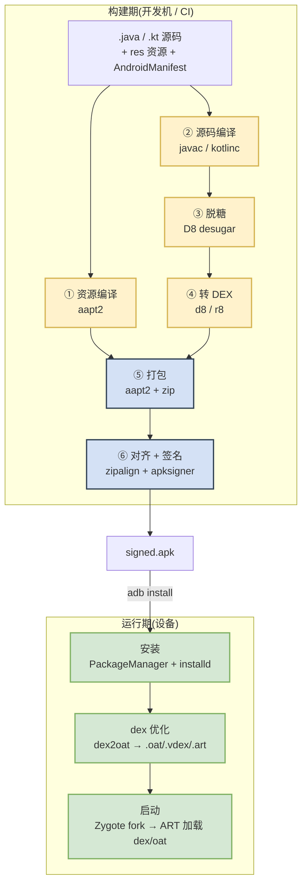
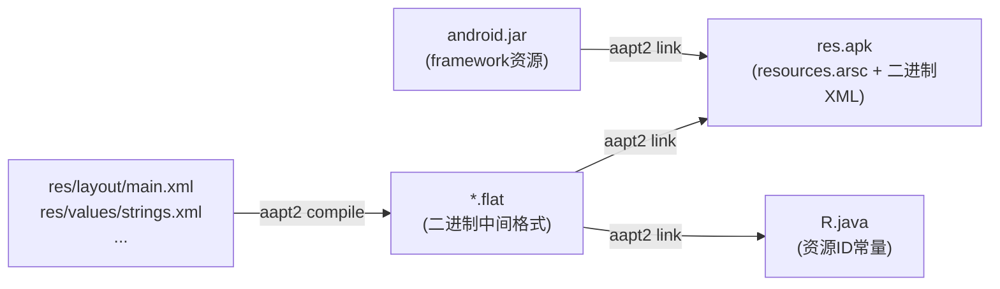
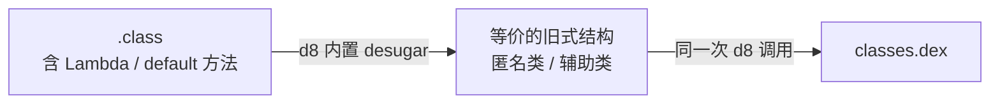
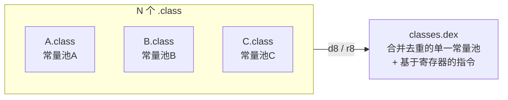
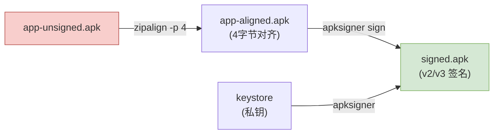
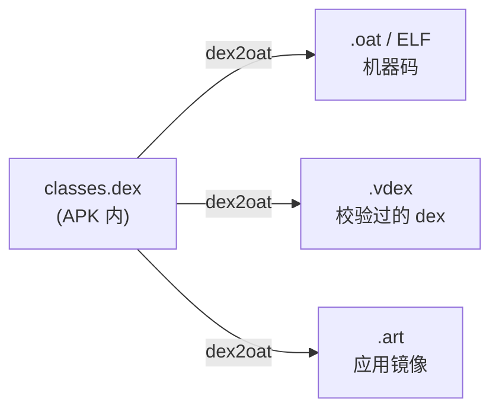
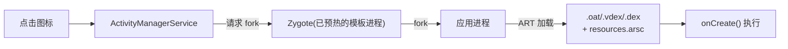

# 安卓应用从编译到运行的全过程（可手动复现）

> 目标：把一个 Android 应用从**源码**到**在设备上跑起来**的每一步拆开，每个阶段说清用到的**工具**、**输入产物**、**输出产物**，并给出可以**手动复现**的命令。看完你能脱离 Gradle，自己用命令行把 `.java` 一路搓成能安装、能运行的 `.apk`，并理解运行时 ART 到底加载了什么。

本文与 [ART 虚拟机架构](architecture.md)、[ART 虚拟机创建流程](startup.md) 互为补充：那两篇讲「虚拟机是什么、怎么起来的」，本篇讲「你的代码是怎么变成虚拟机能吃的东西的」。

---

## 先看全景：两条主线，六个阶段

一个 App 的生命，可以切成「构建期（Build Time，在你的开发机上）」和「运行期（Run Time，在设备上）」两条主线。



一句话串起来：**源码 + 资源 →（编译）→ `.class` + 编译后的资源 →（转换）→ `.dex` →（打包 + 签名）→ `.apk` →（安装 + dex2oat）→ 设备上的机器码 →（Zygote fork）→ 进程跑起来**。

下面逐段拆。每一段都遵循同一个模板：**这一步在干嘛 → 用什么工具 → 手动复现命令 → 产物长什么样**。

---

## 阶段总览表

先给一张速查表，后文逐行展开。工具都在 Android SDK 里（`$ANDROID_SDK_ROOT`），下文假设已配好环境变量。

| 阶段 | 工具 | 输入 | 输出 | 所在目录 |
|---|---|---|---|---|
| ① 资源编译 | `aapt2 compile` | `res/**` | `*.flat` | `build-tools/<ver>/aapt2` |
| ① 资源链接 | `aapt2 link` | `*.flat` + `android.jar` | `res.apk` + `R.java` | 同上 |
| ② 源码编译 | `javac` / `kotlinc` | `.java`/`.kt` + `R.java` | `.class` | JDK / Kotlin |
| ③ 脱糖 | `d8`（内置 desugar） | `.class` | 兼容旧版本的 `.class`/`.dex` | `build-tools/<ver>/d8` |
| ④ 转 DEX | `d8`（debug）/ `r8`（release） | `.class` + `android.jar` | `classes.dex` | `build-tools/<ver>/` |
| ⑤ 打包 | `aapt2 link` / `zip` | `res.apk` + `classes.dex` | 未签名 `.apk` | `build-tools/<ver>/` |
| ⑥ 对齐 | `zipalign` | 未签名 `.apk` | 对齐后的 `.apk` | `build-tools/<ver>/zipalign` |
| ⑥ 签名 | `apksigner` | 对齐后的 `.apk` + keystore | 已签名 `.apk` | `build-tools/<ver>/apksigner` |
| 安装 | `adb install` | 已签名 `.apk` | 设备上的应用 | `platform-tools/adb` |
| dex 优化 | `dex2oat` | `.dex` | `.oat`/`.vdex`/`.art` | 设备 `/apex/com.android.art/bin/` |

> **Gradle / AGP 做了什么？** 上面每一个工具，Gradle 的 Android Gradle Plugin（AGP）都帮你自动串好了，`./gradlew assembleDebug` 内部就是按顺序调这些工具。本文的意义在于把这层「魔法」拆开——理解了手动流程，你就能读懂 build 报错、优化包体、排查 dex 问题。

---

## ① 资源编译与链接：`aapt2`

### 这一步在干嘛

`res/` 目录下的 `layout/`、`drawable/`、`values/`、`AndroidManifest.xml` 这些**不是代码**，是资源。它们要经过 **AAPT2（Android Asset Packaging Tool 2）** 处理，做两件事：

1. **compile（编译）**：把每个资源文件编译成二进制中间格式 `.flat`（XML 变成二进制 XML，节省解析开销）。
2. **link（链接）**：把所有 `.flat` 合并，分配资源 ID，生成 `resources.arsc`（资源表）、打包成一个只含资源的 `res.apk`，同时**生成 `R.java`**——那个让你能在代码里写 `R.layout.activity_main` 的类。



### 为什么需要 `android.jar`

链接时要传 `-I android.jar`。这个 jar 在 `$ANDROID_SDK_ROOT/platforms/android-<API>/android.jar`，里面是 **framework 的公开 API 桩（stub）**——只有方法签名、没有实现（实现在设备的 `boot.oat` 里）。它同时提供了系统资源（`android.R.*`）。编译期用它做符号解析，运行期由设备的真实 framework 顶上。

### 手动复现

```bash
# 目录约定
AAPT2=$ANDROID_SDK_ROOT/build-tools/34.0.0/aapt2
ANDROID_JAR=$ANDROID_SDK_ROOT/platforms/android-34/android.jar

# 1. 编译每个资源目录到 .flat（这里编译整个 res/）
$AAPT2 compile --dir res -o compiled_res.zip

# 2. 链接：产出资源 apk + R.java，manifest 必须传
$AAPT2 link \
    -o res.apk \
    -I $ANDROID_JAR \
    --manifest AndroidManifest.xml \
    --java gen/ \
    -R compiled_res.zip \
    --auto-add-overlay
# 产物：res.apk（含 resources.arsc）、gen/<包名>/R.java
```

### 产物长什么样

```bash
unzip -l res.apk
#  AndroidManifest.xml   (二进制 XML)
#  resources.arsc        (资源表：ID → 值)
#  res/layout/main.xml   (二进制 XML)
#  ...

cat gen/com/example/app/R.java
# public final class R {
#   public static final class layout { public static final int main=0x7f0b0001; }
#   public static final class string { public static final int app_name=0x7f0f0000; }
# }
```

那个 `0x7f0b0001` 就是资源 ID：高字节 `7f` 是包（app 自己），中间是类型，低字节是序号。运行时靠这个 ID 去 `resources.arsc` 查真正的值。

---

## ② 源码编译：`javac` / `kotlinc`

### 这一步在干嘛

标准的 Java/Kotlin 编译，把 `.java`/`.kt` 编译成 **JVM 字节码 `.class`**。注意：**这一步产出的还是标准 JVM 字节码，不是 Android 的 DEX**。Android 只是复用了「先编成 `.class`」这半程，DEX 转换在下一步。

编译时 classpath 要包含两样东西：
- `android.jar`：framework API（同上）。
- 上一步生成的 `R.java`：否则代码里的 `R.layout.main` 无法解析。

### 手动复现

```bash
# Java
javac \
    -classpath $ANDROID_JAR \
    -d classes/ \
    $(find src gen -name '*.java')
# 产物：classes/com/example/app/*.class

# Kotlin（如果用 Kotlin）
kotlinc \
    -classpath $ANDROID_JAR \
    -d classes/ \
    src/**/*.kt
```

### 产物长什么样

```bash
javap -c -p classes/com/example/app/MainActivity.class
# 反编译出 JVM 字节码：
#   public void onCreate(android.os.Bundle);
#     Code:
#        0: aload_0
#        1: aload_1
#        2: invokespecial #12  // Activity.onCreate
#        ...
```

这里是**基于栈**的 JVM 字节码（`aload`/`invokespecial`……）。而 Android 的 Dalvik/ART 是**基于寄存器**的——两者指令模型不同，这正是下一步 `d8` 要做转换的原因（对比见 [README 的 Dalvik vs JVM 表](README.md#dalvik-与-jvm--art-的区别)）。

---

## ③ 脱糖（Desugaring）：`d8` 内置

### 这一步在干嘛

「脱糖」= 把新语法的「语法糖」翻译成旧设备也能跑的等价形式。因为一个 App 的 `minSdkVersion` 可能很低，而你想用新语言特性：

- Java 8 的 **Lambda / 方法引用** → 转成匿名类或 `invoke-custom`。
- **接口的 default / static 方法** → 在低版本上没有原生支持，脱糖器生成辅助类。
- **`try-with-resources`**、部分 `java.time`、`java.util.stream` 等 API → 库脱糖（library desugaring）补齐。

现代工具链里，脱糖**内置在 `d8`/`r8` 里**，转 DEX 时顺带做，通常不需要你单独调一步。历史上曾有独立的 `desugar` 工具，现已并入 D8。



> 记住：**脱糖不是独立阶段，是 d8 转 DEX 时的一个内部环节**。单列出来是为了让你知道「为什么低版本设备能跑 Lambda」。

---

## ④ 转 DEX：`d8`（Debug）/ `r8`（Release）

### 这一步在干嘛

这是 Android 独有的关键一步：把 **JVM 字节码 `.class`（基于栈）** 转换成 **DEX 字节码（基于寄存器）**，输出 `classes.dex`。

- **`d8`**：默认 dexer，纯转换 + 脱糖，速度快，debug 构建用它。
- **`r8`**：`d8` 的超集，release 构建用它。除了转 DEX，还做**代码压缩（shrink，删无用类/方法）、混淆（obfuscate，改短名字）、优化（optimize，内联等）**——即取代了老的 ProGuard。

为什么要 DEX 而不直接用 `.class`？因为 Android 设备内存/存储紧张，DEX 做了**常量池合并去重**：多个 `.class` 各有一份字符串/类型常量池，合并成一个 `.dex` 后共享一份，体积显著更小。这也是「一个 dex 装全部类」而非「一个 class 文件一个类」的由来。



### 手动复现

```bash
D8=$ANDROID_SDK_ROOT/build-tools/34.0.0/d8

# debug：直接转
$D8 \
    --lib $ANDROID_JAR \
    --min-api 24 \
    --output dex_out/ \
    $(find classes -name '*.class')
# 产物：dex_out/classes.dex

# release：用 r8 顺带压缩混淆（需要 rules 文件）
R8=$ANDROID_SDK_ROOT/build-tools/34.0.0/r8   # 或 java -jar r8.jar
$R8 \
    --release \
    --lib $ANDROID_JAR \
    --min-api 24 \
    --pg-conf proguard-rules.pro \
    --output dex_out/ \
    $(find classes -name '*.class')
```

### 产物长什么样

```bash
# dexdump 是 build-tools 里的 DEX 反汇编器
$ANDROID_SDK_ROOT/build-tools/34.0.0/dexdump -d dex_out/classes.dex | head -40
# Class #0 - 'Lcom/example/app/MainActivity;'
#   virtual method onCreate
#     0000: invoke-super {v1, v2}, Landroid/app/Activity;.onCreate:(...)V
#     0003: ...
```

注意指令是 `invoke-super {v1, v2}`——**`v1`/`v2` 是寄存器**，对比上一步 `javac` 产出的基于栈的指令，这就是「JVM 字节码 → DEX 字节码」的直观差别。

> **64K 方法数限制与 MultiDex**：单个 dex 文件里方法引用数上限是 65536（`method_ids` 用 16 位索引）。方法数超了就要拆成 `classes.dex`、`classes2.dex`……即 MultiDex。`d8`/`r8` 会按需自动拆分。

---

## ⑤ 打包成 APK

### 这一步在干嘛

把「资源 apk（阶段①的 `res.apk`）」和「代码 dex（阶段④的 `classes.dex`）」以及 `assets/`、`lib/`（so 库）等，合并成一个 **APK**。APK 本质就是一个 **ZIP 压缩包**，只是约定了内部结构。

一个典型 APK 解开后：

```
signed.apk (ZIP)
├── AndroidManifest.xml   ← 二进制 XML（来自 aapt2 link）
├── classes.dex           ← 代码（来自 d8/r8）
├── classes2.dex          ← MultiDex 时才有
├── resources.arsc        ← 资源表（来自 aapt2 link）
├── res/                  ← 二进制 XML 资源
├── assets/               ← 原样打包的资源文件
├── lib/arm64-v8a/*.so    ← native 库
└── META-INF/             ← 签名信息（阶段⑥写入）
```

### 手动复现

打包有两种做法：

**做法 A：让 `aapt2 link` 直接把 dex 一起塞进去**——阶段①的 link 可以顺带打包。但更清晰的教学做法是手动往 ZIP 里加 dex：

```bash
# 以阶段①产出的 res.apk 为基础，把 dex 加进去
cp res.apk app-unsigned.apk
cd dex_out && zip ../app-unsigned.apk classes.dex && cd ..
# 有 native 库也一并加：
# zip -r app-unsigned.apk lib/
# 此时 app-unsigned.apk 结构已完整，但还不能装（未对齐、未签名）
```

> 产物 `app-unsigned.apk` 已经是结构完整的 APK，但**装不上**——因为 Android 强制要求 APK 必须对齐 + 签名。见下一步。

---

## ⑥ 对齐与签名：`zipalign` + `apksigner`

### 这一步在干嘛，为什么顺序重要

两件事，**顺序不能反**：

1. **`zipalign`（对齐）**：把 ZIP 里的未压缩文件（尤其 `.so`、`resources.arsc`）按 4 字节边界对齐，让运行时可以直接 `mmap` 访问、减少内存拷贝。
2. **`apksigner`（签名）**：给 APK 加数字签名，证明「来源可信 + 未被篡改」。Android 不装任何未签名的包。

**为什么必须先对齐再签名？** 因为对齐会移动 ZIP 内文件的偏移，而 v2/v3 签名是对整个 APK 的字节做完整性校验——先签名再对齐会破坏签名。所以顺序永远是 **zipalign → apksigner**。



### 签名方案演进（了解即可）

| 方案 | 签什么 | 特点 |
|---|---|---|
| v1（JAR 签名） | 逐个文件（`META-INF/`） | 老方案，慢、可被局部篡改 |
| v2（APK 签名，7.0+） | 整个 APK 的字节块 | 快、完整性强，主流 |
| v3（9.0+） | 在 v2 基础上支持**密钥轮换** | 换签名密钥不破坏升级 |
| v4（11+） | 增量签名（配合流式安装） | 大包/`adb install --incremental` |

`apksigner` 默认会同时打 v1+v2+v3。

### 手动复现

```bash
ZIPALIGN=$ANDROID_SDK_ROOT/build-tools/34.0.0/zipalign
APKSIGNER=$ANDROID_SDK_ROOT/build-tools/34.0.0/apksigner

# 0. 首次先造一个调试用 keystore（生产环境用你自己的正式密钥）
keytool -genkeypair -v \
    -keystore debug.keystore \
    -alias androiddebugkey -keyalg RSA -keysize 2048 -validity 10000 \
    -storepass android -keypass android \
    -dname "CN=Android Debug,O=Android,C=US"

# 1. 对齐（-p 让 so 按页对齐；4 是对齐字节数）
$ZIPALIGN -p -f 4 app-unsigned.apk app-aligned.apk

# 2. 签名
$APKSIGNER sign \
    --ks debug.keystore \
    --ks-key-alias androiddebugkey \
    --ks-pass pass:android \
    --key-pass pass:android \
    --out signed.apk \
    app-aligned.apk

# 3. 验证签名
$APKSIGNER verify -v signed.apk
# Verifies
# Verified using v1 scheme (JAR signing): true
# Verified using v2 scheme (APK Signature Scheme v2): true
```

到这里，`signed.apk` 就是一个**可以安装、可以运行**的完整 APK 了。构建期结束。

---

## 从 APK 到运行：安装、优化、启动

APK 造好只是「静态产物」。真正跑起来还要经过设备侧三步。这部分和 [startup.md](startup.md) 的进程启动链路衔接。

### 安装：`adb install` → `PackageManagerService` → `installd`

```bash
adb install -r signed.apk
```

`adb install` 把 APK 推到设备，交给 **`PackageManagerService`（PMS）** 解析 `AndroidManifest.xml`（要哪些权限、有哪些组件），再由守护进程 **`installd`** 把 APK 落到 `/data/app/<包名>/`，并触发 dex 优化。

### dex 优化：`dex2oat` → `.oat` / `.vdex` / `.art`

这是 ART 相比 Dalvik 的核心差异（对比见 [README 的 Dalvik vs ART 表](README.md#dalvik-与-jvm--art-的区别)）。安装时（或系统空闲时），设备上的编译器 **`dex2oat`** 把 APK 里的 `classes.dex` 处理成三类产物，存到 `/data/app/.../oat/<abi>/`：

| 产物 | 内容 | 作用 |
|---|---|---|
| `.oat`（ELF） | AOT 预编译的**机器码** | 运行时无需再解释/JIT，直接执行 |
| `.vdex` | 校验过的 dex（+快速校验信息） | 跳过重复的 dex 校验，加速加载 |
| `.art` | 应用镜像（部分对象的内存快照） | 类似 boot.art，加速启动 |



**编译力度（compiler filter）** 由安装场景决定，可手动触发：

```bash
# 手动对已安装应用做 AOT 全量编译（speed），观察 dex2oat 效果
adb shell cmd package compile -m speed -f com.example.app

# 常见 filter：
#   verify         只校验，不编译（省空间，靠解释器+JIT 跑）
#   speed-profile  按 .prof 只编译热点(默认，PGO)
#   speed          尽量全量 AOT
```

> 这正是 [architecture.md 的「混合编译」](architecture.md#混合编译aot--jit--解释器三者共存)：`dex2oat` 通常只按 profile 编热点代码（`speed-profile`），冷代码运行时交给解释器，变热了 JIT 再编——AOT/JIT/解释器全时段共存。

### 启动：Zygote fork → ART 加载 dex/oat

点击图标后：`Launcher` → AMS（`ActivityManagerService`）→ 请求 **Zygote fork** 出应用进程 → 新进程里 ART 加载应用的 `.oat`/`.vdex`/`.dex` 和资源 → 执行 `main`/`onCreate`。

Zygote 本身怎么起来、`JNI_CreateJavaVM` 怎么创建 Runtime，见 [startup.md](startup.md)；Zygote fork 时 `boot.art` 如何被所有进程 COW 共享，见 [09 镜像篇](heap_manage/09_image_space.md)。



---

## 一把梭：完整可复现脚本

把上面所有阶段串成一个脚本。假设你有一个最小工程：`src/`（Java 源码）、`res/`、`AndroidManifest.xml`。

```bash
#!/usr/bin/env bash
set -euo pipefail

# ---- 环境 ----
SDK=$ANDROID_SDK_ROOT
BT=$SDK/build-tools/34.0.0
ANDROID_JAR=$SDK/platforms/android-34/android.jar
export PATH="$BT:$SDK/platform-tools:$PATH"

rm -rf out && mkdir -p out/{classes,dex,gen}

# ① 资源：compile + link，产出 res.apk 和 R.java
aapt2 compile --dir res -o out/compiled_res.zip
aapt2 link -o out/res.apk -I "$ANDROID_JAR" \
    --manifest AndroidManifest.xml --java out/gen \
    -R out/compiled_res.zip --auto-add-overlay

# ② 编译源码 + R.java 到 .class
javac -classpath "$ANDROID_JAR" -d out/classes \
    $(find src out/gen -name '*.java')

# ③④ 脱糖 + 转 DEX（d8 一步完成）
d8 --lib "$ANDROID_JAR" --min-api 24 --output out/dex \
    $(find out/classes -name '*.class')

# ⑤ 打包：res.apk 基础上加 classes.dex
cp out/res.apk out/app-unsigned.apk
( cd out/dex && zip -q ../app-unsigned.apk classes.dex )

# ⑥ 对齐 + 签名
zipalign -p -f 4 out/app-unsigned.apk out/app-aligned.apk
apksigner sign --ks debug.keystore --ks-key-alias androiddebugkey \
    --ks-pass pass:android --key-pass pass:android \
    --out out/signed.apk out/app-aligned.apk
apksigner verify -v out/signed.apk

# 安装并启动
adb install -r out/signed.apk
adb shell monkey -p com.example.app -c android.intent.category.LAUNCHER 1
```

跑通这段，你就用**纯命令行**复现了 Gradle 帮你做的一切。

---

## 常见疑问速答

| 疑问 | 答案 |
|---|---|
| `.class` 和 `.dex` 有什么区别？ | `.class` 是基于**栈**的 JVM 字节码，一个类一个文件；`.dex` 是基于**寄存器**的 Dalvik/ART 字节码，多个类合并去重进一个文件。见 [README](README.md#dalvik-与-jvm--art-的区别)。 |
| 为什么 debug 用 d8、release 用 r8？ | d8 只转 DEX；r8 在转 DEX 之外还做压缩/混淆/优化，release 才需要，代价是更慢。 |
| 为什么必须先对齐再签名？ | 对齐会挪动文件偏移，而 v2+ 签名校验整包字节，反过来会破坏签名。 |
| dex2oat 什么时候跑？ | 安装时、系统空闲充电时、或手动 `cmd package compile`。默认按 profile 只编热点。 |
| 装不上，提示签名错误？ | 检查是否漏了 zipalign/apksigner，或用 `apksigner verify` 看签名方案。 |
| `android.jar` 里的方法为什么没实现？ | 它是编译期的**API 桩**，实现在设备的 `boot.oat` 里，运行时才顶上。 |

---

## 小结

- **构建期六步**：`aapt2`（资源）→ `javac`/`kotlinc`（源码）→ `d8`(脱糖+转DEX)/`r8`（release 再加压缩混淆）→ `zip`（打包）→ `zipalign`（对齐）→ `apksigner`（签名）。
- **产物流转**：源码/资源 → `.class` + `res.apk` → `classes.dex` → 未签名 APK → 对齐 → 签名 APK。
- **运行期三步**：`adb install`（PMS+installd）→ `dex2oat`（AOT 成 `.oat/.vdex/.art`）→ Zygote fork + ART 加载。
- **可复现性**：每一步都是可以脱离 Gradle 手动调用的独立工具，理解了这条链，build 报错、包体优化、启动性能问题都有了排查的抓手。

## 参考链接

- [ART 虚拟机架构](architecture.md)
- [ART 虚拟机创建流程](startup.md)
- [09 镜像篇：ImageSpace 的加载全过程](heap_manage/09_image_space.md)
- [Android 官方：构建流程](https://developer.android.com/build/building-cmdline)
- [D8 / R8 官方文档](https://developer.android.com/tools/r8)
- [APK 签名方案 v2/v3](https://source.android.com/docs/security/features/apksigning)
