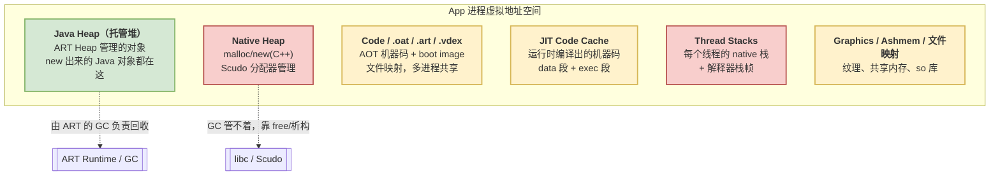

# 01 架构篇：进程内存全景

> 目标：搞清楚一个 Android 应用进程里，Java 「内存」是怎么管理的。看透 Java 内存管理的本质——从虚拟地址空间申请内存空间并管理这部分的分配和回收。


## What：一个 App 进程的内存版图

系统为进程的内存使用虚拟了内存空间，提供进程隔离功能。Java 虚拟机在系统层面表现为一个进程，Linux 上 maps 文件提供了进程的地址空间使用情况，用 `adb shell cat /proc/<pid>/maps` 就能看到成百上千行。把它们归归类，其实就几大块：



`dumpsys meminfo <pkg>` 输出里的那些名字，正是对应这张图：

| meminfo 分类 | 对应上图 | 谁在管 |
|---|---|---|
| `Java Heap` | Java Heap | **ART Heap + GC（本系列主角）** |
| `Native Heap` | Native Heap | libc 的 Scudo 分配器 |
| `Code` | .oat/.art/.vdex/.so | 文件映射，内核页缓存 |
| `Stack` | Thread Stacks | 内核按需分页 |
| `Graphics` | GPU/GL/EGL | gralloc / GPU 驱动 |
| `Private Other` / `System` | 杂项 | — |

**一句话记住边界**：ART 的垃圾回收器，**只负责 Java Heap 这一块**。你在 JNI 里 `malloc` 的内存、`so` 库占用、GPU 纹理，GC 一概不管——这也是「Java 层看着没泄漏、进程内存也可能会却越用越大」的常见根源。


## Why：为什么要单独切出一块「托管堆」

为了减轻开发者的心智负担，Java 设计采用了内存管理自动化的策略：**Java 对象的分配和回收都由虚拟机负责**，开发者只管 `new`，不用管 `delete`。为了实现这一点，拉回回收被引入。

**一次性向内核批发一大片虚拟地址，自己零售给 Java 对象**。这块「批发来的地址」被 ART 统一抽象成 `MemMap`。


## How：内存从内核到 Java 对象的三级跳

一个 Java 对象要落地，中间隔着三层，从粗到细：


### 第 1 级：`MemMap` —— 向内核批发地址

ART 不逐个对象去问内核要内存，而是**一次性预留一大段虚拟地址**（此刻只是「占坑」，物理内存还没真正落地，等第一次写入时内核才按页补上）。ART 把这层「批发来的地址」封装成统一抽象 `MemMap`——本系列只需把它理解成「一段带起止地址的连续内存」，重点看它的**数据结构**，而不是它底层怎么调系统调用：

```cpp
// 源码：art/libartbase/base/mem_map.h（只看数据结构：一段连续内存的描述）
class MemMap {
  const char* name_;   // 这段内存叫什么（会显示在 /proc/pid/maps 里，便于排查）
  uint8_t* begin_;     // 起始地址
  size_t size_;        // 大小
  // 关键方法（了解语义即可）：
  //   MapAnonymous(name, size, ...)  预留一段匿名内存，用作堆
  //   MapFile(...)                   把 .art/.oat 等文件映射进来（多进程共享）
  //   RemapAtEnd(...)                把一段切成两段，给不同 Space 用
};
```

你在 `/proc/<pid>/maps` 里看到的 `[anon:dalvik-main space]`、`[anon:dalvik-large object space]` 这类名字，就是各个 `MemMap` 的 `name_`——ART 特意给每段内存起了可读的名字，方便我们排查（见 [06 篇](06_tuning_and_debugging.md) 的 maps 解读）。

### 第 2 级：`Space` —— 把大片地址划成功能分区

`Heap` 拿到 `MemMap` 后，不会把整片地当成一锅粥，而是切成若干**功能分区**，每个分区叫一个 `Space`：有的放启动镜像（`ImageSpace`）、有的放普通新对象（`main space`，随 GC 是 RegionSpace 或 BumpPointerSpace）、有的专收大对象（`LargeObjectSpace`）。每种 Space 的分配和回收策略都不同。**这是 [02 分区篇](02_heap_and_spaces.md) 的主题。**

### 第 3 级：分配器 —— 把分区零售给对象

真正把「一段空闲内存」交到 `new` 手上的，是各个 Space 背后的**分配器**：`RosAlloc`（按大小分桶）、`Bump Pointer`（指针一推）、`TLAB`（线程私有自留地）等。一次 `new Object()` 从字节码到拿到地址的完整链路，**是 [03 分配篇](03_allocation.md) 的主题**（也可先看已有笔记 [对象创建](create_object.md)）。

### 串起来：`Heap` 是「三级跳」的总调度

`Heap` 这个类就是把上面三级串起来的总管：它持有所有 `MemMap`/`Space`，对外只暴露简洁的 `AllocObject()`（分配）和 `CollectGarbage()`（回收）。

```cpp
// 源码：art/runtime/gc/heap.h（只看它"持有什么"，不看实现）
namespace art::gc {
class Heap {
  // 持有一堆 Space（下一篇的主角）
  std::vector<space::ContinuousSpace*> continuous_spaces_;
  std::vector<space::DiscontinuousSpace*> discontinuous_spaces_;
  space::LargeObjectSpace* large_object_space_;
  // 持有 GC 收集器（第 05 篇的主角）
  // 对外的两个核心动作：
  //   AllocObject(...)     分配一个对象
  //   CollectGarbage(...)  触发一次回收
};
}
```

到这里，架构地基就打好了：**`Runtime` 持有 `Heap`，`Heap` 用 `MemMap` 向内核批发地址、切成 `Space`、再由分配器零售给对象；GC 只在 `Heap` 这块托管堆里工作。** 后面每一篇都是在放大这张图的某一块。

---

## 课后验证

### 思考题

1. `dumpsys meminfo` 里的 `Java Heap` 和 `Native Heap` 有什么本质区别？为什么「Java 层没有泄漏，进程内存却一直涨」是可能的？

2. `JavaVM` 和 `JNIEnv` 各自唯一性是「进程级」还是「线程级」？为什么局部引用放在 `JNIEnv`、全局引用放在 `JavaVM`？

3. 为什么 GC 要求对象都待在 ART 自管理的 `MemMap` 区域里，而不能散落在普通的 `malloc` 内存中？（提示：从「枚举对象」和「移动对象」两点想。）
4. `Runtime`、`Heap`、`Space`、分配器，这四者是什么从属/调用关系？试着不看图复述一遍。

<details>
<summary>参考答案</summary>

1. Java Heap 由 ART GC 管理、能自动回收并整理；Native Heap 由 libc 分配器管理，GC 完全不碰。JNI 里 `malloc`、`so` 库、未释放的 JNI 全局引用等都算 native 侧，Java 层可达性分析看不到它们，所以会「Java 不泄漏、进程仍涨」。
2. `JavaVM` 进程级唯一，`JNIEnv` 每线程一个。局部引用生命周期短、随线程走，放线程级的 `JNIEnv` 里方法返回即清；全局引用要跨线程跨调用存活，放进程级的 `JavaVM` 里、需手动删除。
3. GC 要做可达性分析，必须能枚举堆内所有对象、知道边界；还要能整体搬移对象消碎片。这两点都要求对象位于 ART 掌控的连续内存里，散落的 `malloc` 内存既无法枚举也不能安全搬移。
4. `Runtime` 持有 `Heap`；`Heap` 持有若干 `Space`；每个 `Space` 背后由具体分配器零售内存给对象。取用链常见写法：`Runtime::Current()->GetHeap()->AllocObject(...)`。

</details>

### 小实验：亲眼看到这张内存版图

在真机或模拟器上跑：

```shell
# 1. 找到某个 app 的进程号
adb shell pidof com.android.settings

# 2. 看它的内存分类（重点看 Java Heap / Native Heap / Code 三行）
adb shell dumpsys meminfo com.android.settings

# 3. 看 ART 给各段内存起的名字（对应本篇的 MemMap.name_）
adb shell "cat /proc/$(adb shell pidof com.android.settings)/maps | grep dalvik"
```

观察点：
- `dumpsys meminfo` 里 `Java Heap` 的大小，和 `maps` 里 `dalvik-main space` 系列区段的总和大致能对上。
- 在 `maps` 里数一数有几种 `dalvik-*` 命名的区段——它们就是下一篇要讲的各个 `Space`。
