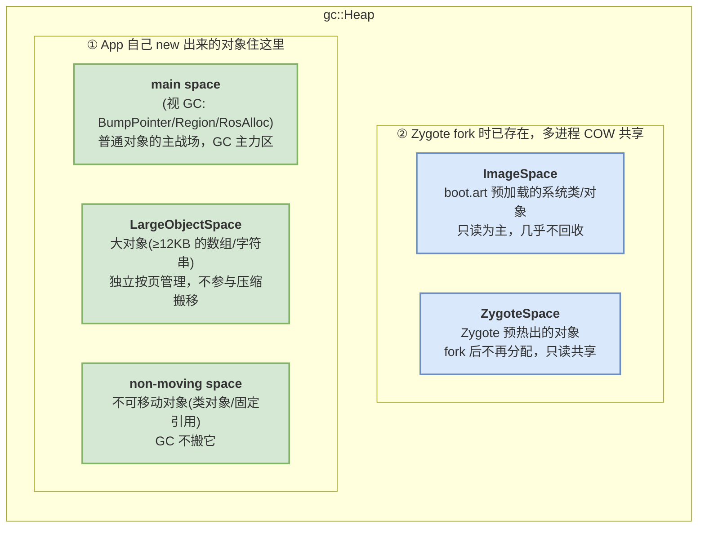
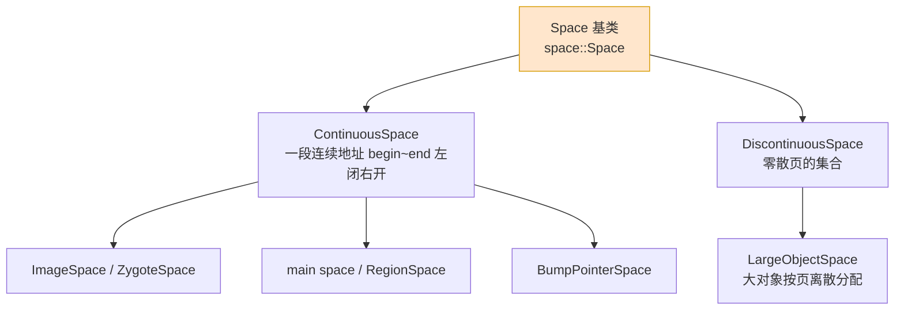
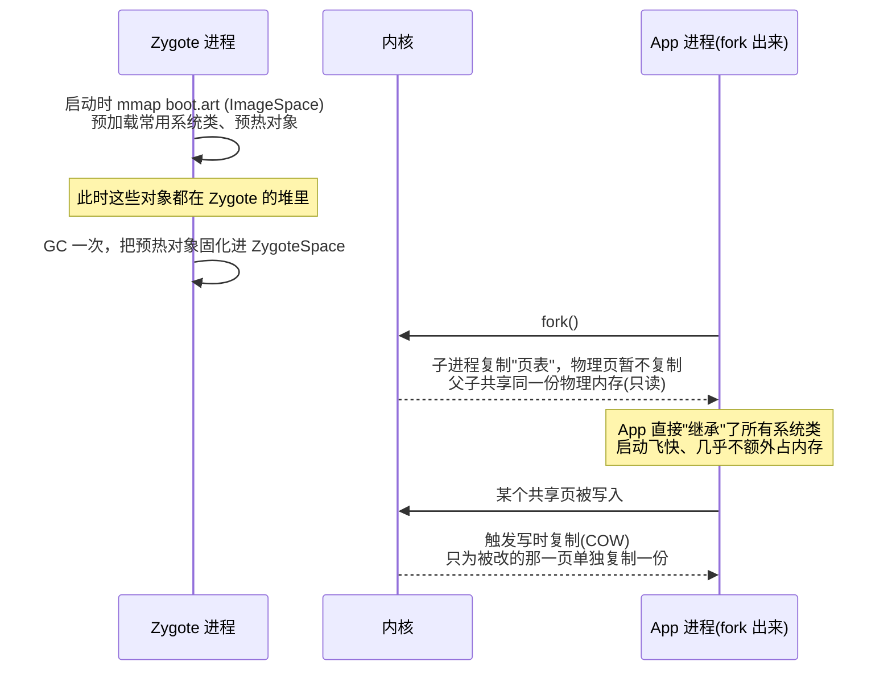
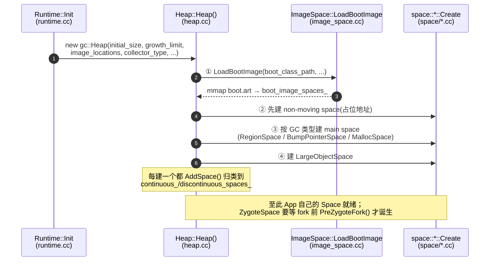

# 02 分区篇：Heap 的 Space 家族

> 目标：把上一篇 `maps` 里那一堆 `dalvik-*` 区段逐个讲清楚——`Heap` 为什么要切成这么多 `Space`，每个 Space 装什么、谁分配谁回收，以及 Zygote 是怎么用「写时复制」让几百个 App 共享同一份系统类的。

承接 [01 架构篇](01_architecture_overview.md)：`Runtime` 持有 `Heap`，`Heap` 把 `MemMap` 批发来的地址切成若干 `Space`。本篇就是放大「切成若干 Space」这一步。

---


## What：一个 App 堆里到底有哪些 Space

先看全景。ART 的 `Heap` 不是一整块，而是一组各司其职的分区：


**这些 Space 是专门用来存放 Java 对象实例的”堆“空间。而 DEX 文件和 AOT 编译后的代码，属于程序指令和数据，它们不会进入这些堆空间，而是通过 mmap（内存映射） 的方式，直接映射到进程的独立内存区域中。**

对应到 `/proc/<pid>/maps` 里，你能看到类似这些名字（上一篇小实验里 `grep dalvik` 出来的就是它们）：

| maps 里的名字 | 对应的 Space | 装什么 |
|---|---|---|
| `dalvik-main space` / `dalvik-main space 1` | main space | 你 `new` 出来的绝大多数对象 |
| `dalvik-large object space` | LargeObjectSpace | 大数组、大字符串 |
| `dalvik-non moving space` | non-moving space | 不可搬移的对象 |
| `dalvik-zygote space` | ZygoteSpace | Zygote 预热的共享对象 |
| `/…/boot.art`（文件映射） | ImageSpace | 系统框架预加载对象**包含预初始化的对象和类数据，即运行时所需的内存“快照”** |

---

## What：两条分类主线

Space 种类看着多，其实沿两个维度就能理清：

### 主线一：连续 vs 不连续



- **连续空间（ContinuousSpace）**：一段 `[begin, end)` 连续地址，绝大多数对象都在这——连续才方便「指针一推就分配」和「整体搬移做压缩」。
- **不连续空间（DiscontinuousSpace）**：以 `LargeObjectSpace` 为代表，大对象直接按页离散映射，各自独立，不塞进连续区里（否则一个大对象会把连续区搅得千疮百孔）。

### 主线二：可移动 vs 不可移动

现代 ART 的 GC 会搬移对象来消碎片（[05 篇](05_gc_collectors.md)），但**不是所有对象都能搬**：

- **可移动（moving）**：main space（RegionSpace 或 BumpPointerSpace）里的普通对象，GC 可以把它们挪位置来整理空间。
- **不可移动（non-moving）**：有些对象的地址被别处"记死"了（比如被 JNI 全局引用固定、类对象 `Class` 本身），一搬就会出错，于是单独放进 `non-moving space`，GC 只回收不搬移。

> 一句话记忆：**Space 的设计，本质是「按对象的回收/移动特性分而治之」**——大对象单独管、不能搬的单独放、能共享的做成只读，剩下的普通对象放主战场高频回收。

```cpp
// 源码：art/runtime/gc/space/space.h（只看类型枚举，理解分类即可）
enum SpaceType {
  kSpaceTypeImageSpace,          // 启动镜像
  kSpaceTypeMallocSpace,         // RosAlloc/DlMalloc 管理的主空间
  kSpaceTypeZygoteSpace,         // Zygote 共享空间
  kSpaceTypeBumpPointerSpace,    // 指针推进空间(CMC 标记压缩用)
  kSpaceTypeLargeObjectSpace,    // 大对象空间
  kSpaceTypeRegionSpace,         // Region 空间(CC 并发复制用)
};
```

---

## Why：为什么偏偏切成这几种

每一种 Space 的存在都对应一个具体痛点：

| Space | 解决的问题 |
|---|---|
| **ImageSpace / ZygoteSpace** | 系统类（`String`、`Activity`…）几百个 App 都要用，逐个进程各加载一份太浪费。做成只读镜像 + fork 共享，几百个进程只占一份物理内存。 |
| **main space** | 普通对象生死频繁，需要一个高频分配、高频回收、能整理碎片的主战场。 |
| **LargeObjectSpace** | 大对象搬一次成本极高，且塞进连续区会制造大空洞。单独按页管理，绝不搬移。 |
| **non-moving space** | 有些对象地址不能变（被 native 固定/类元数据），必须给它们一个「GC 不搬」的安身之所。 |

---

## How：Zygote 与写时复制——省内存的关键一招

这是 Android 内存模型里最漂亮的设计，也是 ImageSpace/ZygoteSpace 存在的意义。

### 它是怎么工作的



> 📷 **配图与延伸阅读**：Zygote「预加载 ~3000 个框架类 → fork → COW 共享」的经典示意图，可看 codecentric 的 [Android Zygote boot process](https://www.codecentric.de/en/knowledge-hub/blog/android-zygote-boot-process) 和 [Forked at Birth: Understanding Zygote](https://medium.com/@paritasampa95/forked-at-birth-understanding-zygote-in-android-internals-a5a64067dfdf)。想本地留存图，把图存到 `art_img/zygote_cow.png` 后改用 ``。

要点拆解：

1. **Zygote 是所有 App 的「模板进程」**。它在开机时就把最常用的系统类加载好、把一些对象预热好，然后停在那里等。
2. **每个 App 都是 `fork` 出来的**。`fork` 的关键特性：子进程一开始和父进程**共享同一份物理内存页**，只复制页表映射。所以几百个 App 共享 Zygote 那一份系统类，物理内存只算一份。
3. **写时复制（Copy-On-Write）**：共享页保持只读，直到某个进程去改它，内核才为改动者单独复制那一页。没被改的系统类，永远是共享的。

### 为什么要专门有个 ZygoteSpace

fork 之后，App 会不断 `new` 新对象。如果新对象和 Zygote 预热对象混在同一块页里，一 `new` 就把整页写脏、触发 COW，共享就白费了。

ART 的做法：**在 fork 之前，把 Zygote 已有的对象「封存」进一个只读的 `ZygoteSpace`，之后 App 的新对象一律分配到全新的 main space**。这样：

- ZygoteSpace = 老对象，只读、跨进程共享、GC 基本不动它。
- main space = App 自己的新对象，随便读写、频繁 GC。

两者物理隔离，App 写新对象不会污染共享页。这一步「封存」在源码里叫 `Heap::PreZygoteFork()`。

```cpp
// 源码：art/runtime/gc/heap.cc（语义示意）
// fork 出 App 之前调用：把当前 main space 里已有的对象整体转成只读的 ZygoteSpace，
// 然后开一个全新的 main space 给 App 用。目的就是隔离"共享的老对象"和"App 的新对象"。
void Heap::PreZygoteFork() {
  // ... 把 main space 变身为 zygote space，再新建一个 main space ...
}
```

> 想直观感受 COW 的省内存效果：同一台设备开 10 个 App，它们的 `boot.art`/ZygoteSpace 在物理内存里基本只有一份——这就是 Android 能在有限 RAM 上跑一大堆进程的底气之一。

---

## How：main space 的「变形」——RosAlloc / Region / BumpPointer

一个容易困惑的点：main space 到底是什么？答案是**取决于当前用哪个 GC**，三代收集器各配一种：

- 用 **CMS**（老，标记清除、不搬对象）时，main space 是 `RosAlloc space`（按大小分桶的分配器，见 [03 篇](03_allocation.md)）。
- 用 **CC**（并发复制，Android 8–13）时，main space 是 `RegionSpace`（把空间切成一个个固定大小的 Region，便于按区复制回收）。
- 用 **CMC**（并发标记压缩，Android 14+ 默认）时，main space 是 `BumpPointerSpace`（一整块指针推进空间，回收时原地向一端压缩）。

也就是说，**GC 算法决定了 main space 用哪种数据结构**——这正是「Space 布局为回收策略服务」的又一体现。RegionSpace / BumpPointerSpace 各自为什么适合自己那种回收方式，留到 [05 收集器演进篇](05_gc_collectors.md)。

---

## How：源码视角——各 Space 的创建流程与关键代码节点

> 前面讲清了「有哪些 Space、为什么这么切」，这一节把镜头拉到源码：**这些 Space 到底在什么时机、由哪个函数、按什么顺序创建出来**。
>
> **依据说明**：以下以 **AOSP `main` 分支（Android 17 时代，CMC 为默认 GC）** 为准。ART 已是 Mainline 模块，**文件路径与函数名跨版本高度稳定**，可在 [cs.android.com](https://cs.android.com/android/platform/superproject/main/+/main:art/) 按函数名直接检索复核；本节**不写死行号**（行号随版本频繁漂移，给错反而误导）。标注「精简」的代码块为保留关键调用、省略无关分支的语义化摘录，非逐字原文。

### 全景：一次进程启动里 Space 的创建时序

所有 Space 的诞生都收敛在**一个入口**——`gc::Heap` 的构造函数。它像一条流水线，按固定顺序把 `MemMap` 批发来的地址切成各个 Space。



### 入口：`Runtime::Init` → `new gc::Heap`

Heap 不是自己冒出来的，是 `Runtime` 初始化时 new 出来的。堆的所有尺寸/GC 类型参数都在这里传进去。

```cpp
// art/runtime/runtime.cc → Runtime::Init()（精简）
heap_ = new gc::Heap(runtime_options.GetOrDefault(Opt::MemoryInitialSize),   // 初始堆
                     runtime_options.GetOrDefault(Opt::HeapGrowthLimit),     // 增长上限
                     runtime_options.GetOrDefault(Opt::HeapMinFree),
                     runtime_options.GetOrDefault(Opt::HeapMaxFree),
                     ...
                     GetBootClassPath(),                 // 决定要不要加载 boot.art（ImageSpace）
                     image_locations_,
                     ...
                     foreground_collector_type_,         // ← 这个参数决定 main space 的形态
                     background_collector_type_,
                     ...);
```

> 一句话：**`foreground_collector_type_` 是那把「决定 main space 长什么样」的钥匙**，它从这里一路传进 `Heap::Heap()`。

### 总控：`Heap::Heap()` 构造函数——所有 Space 的产房

`art/runtime/gc/heap.cc → Heap::Heap(...)` 是本篇的主角。它的创建顺序有讲究（注释里写着「先建 non-moving space，免得它的 bitmap 占掉我们想要的地址段」）：

```cpp
// art/runtime/gc/heap.cc → Heap::Heap()（精简，只保留 Space 创建骨架）

// ① 启动镜像：把 boot.art 映射进来，产出若干只读 ImageSpace
if (space::ImageSpace::LoadBootImage(/*boot_class_path*/..., image_locations_, ...,
                                     &boot_image_spaces_,      // out: 加载好的 ImageSpace 列表
                                     &heap_reservation)) {     // out: 给后续 Space 预留的地址
  // boot_image_spaces_ 里每个元素都是一个 ContinuousSpace，随后逐个 AddSpace()
}

// ② non-moving space：先建，占住地址范围（不可移动对象的家）
if (separate_non_moving_space) {
  non_moving_space_ = space::DlMallocSpace::CreateFromMemMap(
      std::move(non_moving_space_mem_map), "non moving space",
      kDefaultStartingSize, non_moving_space_capacity, ...,
      /*can_move_objects=*/ false);          // ← 关键：明确不可搬移
  AddSpace(non_moving_space_);
}

// ③ main space：按当前 GC 类型三选一
if (foreground_collector_type_ == kCollectorTypeCC) {              // CC：并发复制
  region_space_ = space::RegionSpace::Create("main space (region space)",
                                             std::move(region_space_mem_map), ...);
  AddSpace(region_space_);
} else if (IsMovingGc(foreground_collector_type_)) {              // CMC/SS：搬移式
  bump_pointer_space_ = space::BumpPointerSpace::CreateFromMemMap(
      "Bump pointer space 1", std::move(main_mem_map_1));
  AddSpace(bump_pointer_space_);
  if (foreground_collector_type_ != kCollectorTypeCMC) {          // CMC 原地压缩，不需要第二块 temp
    temp_space_ = space::BumpPointerSpace::CreateFromMemMap(
        "Bump pointer space 2", std::move(main_mem_map_2));
    AddSpace(temp_space_);
  }
} else {                                                          // CMS：不搬移的 malloc 空间
  CreateMainMallocSpace(std::move(main_mem_map_1), initial_size, growth_limit_, capacity_);
  AddSpace(main_space_);
}

// ④ large object space：大对象离散空间
if (large_object_space_type == space::LargeObjectSpaceType::kFreeList) {
  large_object_space_ = space::FreeListSpace::Create("free list large object space", capacity_);
} else if (large_object_space_type == space::LargeObjectSpaceType::kMap) {
  large_object_space_ = space::LargeObjectMapSpace::Create("mem map large object space");
}
if (large_object_space_ != nullptr) {
  AddSpace(large_object_space_);   // 注意：它是 DiscontinuousSpace
}
```

对照上一节的分类主线，这段代码恰好把「谁连续、谁可移动」写死在了创建分支里：`RegionSpace`/`BumpPointerSpace` 走可移动分支，`non moving space` 明确传 `can_move_objects=false`，`LargeObjectSpace` 走离散分支。

### ImageSpace：`LoadBootImage` → mmap `boot.art`

ImageSpace 不是「new 对象」建出来的，而是**把磁盘上的 `boot.art` 文件 mmap 进地址空间**——这正是它能跨进程 COW 共享的物理基础。

```cpp
// art/runtime/gc/space/image_space.cc（精简调用链）
ImageSpace::LoadBootImage(...)          // Heap 构造里调用的静态入口
  └─> BootImageLayout::LoadOrValidate() // 解析 boot image 的组成与校验
  └─> ImageSpace::Loader::Load(...)     // 真正把 image 文件映射进来
        └─> MemMap::MapFileAtAddress(image.fd, ...)   // ← mmap boot.art 的落点
```

- **boot 镜像**：由 `LoadBootImage` 负责，产物挂到 `boot_image_spaces_`。若本地 `boot.art` 缺失/失效，会触发 `dex2oat` 现场生成再映射。
- **App 镜像**（`.art`，你的 App 自己那份预编译镜像）：不在 Heap 构造期，而是在 `ClassLinker` 打开 oat 文件时，由 `art/runtime/gc/space/image_space.cc → ImageSpace::CreateFromAppImage(...)` 创建。

> 复核入口：cs.android.com 搜 `ImageSpace::LoadBootImage`、`ImageSpace::CreateFromAppImage`。

### main space 的三种 `Create`

承接上一节「main space 变形」，落到源码就是三个不同的 `Create`：

| GC 类型 | main space 数据结构 | 创建函数（文件 → 函数） |
|---|---|---|
| CMC（Android 14+ 默认） | `BumpPointerSpace` | `space/bump_pointer_space.cc → BumpPointerSpace::Create / CreateFromMemMap` |
| CC（Android 8–13） | `RegionSpace` | `space/region_space.cc → RegionSpace::Create` |
| CMS（老） | `RosAllocSpace` | `gc/heap.cc → Heap::CreateMainMallocSpace` → `space/rosalloc_space.cc → RosAllocSpace::CreateFromMemMap` |

其中 CMS 路径多绕一层 `Heap` 的工厂方法：

```cpp
// art/runtime/gc/heap.cc（精简）
void Heap::CreateMainMallocSpace(MemMap&& mem_map, size_t initial_size,
                                 size_t growth_limit, size_t capacity) {
  main_space_ = CreateMallocSpaceFromMemMap(std::move(mem_map), initial_size,
                                            growth_limit, capacity,
                                            kMemMapSpaceName[0], can_move_objects);
}

space::MallocSpace* Heap::CreateMallocSpaceFromMemMap(...) {
  if (kUseRosAlloc) {          // 编译期开关：默认走 RosAlloc（按大小分桶，见 03 篇）
    return space::RosAllocSpace::CreateFromMemMap(...);
  } else {
    return space::DlMallocSpace::CreateFromMemMap(...);
  }
}
```

### LargeObjectSpace：两种实现，都走离散分配

```cpp
// art/runtime/gc/space/large_object_space.cc（精简）
FreeListSpace* FreeListSpace::Create(const std::string& name, size_t capacity);        // 预留一大段，按空闲链表切
LargeObjectMapSpace* LargeObjectMapSpace::Create(const std::string& name);             // 每个大对象单独 mmap 一段
```

选哪种由 `large_object_space_type` 决定（见 `Heap::Heap()` 的 ④ 分支）。两种共同点：**按页管理、绝不参与压缩搬移**，所以它们注册进的是 `discontinuous_spaces_`。

### ZygoteSpace：不在构造期，而在 `PreZygoteFork()` 里「封存」出来

这是最特殊的一个：**ZygoteSpace 不是启动时建的，而是 Zygote 在 `fork` 出第一个 App 之前，把已有的 main space「就地封存」转化出来的**——正对应本篇前面讲的「隔离共享老对象与 App 新对象」。

```cpp
// art/runtime/gc/heap.cc → Heap::PreZygoteFork()（精简）
void Heap::PreZygoteFork() {
  MutexLock mu(self, zygote_creation_lock_);
  if (HasZygoteSpace()) return;                 // 只做一次
  ...
  if (kCompactZygote) {
    // 用一次专门的 GC（zygote 语义空间收集器）把存活对象压实，便于封存
    ...
  }
  // 把「旧 main space」整体转成只读 ZygoteSpace，并顺手 new 出一个「新 main space」给 App
  if (main_space_ != nullptr) {
    zygote_space_ = main_space_->CreateZygoteSpace(kNonMovingSpaceName,
                                                   low_memory_mode_,
                                                   &main_space_ /*out: 新 main space*/);
  }
  AddSpace(zygote_space_);
}
```

真正干「一分为二」活的是 malloc 空间的成员函数：

```cpp
// art/runtime/gc/space/malloc_space.cc → MallocSpace::CreateZygoteSpace（精简）
ZygoteSpace* MallocSpace::CreateZygoteSpace(const char* alloc_space_name,
                                            bool low_memory_mode,
                                            MallocSpace** out_malloc_space) {
  ...
  // 用旧空间的 [Begin, End) 造出只读、跨进程共享的 ZygoteSpace
  ZygoteSpace* zygote_space = space::ZygoteSpace::Create("Zygote space", std::move(mem_map),
                                                         std::move(live_bitmap),
                                                         std::move(mark_bitmap));
  // 再在其后开一个全新的 malloc 空间，作为 App 之后 new 对象的 main space
  *out_malloc_space = CreateInstance(...);
  return zygote_space;
}
```

> CC/CMC 由于 main space 是 Region/BumpPointer 而非 malloc 空间，封存路径略有不同（存活对象先挪到 non-moving/新空间再封存），但**「fork 前封存出 ZygoteSpace」这个时机与目的完全一致**。复核入口：`Heap::PreZygoteFork`、`MallocSpace::CreateZygoteSpace`、`ZygoteSpace::Create`。

### 收尾：`AddSpace` 把每个 Space 归位

每个 Space 建好后都要 `AddSpace()` 登记，这里就是「连续 vs 不连续」两条链的分流点：

```cpp
// art/runtime/gc/heap.cc → Heap::AddSpace()（精简）
void Heap::AddSpace(space::Space* space) {
  if (space->IsContinuousSpace()) {
    continuous_spaces_.push_back(space->AsContinuousSpace());   // Image/Zygote/main/non-moving
    // 同时登记它的 live/mark bitmap
  } else {
    DCHECK(space->IsDiscontinuousSpace());
    discontinuous_spaces_.push_back(space->AsDiscontinuousSpace()); // LargeObjectSpace
  }
}
```

### 速查表：关键函数 → 文件

| 环节 | 关键函数 | 文件 |
|---|---|---|
| 堆创建入口 | `Runtime::Init` → `new gc::Heap` | `art/runtime/runtime.cc` |
| Space 总产房 | `Heap::Heap()` 构造函数 | `art/runtime/gc/heap.cc` |
| 归类登记 | `Heap::AddSpace` | `art/runtime/gc/heap.cc` |
| ImageSpace（boot） | `ImageSpace::LoadBootImage` | `art/runtime/gc/space/image_space.cc` |
| ImageSpace（app） | `ImageSpace::CreateFromAppImage` | `art/runtime/gc/space/image_space.cc` |
| main space(CMC) | `BumpPointerSpace::Create / CreateFromMemMap` | `art/runtime/gc/space/bump_pointer_space.cc` |
| main space(CC) | `RegionSpace::Create` | `art/runtime/gc/space/region_space.cc` |
| main space(CMS) | `Heap::CreateMainMallocSpace` → `RosAllocSpace::CreateFromMemMap` | `art/runtime/gc/heap.cc` / `space/rosalloc_space.cc` |
| non-moving space | `DlMallocSpace::CreateFromMemMap`（`can_move_objects=false`） | `art/runtime/gc/space/dlmalloc_space.cc` |
| LargeObjectSpace | `FreeListSpace::Create` / `LargeObjectMapSpace::Create` | `art/runtime/gc/space/large_object_space.cc` |
| ZygoteSpace | `Heap::PreZygoteFork` → `MallocSpace::CreateZygoteSpace` → `ZygoteSpace::Create` | `heap.cc` / `space/malloc_space.cc` / `space/zygote_space.cc` |

> 复核方法：在 cs.android.com 顶部搜索框直接粘函数名（如 `Heap::PreZygoteFork`），即可跳到 `main` 分支对应文件与行；换分支/标签即可对照不同 Android 版本。

---

## 课后验证

### 思考题

1. 为什么大对象要单独放 `LargeObjectSpace`，而不是和普通对象挤在 main space？（从「搬移成本」和「碎片」两个角度答。）
2. `ZygoteSpace` 和 `main space` 为什么要在 fork 前就分开？如果不分开会发生什么？
3. 写时复制（COW）在什么时刻会「失效」（即真正发生物理内存复制）？这对「共享系统类省内存」意味着什么？
4. 为什么 main space 在 CMS 下是 RosAlloc space、CC 下是 RegionSpace、CMC 下又是 BumpPointerSpace？这体现了 Space 设计的什么原则？

<details>
<summary>参考答案</summary>

1. 大对象搬移一次要拷贝大量字节，成本极高，所以设计上就不搬它；且大对象若塞进连续 main space，回收后会留下大空洞制造严重碎片。单独按页离散管理，既省搬移又不碎化主空间。
2. fork 前把老对象封存进只读 ZygoteSpace、给 App 开全新 main space，是为了让 App 的新对象不去写脏共享页。若不分开，App 一 `new` 就可能触发共享页的 COW，跨进程共享的省内存效果就被破坏了。
3. 当某进程**写入**一个共享的只读页时，内核为它单独复制该页。意味着只要系统类页不被改（通常只读），它们就一直被所有 App 共享、物理内存只算一份；被改的页才各自复制。
4. 因为 main space 的数据结构要配合 GC 的回收方式：CMS 不搬对象、用分桶分配器 RosAlloc；CC 按区复制、用 RegionSpace；CMC 原地压缩、用 BumpPointerSpace。体现的原则是「Space 布局为回收策略服务」。

</details>

### 小实验：数一数你的 App 有几个 Space

```shell
PID=$(adb shell pidof com.android.systemui)
# 列出所有 dalvik 命名的堆区段，观察 main / large object / non moving / zygote
adb shell "cat /proc/$PID/maps | grep -E 'dalvik|boot.art'"
```

观察点：
- 找到 `dalvik-main space`、`dalvik-large object space`、`dalvik-non moving space`、`dalvik-zygote space` 各自的地址范围和大小。
- 找到 `boot.art` 的文件映射——它就是 ImageSpace，注意它是**文件映射**（有路径名），说明能跨进程共享。
- 换一个 App 再看一次，对比两个进程的 `boot.art` 映射——它们指向同一个文件，物理页是共享的。

> 下一篇：[03 分配篇：分配器与一次 `new` 的完整链路](03_allocation.md)——对象是怎么从这些 Space 里被「零售」出来的。
