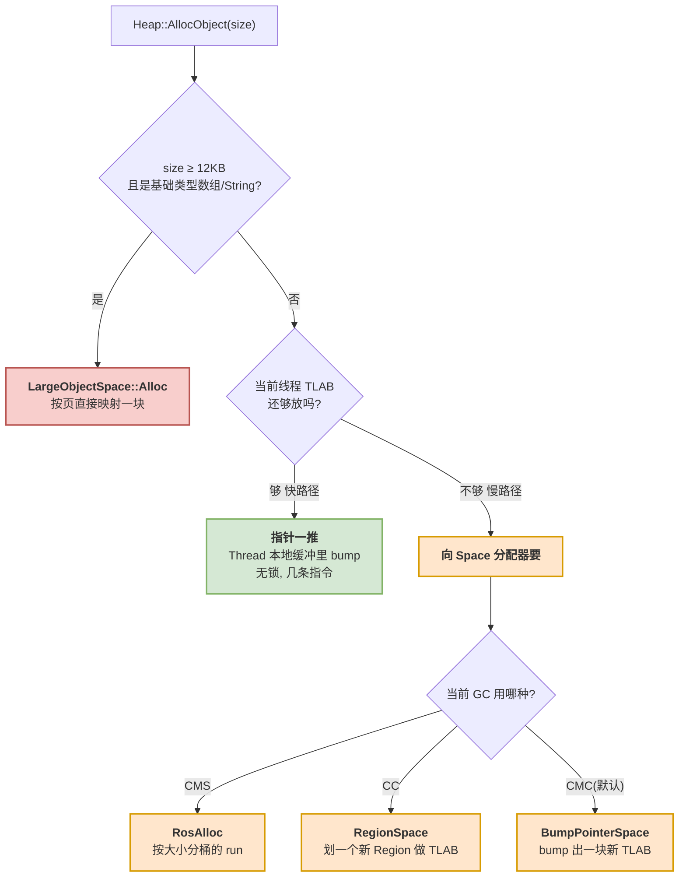
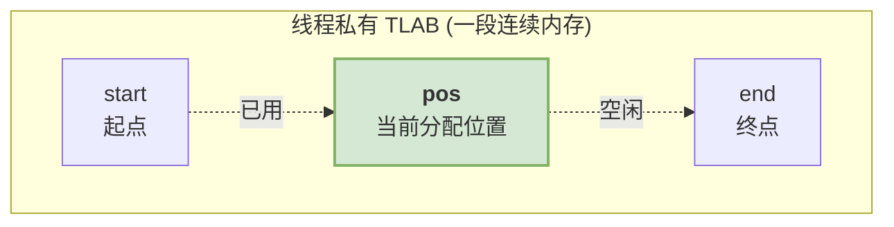
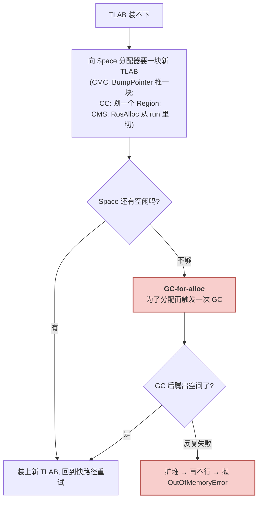
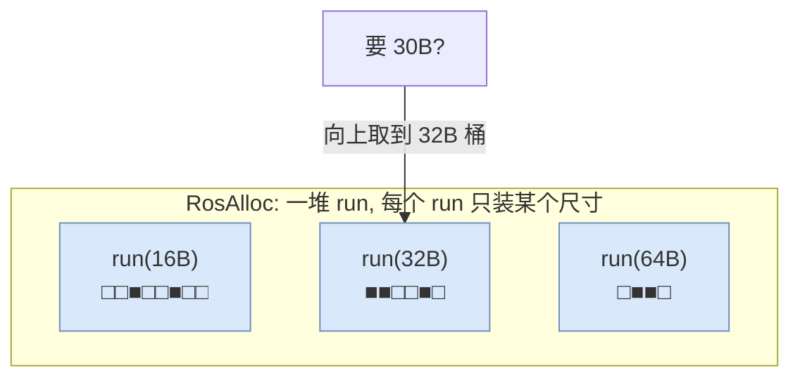
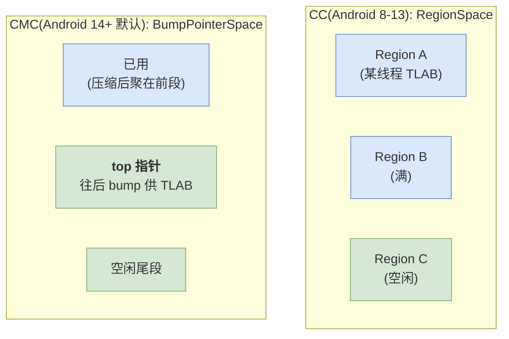
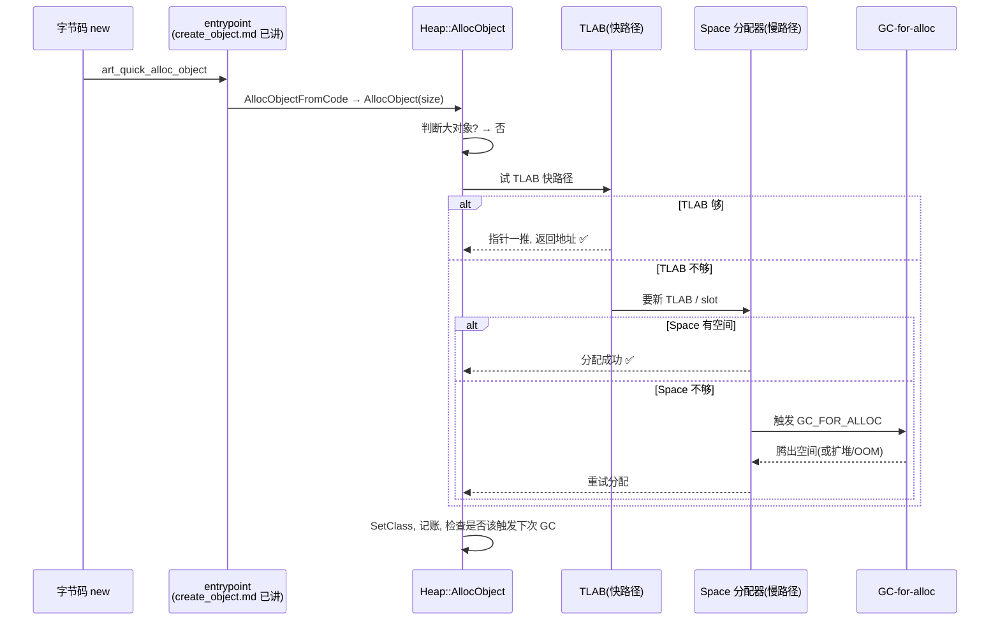

# 03 分配篇：分配器与一次 `new` 的完整链路

> 目标：搞清楚一次 `new Object()` 从字节码到拿到一块内存，中间经过了哪些分配器；为什么 ART 要准备好几种分配器；以及最关键的「快路径为什么快、慢路径什么时候触发 GC」。

承接 [02 分区篇](02_heap_and_spaces.md)：Space 是「货架」，本篇讲的**分配器**是「把货从货架上取给你的店员」。字节码层面的入口链路（`new` → entrypoint → `Heap::AllocObject`）在已有笔记 [对象创建](../create_object.md) 里已经拆得很细，本篇不重复，只从 **`Heap::AllocObject` 往下**、聚焦分配器本身。

---

## What：ART 有一整套分配器

先建立全景。同样是「给一个对象找块内存」，ART 根据**对象大小**和**当前 GC 类型**会走不同的分配器：



一句话概括这张图：**绝大多数分配走「快路径」——在线程私有的 TLAB 里指针一推就完成，不加锁；只有 TLAB 装不下了才走「慢路径」去找 Space 分配器补货；补不到内存就触发 GC。**

`Heap::AllocObject` 内部其实是靠模板参数 `AllocatorType` 分派到不同分配器的：

```cpp
// 源码：art/runtime/gc/heap.h（分配器种类，理解语义即可）
enum AllocatorType {
  kAllocatorTypeBumpPointer,   // 指针推进：最简单，一推到底
  kAllocatorTypeTLAB,          // 线程本地缓冲，基于 bump pointer（CMC 默认）
  kAllocatorTypeRosAlloc,      // Runs-of-Slots：按大小分桶
  kAllocatorTypeDlMalloc,      // 经典 dlmalloc，兜底
  kAllocatorTypeRegion,        // Region 分配（CC）
  kAllocatorTypeRegionTLAB,    // Region + 线程本地缓冲（CC 默认）
  kAllocatorTypeLOS,           // 大对象
};
```

---

## Why：为什么不用一个分配器打天下

因为「分配」这件事有互相冲突的需求，单一策略无法全都满足：

| 需求 | 谁来满足 | 代价 |
|---|---|---|
| **多线程高频分配小对象，别抢锁** | TLAB（每线程一块自留地，无锁） | 每个线程要预留一块 buffer，略费空间 |
| **回收后不产生碎片** | Bump Pointer + 搬移压缩（CC/CMC） | 需要能搬对象、需要 To 空间或 UFFD |
| **不搬对象也要控制碎片** | RosAlloc 按大小分桶 | 分桶元数据开销、跨线程要加锁 |
| **大对象别拖累主空间** | LargeObjectSpace 按页管理 | 页对齐有内部浪费 |

ART 的选择是「组合拳」：**用 TLAB 兜住 99% 的快路径，用 RosAlloc / RegionSpace / BumpPointerSpace（视 GC 而定）兜住慢路径，用 LargeObjectSpace 兜住大对象。**

---

## How：快路径——TLAB 里「指针一推」

TLAB（Thread Local Allocation Buffer，线程本地分配缓冲）是快路径的核心。理解它，就理解了为什么 Java 的 `new` 能比 C 的 `malloc` 还快。

### 数据结构：一块自留地上的三个指针

每个线程在自己的 `Thread` 结构里持有一小段私有内存，用三个指针描述：



分配一个对象，快路径就三步（无锁）：

```cpp
// 语义示意：TLAB 快路径分配（真实实现见 Thread::AllocTlab / bump_pointer_space-inl.h）
inline mirror::Object* AllocInTlab(size_t size) {
  if (pos + size <= end) {   // 1. 自留地还够吗？
    Object* obj = pos;       // 2. 当前位置就是新对象地址
    pos += size;             // 3. 指针往后推 size，完事
    return obj;
  }
  return nullptr;            // 不够 → 走慢路径
}
```

为什么这么快：
- **无锁**：这块内存是线程私有的，别的线程碰不到，不需要任何同步。
- **无搜索**：不像 `malloc` 要在空闲链表里找合适的块，这里就是「指针加一下」。
- 这也解释了 [对象创建](../create_object.md) 笔记里那句「大部分小对象分配在无锁的线程本地缓冲区中，效率极高」。

### 慢路径：TLAB 用完了怎么办

当 `pos + size > end`（自留地装不下），走慢路径：



关键概念 **GC-for-alloc**：当分配要不到内存时，ART 会**当场同步触发一次 GC** 来腾空间，成功了继续分配，反复失败才扩堆、最终抛 OOM。你在日志里看到的 `GC_FOR_ALLOC` 就是这个——它往往意味着堆压力大、分配阻塞，是需要关注的性能信号（[06 篇](06_tuning_and_debugging.md) 会讲怎么读这些日志）。

---

## How：慢路径的两种主力分配器

### RosAlloc —— 按大小分桶（CMS 时代主力）

RosAlloc（Runs of Slots Allocation）是 Android 为「不搬对象、又要少碎片」设计的分配器。核心思想是**按对象大小分桶**：



- 一个 **run** 是一页或几页，被切成同样大小的 **slot**。要分配 30B，就去「32B 桶」里找个空 slot。
- 同尺寸对象聚在一起，回收后留下的空洞恰好又能装下同尺寸的新对象，**碎片天然可控**。
- 每个尺寸桶还分「线程本地 run」和「全局 run」，小对象优先走线程本地、少加锁。

这就是 [对象创建](../create_object.md) 里提到的「rosalloc 比标准 dlmalloc 更擅长多线程并发分配小对象」的原因。`DlMalloc` 则是更通用的经典分配器，ART 里作为兜底/特定场景使用。

### RegionSpace（CC）与 BumpPointerSpace（CMC）—— 搬移类 GC 的两种主力

会**搬移对象消碎片**的 GC 有两代，它们的 main space 数据结构不同，但慢路径给线程供货的方式一致——都是「切一块给你当新 TLAB，你在里面指针一推」：



- **RegionSpace（CC）**：把 main space 切成一堆**固定大小的 Region**（通常 256KB）。分配时把一个空闲 Region 整个划给某线程当 TLAB（`kAllocatorTypeRegionTLAB`）；回收时以 Region 为单位，把某 Region 里的少量存活对象**复制**到别处、整个 Region 释放。
- **BumpPointerSpace（CMC，当前默认）**：main space 是**一整块**指针推进空间，只有一个 `top` 指针。分配时从 `top` 往后 bump 一块给线程当 TLAB（`kAllocatorTypeTLAB`）；回收时把存活对象**原地向一端压缩**，`top` 回退，后面整段变空闲。
- 两者共同点：慢路径都是「切一块 → 线程内 bump pointer 快分配」；区别只在**回收方式**（CC 按区复制 vs CMC 原地压缩）。为什么各自这么设计，是 [05 收集器演进篇](05_gc_collectors.md) 的核心。

### 大对象：LargeObjectSpace

`size ≥ 12KB`（`large_object_threshold_`）且是基础类型数组或字符串时，直接走 `LargeObjectSpace`：按页映射一块独立内存，不塞进连续区、不参与搬移压缩。判断逻辑在 [对象创建](../create_object.md) 的 `Heap::AllocObject` 片段里能看到。

> 为什么大对象门槛要限定「基础类型数组/字符串」？因为这类对象内部没有对指向堆内其他对象的引用（`int[]` 里全是 `int`，不是对象引用），GC 扫描时可以整块跳过，放进不参与压缩的 LOS 最划算。

---

## How：把整条链路串成一张图



这张图和 [对象创建](../create_object.md) 开头那张流程图正好接续：那篇讲「`new` 怎么走到 `Heap::AllocObject`」，本篇讲「`Heap::AllocObject` 之后分配器怎么干活」。

---

## 课后验证

### 思考题

1. 为什么 TLAB 分配可以不加锁？它的「快」到底快在哪两点？
2. `GC_FOR_ALLOC` 是在什么情况下触发的？在日志里频繁看到它说明什么？
3. RosAlloc 的「按大小分桶」是怎么控制碎片的？为什么它比通用 `malloc` 更适合并发分配小对象？
4. 为什么大对象门槛限定「基础类型数组 / 字符串」，而不是所有 ≥12KB 的对象？
5. 同样是「指针一推」，TLAB 和 RegionSpace / BumpPointerSpace 是什么关系？CC 和 CMC 的 main space 数据结构差别在哪，回收方式又差在哪？

<details>
<summary>参考答案</summary>

1. TLAB 是线程私有内存，别的线程访问不到，无需同步；快在「无锁」和「无搜索」——分配只是 `pos += size` 几条指令，不像 `malloc` 要遍历空闲链表找块。
2. 当分配（通常是慢路径向 Space 要内存）时发现空间不够，ART 当场同步触发一次 GC 来腾空间，即 GC_FOR_ALLOC。频繁出现说明堆接近上限、分配在阻塞等待回收，是内存压力大的信号。
3. 同尺寸对象放同一种 run 的等大 slot 里，回收后的空洞正好能被同尺寸新对象复用，碎片可控；且每个尺寸桶有线程本地 run，小对象分配大多不用抢全局锁，因此并发友好。
4. 基础类型数组/字符串内部不含指向其他堆对象的引用，GC 扫描时可整块跳过，放进不参与压缩的 LargeObjectSpace 收益最大；含引用的大对象若不扫描会漏标，不适合这样处理。
5. 慢路径都是「切一块给线程当新 TLAB，线程再 bump pointer 分配」——RegionSpace 切的是一个 Region，BumpPointerSpace 切的是从 top 往后的一段，所以 Space 是 TLAB 的供货来源、快路径本质都是指针一推。区别在回收：CC 用 RegionSpace 按区**复制**存活对象，CMC 用 BumpPointerSpace 把存活对象**原地压缩**向一端聚拢。

</details>

### 小实验：观察分配触发的 GC

```shell
# 打开某 app 的 ART GC 日志（部分机型/debuggable 应用可见）
adb shell setprop dalvik.vm.checkjni false
# 抓 logcat 里的 GC 事件, 关注 GC_FOR_ALLOC / 分配停顿
adb logcat -s art | grep -iE "GC_FOR_ALLOC|Alloc|Pause"
```

配合一段会疯狂分配的代码（在测试 App 里循环 `new byte[1024*1024]` 并短暂持有），观察：
- 是否出现 `GC_FOR_ALLOC`——说明分配把堆逼到了触发同步 GC。
- 日志里 `paused` 时间——分配被 GC 阻塞了多久。

> 下一篇：[04 GC 原理篇：可达性、三色标记与屏障](04_gc_principles.md)——分配讲完了，该讲怎么把不用的对象找出来回收。
