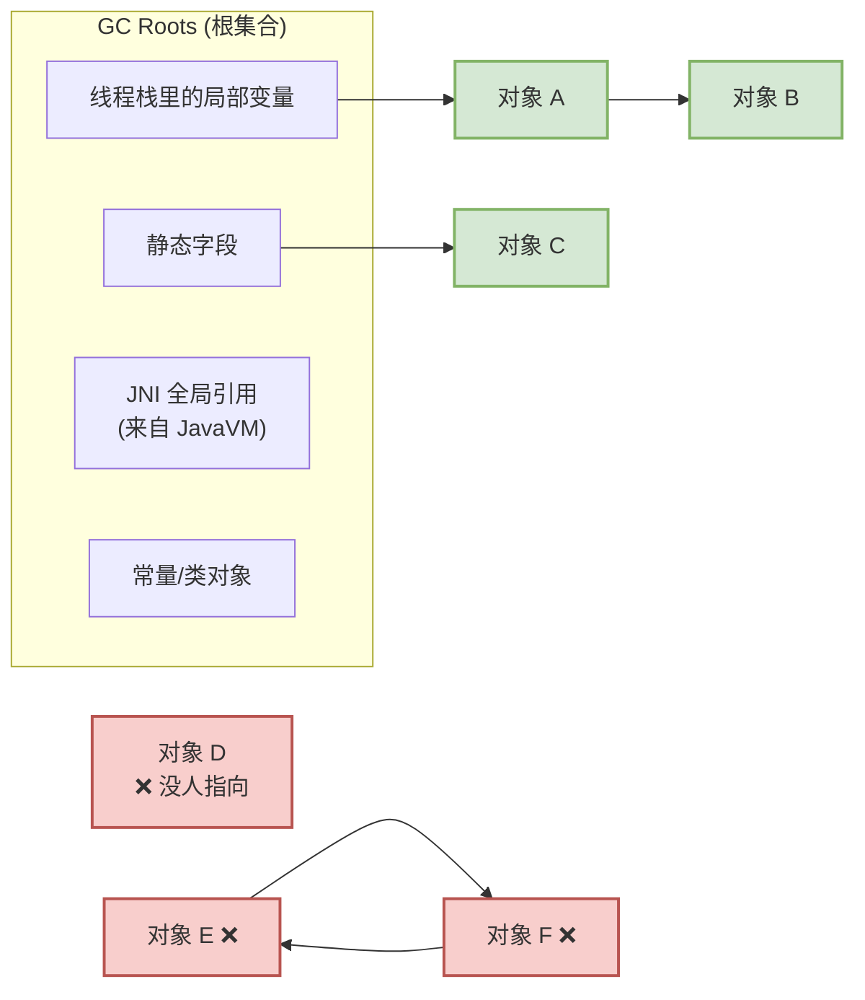
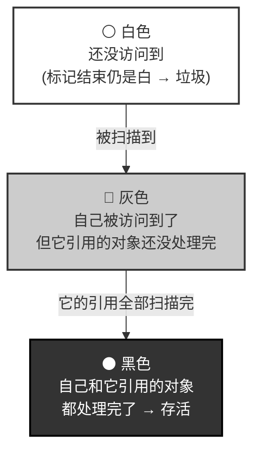
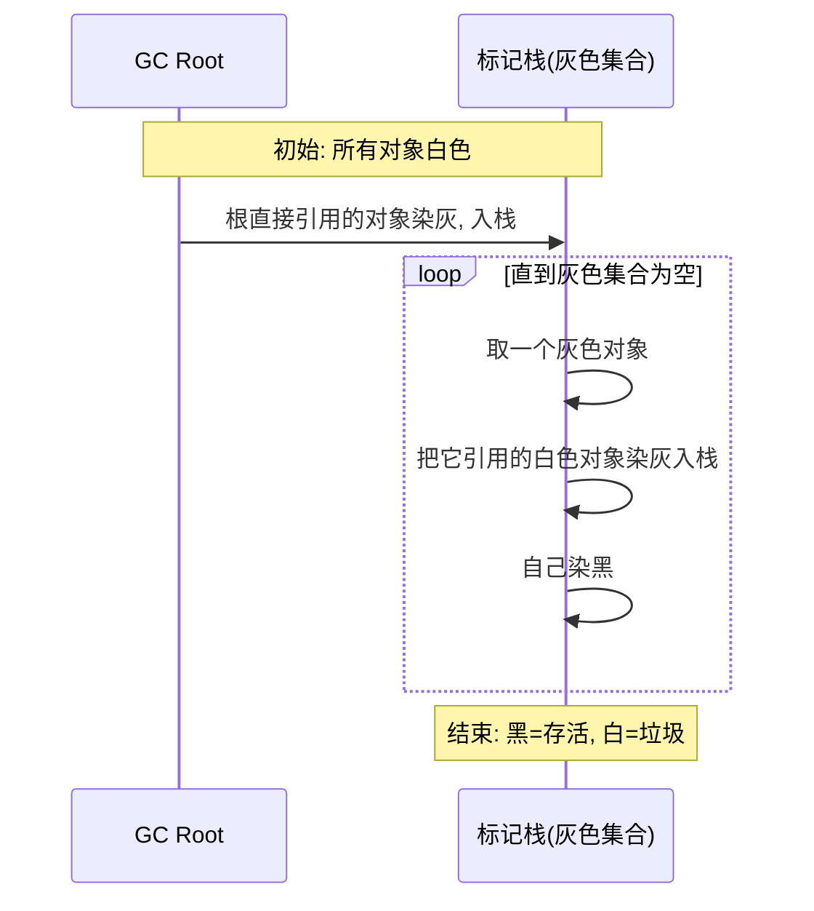
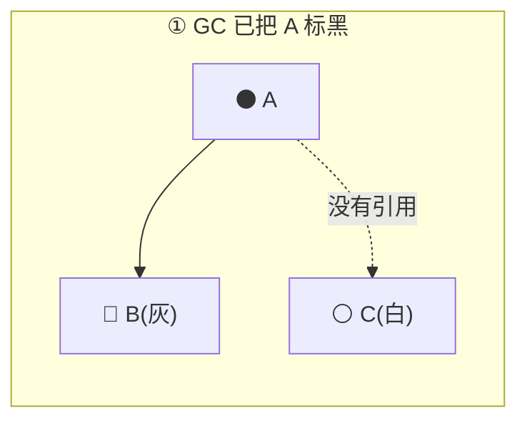
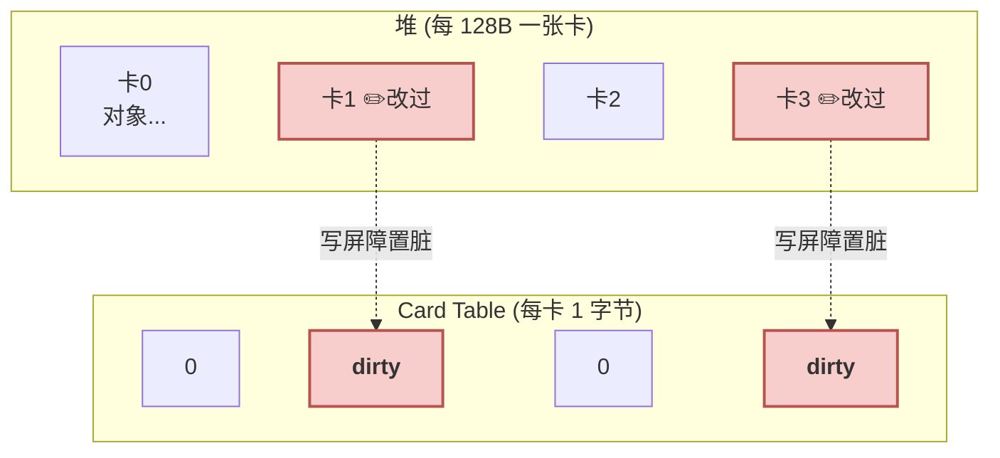
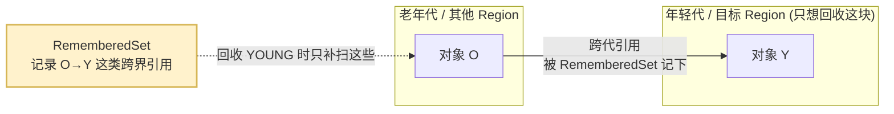
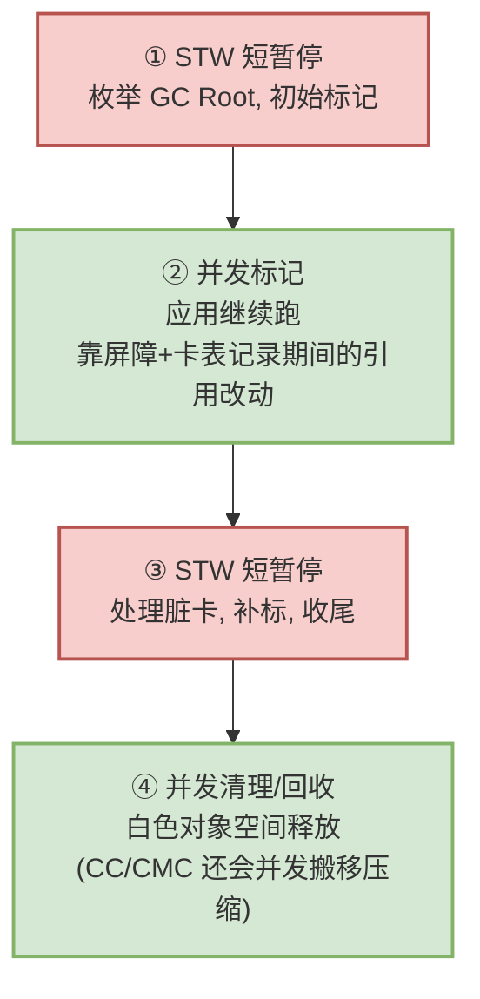

# 04 GC 原理篇：可达性、三色标记与屏障

> 目标：把「垃圾回收怎么判断一个对象还有没有用」这件事讲透——GC Root 是什么、三色标记怎么跑、为什么并发标记需要「屏障」来保证不漏标，以及 Card Table / Remembered Set 这些加速结构在解决什么问题。

承接前三篇：[01](01_architecture_overview.md) 讲了托管堆的由来，[02](02_heap_and_spaces.md) 讲了对象住哪，[03](03_allocation.md) 讲了对象怎么生。本篇讲对象怎么**被判死**。GC 算法的基础分类（标记清除/复制/标记整理/分代）在已有笔记 [垃圾回收](../gc.md) 里已有，本篇聚焦 ART 实际用的「可达性 + 三色 + 屏障」这套机制。

---

## What：垃圾的定义——不可达即垃圾

GC 判断对象死活，不看「有没有人还想用」（无法知道），而看「**从根还能不能走到它**」。走得到就是活的，走不到就是垃圾。



注意图里的 D、E、F：**E 和 F 互相引用，但整体从根不可达，照样是垃圾**。这就是为什么 ART 用可达性分析而非引用计数——引用计数解决不了这种循环引用（[垃圾回收](../gc.md) 笔记里也强调了这点）。

### GC Roots 到底有哪些

回收从「根」出发，根就是「不需要经过其他对象、直接就被持有」的引用。呼应 [01 篇](01_architecture_overview.md) 的 `Runtime` 关系图，根其实分散在 `Runtime` 的几个子系统里：

| GC Root 来源 | 挂在哪个运行时对象 |
|---|---|
| 各线程栈帧里的局部变量、寄存器里的对象引用 | `ThreadList` 里的每个 `Thread` |
| 类的静态字段引用的对象 | `ClassLinker` 加载的类 |
| **JNI 全局引用** | `JavaVMExt` 的全局引用表 |
| **JNI 局部引用** | 每个 `JNIEnv` 的局部引用表 |
| 常量、被 GC 固定的对象 | 各处 |

> 这正好呼应了 [01 篇](01_architecture_overview.md) 里那句「GC 能掌控全局，是因为它和线程列表、类加载器、JNI 引用表同属一个 `Runtime`」——枚举 GC Root 时，GC 要把这些子系统全都问一遍。

---

## What & Why：三色标记法

「从根遍历、标记可达对象」听起来简单，但 GC 想**边标记边让应用继续跑**（并发），就需要一个能表达「标记进度」的模型。这就是三色标记法。

给每个对象三种颜色：



标记过程就是「把灰色对象逐个变黑、顺手把它引用的白色对象染灰」，直到没有灰色为止：



标记结束后，**还是白色的对象就是垃圾**，可以回收。

> 📷 **配图与延伸阅读**：三色标记的权威定义与「三色不变式（tri-color invariant）」的严谨表述，见内存管理参考手册 [Memory Management Reference: Tri-color marking](https://www.memorymanagement.org/glossary/t.html)。想本地留存分步动图/示意，可存到 `art_img/tricolor.png` 后改用 ``。

---

## Why：并发标记的「漏标」难题，与屏障的角色

如果标记期间把整个世界停下（STW，Stop-The-World），一切都简单。但 STW 会造成明显卡顿，所以 ART 要**并发标记**——GC 在标记，应用线程还在改对象引用。这就带来一个正确性风险：**漏标**。

### 漏标是怎么发生的

考虑这个经典场景（GC 正在并发标记）：



此刻应用线程做了两步操作：
1. 让 **A（已黑）指向 C（白）**：`A.field = C`
2. 断开 **B → C 的路径**（假设原本只有 B 能到 C）

现在 C 只被黑色的 A 引用。但 GC 认为「黑色对象已经处理完了，不会再回头看它」——于是 **C 永远不会被染灰，标记结束还是白色，会被当垃圾错杀**。这就是漏标，是并发 GC 必须解决的正确性 bug。

漏标发生，需要**同时**满足两个条件：
- 一个**黑色**对象新增了指向**白色**对象的引用；
- 且这个白色对象**不再有**任何灰色对象能到达它。

### 屏障：GC 用来「不漏标」的记录机制

破坏上面任一条件即可。ART 的收集器为此在「应用线程读/写对象引用」这个动作上挂一小段 GC 逻辑，叫**屏障（barrier）**。请把它理解成——**GC 为了保证自己标记正确，在对象引用被改动时做的一次记账**，而不是什么通用的内存拦截手段。它服务的唯一目的就是「维护对象图的一致视图」。

- **写屏障（Write Barrier）**：当应用给一个对象的引用字段赋值时，顺手记一笔「这个对象被改过，重新看一眼」。这样即便黑色对象新指向了白色对象，GC 也会因为这笔记录而回头补标，白色对象不会被错杀。CMS/CMC 用它。
- **读屏障（Read Barrier）**：当应用读取一个对象引用时，顺手检查/修正这个引用（比如对象已被搬走要读到新地址）。CC 收集器用它来支撑「一边搬对象一边让应用跑」。

> 两种屏障都只在「对象引用被读写」时触发、只做 GC 记账，是 GC 正确性的一部分。它们各自服务哪个收集器、代价如何，[05 收集器演进篇](05_gc_collectors.md) 会具体对照。

---

## How：Card Table —— 写屏障的落地结构

写屏障要「记一笔哪些对象被改过」，这笔账记在哪？答案是 **Card Table（卡表）**。

思路很朴素：把整个堆按固定大小（ART 里是 **128 字节**一张「卡」）划成格子，用一个字节数组，每个字节对应一张卡。写屏障触发时，不精确记录是哪个对象，只把「被改对象所在的那张卡」标记为脏（dirty）。



- **写的时候**：只需一条指令把对应卡字节置脏，极快，几乎不拖慢应用。
- **GC 的时候**：只扫描「脏卡」覆盖的那 128 字节里的对象，而不是全堆重扫——把「找出被改过的对象」的成本从 O(全堆) 降到 O(脏卡)。

```cpp
// 源码：art/runtime/gc/accounting/card_table.h（只看核心常量与语义）
class CardTable {
  static constexpr size_t kCardShift = 7;             // 2^7 = 128 字节一张卡
  static constexpr size_t kCardSize = 1 << kCardShift;
  static constexpr uint8_t kCardDirty = 0x70;         // 脏卡标记值
  // MarkCard(obj): 把 obj 所在的卡置脏 —— 写屏障就调用它
};
```

---

## How：Remembered Set / Mod-Union —— 让分代与分区回收成立

有了卡表还不够。分代 GC（[gc.md](../gc.md) 讲过年轻代/老年代）和分区 GC 都想「只回收一小块，别扫全堆」。但「只扫一小块」有个前提问题：**这一小块里的对象，可能被块外的对象引用着**，不扫外面怎么知道？

这就是 **Remembered Set（记忆集）** 和 **Mod-Union Table** 要解决的——它们记录「跨区/跨代的引用」，让 GC 回收某一小块时，能只补扫「外部指向这块」的少量引用，而不必扫描整个堆：



- **Remembered Set**：记录「从别的空间指向本空间」的引用。回收本空间时，把这些外部引用也当作根，就不会误杀被外部引用的对象。
- **Mod-Union Table**：卡表在「非并发扫描时机」之间会被清掉，Mod-Union 把「镜像空间/Zygote 空间指向 App 空间」这类长期跨界引用累积记下来，避免每次都重扫这些只读大空间。

一句话：**卡表解决「堆内谁被改了」，Remembered Set / Mod-Union 解决「跨区/跨代谁指向了我」——都是为了让 GC 少扫、快扫，同时不漏。**

---

## How：STW 与并发——一次 ART GC 的骨架

把上面拼起来，一次现代 ART 并发 GC 大致是这个骨架（细节因收集器而异，见 [05](05_gc_collectors.md)）：



设计目标始终如一：**把必须停顿（STW）的部分压到最短，把耗时的标记/清理/搬移尽量放到与应用并发执行**——屏障、卡表、记忆集全都是为「并发时仍不漏标、不错杀」这个正确性目标服务的。

---

## 课后验证

### 思考题

1. 为什么 ART 用可达性分析而不是引用计数？举一个引用计数处理不了的例子。
2. 三色标记里，「黑色」和「灰色」的本质区别是什么？为什么标记结束后白色就是垃圾？
3. 并发标记的「漏标」需要同时满足哪两个条件？写屏障是通过破坏哪个条件来防止漏标的？
4. Card Table 为什么用「128 字节一张卡」这种粗粒度，而不精确记录到具体对象？粗粒度的代价和收益各是什么？
5. Remembered Set 和 Card Table 各自解决的问题有什么不同？为什么分代/分区回收两者都需要？

<details>
<summary>参考答案</summary>

1. 引用计数无法回收循环引用（如 E↔F 互指但整体不可达），且每次引用变动都要改计数、并发下成本高。可达性分析从根出发遍历，天然不受循环引用影响。
2. 灰色=自己已被访问但其引用的对象还没处理完；黑色=自己及其直接引用都已处理完。标记从根出发，凡可达对象最终都会被染黑，所以结束仍为白的必然从根不可达，即垃圾。
3. 条件：①一个黑色对象新增了指向白色对象的引用；②该白色对象不再有灰色对象可达。写屏障在「给引用字段赋值」时记账（置脏卡），使 GC 回头重扫该对象，从而破坏条件①的后果——被黑对象新指的白对象会被补标。
4. 粗粒度让写屏障只需一条指令置脏，几乎不拖慢应用（写路径极热，必须极快）；代价是 GC 时要扫整张脏卡的 128 字节、可能扫到没改的对象（假阳性）。收益是写快、整体净赚。
5. Card Table 记录「堆内哪些区域被写过」（脏卡），服务于并发标记补标；Remembered Set 记录「跨空间/跨代的引用指向」，服务于「只回收一小块时不误杀被外部引用的对象」。分代/分区回收既要并发正确（卡表）又要能局部回收（记忆集），故都需要。

</details>

### 小实验：观察一次 GC 的停顿构成

```shell
# 抓 ART 的 GC 日志，观察一次 GC 里的 paused（STW）时长 vs 总时长
adb logcat -s art | grep -iE "Concurrent|paused|GC freed"
```

一条典型 GC 日志形如：`Concurrent ... GC freed 12345 objects ... paused 1.2ms+0.8ms total 45ms`。观察：
- `paused` 是两段很短的 STW（对应上图 ① 和 ③）；
- `total` 远大于 `paused`——中间的差值就是与应用并发执行的标记/清理时间（②④）。
- 体会「把停顿压短、把耗时并发化」这个设计目标在真实日志里的样子。

> 下一篇：[05 收集器演进篇：CMS → CC → CMC](05_gc_collectors.md)——同样的原理，三代收集器给出了三种不同的工程答案。
