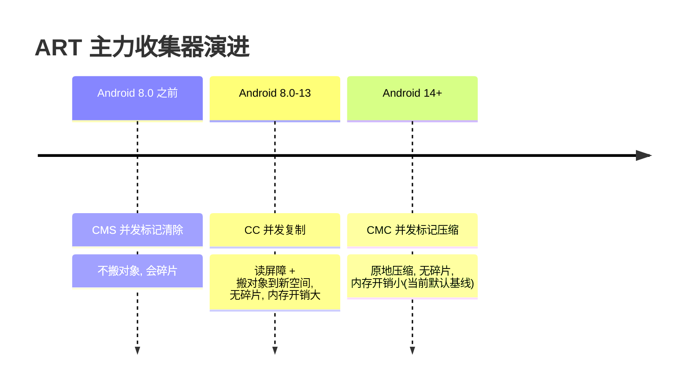
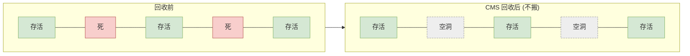
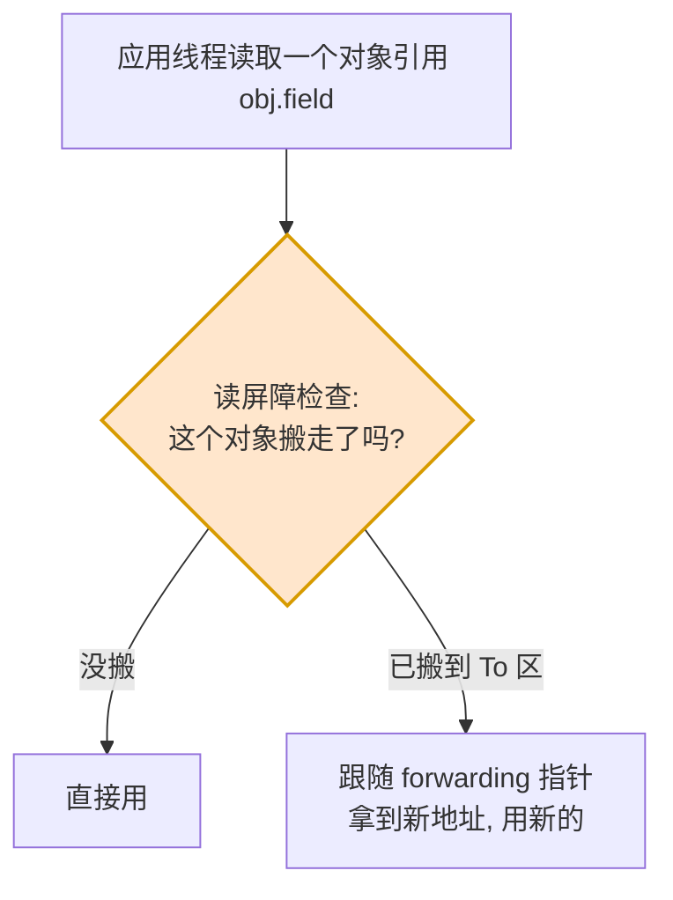
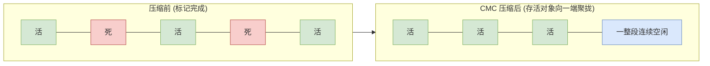
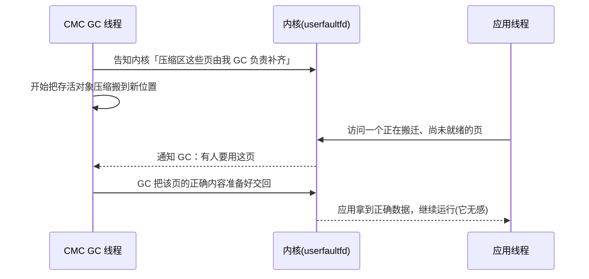
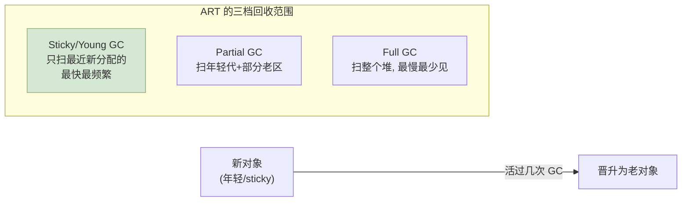
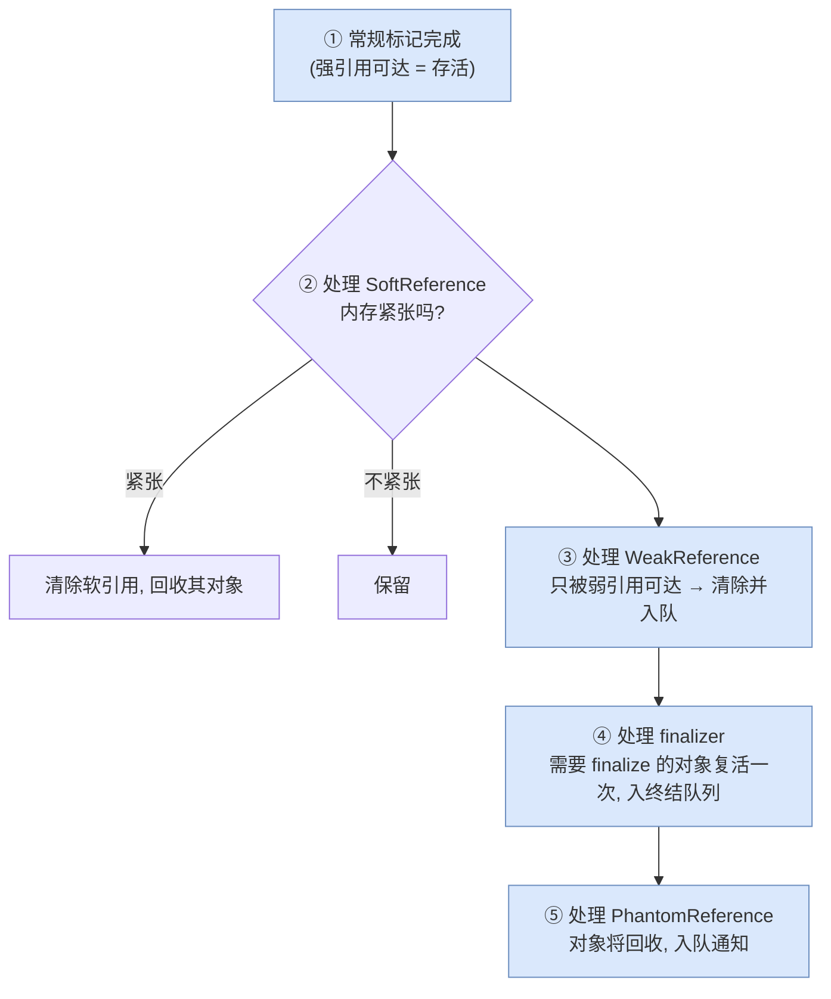
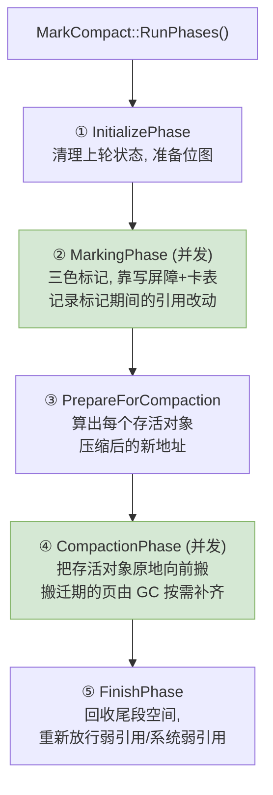

# 05 收集器演进篇：CMS → CC → CMC

> 目标：把 [04 篇](04_gc_principles.md) 的原理落到具体收集器上。同样是「标记存活、回收垃圾」，ART 三代收集器（CMS / CC / CMC）在「要不要搬对象、用读屏障还是写屏障、怎么消碎片」上给出了三种不同工程答案。理解它们的取舍，才能看懂 GC 日志、才知道该调什么。

承接 [04 GC 原理篇](04_gc_principles.md)：三色标记、屏障、卡表是共同地基；[gc.md](../gc.md) 里那张 CMS/CC/CMC 对比表是结论速查，本篇把结论背后的「为什么」讲开。

---

## What：三代收集器的一句话画像



| | CMS（Concurrent Mark Sweep） | CC（Concurrent Copying） | CMC（Concurrent Mark Compact） |
|---|---|---|---|
| 核心动作 | 标记 + 清除，**不搬对象** | 标记 + **复制**对象到新空间 | 标记 + **原地压缩** |
| 碎片 | 会累积碎片 | 无（每次整理） | 无（压缩消除） |
| 额外内存 | 低 | **高**（需 To 空间） | 低（原地压缩） |
| 主要屏障 | 写屏障 | **读屏障** | 写屏障 |
| main space | RosAlloc space | RegionSpace | **BumpPointerSpace** |
| 地位 | 历史默认 | 8.0–13 默认 | **14+ 默认基线** |

下面逐个讲清「它想解决前一代的什么痛点」。

> 📷 **配图与延伸阅读**：CMC（userfaultfd 并发标记压缩）的默认启用范围、调试字段与「约 30% 内存节省」的官方说明，见 AOSP 官方文档 [Debug ART garbage collection](https://source.android.com/docs/core/runtime/gc-debug)。想本地留存 CC vs CMC 的对比时间线图，可存到 `art_img/cc_vs_cmc.png` 后改用 ``。

---

## CMS：不搬对象的代价——碎片

CMS 是最直白的方案：用 [04 篇](04_gc_principles.md) 的三色标记找出存活对象，然后把死对象所在的内存**标记为空闲、原地回收**，不移动任何存活对象。



- **优点**：不搬对象 → 不用读屏障、额外内存开销低、实现相对简单。
- **痛点**：回收后存活对象之间留下**大小不一的空洞**。跑久了碎片累积，可能出现「空闲总量够、但没有一段连续空间能装下一个较大对象」的尴尬——这正是 [gc.md](../gc.md) 里说标记清除「长期运行导致碎片严重」的含义。CMS 配合 RosAlloc 的分桶来缓解，但根治不了。

**结论**：想彻底消碎片，就得搬对象。于是有了 CC。

---

## CC：搬对象消碎片——代价是读屏障与双份空间

CC（并发复制）用 [02](02_heap_and_spaces.md)/[03](03_allocation.md) 讲过的 **RegionSpace**：把存活对象从「From 区」复制到「To 区」，复制的同时紧挨着摆放，天然无碎片（就是 [gc.md](../gc.md) 里的复制算法，只是做成了并发）。

### 难点：一边搬，应用一边在访问

对象正被 GC 搬到新地址，而应用线程可能同时在读这个对象的引用——它手上还是旧地址。怎么保证应用永远访问到「正确的那一份」？CC 的答案是 **读屏障**：



- 每次应用读对象引用，读屏障顺手确认「这个对象是否已被搬走」，若搬走了就跟随一个 **forwarding（转发）指针**读到新副本。呼应 [04 篇](04_gc_principles.md)：读屏障就是 GC 为「并发搬移下仍读到正确对象」而做的记账/修正，只服务于这个目的。
- **代价一**：读屏障加在「读引用」这个极高频操作上，有持续的运行时开销（[gc.md](../gc.md) 提到 CMC 的一大改进正是「消除了 ReadBarrier」）。
- **代价二**：复制需要一块 To 空间，极端情况接近**双倍内存**（[gc.md](../gc.md) 里「内存开销极高」说的就是它）。移动设备内存紧张，这个代价很肉疼。

**结论**：既想搬对象消碎片（保留 CC 的好），又想去掉读屏障开销、去掉双份内存（去掉 CC 的痛）。于是有了 CMC。

---

## CMC：原地压缩——当前默认基线

CMC（并发标记压缩，Concurrent Mark Compact，Android 14 起成为默认基线并延续至今）的目标很明确：**无碎片 + 低内存开销 + 无读屏障**。它的 main space 不再是 CC 的 RegionSpace，而换成了 `BumpPointerSpace`（[02](02_heap_and_spaces.md)/[03](03_allocation.md) 讲过）——一整块指针推进空间。做法是标记后把存活对象在这块空间里**原地向一端压缩**（[gc.md](../gc.md) 的标记整理算法的并发版），而不是像 CC 那样复制到另一块等大的空间。



对比 CC：CC 要一块等大的 To 空间；CMC 是**原地向一端挪**，压缩完后面是一整段连续空闲，不需要预留双份内存。

### CMC 怎么做到「并发压缩」——用 userfaultfd 让 GC 接管搬移期的缺页

压缩要移动对象，同样面临 CC 那个难题：搬的过程中应用还在访问这些内存页。CC 用读屏障在「每次读引用」时解决；CMC 换了一条更省的路——**借助 Linux 的 userfaultfd 机制，把「对象正在被搬的那些内存页」交由 GC 自己处理**，从而不需要在应用的每次读操作上加屏障。

这里只需从 **GC 流程** 的角度理解它的作用，不必深入内核细节：



要点（都锚定在「GC 做并发压缩」这个唯一目的上）：
- **它替代了读屏障**：应用不再需要为每次读引用付出屏障开销——这正是 [gc.md](../gc.md) 里 CMC 「消除了 ReadBarrier、Object 访问性能提升、BinarySize 减小」的来源。
- **它降低了内存峰值**：原地压缩不需要双份空间，[gc.md](../gc.md) 里「GC 过程中 RSS 峰值降低」说的就是这个。
- **它的代价**（同样出自 [gc.md](../gc.md)）：一次 GC 活跃对象可能被拷贝两次；搬迁期若应用访问未就绪页会产生等待延迟，可能造成 GC 期间的性能抖动；且早期未实现 Young GC（见下）。

> 用一句话收束：CMC 把 CC「每次读都掏屏障」的持续小额税，换成了「只在真正访问到搬迁中页面时才处理」的按需成本——大多数页搬完前根本没人碰，于是整体更省。userfaultfd 在这里的角色，仅仅是「让 GC 能在压缩期按需补齐页面」这一件事。

---

## Why：分代（Generational）——大多数对象朝生夕死

三代收集器之上还有一个正交的优化维度：**分代**。依据是经验规律「绝大多数对象创建后很快就死」（[gc.md](../gc.md) 的分代思想）。既然如此，何必每次都扫全堆？只扫「新对象」这一小片，回收效率最高。



- **Sticky/Young GC**：只回收「上次 GC 以来新分配的对象」，最快、最频繁。要能只扫这一小片而不漏，靠的正是 [04 篇](04_gc_principles.md) 的 **卡表 + Remembered Set**——记录「老对象指向新对象」的跨代引用。
- **Partial / Full GC**：范围逐级扩大，代价逐级升高，频率逐级降低。
- CC 天然支持分代（sticky）；CMC 早期以整堆压缩为主、Young GC 是后续演进方向（对应 [gc.md](../gc.md) 里「暂时没有实现 YoungGC」那条）。

---

## How：引用处理——soft/weak/phantom/finalizer 在 GC 里怎么被处理

[对象生命周期管理](../lifecycle_management.md) 讲过四种引用类型的语义（强/软/弱/虚）。它们的「特殊回收时机」正是在**每次 GC 的标记末尾**由收集器统一处理的：



处理顺序是有讲究的（软 → 弱 → finalizer → 虚），对应引用「强度」递减。关键理解：**引用类型不是应用自己去轮询，而是 GC 在标记阶段顺带判定并入队 `ReferenceQueue` 的**——这也是为什么 `SoftReference` 的回收时机「受 GC 策略影响、不可精确预测」（[lifecycle_management.md](../lifecycle_management.md) 的提醒）。软引用是否清除，取决于当前这次 GC 判断的内存松紧。

---

## How：GC 触发类型与日志解读

ART 会因不同原因触发 GC，日志里的 GC「原因」字段是排查的重要线索：

| 触发原因（日志关键字） | 含义 | 该不该担心 |
|---|---|---|
| `Explicit` | 代码调了 `System.gc()` | 通常不建议手动调 |
| `GC_FOR_ALLOC` / `Alloc` | 分配要不到内存、当场同步 GC（[03 篇](03_allocation.md)） | 频繁出现 = 内存压力大，**要关注** |
| `Concurrent` | 堆用量到阈值，后台并发 GC | 正常 |
| `Background` / `CollectorTransition` | 进入后台，切成更省内存的策略（[06 篇](06_tuning_and_debugging.md)） | 正常 |
| `NativeAlloc` | native 分配压力触发 | 关注 native 内存 |

一条典型日志的读法：

```
Concurrent mark compact GC freed 45230(2MB) AllocSpace objects,
  12(480KB) LOS objects, 33% free, 18MB/27MB,
  paused 456us+1.2ms total 34.5ms
```

- `mark compact` → 当前是 CMC 收集器；
- `freed 45230(2MB)` → 回收了多少对象/内存；`LOS objects` → 大对象空间也回收了；
- `33% free, 18MB/27MB` → 回收后 18MB 在用、堆总 27MB、33% 空闲；
- `paused 456us+1.2ms` → 两段 STW（对应 [04 篇](04_gc_principles.md) 骨架的 ①③），很短；
- `total 34.5ms` → 整次 GC 墙钟时长，远大于 paused，差值是并发执行的部分。

会读这行日志，就能快速判断「这次 GC 是什么收集器、回收了多少、卡了用户多久」。

---

## 深入源码：CMC 一次回收的阶段与关键数据结构

前面从「设计取舍」讲了 CMC，这一节沿着源码把「一次 CMC 到底分几步、每步靠哪些数据结构记账」摊开，方便你对着 AOSP 读。所有内容都锚定在「GC 如何组织一次标记 + 压缩」这一件事上。

> 主源码：`art/runtime/gc/collector/mark_compact.h` / `mark_compact.cc`，收集器类是 `art::gc::collector::MarkCompact`，入口是 `MarkCompact::RunPhases()`。

### 五个阶段：`RunPhases()` 的骨架



对照 [04 篇](04_gc_principles.md) 的「STW 短 + 并发长」骨架：② 标记和 ④ 压缩是耗时的大头，都做成**并发**；只有阶段切换处有很短的 STW。

### 关键数据结构：压缩靠「记账」而非「试探」

CMC 能原地压缩而不乱套，靠的是在标记阶段就把「谁活、活了多少、搬到哪」算清楚，全记在几张表里：

| 数据结构（字段名） | 作用 |
|---|---|
| **mark bitmap / `live_words_bitmap_`** | 位图，标记 BumpPointerSpace 里哪些「字」属于存活对象。压缩阶段线性扫这张位图就知道要搬谁 |
| **`chunk_info_vec_`** | 把空间按固定粒度切成 chunk，逐 chunk 累计「存活字节数」。用它做前缀和，就能 O(1) 算出任一存活对象**压缩后的新偏移** |
| **`first_objs_moving_space_`** | 记录每个页里的第一个存活对象。这样当应用访问到某个搬迁中的页时，GC 能只根据这张表**局部重建**该页内容，而不必回溯整个空间 |
| **`post_compact_end_` / black-dense 优化** | 压缩后存活区的末端；对「几乎全是存活对象」的密集前段可跳过搬迁，省功 |

一句话：**压缩前先用位图 + chunk 前缀和把「新地址」全部算好，压缩时就变成一次确定性的线性搬迁**——这也是 [gc.md](../gc.md) 说 CMC「一次 GC 活跃对象可能被拷贝两次」的来源：一次是计算/整理阶段的处理，一次是真正搬到新位置。

### 收尾：重新放行弱引用

`FinishPhase` 里有一步是重新放行「系统弱引用」（`Runtime::AllowNewSystemWeaks()` 一类）——因为标记/压缩期间，为保证一致性会暂时冻结弱引用的新增。这一步呼应 [04 篇](04_gc_principles.md) 讲的引用处理：弱/软/虚引用的最终入队判定，都由收集器在这一带统一完成。（题外话：这一步在「调试器挂着 + JVMTI ObjectFree 事件」的特定场景下曾出现过死锁问题，见文末参考。）

> 想读得更细，建议顺序：先 `mark_compact.h` 看类的字段（就是上表那些），再 `RunPhases()` 看五个阶段的调用顺序，最后才钻单个阶段的实现。**先数据结构、再流程、后细节**——和本系列的顺序一样。

---

## 课后验证

### 思考题

1. CMS 不搬对象带来什么好处、什么坏处？为什么说「碎片」是它的根本局限？
2. CC 为什么必须要读屏障？它的「双倍内存」代价从何而来？
3. CMC 相比 CC，去掉了读屏障、降低了内存峰值，它是靠什么机制做到「并发压缩」的？这个机制在 GC 流程里只负责哪一件事？
4. Sticky/Young GC 为什么能「只扫一小片就不漏」？它依赖 [04 篇](04_gc_principles.md) 的哪个结构？
5. `SoftReference` 的回收时机为什么不可精确预测？它是在 GC 的哪个阶段被判定的？
6. 日志里频繁出现 `GC_FOR_ALLOC` 和偶尔出现 `Concurrent`，分别说明什么？
7. （源码题）CMC 为什么能在压缩阶段直接「线性搬迁」而不用边搬边试？`chunk_info_vec_` 和 mark bitmap 在其中各起什么作用？

<details>
<summary>参考答案</summary>

1. 好处：无需读屏障、内存开销低、实现简单。坏处：存活对象间留下大小不一的空洞，长期运行碎片累积，可能「空闲够但无连续大块」，无法根治，只能靠 RosAlloc 分桶缓解。
2. 复制会改变对象地址，而应用可能并发访问旧地址，读屏障负责让每次读引用都跟随 forwarding 指针拿到新副本，保证访问正确。双倍内存来自：复制需要一块等大的 To 空间容纳存活对象。
3. 靠 userfaultfd 让 GC 在压缩期「按需补齐正被搬迁的页面」，从而不必在应用每次读引用上加屏障。它在 GC 流程里只负责一件事：当应用访问到搬迁中尚未就绪的页时，让 GC 把该页正确内容准备好交回。
4. 因为卡表 + Remembered Set 记录了「老对象指向新对象」的跨代引用，回收年轻代时把这些跨代引用也当根扫，就不会漏掉被老对象引用的新对象。依赖 04 篇的卡表/记忆集。
5. 因为它由 GC 在标记末尾根据「当前内存松紧」决定是否清除，而 GC 何时跑、当时内存多紧都不确定，所以时机不可精确预测。它在常规标记之后、弱引用处理之前那一步被判定。
6. 频繁 GC_FOR_ALLOC = 分配在阻塞等待回收、内存压力大，需要关注；偶尔 Concurrent = 堆用量到阈值触发的正常后台并发 GC，属健康行为。
7. 因为在压缩前的 PrepareForCompaction 阶段就把每个存活对象的新地址算好了：mark bitmap 标出「哪些字是存活对象」，`chunk_info_vec_` 逐 chunk 累计存活字节数、做前缀和即可 O(1) 得到任一对象压缩后的偏移。有了这张「新地址表」，压缩阶段就退化成一次确定性的线性搬迁，无需边搬边探测空位。

</details>

### 小实验：确认你的设备在用哪个收集器

```shell
# 查看 ART 的 GC 相关属性（不同机型字段名可能不同）
adb shell getprop | grep -iE "dalvik.vm.*gc|heap"
# 抓一段 GC 日志，从关键字判断收集器（mark sweep / concurrent copying / mark compact）
adb logcat -s art | grep -iE "mark sweep|concurrent copying|mark compact"
```

观察点：
- 日志里出现 `mark compact` → CMC；`concurrent copying` → CC；`mark sweep` → CMS。
- 对照 [gc.md](../gc.md) 的对比表，看看你手上这台设备落在演进的哪一代。

---

## 参考

- AOSP 官方：[Debug ART garbage collection](https://source.android.com/docs/core/runtime/gc-debug)（CMC/userfaultfd 默认启用范围、GC 日志与调试字段）
- 源码：`art/runtime/gc/collector/mark_compact.{h,cc}`（`MarkCompact::RunPhases`）、`art/runtime/gc/collector/concurrent_copying.{h,cc}`
- CMC 收尾放行弱引用与 JVMTI 调试器的死锁案例：[Issue 535876878](https://issuetracker.google.com/issues/535876878)

> 下一篇：[06 实战篇：堆策略、调优与内存排查](06_tuning_and_debugging.md)——原理和收集器都懂了，最后落到「怎么调、怎么查」。
