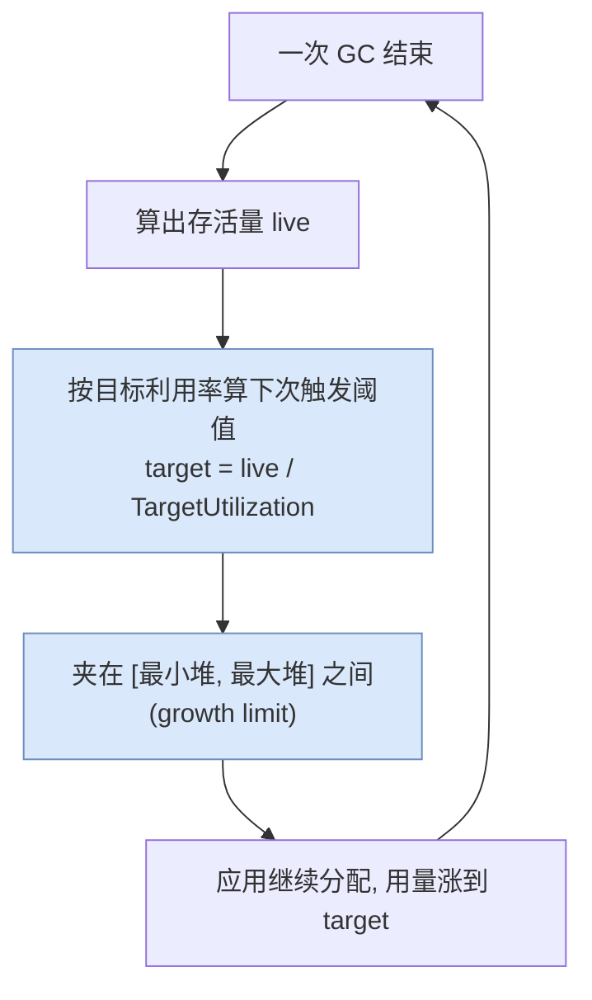
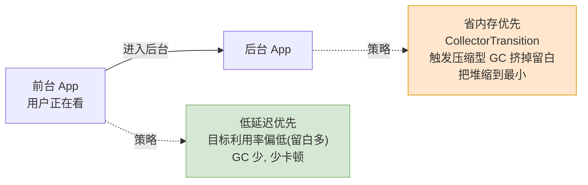
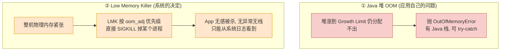
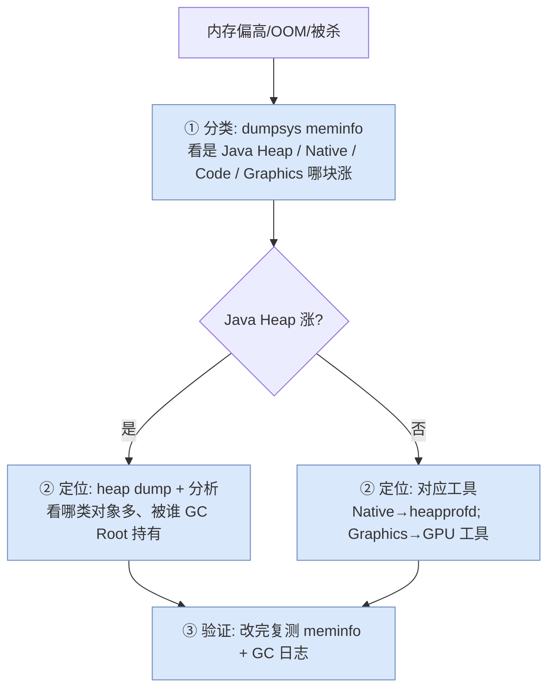

# 06 实战篇：堆策略、调优与内存排查

> 目标：把前五篇的原理落到手上。搞清楚 ART 堆是怎么「自己长大又自己收缩」的、前后台为什么用不同策略、OOM 和系统级 Low Memory Killer 的区别，以及一套「先分类、再定位、后验证」的内存排查流程和工具。

承接全系列：[01](01_architecture_overview.md) 内存版图 → [02](02_heap_and_spaces.md) Space → [03](03_allocation.md) 分配 → [04](04_gc_principles.md) 原理 → [05](05_gc_collectors.md) 收集器。本篇是收尾的「怎么用」。系统层的 [OOM](../../oom.md) 与 [OOM Killer](../../oom_killer.md) 已有专门笔记，这里侧重「ART 堆自身」的调与查。

---

## What：ART 堆不是固定大小，它会「呼吸」

初学者常以为「堆就是一个固定上限」。实际上 ART 堆的大小是**动态的**——每次 GC 后，ART 会根据「当前活了多少」重新决定「下次让堆长到多大再触发 GC」。这套逻辑叫**堆增长策略**，核心是一个目标利用率。



几个关键参数（都是 `gc::Heap` 的字段 / 系统属性）：

| 概念 | 含义 | 对应 |
|---|---|---|
| **Target Utilization** | 目标利用率，默认约 0.5–0.75。GC 后让「存活/堆容量」维持在这个比例 | 比例越低→堆留白越多→GC 越少但更费内存 |
| **Growth Limit** | 单个 App 允许的堆增长上限（`dalvik.vm.heapgrowthlimit`） | 到顶还不够 → OOM |
| **Heap Max Size** | 硬上限（`dalvik.vm.heapsize`） | 大堆应用（`largeHeap=true`）用它 |
| **Min Free / Max Free** | GC 后保留的最小/最大空闲量，给增长留缓冲 | 平滑「呼吸」幅度 |

一句话：**堆用量在「触发 GC」和「GC 后回落」之间来回波动，像呼吸；目标利用率决定呼吸的深浅——留白多则省 CPU 费内存，留白少则省内存费 CPU。**

```cpp
// 源码：art/runtime/gc/heap.h（只看相关字段语义）
class Heap {
  double target_utilization_;      // 目标利用率
  size_t growth_limit_;            // 堆增长上限
  size_t max_allowed_footprint_;   // 当前允许的堆足迹（下次 GC 阈值）
  size_t min_free_, max_free_;     // GC 后保留空闲的上下限
};
```

---

## Why：为什么前台后台要用不同策略

Android 要在有限 RAM 上同时保活一堆进程，所以 ART 对「前台可见的 App」和「退到后台的 App」区别对待——这是省内存的关键一环。



- **前台**：优先响应速度，容忍多占一点内存，尽量少 GC、GC 停顿短（用户看得见卡顿）。
- **后台**：优先省内存。ART 会做一次 **CollectorTransition** / 压缩，把堆里的留白挤掉、footprint 缩到最小——因为后台 App 随时可能被系统回收，占内存越少活得越久。你在日志里看到的 `Background` / `CollectorTransition` GC（[05 篇](05_gc_collectors.md) 的触发类型表）就是这一步。
- **`onTrimMemory()`**：系统还会回调 App，示意「该主动放缓存了」——呼应 [对象生命周期管理](../lifecycle_management.md) 里软引用/缓存收缩的用法。

---

## What：OOM ≠ 被系统杀——两种「内存不够」要分清

这是最容易混淆的一点，排查方向完全不同：



| | Java OOM | Low Memory Killer（LMK/LMKD） |
|---|---|---|
| 谁判定 | ART，堆到上限分配失败 | 系统，整机物理内存紧张 |
| 现象 | 抛 `OutOfMemoryError`，有 Java 栈 | 进程直接被 `SIGKILL`，无异常 |
| 影响范围 | 当前 App 的 Java 堆 | 任意进程（按 `oom_adj` 优先级挑） |
| 排查方向 | 查 Java 堆泄漏/大对象 | 查整机内存 + 本进程各类内存总量 |
| 深入 | 本系列 [04](04_gc_principles.md)/[05](05_gc_collectors.md) | 见 [OOM](../../oom.md) / [OOM Killer](../../oom_killer.md) |

**关键判断**：如果崩溃日志里有 `OutOfMemoryError` + Java 栈，那是 Java 堆的问题（本系列范围）；如果 App「悄无声息就没了」、只在 `logcat` 或 `dmesg` 里看到 `lowmemorykiller` / `Killing`，那是被系统杀的，得看整机内存和本进程的 Native/Graphics 等**非 Java 部分**（[01 篇](01_architecture_overview.md) 的内存版图）。

---

## How：一套内存排查流程——先分类，再定位

排查内存问题，最忌一上来就抓 heap dump。正确顺序是**先分类（是哪块内存涨了）→ 再定位（涨的是什么对象）→ 后验证（改完真的降了吗）**。



### 第一步工具：`dumpsys meminfo`（分类）

呼应 [01 篇](01_architecture_overview.md) 的内存版图，这一步只回答「**哪一块在涨**」：

```shell
adb shell dumpsys meminfo <pkg>
```

看输出里 `Java Heap` / `Native Heap` / `Code` / `Graphics` 哪个 `PSS` 最大、最异常。**这一步决定后面用哪套工具**——不同块的泄漏定位手段完全不同。

### 第二步工具（按分类分流）

| 涨的是 | 用什么定位 | 找什么 |
|---|---|---|
| **Java Heap** | Android Studio Memory Profiler / `am dumpheap` 导出 `.hprof` + MAT | 哪类对象数量异常、被哪个 GC Root 链持有不放（泄漏） |
| **Native Heap** | `heapprofd`（Perfetto 的 native 内存剖析） | 哪个 native 调用栈在持续分配不释放 |
| **全景/时间线** | **Perfetto** 系统级 trace | GC 事件、内存随时间曲线、卡顿与 GC 的关联 |
| **实时增长** | `adb logcat -s art`（[05 篇](05_gc_collectors.md) 日志读法） | GC 频率、`GC_FOR_ALLOC`、堆 footprint 变化 |

```shell
# 导出 Java 堆快照做泄漏分析
adb shell am dumpheap <pkg> /data/local/tmp/dump.hprof
adb pull /data/local/tmp/dump.hprof
# 转成 MAT/AndroidStudio 可读格式
hprof-conv dump.hprof dump-conv.hprof
```

> 自动化泄漏检测可用 LeakCanary（已有笔记 [leak_canary](../leak_canary.md)）——它本质就是用 [04 篇](04_gc_principles.md) 的可达性分析 + 弱引用（[lifecycle_management](../lifecycle_management.md)），在对象「本该被回收却仍可达」时报告泄漏链。

### 第三步：验证

改完别只看「不崩了」。回到 `dumpsys meminfo` 和 GC 日志复测：Java Heap 的 PSS 有没有真的降、`GC_FOR_ALLOC` 是不是变少了、footprint 曲线是否平稳。**没有前后对比的「修复」不算修复。**

---

## How：常用调优手段（克制使用）

调优的第一原则是**先测量再动手**，绝大多数 App 不需要动 ART 参数，优先改代码（少持有、及时释放、用对引用类型）。确需调整时：

| 手段 | 场景 | 注意 |
|---|---|---|
| `android:largeHeap="true"`（manifest） | 确实需要大堆（图像/编辑类） | 治标，滥用会挤占整机内存、更易被 LMK 盯上 |
| 减少大对象 / 复用缓冲 | 大 `Bitmap`、大数组频繁分配 | 大对象走 LOS（[03 篇](03_allocation.md)），复用比调参有效得多 |
| 用对引用类型 | 缓存、监听器 | 软/弱引用（[lifecycle_management](../lifecycle_management.md)）让 GC 能在紧张时回收缓存 |
| 响应 `onTrimMemory` | 后台主动放缓存 | 配合前后台策略，降低被杀概率 |
| 避免 `System.gc()` | —— | 手动触发常打乱 ART 的自适应节奏，通常有害无益 |

> 记住：ART 的堆策略（目标利用率、前后台切换、自适应触发）已经相当聪明。**多数「内存问题」是代码持有不当，不是 GC 不给力。** 调参是最后手段。

---

## 综合实验：完整跑一遍「分类 → 定位 → 验证」

准备一个可复现的泄漏：在测试 App 里，用一个 `static List` 不断往里塞对象且从不清空（模拟经典的静态集合泄漏）。然后：

```shell
PKG=你的测试包名

# ① 基线：先记一次 meminfo（重点抄下 Java Heap 的 PSS）
adb shell dumpsys meminfo $PKG | grep -A2 "App Summary\|Java Heap"

# ② 操作 App 触发泄漏（反复进出那个页面若干次）

# ③ 再记一次 meminfo，对比 Java Heap 是否单调上涨
adb shell dumpsys meminfo $PKG | grep -A2 "App Summary\|Java Heap"

# ④ 同时观察 GC 日志：泄漏会让存活量涨→堆频繁增长→GC 更频繁
adb logcat -s art | grep -iE "GC freed|GC_FOR_ALLOC|paused"

# ⑤ 导出堆快照定位是谁在泄漏
adb shell am dumpheap $PKG /data/local/tmp/leak.hprof
adb pull /data/local/tmp/leak.hprof
# 用 Android Studio / MAT 打开，看 static List 的持有链
```

预期观察：
- meminfo 的 `Java Heap` 随操作单调上涨、不回落；
- GC 日志里存活量（`X MB/Y MB` 的前一个数）越 GC 越大——GC 拼命跑也回收不掉，因为对象仍被 `static List`（GC Root 链，[04 篇](04_gc_principles.md)）可达；
- heap dump 里能看到那个 `static` 集合持有着一大堆本该死掉的对象。

把 `static List` 改成会清理的结构（或用弱引用），重跑上面步骤 ①–④，验证 Java Heap 回落、GC 恢复平稳——这一整套，就是内存排查的完整闭环。

---

## 课后验证

### 思考题

1. 为什么说 ART 堆会「呼吸」？目标利用率调低和调高，分别在拿什么换什么？
2. 前台和后台 App 的 GC 策略有什么不同？为什么后台要主动把堆压缩到最小？
3. `OutOfMemoryError` 和「被 Low Memory Killer 杀掉」有什么本质区别？各自应该往哪个方向排查？
4. 为什么内存排查要「先 `dumpsys meminfo` 分类，再上 heap dump」，而不是反过来？
5. 一次 GC 后存活量持续变大、GC 越来越频繁却回收不动，最可能是什么问题？怎么定位？

<details>
<summary>参考答案</summary>

1. 因为堆用量在「涨到阈值触发 GC」和「GC 后回落」之间反复波动。目标利用率调低→GC 后留白多→GC 更少但更占内存（省 CPU 费内存）；调高→留白少→更省内存但 GC 更频繁（省内存费 CPU）。
2. 前台低延迟优先、少 GC 少停顿、容忍多占内存；后台省内存优先，做 CollectorTransition/压缩把留白挤掉、footprint 缩到最小。因为后台进程随时可能被系统回收，占内存越少存活越久。
3. Java OOM 是 ART 判定「堆到上限分配失败」，抛异常有 Java 栈，查 Java 堆泄漏/大对象；LMK 是系统判定整机内存紧张、按优先级直接 SIGKILL 进程，无异常无栈，要查整机内存和本进程 Native/Graphics 等非 Java 部分。
4. 因为不同内存块（Java/Native/Graphics）的定位工具完全不同，先分类才能选对工具；若直接抓 Java heap dump，而问题其实在 Native/Graphics，就白忙且被误导。
5. 典型的 Java 内存泄漏——对象仍被某 GC Root 链（如 static 集合、未注销监听器）可达，GC 无法回收，于是存活量涨、堆频繁增长、GC 频繁但徒劳。用 heap dump + MAT/Profiler 看该类对象的 GC Root 持有链定位。

</details>

### 总复习：把六篇连成一条线

试着不看文档、用一句话串起来回答：**一个 `new Object()`，从 `Runtime` 拿到 `Heap`、在某个 `Space` 里由某个分配器零售出内存，到它不可达后被某代收集器标记回收，中间发生了什么？** 能顺畅讲完这条链，你就真的吃透 ART 的内存管理了。

- 拿堆：[01 架构篇](01_architecture_overview.md)
- 选 Space：[02 分区篇](02_heap_and_spaces.md)
- 分配器零售：[03 分配篇](03_allocation.md)
- 判死（可达性/三色/屏障）：[04 GC 原理篇](04_gc_principles.md)
- 谁来收（CMS/CC/CMC）：[05 收集器演进篇](05_gc_collectors.md)
- 怎么调怎么查：本篇
