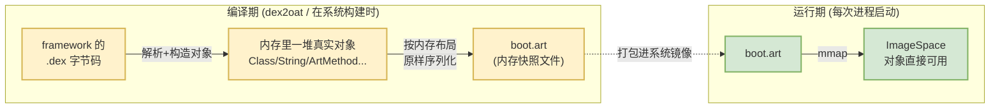
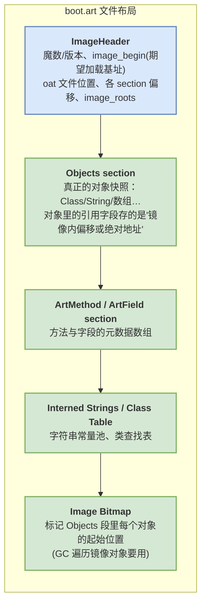
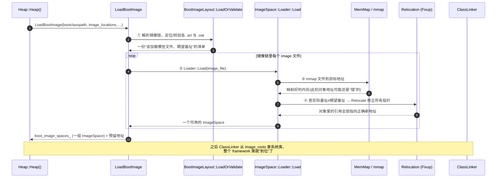
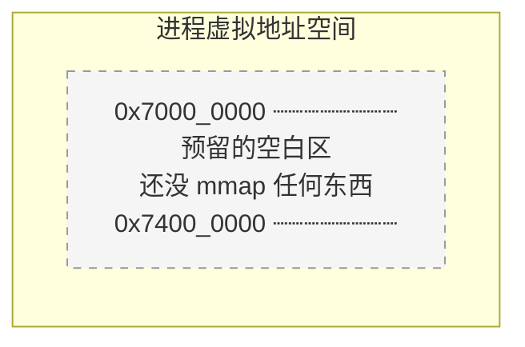
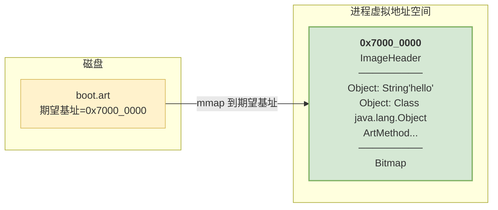
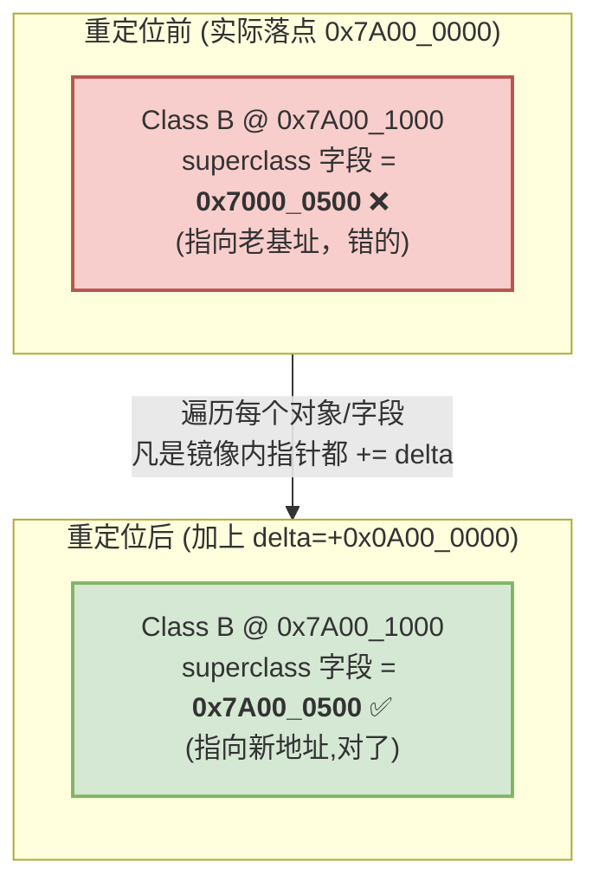
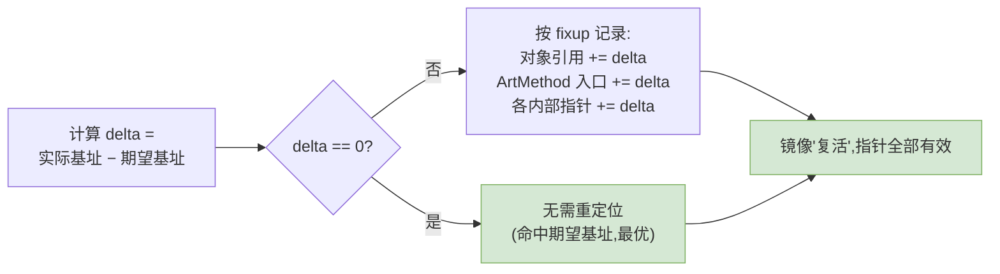
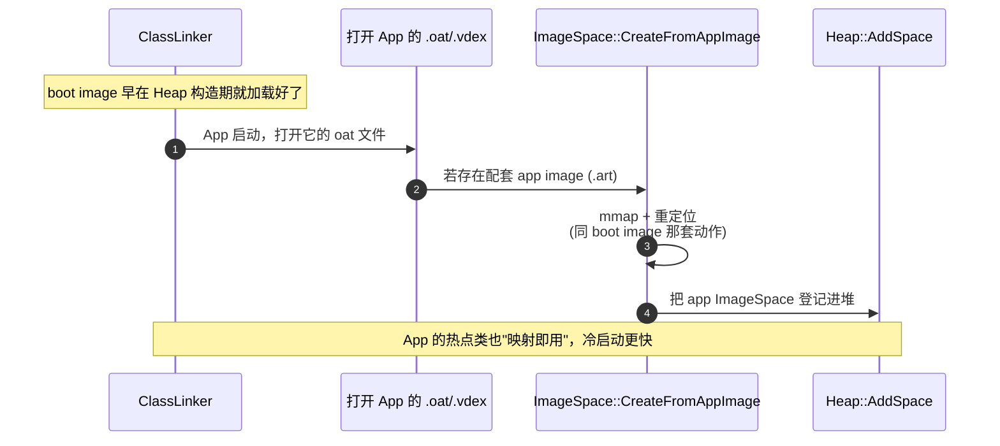
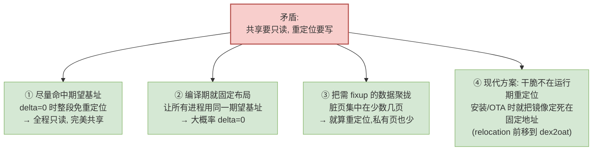
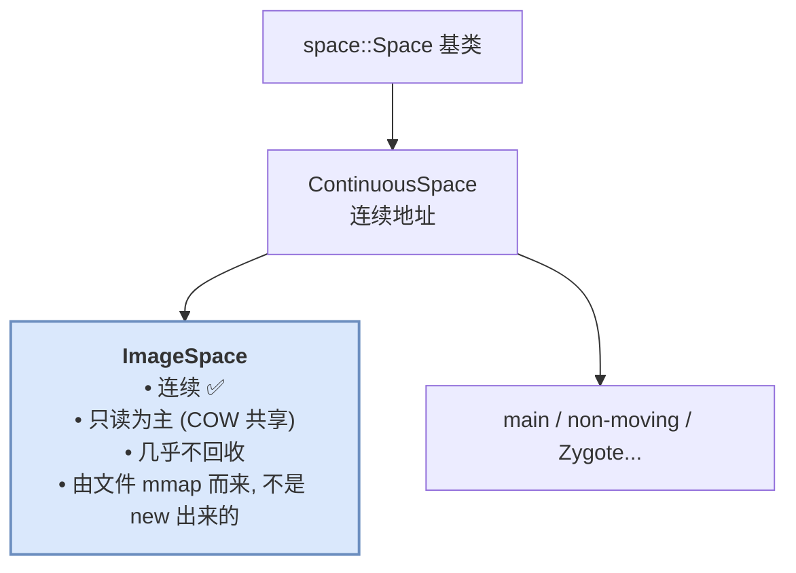

# 09 镜像篇：ImageSpace 的加载操作全过程

> 目标：把 [02 分区篇](02_heap_and_spaces.md) 里一笔带过的那句「`LoadBootImage` → mmap `boot.art`」彻底拆开——ImageSpace 到底是什么、`boot.art` 文件长什么样、从进程启动到「几百个类和对象凭空出现在堆里」这中间发生了哪些操作。全程用**分步动画式的图**逐帧演示，看完你能自己在脑子里"放"一遍这段流程。


---

## 先建立直觉：ImageSpace 是「内存快照」，不是「文件缓存」

初学者最容易犯的错，是把 `boot.art` 理解成"编译好的类的缓存文件"。不对。

一句话先钉死结论：**`boot.art` 是 ART 在编译期就把一堆 Java 对象（`Class`、`String`、方法元数据……）按它们在内存里的真实二进制布局，原样"拍照"存进的文件。运行时不需要"解析",只要 `mmap` 进来，那些对象就"活"在堆里了。**

对比一下就懂了：

| | 普通做法（Dalvik 时代思路） | ART 的 ImageSpace |
|---|---|---|
| 系统类怎么来 | 运行时读 `.dex` → 逐个解析 → `new` 出 `Class` 对象 | 编译期就 `new` 好，二进制快照存进 `boot.art` |
| 启动时的操作 | 解析、链接、构造对象……几千个类逐个走一遍 | `mmap` 一下文件，对象**直接就在内存里** |
| 多进程 | 每个进程各解析一份 | 一份物理内存，所有进程 COW 共享 |
| 类比 | 每次开机重新"装修房子" | 直接搬进"装修好的样板间" |

所以 ImageSpace 的本质是 **「预先构造好的堆内存镜像」**——它省掉的不是磁盘 IO，而是**运行时构造几千个对象的 CPU 开销**。这也是 ART 相比 Dalvik 启动飞快的核心原因之一。



> 记住这张图：**左边（编译期）干重活构造对象，右边（运行期）只做一次 `mmap`**。本篇后面所有细节，都是在解释「右边这一下 `mmap` 到底怎么做到让对象直接可用」。

---

## What：`boot.art` 文件内部长什么样

要讲清加载操作，得先知道被加载的东西的结构。一个 image 文件（无论 boot 还是 app）由 `art/runtime/image.h` 里的 `ImageHeader` 打头，后面跟几个"段（section）"。



几个关键字段先混个脸熟，后面加载流程全靠它们：

| 字段 / 段 | 作用 | 加载时的角色 |
|---|---|---|
| `image_begin_` | 编译期**期望**被加载到的虚拟地址基址 | 若运行时实际落点 ≠ 它，就要做 **relocation（重定位）** |
| `oat_file_begin_` / `oat_data_begin_` | 配套 `boot.oat`（机器码）的位置 | image 里的对象要指向 oat 里的方法入口 |
| `image_roots_` | 一组"根"对象（如预加载类数组、Well-known 类） | 加载完 ClassLinker 从这里拿到所有系统类 |
| Objects section | 对象快照本体 | `mmap` 进来后就是可用对象 |
| Image Bitmap | 记录每个对象起始地址的位图 | GC 要靠它遍历镜像里的对象 |

> **一个 boot image 可能被拆成多个文件**：早期是单个 `boot.art`，现在为了模块化（ART Mainline + 各 `bootclasspath` 扩展）常拆成 `boot.art` + `boot-framework.art` + … 一串。它们组成一条「boot image chain（镜像链）」，逻辑上首尾相接。加载器把它们当成有序的一组 `ImageSpace` 处理。

---

## Why：为什么要费这么大劲搞镜像

ImageSpace 的所有复杂度，都是在为三个收益买单：

1. **启动速度**：几千个系统类不用运行时构造，`mmap` 即用。这是"空间换时间"里最赚的一笔。
2. **跨进程省内存**：镜像是只读文件映射，Zygote fork 出的几百个 App 进程 COW 共享同一份物理页（细节见 [02 篇](02_heap_and_spaces.md#how-zygote-与写时复制省内存的关键一招)）。
3. **AOT 机器码的锚点**：`boot.oat` 里的机器码要调用系统类的方法、访问它们的字段，这些地址必须稳定。镜像给了这些对象一个**可预测的内存布局**，机器码才能被预编译。

代价就是本篇的主题——**加载时那套"让快照在新地址上重新活过来"的操作**。

---

## How：加载全流程总览（先看全景，再逐帧拆）

进程启动时，`Heap` 构造函数里调用 `ImageSpace::LoadBootImage`。整条链路如下，先扫一眼有个骨架，下面每一步都会用动画图单独拆开讲：



四个大步骤，记住这四个动词就行：**定位校验 → 映射 → 重定位 → 交接**。下面逐帧放动画。

---

## 🎬 分步动画：一次 boot image 加载的"逐帧回放"

我们把加载过程当成一段动画，一帧一帧看内存里发生了什么。假设镜像期望加载到地址 `0x7000_0000`。

### 第 1 帧：进程启动，地址空间还是空的

`Heap` 构造刚开始，先用 `MemMap` 向内核**预留**一大段连续地址（还没放任何东西），准备把 boot image、main space 等依次切进去。



### 第 2 帧：定位与校验（`BootImageLayout::LoadOrValidate`）

还没碰内存，先在磁盘上把"要加载哪些文件"搞清楚，并逐个校验能不能用。这一步决定了后面是**直接用现成的 `boot.art`**，还是**得先 `dex2oat` 现场生成**。

```mermaid
flowchart TD
    START["拿到 image_locations<br/>(如 /system/framework/boot.art)"] --> FIND{"文件存在?"}
    FIND -->|否| GEN["触发 dex2oat<br/>现场编译生成 boot.art"]
    FIND -->|是| CHK{"校验:<br/>版本魔数 / checksum /<br/>与 bootclasspath 的 .dex 是否匹配"}
    CHK -->|校验失败<br/>(系统OTA后dex变了)| GEN
    CHK -->|校验通过| OK["登记进加载清单:<br/>文件路径 + 期望基址 image_begin"]
    GEN --> OK
    OK --> NEXT["镜像链里下一个文件…"]

    classDef bad fill:#f8cecc,stroke:#b85450;
    classDef good fill:#d5e8d4,stroke:#82b366;
    class GEN bad;
    class OK good;
```

> 这一步是 ImageSpace 的"守门员"。系统 OTA、`bootclasspath` 变动、镜像损坏，都会在这里被 checksum 拦下，回退到 `dex2oat` 重建——否则用一份和当前 `.dex` 对不上的旧镜像，运行时必崩。

### 第 3 帧：把文件映射进来（`Loader::Load` → `MemMap::MapFileAtAddress`）

校验通过，正式 `mmap`。理想情况下，内核就把文件映射到期望基址 `0x7000_0000`。此刻对象的二进制字节已经在内存里了。



**关键问题来了**：对象内部的引用字段（比如某个 `Class` 对象指向它的父类 `Class`）当初是按"对象会落在 `0x7000_0000`"这个假设写死的。如果这一帧真的映射到了 `0x7000_0000`，那所有指针**天然正确**，皆大欢喜，跳过第 4 帧。

但现实里，因为 **ASLR（地址空间布局随机化）** 等原因，内核未必给得到期望基址……于是进入下一帧。

### 第 4 帧:重定位 —— 让快照在新地址上"复活"（Relocation / Fixup）

假设内核实际把文件映射到了 `0x7A00_0000`，比期望的 `0x7000_0000` 偏移了 `delta = +0x0A00_0000`。此时对象里所有"按老基址写死"的指针**全是错的**，指向一片虚空。



重定位就是**把镜像里每一个"指向镜像内部"的指针都加上 `delta`**。这是加载操作里最"重"的一步，涉及遍历对象引用、`ArtMethod` 里的入口地址、`ArtField`、字符串表指针等等。

它怎么知道哪些位置是需要修正的指针？——靠镜像里预存的一张 **relocation bitmap / 记录**，编译期就把"所有需要 fixup 的位置"记下来了，运行时照着改即可，不用全内存扫描。



> **为什么重定位会"轻微破坏"COW？** 重定位是对映射内存的**写操作**，会触发这些页的写时复制，让它们从"只读共享"变成"进程私有"。为把损失降到最低，ART 尽量让镜像命中期望基址（`delta=0` 时整段免于修改），并把需要 fixup 的数据尽量聚拢——细节见下文「COW 与 relocation 的博弈」。

### 第 5 帧：登记为 ImageSpace，交接给 ClassLinker

映射 + 重定位完成，这段内存正式包装成一个 `space::ImageSpace` 对象，`AddSpace()` 登记进 `Heap` 的 `continuous_spaces_`（见 [02 篇](02_heap_and_spaces.md#收尾addspace-把每个-space-归位)）。随后 `ClassLinker` 从 `image_roots_` 里把预加载类数组取出来，整个 framework 的类就"到位"了——上层再 `FindClass("java/lang/String")` 时，直接命中镜像里的现成 `Class` 对象，无需解析。


至此，动画放完。**「几百个类和对象凭空出现在堆里」的魔法，本质就是：映射一段二进制快照 + 把里面的指针按实际落点修正一遍。**

---

## How：源码落点——四步各自在哪个函数

把上面五帧对回源码，方便你在 cs.android.com 追：

```cpp
// art/runtime/gc/space/image_space.cc（精简调用链，对应动画各帧）

// ── Heap 构造里的入口（第 1 帧之后被调用）──
bool ImageSpace::LoadBootImage(
        const std::vector<std::string>& boot_class_path,
        const std::string& image_location,
        /* ... */
        std::vector<std::unique_ptr<ImageSpace>>* boot_image_spaces,  // out: 加载好的镜像链
        MemMap* heap_reservation) {                                   // out: 给后续 Space 预留的地址
  // 第 2 帧：解析镜像链 + 校验，决定"用现成的"还是"dex2oat 重建"
  BootImageLayout layout(image_location, boot_class_path, ...);
  if (!layout.LoadOrValidate(...)) {
    // 校验失败 → 走生成/回退分支
  }
  // 第 3~5 帧：对镜像链里每个文件逐个 Load
  for (const auto& image_file : layout.GetChunks()) {
    std::unique_ptr<ImageSpace> space = Loader::Load(image_file, ...);
    boot_image_spaces->push_back(std::move(space));
  }
  return true;
}

// ── 单个 image 文件的加载（第 3~4 帧核心）──
std::unique_ptr<ImageSpace> ImageSpace::Loader::Load(/* ... */) {
  // 第 3 帧：把文件映射到目标地址
  MemMap map = MemMap::MapFileAtAddress(target_addr, image_header.GetImageSize(),
                                        PROT_READ | PROT_WRITE, /* fd */..., ...);
  // 第 4 帧：实际落点 ≠ 期望基址就重定位
  if (map.Begin() != image_header.GetImageBegin()) {
    RelocateInPlace(image_header, map.Begin(), ...);   // 所有内部指针 += delta
  }
  // 第 5 帧：包装成 ImageSpace 返回
  return std::make_unique<ImageSpace>(..., std::move(map), ...);
}
```

| 动画帧 | 关键函数 | 文件 |
|---|---|---|
| 入口 | `ImageSpace::LoadBootImage` | `art/runtime/gc/space/image_space.cc` |
| ② 定位/校验 | `BootImageLayout::LoadOrValidate` | `image_space.cc` |
| ③ 映射 | `ImageSpace::Loader::Load` → `MemMap::MapFileAtAddress` | `image_space.cc` / `libartbase/base/mem_map.cc` |
| ④ 重定位 | `RelocateInPlace`（及其 `PatchObjects`/`FixupPointer`） | `image_space.cc` |
| 校验找不到回退 | `dex2oat` 现场生成 | `art/dex2oat/…` |
| 头结构定义 | `class ImageHeader` | `art/runtime/image.h` |

> 复核方法：cs.android.com 顶部搜索框粘 `ImageSpace::LoadBootImage` / `RelocateInPlace` / `class ImageHeader` 即可直达 `main` 分支对应文件；切换分支/标签可对照不同 Android 版本，函数名跨版本相当稳定。

---

## How：App Image —— 你自己 App 的那份小镜像

前面讲的都是 **boot image（系统框架的镜像）**。其实你的 App 也可以有自己的镜像——`app image`，通常是安装/优化时 `dex2oat` 为你的应用生成的 `.art`（伴随 `.odex`/`.vdex` 放在 `oat/` 目录）。

它装的是**你 App 里"启动时高频用到"的类和对象**（由 Profile 引导决定装哪些），目的和 boot image 一样：让 App 冷启动时这些类"映射即用"，不必逐个加载解析。

两者的关键差异：

| | boot image (`boot*.art`) | app image (`<app>.art`) |
|---|---|---|
| 装什么 | framework 系统类/对象 | 你 App 的热点类/对象（Profile 决定） |
| 何时加载 | `Heap` 构造期，`LoadBootImage` | `ClassLinker` 打开 App 的 oat 文件时 |
| 加载函数 | `ImageSpace::LoadBootImage` | `ImageSpace::CreateFromAppImage` |
| 共享范围 | 全系统所有进程 COW 共享 | 只属于你这个 App 的进程 |
| 生成时机 | 系统构建 / OTA 后 | App 安装、后台 `dex2oat` 优化 |



> 复核入口：`ImageSpace::CreateFromAppImage`（`image_space.cc`）。App image 的对象里如果引用了 boot image 的类（几乎必然），加载时还要校验"我依赖的那份 boot image 是不是当前这份"——对不上就放弃 app image，退化成正常加载。

---

## How：COW 与 relocation 的博弈 —— 一个绕不开的取舍

这是 ImageSpace 设计里最精妙、也最容易被忽略的一环，值得单独讲。

前面说过两件看似矛盾的事：

- **ImageSpace 靠只读文件映射实现跨进程 COW 共享**（省内存）。
- **重定位（relocation）要写这段内存**（触发 COW，破坏共享）。

一旦重定位写了某一页，那一页就从"全系统共享一份"变成"这个进程私有一份"，省内存的效果就在这些页上失效了。ART 用几招把损失压到最小：



演进脉络（大致时间线，帮助理解为什么老 ROM 里能看到 `boot.art` 和 `boot.art.rel` 之类的文件）：

- **早期**：每次启动都可能重定位，脏页较多。
- **引入 patchoat / 预重定位**：把重定位工作从"每次启动"前移到"安装/OTA 一次性做好"，运行期尽量 `delta=0`。
- **现代（Mainline ART）**：镜像布局与地址策略进一步优化，让绝大多数进程直接命中、免重定位，最大化 COW 共享。

> 一句话总结这个取舍：**relocation 是"快照能落在任意地址"的灵活性代价，而 COW 共享是"省内存"的核心收益；ART 的所有优化，都是想两者兼得——既保留能重定位的能力，又让实际运行时几乎不用真的去重定位。**

---

## 把 ImageSpace 放回全局：它在 Space 家族的位置

最后拉回全景，对齐 [02 篇](02_heap_and_spaces.md) 的分类主线，看 ImageSpace 是一种什么样的 Space：



- **它是 `ContinuousSpace`**：一整段连续地址，方便 `mmap` 和 GC 遍历。
- **它由文件映射而来**，是 Space 家族里唯一"不靠 `new` 对象、靠加载文件"诞生的成员——这正是它能跨进程共享的物理前提。
- **GC 基本不动它**：镜像对象生命周期等同于整个进程/系统，是天然的 GC Root 来源之一（[04 篇](04_gc_principles.md) 讲可达性时，镜像里的类对象就是根的一部分）。

---

## 课后验证

### 思考题

1. 为什么说 `boot.art` 是「内存快照」而不是「类的缓存文件」？这两种理解会导致你对"启动时做了什么操作"产生什么不同的预期？
2. relocation（重定位）到底在修正什么？如果跳过它，会发生什么后果？
3. 重定位是"省内存"的朋友还是敌人？请从 COW 的角度解释这个矛盾，以及 ART 是怎么缓解的。
4. `BootImageLayout::LoadOrValidate` 这一步的校验如果去掉，会在什么场景下（提示：系统 OTA）导致灾难？
5. boot image 和 app image 加载流程"同一套动作"，但共享范围完全不同——为什么 app image 只能属于单个 App 进程？

<details>
<summary>参考答案</summary>

1. 因为 `boot.art` 存的是编译期就构造好的对象的**二进制内存布局原样快照**，运行时 `mmap` 进来对象就直接可用，不需要解析/构造。若误以为是"类的缓存"，就会以为启动时还要做"读缓存→反序列化→构造对象"的重活；实际上启动时的核心操作只有「映射 + 重定位指针」两下，重活在编译期就做完了。
2. 重定位修正的是**镜像内部所有"按编译期期望基址写死"的指针**（对象间引用、`ArtMethod` 入口地址、字段/字符串表指针等）。因为实际映射地址（受 ASLR 影响）常常不等于期望基址，这些指针会指向错误位置。跳过重定位，一解引用系统类的父类/方法就会访问到无效地址，运行时立刻崩溃。
3. 是"敌人"也是"必要之恶"。ImageSpace 靠只读文件映射实现跨进程 COW 共享省内存，而重定位是**写操作**，会触发被写页的 COW，把它们从共享变私有，省内存效果在这些页上失效。ART 的缓解：①尽量让镜像命中期望基址（`delta=0` 就完全不用写）；②固定布局让所有进程用同一期望基址；③把需 fixup 的数据聚拢，脏页集中；④把重定位前移到安装/OTA 期（patchoat / 预重定位），让运行期几乎免重定位。
4. 系统 OTA 后 `bootclasspath` 的 `.dex` 变了，但磁盘上还残留旧的 `boot.art`。若不校验（checksum / 版本 / 与 dex 是否匹配），就会加载一份和当前 `.dex` 对不上的旧镜像，里面的类结构、方法偏移全错位，运行时必然崩溃或行为诡异。校验就是在这里拦下不匹配的镜像，回退到 `dex2oat` 重新生成。
5. 因为 app image 里的对象大量引用 boot image 的类，且它的地址布局、依赖校验都是针对"这个 App + 当前 boot image"这一组特定上下文生成的；它并不像 boot image 那样在 Zygote fork 前就映射好、被所有进程继承。它是各 App 进程自己打开自己 oat 时才加载的，天然只服务于本进程。

</details>

### 小实验：在 maps 里看见 ImageSpace，并观察它被多进程共享

```shell
# 1) 找两个进程，看它们各自映射的 boot.art
for P in com.android.systemui com.android.launcher3; do
  PID=$(adb shell pidof $P)
  echo "==== $P (pid=$PID) ===="
  adb shell "cat /proc/$PID/maps | grep -E 'boot.*\.art'"
done
```

观察点：
- 两个进程都能看到 `.../boot.art`（及镜像链里的 `boot-*.art`）的**文件映射**（带路径名）——这就是 ImageSpace。带路径名 = 文件映射 = 可跨进程共享。
- 两个进程的 `boot.art` 指向**同一个文件**；它们的物理页在内核里基本是同一份（COW 共享），这正是本篇 relocation/COW 博弈那节想让你省下的东西。

```shell
# 2) 看某进程里 boot.art 有多少页是"私有脏页"(被重定位/写过, COW 分家的部分)
PID=$(adb shell pidof com.android.systemui)
adb shell "cat /proc/$PID/smaps | grep -A 20 'boot.art' | grep -E 'Shared|Private|Rss'" | head
```

观察点：
- `Shared_Clean` 大、`Private_Dirty` 小，说明绝大多数镜像页仍在跨进程共享，只有少数被写过的页分了家——印证了 ART "尽量免重定位、聚拢脏页"的优化效果。

> 上一篇相关：[02 分区篇：Heap 的 Space 家族](02_heap_and_spaces.md) 讲了 ImageSpace 在整个 Space 体系里的位置与创建入口；本篇是对其加载操作的放大特写。
