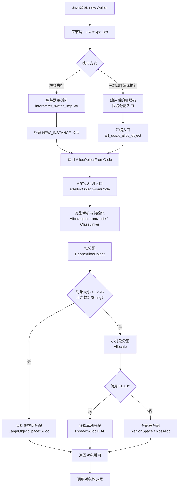

# 对象创建



## Java 对象内存布局

Java 对象在内存中包括以下几个部分：
- 对象头（Object Header）
- 实例数据（Instance Data）
- 对齐填充（Padding）


## 内存申请

```Java
# MemoryAlloc.java
public class MemoryAlloc {
    public static void main(String[] args) {
        Object obj = new Object();
    }
}
```

```shell
# 编译Java代码
$ javac MemoryAlloc.java
# 编译成 class 并转换为 dex
$ <android/sdk/build-tools/version>/d8 MemoryAlloc.class
```

```shell
$ javap -c MemoryAlloc.class
```
应该能看到 Object 的创建过程
```
0: new           #2 // class java/lang/Object。 在堆上申请空间
3: dup              // 复制对象引用
4: invokespecial #1 // 调用对象的构造器方法 Method java/lang/Object."<init>":()V 
```
```
# 查看 dex 字节码(这段不重要)
$ <android/sdk/build-tools/version>/dexdump -d classes.dex
```

将 dex 推入模拟器并生成 oat 文件
```shell
$ adb push classes.dex /data/local/tmp
$ adb shell & cd /data/local/tmp 
# dex2oat 编译为机器指令
$ dex2oat --dex-file=classes.dex --oat-file=classes.oat --instruction-set=arm64
# 如果提示 dex2oat 不存在，可以尝试用完整路径：
# /apex/com.android.art/bin/dex2oat
# 用 oatdump 查看编译后的机器码
oatdump --oat-file=classes.oat
```
搜索 main 方法可以看到：

```asm
0x00001034: aa0103f6	mov x22, x1
0x00001038: b0000000	adrp x0, #+0x1000 (addr 0x2000)
0x0000103c: b9400000	ldr w0, [x0]
0x00001040: f940fa7e	ldr lr, [tr, #496] ; pAllocObjectInitialized # 调用入口，分配对象。
0x00001044: d63f03c0	blr lr
```

- 0x00001040 行从当前线程寄存器 tr 偏移 496 字节处加载一个地址到链接寄存器 lr，该地址正是 ART 中用于分配已初始化对象的入口点 pAllocObjectInitialized。

- 0x00001044 行通过 blr lr 间接跳转到该入口，从而进入运行时执行对象的实际分配逻辑。

这两行对应了 Java 字节码中 new-instance 指令（本方法 DEX 代码的 0x0000: 2200 0100）被编译后的机器码实现，是 ART 将对象分配请求转交给运行时的典型模式。

所有的入口点被组织在一个名为 QuickEntryPoints 的结构体中。
```C++
// art/runtime/entrypoints/quick/quick_entrypoints.h
// Pointers to functions that are called by quick compiler generated code via thread-local storage.
struct QuickEntryPoints {
#define ENTRYPOINT_ENUM(name, rettype, ...) \
  void* p##name;                            \
  void Set##name(rettype (*fn)(__VA_ARGS__)) { p##name = reinterpret_cast<void*>(fn); }
#include "quick_entrypoints_list.h"
  QUICK_ENTRYPOINT_LIST(ENTRYPOINT_ENUM)
#undef QUICK_ENTRYPOINT_LIST
#undef ENTRYPOINT_ENUM
};
```

为了让汇编代码和 C++ 代码同步，ART 在编译时会运行一个名为 cpp-define-generator 的工具。
- **核心逻辑**：它会包含上述 C++ 头文件，使用 OFFSETOF_MEMBER 宏计算出每个函数指针相对于 Thread 对象开头的字节偏移。
- **生成文件**：它会生成一个 .h 或 .s 文件，里面定义了类似 #define THREAD_QUICK_ALLOC_OBJECT_INITIALIZED_OFFSET 496 的常量。
- **代码位置**：art/tools/cpp-define-generator/main.cc

当编译器（dex2oat）生成机器码时，它会查阅上述生成的偏移量表。

- **调用逻辑**：编译器知道 new-instance 需要调用分配函数。它查找“快速入口点”表，发现 pAllocObjectInitialized 对应的偏移是 496。
- **指令生成**：于是它生成 ldr lr, [tr, #496]。这里的 tr (x19) 永远指向当前线程的起始地址。

```C++
// art/runtime/entrypoints/quick/quick_alloc_entrypoints.cc
void SetQuickAllocEntryPoints##suffix(QuickEntryPoints* qpoints, bool instrumented) { \
  if (instrumented) { \
    qpoints->SetAllocArrayResolved(art_quick_alloc_array_resolved##suffix##_instrumented); \
    qpoints->SetAllocArrayResolved8(art_quick_alloc_array_resolved8##suffix##_instrumented); \
    qpoints->SetAllocArrayResolved16(art_quick_alloc_array_resolved16##suffix##_instrumented); \
    qpoints->SetAllocArrayResolved32(art_quick_alloc_array_resolved32##suffix##_instrumented); \
    qpoints->SetAllocArrayResolved64(art_quick_alloc_array_resolved64##suffix##_instrumented); \
    qpoints->SetAllocObjectResolved(art_quick_alloc_object_resolved##suffix##_instrumented); \
    qpoints->SetAllocObjectInitialized(art_quick_alloc_object_initialized##suffix##_instrumented); \
    qpoints->SetAllocObjectWithChecks(art_quick_alloc_object_with_checks##suffix##_instrumented); \
    qpoints->SetAllocStringObject(art_quick_alloc_string_object##suffix##_instrumented); \
    qpoints->SetAllocStringFromBytes(art_quick_alloc_string_from_bytes##suffix##_instrumented); \
    qpoints->SetAllocStringFromChars(art_quick_alloc_string_from_chars##suffix##_instrumented); \
    qpoints->SetAllocStringFromString(art_quick_alloc_string_from_string##suffix##_instrumented); \
  } else { \
    qpoints->SetAllocArrayResolved(art_quick_alloc_array_resolved##suffix); \
    qpoints->SetAllocArrayResolved8(art_quick_alloc_array_resolved8##suffix); \
    qpoints->SetAllocArrayResolved16(art_quick_alloc_array_resolved16##suffix); \
    qpoints->SetAllocArrayResolved32(art_quick_alloc_array_resolved32##suffix); \
    qpoints->SetAllocArrayResolved64(art_quick_alloc_array_resolved64##suffix); \
    qpoints->SetAllocObjectResolved(art_quick_alloc_object_resolved##suffix); \
    qpoints->SetAllocObjectInitialized(art_quick_alloc_object_initialized##suffix); \
    qpoints->SetAllocObjectWithChecks(art_quick_alloc_object_with_checks##suffix); \
    qpoints->SetAllocStringObject(art_quick_alloc_string_object##suffix); \
    qpoints->SetAllocStringFromBytes(art_quick_alloc_string_from_bytes##suffix); \
    qpoints->SetAllocStringFromChars(art_quick_alloc_string_from_chars##suffix); \
    qpoints->SetAllocStringFromString(art_quick_alloc_string_from_string##suffix); \
  } \
}

// Generate the entrypoint functions.
#if !defined(__APPLE__) || !defined(__LP64__)
GENERATE_ENTRYPOINTS(_dlmalloc)
GENERATE_ENTRYPOINTS(_rosalloc)
GENERATE_ENTRYPOINTS(_bump_pointer)
GENERATE_ENTRYPOINTS(_tlab)
GENERATE_ENTRYPOINTS(_region)
GENERATE_ENTRYPOINTS(_region_tlab)
#endif
```
```C++
# art/runtime/arch/quick_alloc_entrypoints.S
GENERATE_ALLOC_ENTRYPOINTS_ALLOC_OBJECT_INITIALIZED(_bump_pointer, BumpPointer)

#define GENERATE_ALLOC_ENTRYPOINTS_ALLOC_OBJECT_INITIALIZED(c_suffix, cxx_suffix) \
  ONE_ARG_DOWNCALL art_quick_alloc_object_initialized ## c_suffix, artAllocObjectFromCodeInitialized ## cxx_suffix, RETURN_OR_DEOPT_IF_RESULT_IS_NON_NULL_OR_DELIVER

GENERATE_ENTRYPOINTS_FOR_ALLOCATOR(BumpPointer, gc::kAllocatorTypeBumpPointer)

#define GENERATE_ENTRYPOINTS_FOR_ALLOCATOR(suffix, allocator_type) \
    GENERATE_ENTRYPOINTS_FOR_ALLOCATOR_INST(suffix, Instrumented, true, allocator_type) \
    GENERATE_ENTRYPOINTS_FOR_ALLOCATOR_INST(suffix, , false, allocator_type)


#define GENERATE_ENTRYPOINTS_FOR_ALLOCATOR_INST(suffix, suffix2, instrumented_bool, allocator_type) \
extern "C" mirror::Object* artAllocObjectFromCodeInitialized##suffix##suffix2( \
    mirror::Class* klass, Thread* self) \
    REQUIRES_SHARED(Locks::mutator_lock_) { \
  return artAllocObjectFromCode<true, false, instrumented_bool, allocator_type>(klass, self); \
}
```
- **_dlmalloc / _rosalloc** 主要用于 CMS 算法。rosalloc（Runs of Slots Allocation）是 Android 专门优化的，比标准的 dlmalloc 更擅长处理多线程并发分配小对象。

- **_region / _region_tlab** 用于 CC (Concurrent Copying) 算法。

- **_bump_pointer** 用于 CMC 或非分代的压缩 GC。

- **_tlab (Thread Local Allocation Buffer)**：在 _bump_pointer 的基础上，给每个线程预先分配一块私有的“自留地”。线程在自己地盘分配不需要加锁，性能巅峰。


## 编译执行

编译后的机器码会调用一个名为 art_quick_alloc_object 的汇编入口点。这个入口点是精心设计的，用于将参数传递给ART运行时。

```asm
; art/runtime/arch/arm64/quick_entrypoints_arm64.S [citation:1][citation:5]
; Entrypoint for allocating an object from compiled code.
ENTRY art_quick_alloc_object
    SETUP_REFS_ONLY_CALLEE_SAVE_FRAME ; 设置栈帧，保存寄存器
    mov     x2, xSELF                 ; 将当前线程指针 (xSELF) 作为第三个参数
    mov     x3, sp                    ; 将栈指针 (sp) 作为第四个参数
    bl      artAllocObjectFromCode     ; 调用C++函数 (参数在 x0, x1, x2, x3)
    RESTORE_REFS_ONLY_CALLEE_SAVE_FRAME ; 恢复栈帧
    cbz     x0, art_quick_deliver_pending_exception ; 如果返回空，则处理异常
    ret
END art_quick_alloc_object
```


## 解释执行

如果代码没有被编译（例如冷启动时），解释器会逐条读取并执行字节码。当读到 new 指令时，会进入一个对应的处理分支

```C++
// art/runtime/interpreter/interpreter_switch_impl.cc
case Instruction::NEW_INSTANCE: {
    // ... 解析类型 ...
    obj = AllocObjectFromCode( c.Ptr(), self, ... ); // 调用分配函数
    // ...
    break;
}
```

## 最终使用 artAllocObjectFromCode 分配对象

```C++
// art/runtime/entrypoints/quick/quick_alloc_entrypoints.cc [citation:1]
extern "C" mirror::Object* artAllocObjectFromCode(uint32_t type_idx,
                                                   mirror::ArtMethod* method,
                                                   Thread* self,
                                                   mirror::ArtMethod** sp) {
    FinishCalleeSaveFrameSetup(self, sp, Runtime::kRefsOnly);
    return AllocObjectFromCode(type_idx, method, self, false);
}
```

这个函数首先设置好栈帧，然后立即调用核心的 AllocObjectFromCode。这个函数负责解析类型并确保类已准备好。

```C++
// art/runtime/entrypoints/entrypoint_utils.h [citation:1]
static inline mirror::Object* AllocObjectFromCode(...) {
    // 1. 从 DexCache 或通过 ClassLinker 解析出对象的 Class
    mirror::Class* klass = method->GetDexCacheResolvedTypes()->Get(type_idx);
    if (UNLIKELY(klass == nullptr)) {
        klass = Runtime::Current()->GetClassLinker()->ResolveType(type_idx, method);
    }

    // 2. 确保类已初始化
    if (!klass->IsInitialized() && !Runtime::Current()->GetClassLinker()->EnsureInitialized(klass, true, true)) {
        return nullptr; // 初始化失败，抛出异常
    }

    // 3. 调用 Class 的 AllocObject 方法，真正分配内存
    return klass->AllocObject(self);
}
```

## 堆分配：内存的最终归属

Class::AllocObject 是一个非常薄的封装，它将分配请求转发给全局的堆管理器 Heap。

```C++
// art/runtime/mirror/class.cc [citation:1]
Object* Class::AllocObject(Thread* self) {
    return Runtime::Current()->GetHeap()->AllocObject(self, this, this->object_size_);
}
```
Heap::AllocObject 函数根据对象的大小和类型，决定使用哪个“空间”（Space）来分配内存。
```
// art/runtime/gc/heap.cc [citation:1][citation:3][citation:7]
mirror::Object* Heap::AllocObject(Thread* self, mirror::Class* c, size_t byte_count) {
    mirror::Object* obj = nullptr;
    // 1. 判断是否为大对象 (>= 12KB 且为基础类型数组或字符串) [citation:3][citation:6]
    bool large_object_allocation = byte_count >= large_object_threshold_ &&
                                   (c->IsPrimitiveArray() || c->IsStringClass());
    if (UNLIKELY(large_object_allocation)) {
        obj = Allocate(self, large_object_space_, byte_count, &bytes_allocated); // 进入大对象空间
    } else {
        // 2. 小对象分配，首选 TLAB (Thread Local Allocation Buffer) [citation:7]
        obj = Allocate(self, alloc_space_, byte_count, &bytes_allocated); // 进入Region或RosAlloc空间
        // Allocate内部会处理TLAB逻辑
    }

    if (LIKELY(obj != nullptr)) {
        obj->SetClass(c);                 // 设置对象头，指向其Class
        // ... 记录分配信息，检查是否需要触发GC等 [citation:1]
        return obj;
    } else {
        self->ThrowOutOfMemoryError(...); // 分配失败，抛出OOM
        return nullptr;
    }
}
```
这里的 Allocate 函数会根据当前使用的垃圾回收器（如并发复制CC、CMS等）和分配策略，最终调用到具体分配器的实现，例如 RegionSpace::Alloc、RosAlloc::Alloc 或 LargeObjectSpace::Alloc。其中 RegionSpace 配合 TLAB 机制，让大部分小对象分配在无锁的线程本地缓冲区中，效率极高。
