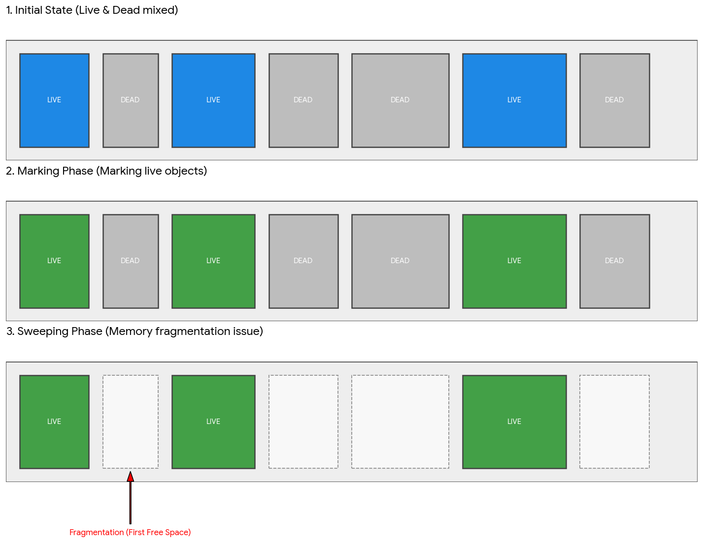
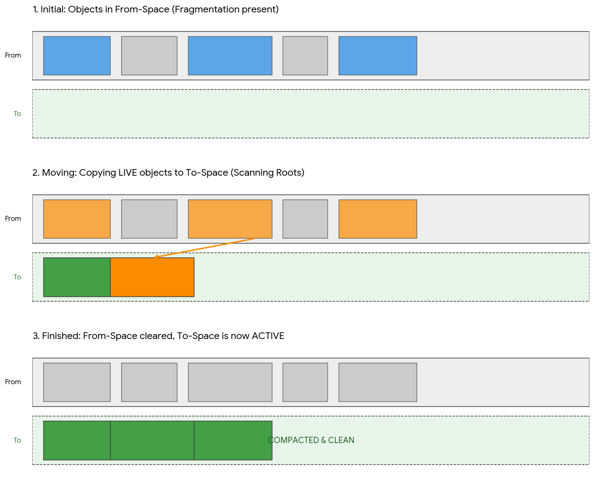
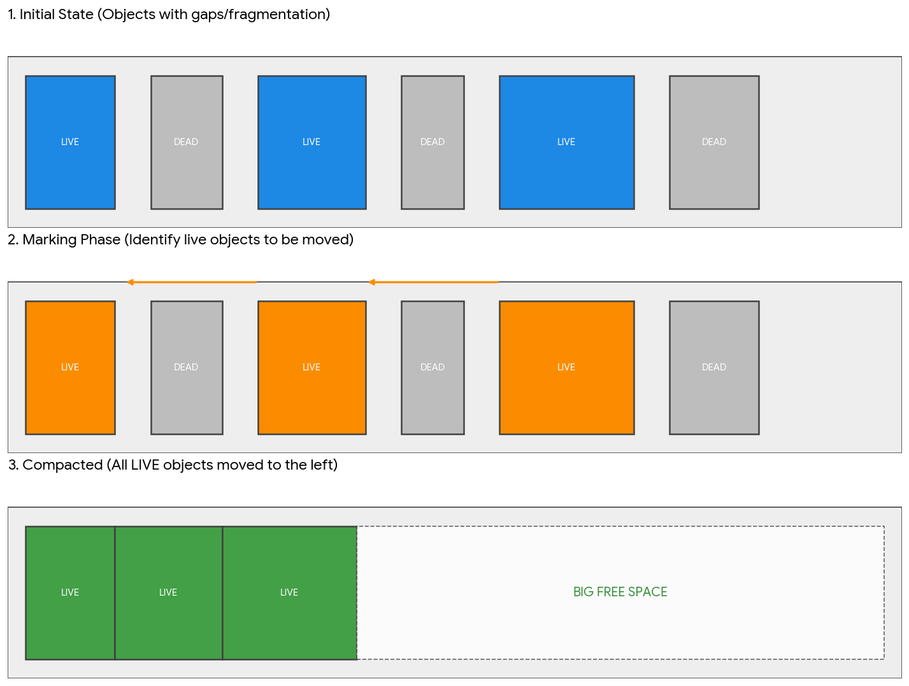
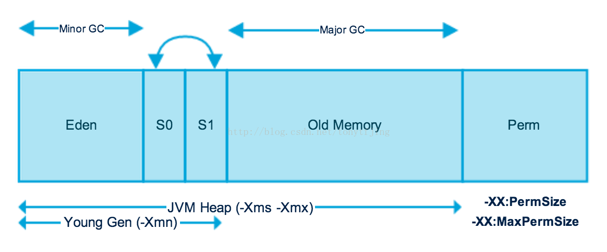

# 垃圾回收

GC 完成了３件事

1. 确定哪些内存需要回收
2. 什么时候进行 GC
3. 如何执行 GC。

## 1. 确定那些对象可以回收

1. 引用计数法

不能解决循环引用的问题

2. 可达性分析: 从根对象集合进行搜索，对象不可达的话，就属于垃圾对象。根集合有：
    - java栈中的引用对象
    - 本地方法栈中JNI的引用对象
    - 方法区中运行常量池中的引用对象
    - 方法区中静态属性引用的对象
    - 运行中的线程
    - 由引导类加载器加载的对象
    - GC控制的对象。
    总之，JVM在做垃圾回收的时候，会检查堆中的所有对象是否被这些根集中的对象所引用，不能够被引用的对象就会被垃圾回收器回收。

## 回收算法

回收垃圾的算法有：

#### 1.标记--清除（mark--sweep）：

算法和名字一样分为两个阶段：标记和清除。标记所有需要回收的对象，之后统一回收。这是最基础的算法，后续的回收算法都是基于这个算法扩展的。

不足：标记清除之后会产生大量内部碎片，导致这些空间在分配大对象时无法使用，浪费空间。

#### 2.复制（copying）：

此算法把内存空间划分为两个相等的区域，每次只使用其中的一个区域。垃圾回收时，遍历当前使用区域的所有对象，将正在使用中的对象复制到另一个区域。此算法每次只处理使用中的对象，因此复制成本比较小，同时复制过去之后还能进行相应的内存整理，所以不会出现碎片问题。

不足：缺点也很明显就是需要两倍的内存空间。以空间换取时间。

#### 3.标记--整理（mark--compact）:

此算法结合了标记--清除和复制的有点，也是分两个阶段，第一阶段是从根节点遍历所有对象标记所有能被引用的对象，第二阶段遍历整个堆中的对象，清除所有未被标记的对象，并把所有存活对象“压缩”到堆的其中一块，按顺序排放。此算法避免了“标记--清除”的碎片问题，也没有“复制”的空间问题。

UFFD特性介绍
UFFD全称User Fault FD，其核心机制就是，先注册并监控虚拟内存范围的访问，当该范围的内存访问出现异常时，比如SIGBUS错误时，可以把对这块内存页的处理交接给用户空间。

此外，在没有发生SIGBUS错误时，也可以利用UFFD的ioctl特性进行目标内存页的处理。

1、优点
GC过程中RSS峰值降低

消除了ReadBarrier，BinarySize减小，Object访问性能提升

2、缺点
一次GC活跃的对象被拷贝两次
暂时没有实现YoungGC
缺页中断产生的时延可能会导致GC过程的性能退化

#### 分代回收算法

在实际使用中发现，一种算法不能适用所有场景。有的对象声明周期极端需要频繁回收。有的对象则生命周期长，极少回收，每次垃圾回收扫描都要扫描到极大浪费时间。于是就有了根据对象声明周期采用不同回收算法的分代思想。

- 年轻代：是所有新对象产生的地方。年轻代被分为3个部分——Enden区和两个Survivor区（From和to）当Eden区被对象填满时，就会执行Minor GC。并把所有存活下来的对象转移到其中一个survivor区（假设为from区）。Minor GC同样会检查存活下来的对象，并把它们转移到另一个survivor区（假设为to区）。这样在一段时间内，总会有一个空的survivor区。经过多次GC周期后，仍然存活下来的对象会被转移到年老代内存空间。通常这是在年轻代有资格提升到年老代前通过设定年龄阈值来完成的。需要注意，Survivor的两个区是对称的，没先后关系，from和to是相对的。

- 年老代：在年轻代中经历了N次回收后仍然没有被清除的对象，就会被放到年老代中，可以说他们都是久经沙场而不亡的一代，都是生命周期较长的对象。对于年老代和永久代，就不能再采用像年轻代中那样搬移腾挪的回收算法，因为那些对于这些回收战场上的老兵来说是小儿科。通常会在老年代内存被占满时将会触发Full GC,回收整个堆内存。

- 持久代：用于存放静态文件，比如java类、方法等。持久代对垃圾回收没有显著的影响。

优点：
- 减少每次垃圾回收扫描的对象数量、时间、内存空间，因为它只扫描新生代对象，减少了扫描的对象数量。

我这里之所以最后讲分代，是因为分代里涉及了前面几种算法。年轻代：涉及了复制算法；年老代：涉及了“标记-整理（Mark-Sweep）”的算法。 

## ART 虚拟机的 GC

早期安卓使用的是 CMS（并发标记清除）算法；AndroidO之后垃圾回收算法是CC（并发复制）算法。安卓 14 之后使用的是 CMC（并发标记压缩）算法。

> 算法对比与区别

| 特性	| CMS (Concurrent Mark Sweep) | 	CC (Concurrent Copying) | 	CMC (Concurrent Mark Compact) |
| ---- | ---- | ---- | ---- |
|核心机制	| 标记-清除（不移动对象） | 标记-复制（移动对象到新空间） | 标记-压缩（原地或向一端压缩） |
| 内存碎片	| 多。长期运行会导致碎片严重。	| 无。每次 GC 都会整理空间。	| 无。通过压缩消除碎片。 |
| 内存开销	| 较低。	| 极高。需要额外的 To-Space 空间（甚至双倍内存）。	| 较低。由于是原地压缩，内存利用率更高。 |
| 主要性能手段	| 并发标记和清除，减少 STW。	| Read Barrier (读屏障) 拦截访问。	| Userfaultfd (Linux 内核特性)。 |
| Android 版本	| Android 8.0 之前为默认。	| Android 8.0 到 Android 13 的默认。	| Android 14+ 引入的新宠（视厂商配置）。 |
