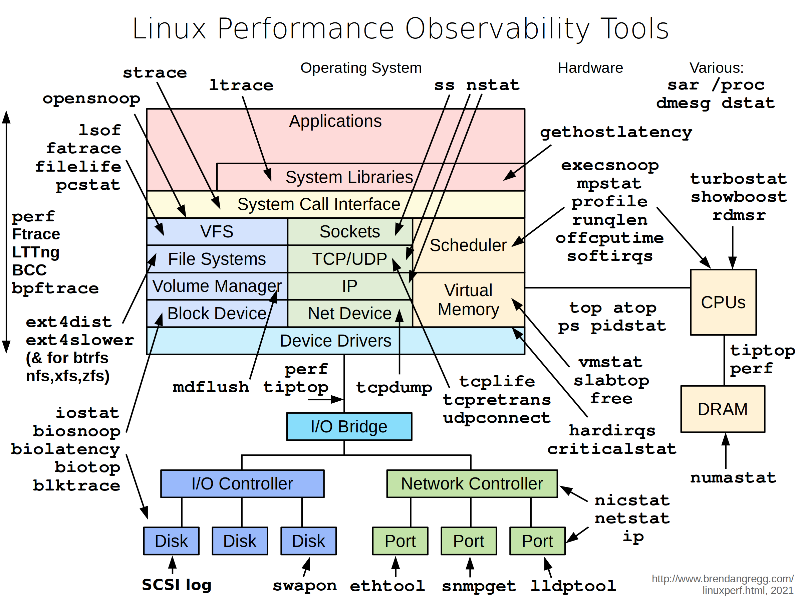

# 系统性能

ltrace: 截获并记录运行进程锁执行的动态库调用。
strack: 跟踪应用程序的系统调用。
ptrace: 它用于一个进程（跟踪器）监视和控制另一个进程（被跟踪程序）的执行。是 ltrace 和 strace 实现的底层工具。

性能工具用到的底层技术有： ftrace, eBPF, perf events, kprobes, uprobes, tracepoints, etc.

1. 硬件性能计数器 (Hardware Performance Counters)
2. 内核静态埋点
3. 动态钩子
4. procfs 内核暴漏的系统信息。
5. 插桩
6. eBPF

性能工具不是“杂乱无章的一堆程序”，而是围绕少数底层能力的不同组合：硬件计数器 + 内核事件与动态探针 + 采样与插桩 + 栈/符号解析 + 时间戳统一 + 数据缓冲与序列化 + 分析与可视化；理解这些基础，就能快速选对工具、甚至自定义采集与分析链路。
