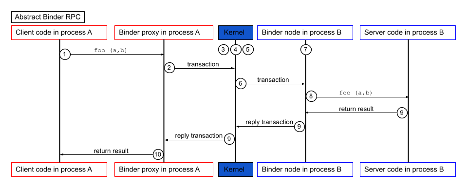

# Binder

Binder 是 Android 操作系统中特有的进程间通信（IPC）方式。它起源于 OpenBinder 项目，其特点是高效、轻量级，专为嵌入式系统设计，数据仅需复制一次即可完成进程间通信。后来安卓项目启动时，由于当时的移动端资源有限，Google 选择了 Binder 作为 Android 的 IPC 机制。安卓曾多次尝试将 Binder 移植到 Linux 内核中，但由于代码的要求（本人读代码也觉得binder 的架构设计确实不太好，继承关系难以理解、接口复杂。虽然 binder 通信高效、社区一定在等更简单、概念清晰的实现。）和理念不同，而且后来 Linux 内核引入了类似的功能，因此这些尝试并未成功。

安卓需要一个深度集成、功能强大的专用 IPC 机制来支撑其整个系统架构，而Linux内核社区坚持维护一个通用、简洁、可组合的基础设施。可预见的未来，Binder将继续以“Android专用内核分支” 的形式存在。

Binder 的翻译是粘合剂，可以想象为将两个进程粘合在一起。Binder 提供了一种在另一个进程中调用另一进程方法的方式，因此更精确说是 RPC(Remote Procedure Call 远程方法调用)，该方法对于调用者来说是完全透明的。**进程是系统提供的强隔离，RPC 也没有什么黑魔法可以越过系统，其本质就是发送进程和接收进程多了一层代码：发送端调用代理对象的方法，由代理对象将数据序列化发送到另一进程；接收端也是由代理对象将数据反序列化后调用本地方法**

在 Binder 术语中，调用进程被视为客户端，其控制点称为 binder 代理或代理。响应的，被调用的进程是服务端，其控制点称为 binder node 或 node。

每个 node 都可以实现并对外提供的接口。客户端可以通过代理像调用是本地函数调用一样在 node 上执行方法。以下示例显示了如何调用方法：

```C
int result = someNodeInterface.foo(a, b); // someNodeInterface is a proxy object
```

假设调用 foo() 的客户端在进程 A 中运行，而实现 foo() 的服务端在进程 B 中运行。图 1 显示了此调用的执行方式：



## 优缺点

### 优点
- 高效：1 次数据复制。Binder 设计用于高效的进程间通信，减少了数据复制的次数，从而提高了性能。
- 轻量级：Binder 占用的系统资源较少，适合资源有限的嵌入式系统。
- 深度集成：Binder 与 Android 系统深度集成，支持 Android 的组件模型（如 Service、Content Provider 等）。
- 安全性：Binder 提供了权限检查机制，确保只有授权的进程才能访问特定的服务。

### 缺点
- 平台依赖性：Binder 是 Android 特有的 IPC 机制，无法在其他操作系统上使用。
- 复杂性：对于初学者来说，理解和使用 Binder 可能比较复杂，需要掌握 AIDL（Android 接口定义语言）等相关知识。
- 内核修改：Binder 需要对 Linux 内核进行修改，这可能导致与主流内核的不兼容性问题。


## 适用场景


## 使用方式

- Native 直接使用 Binder API。
- 使用 Android 提供的 AIDL（Android 接口定义语言）工具生成接口代码，简化 Binder 的使用。
- 使用高层框架如 Android 的 Service 和 Content Provider，这些框架底层使用 Binder 进行通信。
- Messenger 类，用于在不同进程间传递消息。底层也是基于 Binder 实现的。


## 使用方法

- Java 层
    - AIDL 
    - 高层框架（Service、Content Provider）

- Native Binder API


### 1. AIDL

AIDL（Android 接口定义语言）是一种用于定义进程间通信接口的语言。通过 AIDL，开发者可以定义接口，然后使用 Android 提供的工具生成相应的代码，从而简化 Binder 的使用。

AIDL 语言大致基于 Java 语言。

1. 配置 gradle 构建脚本，启用 AIDL 支持。
```
  buildFeatures {
      // 支持 AIDL
      aidl = true
  }
```
2. 同步过项目后，右键直接在菜单中创建 AIDL 文件。

3. 定义 .aidl 接口文件，假如接口名为 `IExample.aidl`，例如：
```
interface IExample {
    String callFunc(String msg);
}
```

4. 编译成成代码，然后在 Service 中实现 IExample.Slub 类，该类继承自 Binder，并实现了 IExample 接口。实现该类恰好作为 Service 的 Binder 对象返回给客户端。

```Kotlin
class ExampleService : Service() {

    private val binder = object : IExample.Stub() {
        override fun callFunc(msg: String?): String = msg + " from Service"
    }

  override fun onBind(intent: Intent?): IBinder = binder
}

// 在 AndroidManifest.xml 中注册服务
<service android:name=".ExampleService" android:exported="false"/>
         
```

5. 客户端 通过 bindService 绑定 Service，并获取 IExample 接口的代理对象，然后调用接口方法。

```Kotlin
laterinit var service: ICounterService
// 1. 创建链接对象
val connection = object : ServiceConnection {
    override fun onServiceConnected(name: ComponentName?, binder: IBinder?) {
        service = ICounterService.Stub.asInterface(binder)
    }
    
    override fun onServiceDisconnected(name: ComponentName?) {
         service = null
    }
}

// 2. 绑定服务
val intent = Intent(context, ExampleService::class.java)
context.bindService(intent, connection, Context.BIND_AUTO_CREATE)


// 3. 调用接口方法
service.callFunc("测试")

// 4. 解绑服务
context.unbindService(connection)
```


### Service 注册本质

在 Service 的 onBind 方法中返回的 Binder 对象会被系统注册到 Binder 驱动中。系统会为该 Binder 对象分配一个唯一的句柄（handle），并将其与 Service 的进程 ID 关联起来。 这个句柄用于标识该 Binder 对象，客户端通过该句柄可以找到对应的 Service。

```
 ServiceManager.addService(Context.ACTIVITY_SERVICE, this, /* allowIsolated= */ true,
                    DUMP_FLAG_PRIORITY_CRITICAL | DUMP_FLAG_PRIORITY_NORMAL | DUMP_FLAG_PROTO);
```

> ServiceManager 是一个单独的进程，为什么可以在 SystemServer 中调用 ServiceManager.addService 添加 Service?

简单来说：在SystemServer中调用的ServiceManager.addService()方法，并不是真正的ServiceManager进程的方法，而是ServiceManager 服务的同名客户端。这个代理通过Binder驱动，将请求转发给了独立的servicemanager进程。

> Binder 在设计时为什么需要一个 servicemanager？客户端和服务端直接通信不行吗，为什么需要 一个manager 管理？

- 服务发现
- 引用计数与生命周期协调者
- 安全模型

Java_android_os_ServiceManagerProxy_getNativeServiceManager native 调用返回的是 `android.os.BinderProxy` 对象，它持有 BackendUnifiedServiceManager 的引用。

```
jobject JNICALL Java_android_os_ServiceManagerProxy_getNativeServiceManager(JNIEnv *env,
                                                                            jobject obj) {
    sp<IBinder> service = IInterface::asBinder(
            impl::getJavaServicemanagerImplPrivateDoNotUseExceptInTheOnePlaceItIsUsed());
    return javaObjectForIBinder(env, service);
}
```

## 架构

Binder 架构主要包括以下几个组件：
- Binder 内核驱动：位于 Linux 内核中，负责管理 Binder 对象的生命周期、处理进程间通信请求以及数据传输。
- Binder 用户端
    - Binder Manager: 负责管理 Binder 对象的注册和查找。
    - 服务端
    - 客户端

接口：

- IBinder 代表了 Binder 实际通信的接口，任何首发数据的类都继承这个接口。

- IInterface 代表了 C/S 直接的通信接口。AIDL 生成的 C/S 两端通信的 Proxy 和 Node 就需要继承这个接口。

- 

### 内核驱动初始化流程

init.rc 文件中配置了 binderfs 文件系统的挂载，用于创建 Binder 设备节点。

```
    # Mount binderfs
    mkdir /dev/binderfs
    mount binder binder /dev/binderfs stats=global
    chmod 0755 /dev/binderfs

    # Mount fusectl
    mount fusectl none /sys/fs/fuse/connections

    symlink /dev/binderfs/binder /dev/binder
    symlink /dev/binderfs/hwbinder /dev/hwbinder
    symlink /dev/binderfs/vndbinder /dev/vndbinder

    chmod 0666 /dev/binderfs/hwbinder
    chmod 0666 /dev/binderfs/binder
    chmod 0666 /dev/binderfs/vndbinder
```


## binder manager

Binder 采用 CS 架构，通信的两个进程被视为服务端和客户端。这就设计到一个问题——客户端需要知道服务端的"地址(或类似的东西)"才能通信，在 binder 中被称为句柄。这就需要一个句柄查询服务。binder 作为一个 IPC 方式，不能再依赖其它 IPC 了。因此它使用 Binder IPC 来提供查询功能。不知道你是否意识到这是一个先有鸡还是先有蛋的问题：想要使用服务的进程先要查询服务句柄，查询句柄使用的是 binder 也需要句柄, 这个句柄该找谁呢？ Binder 的解决方案是固定句柄，第一个注册为 binder 句柄为 0 的进程是binder 的管理器。和 binder 管理器通信不需要查询了，童工固定句柄 0 直接通信。在 Binder 驱动中，这个角色是唯一且全局的。

驱动会将所有对服务句柄为0的 Binder 请求，自动路由到被设为上下文管理者的进程（即 ServiceManager）。这就是为什么客户端查询服务时，可以通过 BINDER_SERVICE_MANAGER 这个特殊的句柄（它就是0）找到 ServiceManager 的根本原因。

注册流程：

```C++
// frameworks/native/libs/binder/ProcessState.cpp
bool ProcessState::becomeContextManager()
{
    std::unique_lock<std::mutex> _l(mLock);

    flat_binder_object obj {
        .flags = FLAT_BINDER_FLAG_TXN_SECURITY_CTX,
    };

    int result = ioctl(mDriverFD, BINDER_SET_CONTEXT_MGR_EXT, &obj);

    // fallback to original method
    if (result != 0) {
        android_errorWriteLog(0x534e4554, "121035042");

        int unused = 0;
        result = ioctl(mDriverFD, BINDER_SET_CONTEXT_MGR, &unused);
    }

    if (result == -1) {
        ALOGE("Binder ioctl to become context manager failed: %s\n", strerror(errno));
    }

    return result == 0;
}

```

### Service 注册

BpHwBinder 是负责 Binder 通信的底层数据。 构造方法中的 BpHwBinder(int32_t handle) 中的 handler 就是目标进程的binder 句柄，如果是和上下文管理通信，固定传 0。

```C++
new BpHwBinder(0)

// system/libhwbinder/BpHwBinder.cpp
BpHwBinder::BpHwBinder(int32_t handle)
    : mHandle(handle)
    , mAlive(1)
    , mObitsSent(0)
    , mObituaries(nullptr)
{
    ALOGV("Creating BpHwBinder %p handle %d\n", this, mHandle);

    extendObjectLifetime(OBJECT_LIFETIME_WEAK);
    IPCThreadState::self()->incWeakHandle(handle, this);
}

status_t BpHwBinder::transact(
    uint32_t code, const Parcel& data, Parcel* reply, uint32_t flags, TransactCallback callback)
{
    // Once a binder has died, it will never come back to life.
    if (mAlive) {
        status_t status = IPCThreadState::self()->transact(
            mHandle, code, data, reply, flags);

        if (status == ::android::OK && callback != nullptr) {
            callback(*reply);
        }

        if (status == DEAD_OBJECT) mAlive = 0;
        return status;
    }

    return DEAD_OBJECT;
}

```


### Client

### 消息传递

Binder IPC 的数据消息是用户进程主动调用系统调用（通常是 ioctl）从驱动中读取出来的，而不是由驱动“回调”到用户进程的。这是一种典型的 “等待-读取”（Wait-and-Read）模型，而非事件驱动的“回调”（Callback）模型。

整个流程可以概括为：Binder 驱动将 IPC 事务数据写入目标进程的缓冲区，然后“唤醒”正在等待该数据的线程，由该线程主动读取。

1. 驱动写入，进程等待：当 Client 端发起一个 Binder 调用时，驱动会将此调用封装为一个 binder_transaction_data 结构体。驱动根据目标服务找到其所在进程（例如 ServiceManager），并将这个事务数据放入该进程的一个专属待处理事务队列中。

2. 唤醒与读取：如果目标进程（或其中的一个线程）此时正在 ioctl 调用中休眠等待（即调用了 ioctl(BINDER_WRITE_READ, ...) 且没有数据可读），驱动会将其唤醒。被唤醒的线程从 ioctl 系统调用中返回，并从它传入的缓冲区里读取到驱动已经写好的事务数据。

3. 处理与回复：用户空间的代码（如 IPCThreadState）解析这些数据，找到对应的 Binder 对象（例如 ServiceManager），并调用其 onTransact() 方法。处理完毕后，再将回复数据通过 ioctl 写回驱动，由驱动传递给等待回复的 Client 端。


https://carsonho.blog.csdn.net/article/details/73560642