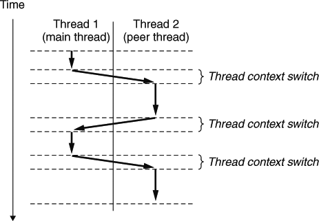

# 线程

[TOC]

线程的出现基于这样的需求：在一个进程中同样需要并发执行的任务。例如一个音乐播放器在请求网络数据时，不能阻塞 UI 截面的操作，同时也要允许播放声音。60年代，在OS中能拥有资源和独立运行的基本单位是进程，然而随着计算机技术的发展，进程暴漏了很多弊端，一是由于进程是资源拥有者，创建、撤消与切换存在较大的时空开销，因此需要引入轻型进程；二是由于对称多处理机（SMP）出现，可以满足多个运行单位，而多个进程并行开销过大。到了80年代，线程的概念被提出来，将进程进一步划分为更多的可执行流。这些流——线程——作为运行和调度的基本单位。

进程拥有独立的地址空间，这使得他们之间共享数据很困难。同一进程中的线程共用相同的地址空间和资源，这使得他们可以直接访问相同的数据。线程作为执行的基本单位，由内核进行调度。每个线程都有它自己的线程上下文，包括：
- 一个整数线程 ID（Thread ID TID）
- 栈 和 栈指针
- 程序计数器
- 通用目的的寄存器和条件码

同一进程中的所有线程共享整个进程的上下文，因而能够共享资源，包括虚拟地址空间，代码、数据区域、堆、共享库、和打开的文件。

## 线程执行模型

线程其实就是将原来进程中用于执行的部分独立出来，并且在一个进程中可以有多个这种执行流，它们共用其它部分。在某些方面多线程的执行模型和多进程的执行模型非常相似。因此线程也被称为——轻量级进程。

每个进程开始生命周期时都是单一线程，这个线程称为主线程(mainthread)。在某一时刻，主线程创建一个对等线程(peerthread)，从这个时间点开始，两个线程就并发运行。最后，因为主线程执行一个慢速系统调用，例如read或者sleep，或者因为它被系统的间隔计时器中断，控制就会通过上下文切换传递到对等线程。在控制传递回主线程前，对等线程会执行一段时间，依次类推。



在一些重要的方面，线程执行是不同于进程的。因为一个线程的上下文要比一个进程的上下文小得多，线程的上下文切换要比进程的上下文切换快得多。（事实上，上下文切换导致的性能差别不是由于上下文的大小导致的，而是因为切换地址空间导致的缓存失效。上下文切换分为两步：

1. 切换地址空间
2. 切换内核栈和硬件上下文

线程与进程相比少了步骤 1，这步的代码执行并不多，主要的性能损失是该步骤会导致处理器中缓存失效（还包括MMU内的页表缓存）、这导致一段之间内的执行都需要从内存访问数据，降低了程序的效率。而进程切换不会切换地址空间，从而没有这方面的性能损失。）


另一个不同就是线程，不像进程那样，线程不是按照严格的父子层次来组织的。同一个进程的线程组成一个对等(线程)池(a pool of peers)，独立于其它进程创建的线程。主线程和其他线程的区别仅在于它总是进程中第一个运行的线程。对等(线程)池概念的主要影响是，一个线程可以杀死它的任何对等线程，或者等待它的任意对等线程终止。进一步来说，每个对等线程都能读写相同的共享数据。

What runs next is determined by the OS
scheduler, and although the scheduler likely implements some sensible
algorithm, it is hard to know what will run at any given moment in time.

As you also might be able to tell from this example, threads make life
complicated: it is already hard to tell what will run when! Computers are
hard enough to understand without concurrency. Unfortunately, with
concurrency, it simply gets worse. Much worse.

## 线程模型

多线程的实现不止在系统内核中，也可以使用应用程序层实现，这种实现不是由系统调度的，而是通过软件的长跳转(longjump），称为用户线程。由于应用线程调度仅仅是一个跳转（也需要保存当前运行环境），不像内核线程需要保存寄存器等状态，用户线程往往更高效。由于不同的线程实现，就有了实际应用中三种不同线程模型。

### 1:1

一个应用线程对应一个内核线程。这种实现方式用户线程并没有实现线程调度，线程仅仅是对内核线程的封装，以提供一个套简洁一致的 API。例如 Java 的线程就是对各个平台线程的封装。

缺点：线程调度由内核调度，性能不如其它模型高。

### 1:N

一个内核线程对应 N 个用户线程。由应用程序完成线程的调度。这种实现通常在一些没有内核线程的系统上，应用层通过自己实现线程调度来实现并发。

缺点：无法实现高并发

### M:N

这种线程也称为混合线程模型。N 个用户线程依附于 M 个内核线程。这种实现避免了比 1:1 线程更加高效，同时避免了 1:N 模型中无法实现抢占式调度。

缺点：实现过于复杂。
而且，一旦一个线程阻塞，将阻塞在同一个内核线程中的所有应用线程。(**不一定，根据具体实现，如果所有不被运行的应用线程组成一个任务队列，在运行时才分配的话并不会阻塞。只有预先将所有应用线程和内核线程绑定才会导致这种阻塞。**)

> 多线程实现的现状：

主流的系统都在转为 1:1 的线程模型。虽然 M:N 模型更高效，但是其实现过于复杂，在现代计算机越来越倾向于多核化，以及一些超标量流水线技术等支持，再加上 N:M 实现需要的复杂的代码消耗，M:N 实现带来性能提升并不与其付出成比例。过高的实现复杂度带来的性能回报并不高。

Linux 上 M:N 模型的 NGPT 实现，在 2003 年中期被放弃了，把这个领域完全留给了 NPTL。
有个说法没有验证：
FreeBSD从7.0开始转为 1:1 实现。
Solaris 之前实现了 M:N 线程模型，从某个版本也开始转移到 1:1 模型。

Java 也遗弃了 M:N 的线程模型。现在线程仅仅是对内核线程的一个封装。


我认为 N:M 线程模型被抛弃的另一个原因是：M:N 的实现有更好的 API: 协程。应用线程在编程 API 上不如协程，以为它不支持返回结果，用户切换引起内核调度的消耗更大。内核专心实现内核线程，而将应用级的切换留给协程这种编程模型更好的技术，是更好的选择。

## 线程 API

对于目前常见的系统，由于线程的实现从根本上依赖于操作系统，其用户 API 都不过是对系统线程的一个包装而已。以 UNIX 为例 `POSIX` 标准的线程 API `Pthreads`。其定义了大约 60 个函数，用于创建、杀死和回收线程，以及与对等线程安全地共享数据，通知对等线程系统状态的变化。

pthreads（POSIX Threads）定义了一组C编程语言类型、函数和常量。它是通过pthread.h头文件和线程库实现的。大约有100个线程过程，都以pthread为前缀，它们可以分为四组:
- 线程管理、创建、连接线程等
- Mutexes
- 条件变量
- 用于线程之间的同步的读写锁和屏障
- 自旋锁

POSIX 信号量 API 可以与 POSIX 线程一起使用，但不是线程标准的一部分，它定义在POSIX.1b实时扩展(IEEE Std 1003.1 -1993)标准中。因此，信号量方法的前缀是sem，而不是pthread。


```C
#include "csapp.h"
void *thread(void *vargp);

int main()
{
	pthread_t tid;
	Pthread_create(&tid, NULL, thread, NULL);
	Pthread_join(tid, NULL);
	exit(0);
}

void *thread(void *vargp) /* Thread routine */
{
	printf("Hello, world!\n");
	return NULL;
}
```
PThread 通过 pthread_create 创建一个线程，当线程开始执行时 `thread` 函数被调用，它作为 `pthread_create` 的第三个参数传递给线程。当对 pthread_create 的调用返回时，主线程和新创建的对等线程并发运行，并且 tid 包含新线程的ID。通过调用 pthread_join，主线程等待对等线程终止。最后，主线程调用 exit 终止当时运行在这个进程中的所有线程(在这个示例中就只有主线程)。

正如第二行里的原型所示，每个线程都以一个通用指针作为输入（pthread_create 的最后一个参数传入），并返回一个通用指针。如果你想传递多个参数给线程例程，那么你应该将参数放到一个结构体中，并传递一个指向该结构体的指针。相似地，如果你想要线程例程返回多个参数，你可以返回一个指向一个结构的指针。

### 创建

```C
#include <pthread.h>
typedef void *(func)(void *);
int pthread_create(pthread_t *tid, pthread_attr_t *attr, func *f, void *arg);
					Returns: 0 if OK, nonzero on error
```

`pthread_create` 用于创建一个线程，其有四个参数，分别为：

- tid，用于保存线程 ID, 新线程可以用 `pthread_self` 来获得自己的 ID。

- attr: 用于设置线程的属性。

- f: 线程要执行的函数。

- arg: 传递给线程函数 f 的参数。

### 终止/销毁

一个线程是以下列方式之一来终止的:

- 当顶层的线程例程返回时，线程会隐式地终止。

- 通过调用 pthread_exit 函数，线程会显式地终止，该函数会返回一个指向返回值 thread_return 的指针。如果主线程调用 pthread_exit，它会等待所有其他对等线程终止，然后再终止主线程和整个进程，返回值 thread_return。

- 某个对等线程调用 exit 函数，该函数终止进程以及所有与该进程相关的线程。

- 另一个对等线程通过调用指定当前线程 ID 调用 pthread_cancel 函数来终止当前线程

```C
#include <pthread.h>
void pthread_exit(void *thread_return);
						Never returns

int pthread_cancel(pthread_t tid);
					Returns: 0 if OK, nonzero on error
```

### 回收已终止线程的资源

线程通过调用 pthread_join 函数等待其他线程终止。pthread_join 函数将阻塞当前线程直到等待的线程终止，并将线程例程返回的泛型(void *)指针赋值给 thread_return 所指向的位置，回收已终止线程占用的所有存储器资源。

注意，和Unix的wait函数不同，pthread_join 函数只能等待一个指定的线程终止。没有办法让pihread_wait 等待任意一个线程终止。这使得我们的代码更加复杂，因为它迫使我们去使用其它一些不那么直观的机制来检测进程的终止。实际上，Stevens 在[81]中就很有说服力地论证了这是一个错误。

```C
#include <pthread.h>
int pthread_join(pthread_t tid, void **thread_return);
					Returns: 0 if OK, nonzero on error
```

### 分离线程

在任何一个时间点上，线程是结合的(joinable)或者是分离的(detached)。 一个结合的线程能够被其他线程收回其资源和杀死。在被其他线程回收之前，它的存储器资源 (例如栈)是不释放的。相反，一个分离的线程是不能被其他线程回收或杀死的。它的存储器资源在它终止时由系统自动释放。 默认情况下，线程被创建成结合的。为了避免存储器泄漏，每个可结合线程都应该要么被其它线程显式地收回，要么通过调用pthread_detach 函数被分离。

```C
#include <pthread.h>
int pthread_detach(pthread_t tid) ;
若成功则返回O，若出错则为非零。
```

线程能够通过以 pthread_self() 为参数的 pthread_detach 调用来分离它自己。 尽管我们的一些例子会使用结合线程，但是在现实程序中，有理由要使用分离的线程。例如，一个高性能 Web 服务器可能在每次收到 Web 浏览器的连接请求时都创建一个新的对等线程。因为每个连接都是由一个单独的线程独立处理的，所以对于服务器而言，就很没有必要——实际上也不愿意——显式地等待每个对等线程终止。在这种情况下，每个对等线程都应该在它开始处理请求之前，分离它自身，这样就能在它终止后，自动回收它的存储器资源了。

### 唯一初始化

当我们需要在整个程序中需要对内容仅初始化一次，该初始化需要在使用时才进行，而不是在程序一开始就完成（懒操作，因为可能并不一定用到，过早初始化会造成浪费），我们通常会设置一个全局变量，并对变量进行判断来完成该操作。但在多线程情况下，该操作变得复杂，因为要保证线程的安全。为此，PThread 设计了 `pthread_once` 来保证传递给 pthread_once 的函数仅被调用一次。

```C
#include <pthread.h>
pthread_once_t once_control = PTHREAD_ONCE_INIT;
int pthread_once(pthread_once_t *once_control, void (*init_routine) (void)) ;
```

once_control 变量是一个全局或者静态变量，总是被初始化为 PTHREAD_ONCE_INIT。当你第一次用参数 once_control 调用 pthread_once 时，它调用 init_routine，这是一个没有输入参数，也不返回什么的函数。再次以 once_control 为参数的 pthread_once 调用不做任何事情。

### 线程使用中出现的一些问题

#### 1. 内存泄露


### 切线程的本质

只有操作系统才能真正切线程（用于可以调用系统函数挂起线程也是请求系统进行切换，但是其操作更普遍的叫法是挂起线程），用户代码所指的切线程不过是将一个任务放到线程的执行队列中，等待执行。


## Other


### 线程本地存储

也就是线程的上下文，包括栈指针、程序计数器以及通用目的的寄存器。

https://blog.csdn.net/linyt/article/details/51931737
https://www.cnblogs.com/liu6666/p/12729014.html
https://blog.csdn.net/hujutaoseu/article/details/74936222


## 线程撕裂者/超线程

两核四线程
一个 ALU 同一时刻只能执行一个程序。

一核里一般含有一套 ALU,一套寄存器。而超线程则是一个核里一套 ALU 和多套寄存器。随着计算机的发展，由于计算单元和内存的速度差距越来越大。在每个核里，提供多套寄存器和缓存，它们公用 ALU。ALU 通过轮询使用寄存器和缓存，在使用一套寄存器的时候，另一套寄存器加载数据。这样看起来就增加了核心数量，同时解约了硬件成本。这样一核就能计算多个线程。


### 线程多少合适？

如果是 CPU 密集型，线程数量等于 CPU 核数能达到最大的计算效率。例如 Retrofit 的 Scheulers.computation
根据是非 CUP 密集型，例如网络传输，可以任务多个。例如 Retrofit 的 Scheulers.io。


### 查看线程问题

https://mp.weixin.qq.com/s/oLz_F7zhUN6-b-KaI8CMRw

> 获取当前进程的所有线程，简单介绍两种方式。

1. 在 Native 断点停止时，在 lldb 的终端输入 `thread list`

2. 使用 adb 执行 ps 命令

```
$ adb shell ps | grep com.fenbi.android.servant # 包名
u0_a487       27575    798 7579216 307616 0                   0 S com.fenbi.android.servant

# adb shell ps -T -t | grep <process id>
$ adb shell ps -T -t 27575
```
