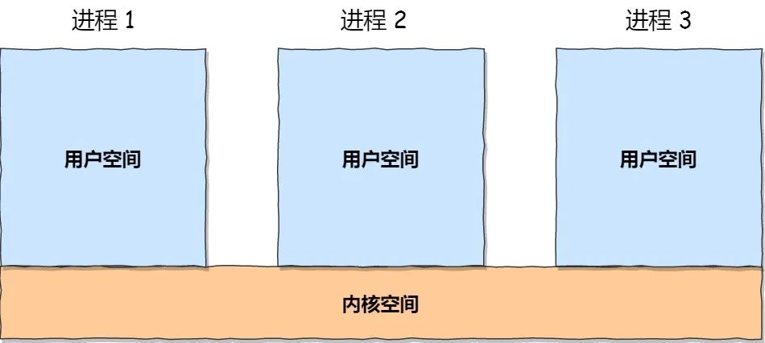
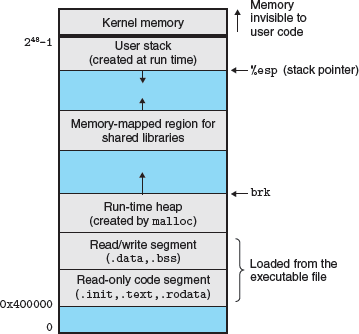
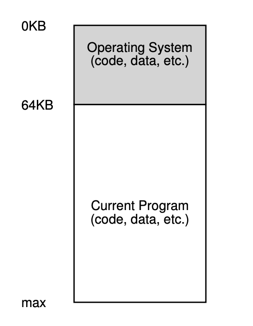

# 虚拟内存

What Why How

[TOC]

**操作系统（甚至整个计算机系统）的核心之一就是虚拟化、如果整个内存学习中只需要记住一个概念、那就是虚拟化。** 系统为每个应用程序提供了一个一致、独立的线性内存地址空间。

- 一致：所有程序内存视图都一样、没有三六九等。

- 独立：地址空间是独占的，程序可以任意使用整个内存，不需要关心影响到其它程序。同理也不会被其它程序操作内存而影响。

- 连续线性：内存地址是0 ~ (2^n - 1) 的自然数。

用户程序生成的每个地址都是一个虚拟地址。操作系统只是给每个进程提供一个幻觉，即它拥有自己庞大而私有的内存；在一些硬件的帮助下，操作系统会将这些虚拟地址转换为真实的物理地址，从而能够定位所需的信息。


虽然所有的程序（包括操作系统）都运行在相同的物理内存上，但是通过操作系统提供的地址空间，他们被隔离在各自虚拟内存中。


## 虚拟内存是什么样 （What）

不只是进程运行使用虚拟内存空间，**内核也运行在虚拟内存空间**。虚拟内存被设计为内核和进程共用地址空间。



- 用户地址空间在低地址、内核地址空间在高地址，二者合起来形成了虚拟地址空间。
- 每个进程都有自己独立的地址空间，互不影响。但内核只有一份地址空间，即便是多核处理器上也是如此。
- 在 64 位机上，目前并没有使用全部64位地址总线，地址空间有空闲。内核和用户地址空间被设计为在地址空间的两端，空白留在二者中间。

这样做有很多好处：

1. 性能优化
减少上下文切换开销：如果内核使用独立的地址空间，每次系统调用或中断时都需要切换地址空间（如切换页表），这会带来显著的性能开销。而共享地址空间的设计使得内核可以直接访问用户空间的数据，避免了频繁的地址空间切换。

高效的数据传递：内核和用户空间共享地址空间后，内核可以直接访问用户空间的缓冲区（如系统调用参数），无需额外的数据拷贝，从而提高了效率。

2. 简化设计
统一的地址管理：共享地址空间简化了内存管理。内核和用户空间使用同一套页表机制，操作系统只需要管理一个地址空间，降低了复杂性。

硬件支持：现代处理器（如x86、ARM）的MMU（内存管理单元）通常设计为支持单一地址空间，内核和用户空间通过权限位（如特权级）来隔离。这种设计充分利用了硬件特性，简化了操作系统的实现。

3. 内核直接访问用户空间
在某些情况下，内核需要直接访问用户空间的数据（如读取系统调用参数或处理I/O请求）。如果内核和用户空间使用独立的地址空间，这种访问会变得非常复杂，可能需要额外的映射机制或数据拷贝。

共享地址空间使得内核可以直接访问用户空间的内存，从而提高了效率。

**每个进程都有独立的**

### 虚拟地址空间到底多大？

现代计算机通常采用 32 或者 64 位处理器。32 位计算机的地址空间大小为 2^32 = 4 GB。虽然一些机器上通过特殊技术支持访问超过 4G 大小的物理内存，但虚拟内存空间仍然限制在 4 GB。

Linux 在 32 位系统上通常将 3 GB 分配给用户空间，1 GB 分配给内核空间。

32 位内存布局：
```
--------------------> +--------------------------+
ffff:ffff             |                          |
                      |      Kernel ( 1G )       |
c000:0000             |                          |
--------------------> +--------------------------+
bfff:ffff             |                          |
                      |                          |
                      |      User ( 3G )         |
                      |                          |
0000:0000             |                          |
--------------------> +--------------------------+
```
Windows 等系统采用 2G/2G 的划分方式。也有说法 Linux 也支持 2G/2G 的划分方式，不过我没有去验证。


对于 64 位机的寻址能力达到了 16 EB，这么大的寻址能力支持的存储有多大呢？现在(2022 年) 美光推出全球最大容量内存卡高达1.5TB!，但是距离 EB 还有很遥远的距离。因此实际上为了节约成本没有计算机实际上支持这么大的内存寻址。当前主流的 64 位 CPU 实现通常支持 `39bits`, `48bits`的内存寻址。

```
--------------------> +--------------------------+
ffff:ffff:ffff:ffff   |                          |
                      |                          |
                      |      Kernel              |
                      |                          |
ffff:ff80:0000:0000   |                          |
--------------------> +--------------------------+
ffff:ff7f:ffff:ffff   |//////////////////////////|
                      z //////////////////////// z
                      z //////////////////////// z
0000:0080:0000:0000   |//////////////////////////|
--------------------> +--------------------------+
0000:007f:ffff:ffff   |                          |
                      |                          |
                      |      User                |
                      |                          |
0000:0000:0000:0000   |                          |
--------------------> +--------------------------+
```
- 64 位机的用户空间和内核地址空间不是使用连续的地址，而是使用虚拟地址的两端。用户和内核虚拟地址大小是一样的。

- 32 位内存的用户空间的布局和 64 位内存的布局顺序一致，只不过地址空间更小。另外 64 位机能够兼容 32 位的程序，在运行 32 位程序时，内核空间仍然是 64 位机的样子，但是程序仅占低地址空间的 4G 内存。具体查看 https://www.cnblogs.com/zengkefu/p/6783456.html

- 一些 64 位 CPU 支持将最高的几位地址为留作它用，例如 ARM 的 `Address Tagging (or top-byte-ignore, TBI)`。[HWAsan 就是使用 64 位中的高 8 为作为标记来检测内存使用问题的](https://clang.llvm.org/docs/HardwareAssistedAddressSanitizerDesign.html)，这也是想要使用 HWAsan 需要 64 位的芯片，并且要编译支持该技术的系统的原因。

计算地址空间大小有一个快速的方法，位数/10 作为单位，其单位转换表如下：

| Name   | Kilobyte | MegaByte | Gogabyte | TeraByte | PetaByte | ExaByte | ZetaByte |
| ------ | -------- | -------- | -------- | -------- | -------- | ------- | -------- |
| Chinese|  千字节   |   兆字节  |   吉字节  |   太字节  |   拍字节  |  艾字节  |   泽字节  |
| Symbol |    KB    |    MB    |    GB    |    TB    |    PB    |    EB   |    ZB    |
| Addres |   2^10   |   2^20   |   2^30   |   2^40   |   2^50   |   2^60  |   2^70   |

例如：

2^32 = 2^2 * 2^30 = 4 GB
2^64 = 2^4 * 2^60 = 16 EB
2^48 = 2^8 * 2^40 = 256 TB

如何验证 Linux 上使用多大的地址空间？我们可以使用如下命令查看实际使用的地址空间，例如在我的 64 位 X86 Linux 上：

```shell
$ cat  /proc/cpuinfo
...
address sizes	: 39 bits physical, 48 bits virtual
...
```

可以看到是 64 位的机器，但是仍然仅有 `48` 位地址在使用，也即 64 为 Linux 支持 256TB( 2^48 ) 的虚拟地址空间。这台机器上有 `39` 位的真实物理地址，也即 512 G，其实是硬盘容量。

但是 `Android ARM ` 系统 `/proc/cpuinfo` 中并没有 `address sizes` 信息。[在 Linux 官方的文档中](https://www.kernel.org/doc/Documentation/arm64/memory.txt)，我们知道 ARM 64 位 CPU **同时支持** `40bits`, `48bits` 的地址空间。支持 `ARMv8.2-LVA` 特性的 [ARM 甚至支持 `52bits` 的地址空间。](https://kernel.org/doc/html/latest/arch/arm64/memory.html)
```
AArch64 Linux memory layout with 4KB pages + 3 levels:

Start			End			Size		Use
-----------------------------------------------------------------------
0000000000000000	0000007fffffffff	 512GB		user
ffffff8000000000	ffffffffffffffff	 512GB		kernel
```


可见，**系统支持的内存地址不是想支持多大的寻址能力就能支持大多，而是 CPU 设计支持哪些地址空间，操作系统在 CPU 支持的地址空间上选择一种使用而已**

如何验证 ARM 上的实际使用的内存空间？

一个变通的方法是使用  `cat /proc/self/maps`，例如：

```
# 因为低地址可能打印时省略高位 0，因此我们看高地址的栈
...
7fd53d5000-7fd53f6000 rw-p 00000000 00:00 0                              [stack]
```

最前面的一列是这块内存占用的内存区间。打印的是 16 进制地址，一共有 10 位，因此使用的 `40 bits` 的地址空间。

## 虚拟内存的重要性 (Why)

用户程序生成的每个地址都是虚拟地址。操作系统只是给每个进程提供了一个假象，具体来说就是它拥有自己的大型私有内存；在一些硬件的帮助下，操作系统会将这些假装的虚拟地址转化为真实的物理地址，从而能够找到所需的信息

主要是易用性：操作系统会给每个程序提供一个大的连续地址空间来存放其代码和数据；因此，作为程序员，你永远不必担心 “我应该把这个变量存放在哪里？”之类的问题，因为程序的虚拟地址空间很大，有很多空间来存放这类东西。对于程序员来说，如果要把所有代码数据都装进一个狭小拥挤的内存中，生活就会变得棘手得多

隔离和保护也很重要。我们不想让一个错误的程序读取或覆盖其他程序的内存

所有的程序和系统一起共享内存，这给内存的管理和使用带来了巨大挑战。例如，一个进程的内存如果被另一个进行修改了，那么其运行的结果可能会错误或者运行崩溃，并且这种错误难以检测和分析；为了更好的管理内存和减少错误，现代系统对内存进行抽象，提供了虚拟内存。

虚拟内存是硬件异常、硬件地址转换、内存、磁盘文件以及内核的完美协作，为每个进程提供了独立、统一、超大的地址空间。在使用内存时，我们不用担心自己使用的内存是否会被别的程序占用，所有的空间都是给我们的程序使用的。虚拟内存提供了三项重要能力：

1. 将内存作为磁盘地址空间的缓存，更高效的使用内存，仅保留活动部分在内存中，只有在需要的时候才将数据从内存和磁盘之间加载和写回。

2. 通过为每个进程提供一致的地址空间来简化内存管理。

3. 保护每个进程的地址空间不被其他进程破坏。

虚拟内存是计算机系统中最伟大的思想之一。它成功的一个主要原因是它默默且自动工作，不需要应用程序开发者的任何介入。既然虚拟内存在幕后工作得如此之好，为什么还需要程序员理解它呢? 有几个原因。


- **虚拟内存是核心。** 虚拟内存涉及计算机系统的各级，在硬件异常、汇编程序、链接程序、加载程序、共享对象、文件和进程的设计中起着关键作用。了解虚拟内存将帮助开发者更好地在整体上理解系统的工作原理。

- **虚拟内存非常强大。** 虚拟内存给于应用程序创建和销毁内存块的强大能力，将内存块映射到磁盘文件的一部分，与其他进程共享内存。例如，你知道可以通过读写内存来读取或修改磁盘文件的内容吗? 或者将文件的内容加载到内存中而无需进行任何显式复制? 了解虚拟内存将帮助你在应用程序中利用它的强大功能。

- **虚拟内存非常危险。** 每当应用程序引用变量、解引用指针或调用动态分配内存(如 malloc )时，它们都会与虚拟内存交互。如果内存使用不当，应用会发生令人困惑的相关错误。例如，程序中一个不好的指向可能触发“segmentation fault”或“protection fault”而立即崩溃，或者在崩溃前静默运行数小时，最可怕的是，能够运行到结束但是结果不正确。了解虚拟内存和管理它的分配(如malloc)可以帮助您避免这些错误。

### 虚拟内存是内存管理的利器

虚拟内存极大的简化了内存管理，并且提供了一种方便的方式来保护内存。实际上，操作系统为每个进程提供了一个独立的页表，因为每个进程都有自己独立的内存空间。不同内存空间的虚拟页可以映射到同一个物理页面上，从而能节省物理内存。

按需页面调度和独立的虚拟地址空间的联合对系统中内存的使用和管理产生了深远的影响。特别是，虚拟内存简化了链接和加载、代码和数据的共用，以及为应用程序分配内存。


- 简化链接： 独立的地址空间让每个进程都使用相同的内存布局。不用关心具体的代码和数据在内存中的位置。例如，对于给定的 Linux 系统，每个进程都具有类似的内存布局。对于 64 的 Linux 系统，如下图所示


    代码段总是从低地址开始，（并不是从 0 开始, 例如 8068 芯片很多从 4MB 的地址开始)，数据段跟在代码段之后，其之间会有一个合适的对齐间隙，栈在了用户地址空间的最高地址部分，并向下增长。这种一致性很大程度地简化了连接器的设计与实现，这使其能够产生全链接的可执行文件，可执行文件是独立于代码和数据在物理存内存中的位置。

- 简化加载: 虚拟内存也让可执行文件和共享文件加载进内存变得简单。为了加载对象文件中的 `.text` 和 `.data` 段进一个新建的进程， Linux 的加载器会为代码和数据段分配虚拟页（PTE），并将其标记为无效（invalid，not cached），并将页表项指向共享文件中的正确位置。有趣的是加载器从不进行磁盘到内存的数据拷贝。数据在页面第一次被访问时（CPU 获取一个指令或者执行指令时引用一个地址）才根据需要被自动换入内存。
    这种将一系列连续虚拟页映射到任意文件中的任意位置的概念称为 `内存映射`。Unix 系统都提供了 mmap 的系统调用以便应用程序创建自己的内存映射。这是一个非常有用的技术，我们会在稍后详细解释。

- 简化共享: 独立的地址空间为操作系统管理用户进程以及系统自己的共享提供了一致的机制。通常，每个进程都有自己的私有代码、数据、对和栈并且不与任何其它进程共享。这种情况下，操作系统创建页表，相应的续页页面映射到不相交的物理页面。
    然而，需要在进程之间共享代码和数据。例如，每个进程必须调用相同的操作系统内核代码，以及每个 C 程序调用 C 标准库中的函数，例如 `printf`。操作系统通过将不同进程中的虚拟页映射到相同的物理页，可以让多个进程共享内存中为唯一代码。而不是将内核和 C 标准库拷贝到不同进程中。

- 简化内存分配：虚拟内存向用户进程分配内存提供了一种简单的机制。当用户进程中的程序申请额外的堆空间时（例如，调用一个 malloc 函数），操作体统分配适当输数量的连续内存虚拟内存页，例如 K 个，并将其映射任意位置的 k 个物理内存页。由于页表的工作方式，操作系统不必寻找 k 个连续的物理内存页。这些页面可以随机地分散在物理内存中。

### 虚拟内存用于内存保护

任何现代计算机系统都必须为操作系统提供控制内存系统访问的机制。一个用户进程不应该被允许修改它的只读代码区。它也不应该被允许读取或更改任何内核中的代码和数据结构。也不应该允许其读取和修改其它进程的私有内存，也不应该允许它修改与其他进程共享的虚拟页，除非各方明确允许（通过显示调用进程间通信系统调用）。

正如我们看到的，提供独立的虚拟地址空间使隔离不同进程的私有内存变得简单。但地址转换机制可以很方便的扩展一提供更精细的访问控制。由于每次进程禅城一个地址地址转换硬件都会读取页表项，通过向页表项中添加额外的控制位就可以直接控制虚拟页内容的访问。

当一个指令违反了这些权限，CPU 就会触发一个通用的保护错误以将控制交给内核中的异常处理，其会向引发异常的进程发送一个 `SIGSEGV` 信号。 Linux shell 通常将该异常报告为 `segmentation fault.`


## 用户虚拟空间 (How)

### 如何使用？

> 1. 先申请后使用：

虚拟内存空间并不是一次性完全开放给应用程序，需要的时候必须申请。访问未分配给应用的内存空间会引起程序 `段错误（segmentation fault）`而崩溃。可执行程序的内存空间分配由内核加载程序时完成分配。其它情况则需要程序主动申请。

> 2. 按页分配：

虚拟内存空间申请必须一次性申请固定块大小的整数倍，固定大小的块被称为一页（像书的每一页大小都一样，很形象。必须整页分配是物理内存的分配的颗粒大小导致的、也是CPU 实现的物理限制条件的一个平衡，我们到虚拟内存实现的细节中再详细探讨其原因。）。这是为了节省内存而不得以作为。内存的分配需要记录各种数据，分配了哪些地址、物理内存是否分配、分配空间的权限是什么。这些都需要数据记录。太小的颗粒度就需要更多的数据记录详细的分配细节，从而占用过多内存而留给应用程序的内存变少。

```
# 获取页大小
getconf PAGE_SIZE
```


> 3. 延迟加载（demand paging）：

只分配地址空间，物理内存直到访问时（读取或写入）才分配。延迟加载有很多好处，①物理内存直到访问时才分配，这样可以有效的节省有限的物理内存。比如一个很大的程序可能一次性映射了2GB的内存，但是由于局部性原理，秩序的代码和数据不会一次性访问，延迟加载可以让我们进使用几M甚至几K的内存就能让程序正常运行，这远小于程序的申请大小。程序实际使用的内存比较小，就可以让更多的进程常驻内存，在进程切换时更加高效。②有了延迟加载后，还可以将程序不经常使用的内存释放掉，直到下次程序再次访问时，再被加载进内存。


### 分配(映射)

Unix 系统中**所有用户空间的分配都使用映射（包括程序自身）**，对于将文件内容和内存关联的被称为文件映射；没有实际文件对应的内存申请称为匿名映射。

- 文件映射: 文件映射是指将**文件的内容**直接映射到进程的**虚拟地址空间**，这样，进程可以像访问普通内存一样读写文件内容。

- 匿名映射: 进程需要分配一定的物理内存来存储运行时的数据，这部分内存没有对应文件，内核就使用 `匿名映射` 将内存中的某段物理地址与用户空间一一映射，这样用户就可用直接操作虚拟地址来访问这段物理内存。比如使用malloc申请内存。


Linux 上查看 `/proc/<pid>/maps` 文件可以看到该进程的内存地址映射情况。包含当前进程使用的虚拟内存区域、内存映射的文件及其访问权限。也可以使用 mmap 命令查看。

此外线程的 maps 跟进程的 maps 是完全一致的，它们在 `/proc/<pid>/task/<tid>/maps` 文件中，它的内容和进程的 maps 几乎完全一致，但会额外、准确地显示出这个线程独有的栈。

文件的格式为：
```
地址区间                权限   偏移                  对应的文件
address               erms offset  dev   inode    pathname
00400000-00452000     -xp 00000000 08:02 173521   /usr/bin/dbus-daemon
00651000-00652000     --p 00051000 08:02 173521   /usr/bin/dbus-daemon
00652000-00655000     w-p 00052000 08:02 173521   /usr/bin/dbus-daemon
00e03000-00e24000     w-p 00000000 00:00 0        [heap]
00e24000-011f7000     w-p 00000000 00:00 0        [heap]
...
35b1800000-35b1820000 r-xp 00000000 08:02 135522  /usr/lib64/ld-2.15.so
35b1a1f000-35b1a20000 r--p 0001f000 08:02 135522  /usr/lib64/ld-2.15.so
35b1a20000-35b1a21000 rw-p 00020000 08:02 135522  /usr/lib64/ld-2.15.so
35b1a21000-35b1a22000 rw-p 00000000 00:00 0
35b1c00000-35b1dac000 r-xp 00000000 08:02 135870  /usr/lib64/libc-2.15.so
35b1dac000-35b1fac000 ---p 001ac000 08:02 135870  /usr/lib64/libc-2.15.so
35b1fac000-35b1fb0000 r--p 001ac000 08:02 135870  /usr/lib64/libc-2.15.so
35b1fb0000-35b1fb2000 rw-p 001b0000 08:02 135870  /usr/lib64/libc-2.15.so
...
f2c6ff8c000-7f2c7078c000 rw-p 00000000 00:00 0    [stack:986]
...
7fffb2c0d000-7fffb2c2e000 rw-p 00000000 00:00 0   [stack]
7fffb2d48000-7fffb2d49000 r-xp 00000000 00:00 0   [vdso]
```
各列的含义：
- 第一列地址区间: `00400000-00452000` 是该虚拟内存段的开始和结束位置，需要说明的是，该地址是前闭后开区间 `[start, end)`，即结束地址不是该断占用的，它可能是下一段的起始地址。
- 第二列内存权限: `r-xp` 内存段的权限，分别是可读、可写、可运行、私有或共享，最后一位p代表私有，s代表共享。例如程序段 `r-xs`，数据段 `r--p`，还有用户保护栈越界触发中断的 `---p`。
- 第三列文件偏移: `00000000` 该虚拟内存段起始地址在对应的映射文件中以页为单位的偏移量，对匿名映射，它等于0或者vm_start/PAGE_SIZE
- 第四列设备号  : `08:02` 文件的主设备号和次设备号。对匿名映射来说，没有对应的磁盘文件，所以没有设备号，始终为00:00。
- 第五列 innode: `173521` 被映射到虚拟内存的文件的索引节点号，通过该节点可以找到该文件，匿名映射的该列始终为00:00。
- 第六列映射文件: `/bin/bash` 被映射到虚拟内存的文件名称。后面带(deleted)的是内存数据，可以被销毁。对于文件映射，是映射的文件名。对匿名映射来说，是此段虚拟内存在进程中的角色：[stack]表示在进程中作为栈使用，[heap]表示堆。如果在申请时没有设置名称，也可能不显示名称。

- `[stack]`、`[heap]`...这是都是系统创建的匿名映射的名字。`[stack]`是主线程的栈，子线程栈要么系统默认分配，要么用户自己指定，都是使用 mmap 分配的匿名映射，如果使用 `prctl` 设置了其名称 `XXX`，则 maps 文件中显示的名称为 `[anon:XXX]`（Linux 5.17 开始支持设置匿名映射的名称，但是在一些系统上可以关闭，例如 docker）。

- [vsyscall, vdso 及 vvar](https://zhuanlan.zhihu.com/p/436454953)用于快速系统调用。vvar 是系统的一些调用的数据会映射到这个页面，用户可以直接在用户空间访问。vdso 就是内核实现了glibc的一些系统调用，然后可以直接在用户空间执行,提高系统调用效率和减少与glibc的耦合。(vDSO -virtual dynamic shared object,is a small shared library exported by the kernel to accelerate the execution of certain system calls that do not necessarily have to run in kernel space, )

相关的 `map_files` 目录下的链接文件就是以上输出中 `文件映射` 的段，并且文件名就是第一列的`地址区间`。

例如以上的进程的 `map_files` 目录：

```
$ ll map_files/
total 0
dr-x------ 2 root root  0 Jun 28 02:25 ./
dr-xr-xr-x 9 root root  0 Jun 28 02:19 ../
lr-------- 1 root root 64 Jun 28 02:25 00400000-00452000 -> /usr/bin/dbus-daemon
lr-------- 1 root root 64 Jun 28 02:25 00651000-00652000 -> /usr/bin/dbus-daemon
lr-------- 1 root root 64 Jun 28 02:25 00652000-00655000 -> /usr/bin/dbus-daemon
lr-------- 1 root root 64 Jun 28 02:25 35b1800000-35b1820000 -> /usr/lib64/ld-2.15.so
```

让我们根据 maps 文件来逐渐学习用户虚拟内存空间的使用。

### 内存空间申请

`exec` 系列调用，执行程序，将可执行程序和虚拟内存空间建立文件映射。并为程序自动分配了匿名映射空间作为栈使用。我们将在链接和装载一节详细介绍其细节。

`mmap、mremap、munmap`: Unix 系统的内存空间分配现代 API，除了提供内存分配外，还支持将文件和设备映射到内存，通过读写内存就可以操作文件和设备，从而提高文件和设备的访问速度。

mmap 是 POSIX 规范中的一个函数，在 Unix 都有实现。详细使用方法可以查看 man 文档，这里不多赘述。这里只简述一下其使用场景和优势。**mmap 的使用非常广泛，例如线程栈的申请，动态库的内存申请，多个线程之间实现内存共享通信，甚至腾讯的 MMKV 也是使用 mmap 实现的**。其用于在调用进程的地址空间和文件或者设备之间建立映射。这样程序就可以直接对内存进行操作，系统会在释放内存时将其修改保存到文件。从而达到以几乎以修改内存的速度修改文件的目的。其也讲一将内存映射到多个进程，从而其修改被多个进程可见。

在调用 mmap 进行匿名映射的时候（比如进行堆内存的分配），仅分配了一段虚拟地址空间，物理内存页会在实际访问该区域时（缺页异常发生时）分配。当调用 mmap 进行文件映射的时候，只是建立了虚拟地址空间与文件的对应关系，并没有立即把文件内容读取到物理内存。物理页的分配和文件内容的加载仍然是在访问时（缺页异常）发生。

磁盘缓存，在需要的时候才写回。

#### 对比

**mmap 一个重要的作用是作为文件缓存**，通过 mmap 系统调用把文件映射到内存中，然后在相应的内存区域中操作字节来访问文件内容，实现更高效的IO操作；例如腾讯的 MMKV 就是使用这部分内存。传统的 open, read, write, close 等文件操作是由内核加载数据，然后再将数据拷贝到用户地址空间，效率比较低。而文件映射在访问数据时，发生缺页中断，内核直接将数据加载到用户空间，整个过程仅一次数据拷贝，性能更好。


1. mmap 只能整页申请内存页。当文件比较小时，会浪费物理内存页。

2. 只支持定长文件（为了支持变长文件，可能可以使用 mremap，但是我几乎没见过有人这样做）。

- 还可以用于进程间通信IPC（共享内存）。

#### mmap 文件映射陷阱

```
非页对齐 length 的风险与应对
1. 文件映射的尾部风险
问题：访问超出文件末尾但仍在分配页内的地址 → 触发 SIGBUS


int fd = open("file.txt", O_RDWR); // 文件大小=5000字节
void* addr = mmap(NULL, 5000, PROT_READ, MAP_SHARED, fd, 0);

char c = *((char*)addr + 5000); // 访问偏移5000（在4096~8192之间）
// 触发 SIGBUS！因文件实际内容不足8192字节
解决方案：

手动扩展文件大小：


ftruncate(fd, aligned_length); // 将文件扩展到8192字节
或严格限制访问范围：[0, min(length, file_size)-1]
```

#### brk/sbrk (进作为科普，不要再使用)

`brk / sbrk`: 是 Unix 系统的古老遗产，Linux 为了兼容性保留了这个系统调用，在一些系统上已被移除（例如 OpenBSD， FreeBSD 上也标记为过时），新的程序应该避免使用该调用。早期系统没有多线程的时候，堆被排在了数据之后，用一个指针来指向数据末尾，这个指针位置成为 `program break`。

brk() 和 sbrk() 都可以用来改变 `program break` 的位置，`program break` 定义了进程数据段的结束为止（也就是说，`program break`是未初始化的数据段结束后的第一个位置）。增大 `program break` 增加进程申请的内存，减小则释放内存。

```c
#include <unistd.h>

/**
 * 使用地址指定 'program break' 的位置。
 * addr: new program break address.
 * return: success -> 0; error -> -1
 */
int brk(void *addr);

/**
 * 使用偏移移动 'program break' 的位置。
 * increment: 大于 0 则申请内存，小于 0 较少内存，等于 0 用于获取当前 的 program break 位置。
 * return: program break address between change.
 */
void *sbrk(intptr_t increment);
```

brk 和 sbrk 均可以用于申请和释放内存，但是常使用 `sbrk` 申请内存。其返回之前的 `program break` 位置，可以使用变量保存该位置。然后在不需要增加的内存时，将其传入 `brk` 释放内存。

在用户空间的内存申请，无论用户 API 调用什么，最终都会调用 `brk/sbrk` 或者 `mmap/mummap` 这两组函数向系统申请内存空间。`brk/sbrk` 用于增加或者减少从低地址空间的内存增长。而 `mmap/mummap` 用户从高地址申请和释放内存。

**对比：**

- brk/sbrk 连续的增长空间，但是由于现代内存空间的碎片化，可能会因为还有很多空间，但是分配失败（有一块内空间已经分配了，挡住了 sbrk 的增长）。

- mmap/mummap 申请的空间一块一块的，不断地分配和释放空间可能导致内存空间碎片化。这需要操作系统提供优秀的算法来避免碎片化，同时应用程序也应该将不使用的空间尽早归还，方便内核的空间分配。

- mmap 既能分配文件映射，也能分配匿名映射。而 bar 和 sbrk 分配的堆内存只是匿名映射。新程序都应该是使用 mmap 来分配空间。

***需要重点说明的是，所有内存分配都是映射。尽管 sbrk 分配的内存在 maps 上被标记为 [heap], 程序的主线程被标记为 [stack]，他们都是匿名映射，在内核看来和 mmap 分配的内存没有本质区别（不过是历史遗留下的痕迹），都是一个 VMA(Virtuail Memory Area)。只是应用程序使用他们的方式不同而已。应用程序完全可以自己使用 mmap 申请一块空间，修改栈顶指针指向其空间将其作为栈使用。***

### 保护

虚拟内存空间对程序的保护体现在多方面：

- 进程间实现隔离，防止进程数据被其它进程访问和修改。

- 分配的内存可以根据需要被赋值为不同权限（可读、可写、可执行），防止程序内部不当的读写操作，让这些错误操作即使被发现。

- 访问未分配的内存空间引起段错误，让程序逻辑错误及时被发现。

出现一直递归调用的情况，这样栈上就会出现很多 fac 的帧栈，会造成栈空间耗尽，出现 StackOverflow。这里的原理是，操作系统会在栈空间的尾部设置一个禁止读写的页，一旦栈增长到尾部，操作系统就可以通过中断探知程序在访问栈末端。


## 节省物理内存

有了虚拟内存之后，我们才有了各种手段来省物理内存,甚至能使用超过真实物理内存的空间。方法有延时分配、写时复制（Copy-On-Write ）.

### 延迟分配

延迟分配是指，用户空间申请内存时，只是分配了虚拟内存空间，并没有分配物理内存。物理内存的分配直到实际访问内存的时候引发一个缺页异常，系统处理该异常时如果虚拟内存时已经映射的，则默默分配物理内存，之后恢复程序的执行，用户空间的程序好似什么都没有发生一样，继续执行。这似乎给当前程序带来了一点性能损失，却带来了巨大的好处，①内存得到了最大化的利用，只有真正被使用的数据才被加载进内存。屏蔽了应用程序申请庞大内存对系统性能造成的影响，以及物理内存的浪费。而且减少了应用开发者的心里负担，他们不必为该申请多大内存而仔细盘算，不必为浪费物理内存而产生心理负担；②延迟分配允许用户申请大于计算机当前拥有的物理内存大小的空间，这被称为 Overcommit（过提交）。因为物理内存不会一次性分配给应用，由于程序的局部性，系统可以在程序需要时将物理内存分配给程序，在程序访问其它块时，将程序不再访问的物理内存回收利用。③系统的整体性能得到提升。I/O 访问成为限制程序性能的核心问题之一，通过只加载实际访问到的数据到内存。减少了因为加载数据导致的 CPU 等待，整个系统的性能显著提升，甚至很多时候当前程序也能获得更好的性能，因为其加载的数据不一定全访问到，全部加载到内存的 I/O 损失有可能更加显著。

### Overcommit

Overcommit allows more memory to be allocated than physically available. (more that the main memory + swap). It is dependent on on-demand paging and on applications not using more than a minority of allocated memory.

It allows for malloc () requests to succeed instead of failing as system will rarely decline requests for virtual memory.

Consequences of overcommit depend on tumbles and how kernel manages memory pressure — most frequently you’ll see OOM Killed (Out of memory killer).

[调整 overcommit 的策略](https://www.kernel.org/doc/Documentation/vm/overcommit-accounting)

### 写时复制

进程的内存分配，Copy-On-Write (写时复制)策略：当创建一个进程时，其和父进程使用同一份 Memory, 只有当写入内存时，才实际分配新内存。fork 出来的进程, 并且没执行新的程序, 内存都是共享的, 可以极大的减少 Memory 的使用。


### Page Allocation Failure

It can be caused by memory segmentation — the available memory is so fragmented that there is not enough contiguous space to allocated pages that require contiguous space.

It can also be caused by a general lack of memory.


Setting /sys/kernel/mm/transparent_hugepapge/enabled to never will disable them.

- 查看进程的 maps 和 smaps 文件。并解释细节
- 查找资料，确认 /proc 目录下面各个文件的作用。
- 代码段和数据段的权限不同，会放在同一页吗？如果不能放在同一页是否有很多内存浪费？可以做到合并映射到同一物理内存页。

- 用户程序向内核申请内存是否只能整页申请？是的。虚拟内存的申请都是整页申请（sbrk 可以不整页，但已不是标准方法）。想要实现细粒度的分配，需要在系统调用之上实现用户空间的分配器。例如 glibc 的 malloc 其实是在映射之上实现的分配器，其本质是向系统申请大块内存然后划分成更小的块来供应用使用。


## 限制

从上面的虚拟地址空间可以看出，由于有多个栈存在，栈的空间大小并不是可以任意增长的；各个区域的内存大小是否有限制？有限制的话内存大小是多少？

不同系统、发行版，甚至版本的限制可能不同。对于 Linux，可以使用 `ulimit -a` 来查看当前 shell 进程和子进程的限制，也可以使用 `ulimit` 来修改这些设置。或者使用 `cat /proc/<pid>/limits` 直接查看运行进程的限制。

1. 堆的起始地址并不是固定的，而是根据运行的程序占用的代码段、数据段决定。在这两部分地址末尾会增加一个随机地址（防止攻击），以此作为堆的起始地址。

```shell
prompt> ulimit -a
core file size          (blocks, -c) 0          # core dump最大字节数
data seg size           (kbytes, -d) unlimited  # 单进程数据段最大空间
scheduling priority             (-e) 0
file size               (blocks, -f) unlimited  # 单个文件最大可写字节数
pending signals                 (-i) 30964
max locked memory       (kbytes, -l) 64         # 单进程可锁定的内存字节数
max memory size         (kbytes, -m) unlimited  # 最大使用内存限制
open files                      (-n) 1048576    # 单进程可打开的文件描述符
pipe size            (512 bytes, -p) 8
POSIX message queues     (bytes, -q) 819200     # 单进程可用的消息队列字节数
real-time priority              (-r) 0          # 
stack size              (kbytes, -s) 8192       # 栈大小
cpu time               (seconds, -t) unlimited  # 单进程可用的CPU秒数
max user processes              (-u) unlimited  # 单用户可创建的线程/进程数
virtual memory          (kbytes, -v) unlimited  # 单进程总虚拟内存空间
file locks                      (-x) unlimited  # 单进程可持有的文件锁数
```

可以看到 `max memory size`、`data seg size`、`virtual memory` 都没有限制，该 Linux 只限制了栈的内存大小为 8MB。

### 区分系统限制和进程限制

Linux 下的“资源限制”主要分为两大类：

- 系统级限制（System-wide limits）
限制整个操作系统层面所有用户、所有进程可用的资源总量。

- 进程级限制（Per-process limits）
限制单个进程（或进程组、用户）可用的资源量。

进程级限制通常由 shell 的 ulimit 命令和 /proc/<pid>/limits 管理。

系统级限制通过 sysctl、/proc/sys、内核参数、配置文件等。

最大进程数（所有用户总和）
/proc/sys/kernel/pid_max
如：cat /proc/sys/kernel/pid_max
设置：sysctl -w kernel.pid_max=4194304


## 总结

虚拟内存在整个现代系统内存管理中占据着核心的位置，系统向上提供虚拟，让应用程序以为是独占了内存。看起来内存的这种虚拟是一种天才设计，但是回顾计算机发展的历史我们发现这种抽象其实是一种必然。

1. 应用程序独占的年代：
    在最早期的计算机出现的年代，计算机就是一台裸机，软件的开发人员直接面向硬件编程（如今的嵌入式编程就是如此）。整个计算机其实只运行一个程序，真正的做到了程序独占内存。那时候还没有称为操作系统的概念，而是系统商场为了编程简单，对硬件操作提供了一组基础的程序。例如 BIOS 就是典型早期程序，从他的名字也能看出其作用：基础输入输出系统，它提供硬件的信息以及对 I/O 设备的输出输出程序，方便开发人员直接调用，而不是从头编写。它只是个普通程序，和用户编写的程序一同驻留在内存中。
    

2. 批处理时代：
    计算机运行的速度越来越快，输入的速度却很慢，CPU 的很大时候需要等待操作员的输出，浪费了计算资源，为了更大效率利用 CPU，就有了将程序积累起来一起输入，然后计算机一个接一个的运行程序，每次只有一个程序在运行，程序仍然是独占内存的。

3. 多任务和分时操作系统的兴起
    由于技术改进，CPU 运行速度速度和程序的存储介质的访问速度的差距拉大，而且程序进行中间进行 IO 访问等操作时，程序实际上是暂停运行的，这时如果能运行其它程序，将很好的利用计算资源。同时由于操作系统概念的发展，对硬件资源进行管理，提供虚拟成了一个必然趋势。而内存的虚拟化是必然的，原因是：

    - 一方面，计算机程序希望独占内存，因为在编写程序时，我们无法预测另一程序使用了哪些内存，从而避开这部分使用。
    - 另一方面，而为了兼容原先的程序，也需要一个程序的内存地址是连续的。

    但是从实际内存的使用上来说，我们希望多个程序其实是同时存在于内存的，以便一个程序进行 IO 操作时，随时切换到其它程序运行。因此段页式的存储被设计出来，同时由操作系统对内存虚拟化，向应用提供虚拟的内存空间，在应用程序看来，整个内存空间都是自己独占的，可以使用内存的任意位置。**虚拟内存并不是一个天才的发明，它是必然的需求。但如何实现虚拟内存却展现了计算机先驱们天才的设计。**


## System

系统内核一样拥有虚拟内存。和进程不同的是，整个系统只有一个内核虚拟地址空间，所有进程共享这个相同的内核空间映射。

虽然内核地址空间是全局的，但内核为每个CPU核心维护私有数据：

ZRAM 在内存中创建的、经过实时压缩的虚拟交换分区（Swap Device）

以及因 user space 进程打开文件所使用的 page cache，以及使用 ZRAM 压缩 user space memory 存储所占用的memory.


## 课后补充

maps 文件
```
786cd22000-786cd23000 rw-s 00000000 00:01 12531627                       /dev/ashmem/GFXStats-29320 (deleted)
```
ashmem 是 Android Shared Memory 的缩写，它是 Android 在 Linux 内核之外，自己实现的一个共享内存驱动。Linux 使用 `/dev/shm` 实现内存共享，它依赖 tmpfs 文件系统，Android 没有完全使用 Linux 标准的 tmpfs (POSIX SHM) 机制，它不依赖于文件系统，提供了一种类似 mmap 的匿名内存映射，但可以在进程间共享。


----------------------------------------------------------------

## 其它内存管理函数

### 内存属性控制

mprotect： 修改内存页保护权限（读/写/执行）
mlock、munlock、mlockall、munlockall：锁定（/解除锁定）物理页在内存中（禁止交换到 Swap）

### 内存优化建议

madvise：	向内核提供内存使用模式建议（共 20+ 种策略），如 MADV_SEQUENTIAL（顺序访问文件）、MADV_DONTNEED（立即释放物理页）
mincore：	查询内存页的驻留状态（是否在物理内存中），监控内存使用，优化缓存策略

### 其它：

memfd_create：创建匿名文件描述符用于内存映射（Linux 3.17+）	高效进程间共享、替代 tmpfs 文件
userfaultfd：注册用户态缺页处理函数（Linux 4.3+）虚拟机内存热迁移、增量快照（如 QEMU）

sysinfo：获取系统全局内存状态（总内存、空闲内存、Swap 等）	监控系统资源使用
getrusage：查询进程内存占用统计（常驻集大小、缺页次数等）	性能分析、资源限制检查
mbind	设置内存的 NUMA 节点绑定策略	多核服务器优化本地访问
set_mempolicy	配置进程的 NUMA 内存分配策略	高性能计算（HPC）
move_pages	将进程的物理页迁移到指定 NUMA 节点	动态负载均衡

参考:

[Linux 最多创建多少线程](https://www.jianshu.com/p/c4bb6457e4a9)
[Android 线程大小](https://zhuanlan.zhihu.com/p/33562383)
[Linux中的进程栈和线程栈大小](https://blog.csdn.net/u013178472/article/details/124117145)
[Android jvm 虚拟机的内存大小限制](https://blog.csdn.net/weixin_39692830/article/details/117498033)
[Linux 内存管理](https://hemantra.medium.com/linux-memory-management-all-you-need-to-know-d1dbdda8b386)
[认真分析mmap：是什么 为什么 怎么用](https://www.jianshu.com/p/57fc5833387a)