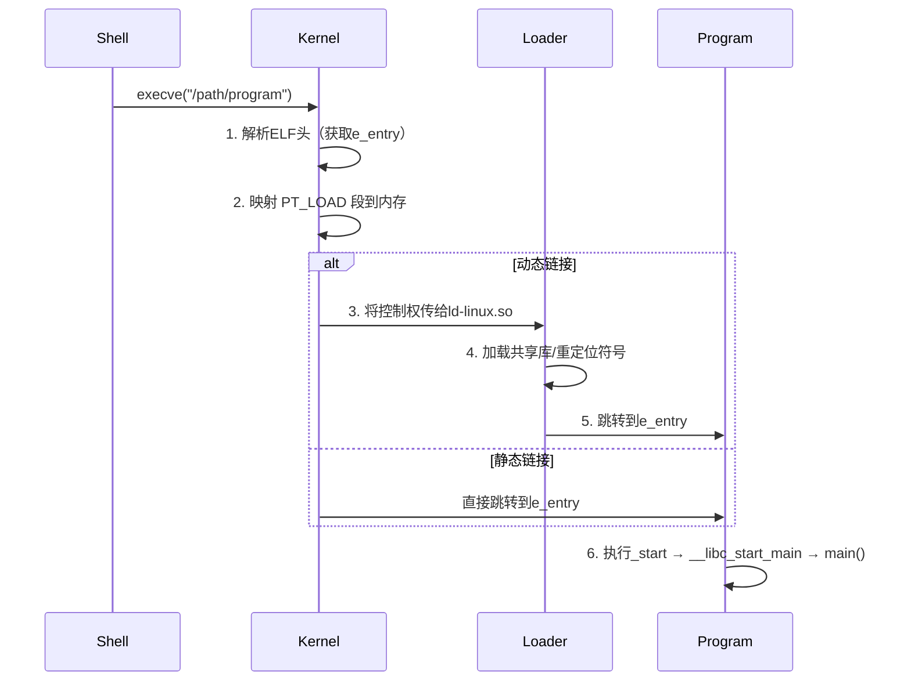
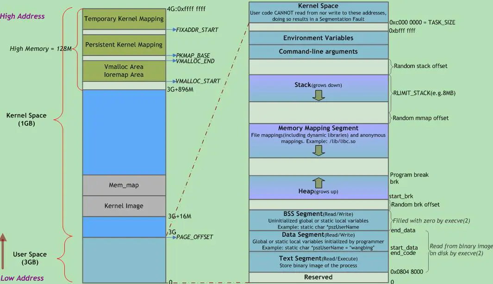

# 程序内存分配

有了虚拟内存之后，程序的链接和加载变得简单，连接器的目标是一个线性、一致的独立空间，无需考虑其它程序的干扰。这里我们主要关注链接和加载如何高效使用虚拟内存，而不会过多关注链接和加载的细节。

我们知道了操作系统通过映射来将虚拟内存空间和文件关联，程序生成链接时，就需要。

execve() 的作用：用新程序替换当前进程的内存空间（代码、数据、堆栈等）。

内核加载可执行文件，解析 ELF 文件头，包括入口点地址（Entry Point e_entry 字段：明确指定了第一条指令的虚拟地址（Virtual Address）。）

查看方式：readelf -h /bin/ls | grep "Entry point"

内核解析程序头（Program Headers），将代码/数据载入内存：
    1. 为每个 PT_LOAD 段分配虚拟内存页。

    2. 将段内容从文件拷贝到内存（例如 .text 段载入到 p_vaddr）。

    3. 对未初始化数据（.bss）清零。

动态链接处理（若需）
    - 对于静态程序：直接跳转到 e_entry。

    - 若依赖动态库：
        1. 内核将连接器载入内存（通常是 /lib64/ld-linux-x86-64.so.2）。

        2. 将控制权先交给解释器（而非直接到 e_entry）。

        3. 动态连接器完成动态链接后，再跳转到程序入口点。

通常，程序的入口并不是 main 函数，而是由静态连机器插入的  _start 函数：
入口点之后的流程
1. _start：初始化栈/寄存器，调用 __libc_start_main。

2. __libc_start_main（在 glibc 中）：

    - 初始化线程本地存储（TLS）

    - 调用全局构造函数（__init）

    - 注册 atexit 析构函数

    - 调用 main() 函数

3. main()：程序员编写的代码开始执行。


## 链接——计算地址


## 加载

数据区域用于存放程序全局数据和静态数据，根据细分可以分为：
    - 常量存储区：.rodata，例如 C++ 的虚函数表就是放在这个区域。
    - 数据存储区：.data, 存放初始化过的数据
    - 未初始化数据区：.bss, 存放未初始化的数据（统一初始化为0，不占程序文件的空间）。

Native 类型的程序，都具有如下的内存区域。其它虚拟机程序，也基本是这几种类型的区域。只不过有的叫法不同（例如 Java 把代码区区域称为方法区，由于 Java 动态加载字节码，其方法区很可能是虚拟机的堆区）。

1. 代码区 （.text段）：
    存放代码（如函数），不允许修改（类似常量存储区），但可以执行（不同于常量存储区）

2. 常量存储区 （.rodata段）：
    存放常量，不允许修改（通过非正当手段也可以修改）。其实就是值编码在可执行文件中，接该部分数据直接加载到内存即可。

3. 全局/静态存储区 （.bss段和.data段） ：
    全局和静态变量被分配到同一块内存中。在C语言中，未初始化的放在.bss段中，初始化的放在.data段中；在C++里则不区分了。

    对于未初始化的全局变量和静态变量，因为编译器知道它们的初始值都是 0，因此便不需要再在程序的二进制映像中存放这么多 0 了，只需要记录他们的大小即可，这便是 BSS 段。Block Started by Symbol，但很多人可能更喜欢把它记作 Better Save Space 的缩写。

除了上面所讲的基本内存区域外，**现代应用程序**中还会包含其他的一些内存区域，主要有以下几类：
- **存放加载的共享库的内存空间**：如果一个进程依赖共享库，那对应的，该共享库的代码段、数据段、BSS 段也需要被加载到这个进程的地址空间中。

- **共享内存段**：我们可以通过系统调用映射一块匿名区域作为共享内存，用来进行进程间通信。

- **内存映射文件**：我们也可以将磁盘的文件映射到内存中，用来进行文件编辑或者是类似共享内存的方式进行进程通信。这样我们就初步了解了一个进程内存中需要哪些区域。


> 都是数据，为什么需要分为常量区、初始化、未初始化的分区？
这是因为不同数据保存的内容和需要做的操作不同：

- 对于常量存储区，其值直接编码在可执行文件中，直接加载到内存即可，而且，因为是常量，其页属性可以设置为 `可读不可的`。

- 对于未初始化的全局变量和静态变量，因为不用保存其值，为了减少可执行文件的大小，只需要记录其大小，加载到内存时再申请相应的空间即可。

- 对于初始化的变量，可执行文件保存的也是其值，但是加载到内存中，其页属性需要是 `可读可写`的。


对于磁盘的程序，每一个单元结构称为 Section。我们可以通过 readelf -S 的选项，来查看二进制文件中所有的 Section 信息。对于右边的内存镜像，每一个单元结构称为 Segment。我们可以通过 readelf -l 的选项，来查看二进制文件加载到内存之后的 Segment 布局信息。

同时我们也可以看到，往往多个 Section 会对应一个 Segment，例如.text、.rodata 等一些只读的 Section，会被映射到内存的一个只读 / 执行的 Segment 里；而.data、.bss 等一些可读写的 Section，则会被映射到内存的一个具有读写权限的 Segment 里。并且对于磁盘二进制中一些辅助信息的 Section，例如.symtab、.strtab 等，不需要在内存中进行映射。

总的来说，Section 主要是指在磁盘中的程序段，而 Segment 则用来指代内存中的程序段，Segment 是将具有相同权限属性的 Section 集合在一起，系统为它们分配的一块内存空间。


## 程序的虚拟内存布局是由谁决定的？是否可以任意调整？

程序的虚拟内存布局主要由操作系统、编译器和链接器共同决定，但开发者可以通过多种方式进行相当程度的调整。


### 用户空间虚拟内存空间布局

有了内存空间，如何高效合理的使用内存空间就成了编码的聚焦点。该如何为程序分配内存空间呢？让我们先来看看程序的构成。程序对内存的使用总体上可以分为4类：代码、（静态）数据、堆、栈。代码和数据的大小在程序运行前我们就知道，可以从头开始顺序排布就行，而堆和栈在运行中大小不断变化，该如何更高效的利用内存空间呢？等比例分配剩余的空间吗？由于栈是需要连续的，很可能就会出现其中一类的空间被用完，另一个的空间还有很大但是却无法继续分配的情况。显然，最理想的情况是将堆和栈放到剩余空间的两头，需要分配新的内存时，两者就想中间不断分配内存，直到全部的内存空间耗尽。


```
堆和栈两者分布两端、新内存申请不断向中间分配。
+--------------------------+
|           代码            |
+--------------------------+
|           数据            |
+--------------------------+
|            堆            |
+--------------------------+
|            ∨             |
|                          |
|           ...            |
|                          |
|            ∧             |
+--------------------------+
|            栈            |
+--------------------------+
```

栈为什么要由高地址向低地址扩展，堆为什么由低地址向高地址扩展？

历史原因：在没有MMU的时代，为了最大的利用内存空间，堆和栈被设计为从两端相向生长。人们对数据访问是习惯于从地址小的位置开始，比如你在堆中申请一个数组，是习惯于把低元素放到低地址，把高位放到高地址，所以堆向上生长比较符合习惯,  而栈则对方向不敏感，一般对栈的操作只有 push 和 pop，无所谓向上向下，所以就把堆放在了低端，把栈放在了高端. 但现在已经习惯这样了。这个和处理器设计有关系，目前大多数主流处理器都是这样设计，但ARM 同时支持这两种增长方式。

到目前还很完美，然而随着程序模块化和多线程的出现，这种完美被打破了。有些例程在很多程序中都可以被用到，他们被抽取成动态库，动态库也有自己的代码和数据，由于动态库是需要允许运行时才加载，它不能和主程序合并在一起，而且不知道已经使用了哪些内存空间，所以它需要被加载到任意为止。多线程程序也需要每次创建线程时，动态为线程申请一块空间作为栈使用。这些都导致内存空间的分配变得破碎。

```
User address space
+--------------------------+--------------------------
|       Main Stack         |
+--------------------------+ - - - - - - - - - - - - -
|            |             |
|            ∨             | 
|                          | 
|                          |
|   (unallocated memory)   | <----------- mmap/munmap 
|                          |
|                          |
|                          |
|            ∧             |
|            |             |                    ∧
+--------------------------+< Program Break - brk/sbrk 
|      Main Heap           |                    ∨
+--------------------------+
| Uninitialized data (bss) |
+--------------------------+
|    Initialized data      |
+--------------------------+
|    Text (program code)   |
+--------------------------+--------------------------
```

虽然应用程序可以像独占内存一样使用全部的内存，链接器对应用程序的内存的布局有一个默认的排布（不是操作系统和连接器精密协作的成果）。想要合理的使用内存，就需要了解应用程序能够使用的内存大小，同时掌握现代应用程序对内存是如何使用的，以及各个区域都有什么性质，如何高效合理的使用这些内存。


这里以 ARM 40bits 的地址空间为例，不同地址空间的内存占用不同，例如，39bits 的用户空间为 256GB，48bits 地址空间时 4 级 4KB 页大小用户空间 256TB，2 级 64KB 页大小用户空间为 4TB。具体平台的实际地址空间使用 `cat  /proc/cpuinfo` 和 `cat /proc/self/maps` 结合实际，具体分析。**虽然空间大小不同，但实际的布局顺序是一致的**

[40 位地址空间的 64 位 linux 系统的虚拟内存布局。](https://stackoverflow.com/questions/51928583/how-to-intepret-the-virtual-kernel-memory-layout-on-arm64)
```
--------------------> +--------------------------+                           +--------------------------+
ffff:ffff:ffff:ffff   |                          |                          /|    vsyscall,vdso,vva     |
                      |                          |                        /  +--------------------------+<--------------------
                      |                          |                      /    +        main stack        |         Stack
                      |----- Kernel (512G)-------| <-- PAGE_OFFSET    /      +--------------------------+<--------------------
                      |                          |                  /        |            :             |           ∨
                      |                          |                /          |       mmap + stack       |
ffff:ff80:0000:0000   |                          |              /            |            :             |
--------------------> +--------------------------+            /              |                          |
ffff:ff7f:ffff:ffff   |//////////////////////////|          /                |                          |
                      z //////////////////////// z        /                  |                          |
                      z //////////////////////// z      /                    |                          |
                      z //////////////////////// z    /                      |            :             |            ∧
0000:0080:0000:0000   |//////////////////////////|  /                        +--------------------------+< Program Break - brk/sbrk 
--------------------> +--------------------------+/                          |           heap           |           
0000:007f:ffff:ffff   |                          |                           +--------------------------+
                      |                          |                           |           data           |
                      |                          |                           +--------------------------+
                      |      User (512G)         |                           |           const          |
                      |                          |                           +--------------------------+
                      |                          |                           |           code           |
0000:0000:0000:0000   |                          |                           +--------------------------+
--------------------> +--------------------------+ - - - - - - - - - - - - > +--------------------------+
```

32 位内存布局：
```
--------------------> +--------------------------+
ffff:ffff             |                          |
                      |----- Kernel ( 1G )-------|
c000:0000             |                          |
--------------------> +--------------------------+
bfff:ffff             |                          |
                      |                          |
                      |                          |
                      |      User ( 3G )         |
                      |                          |
                      |                          |
0000:0000             |                          |
--------------------> +--------------------------+
```

- 64 位机的用户空间和内核地址空间并不连续，而是使用虚拟地址的两端，用户和内核虚拟地址大小是一样的。但是对于 32 位机，用户使用低地址的 3GB，内核只使用了 1GB.

- 32 位内存的用户空间的布局和 64 位内存的布局顺序一致，只不过地址空间更小。另外 64 位机能够兼容 32 位的程序，在运行 32 位程序时，内核空间仍然是 64 位机的样子，但是程序仅占低地址空间的 4 G 内存。具体查看 https://www.cnblogs.com/zengkefu/p/6783456.html

- 一些 64 位 CPU 支持将最高的几位地址为留作它用，例如 ARM 的 `Address Tagging (or top-byte-ignore, TBI)`。[HWAsan 就是使用 64 位中的高 8 为作为标记来检测内存使用问题的](https://clang.llvm.org/docs/HardwareAssistedAddressSanitizerDesign.html)，这也是想要使用 HWAsan 需要 64 位的芯片，并且要编译支持该技术的系统的原因。

- 需要特别说明的是，现代程序为了防止攻击，会开启随机化地址，这些程序的地址也不会严格从以上的分界线开始，而是有一个随机偏移。

- 有些芯片由于历史原因，地址并不能从 0 开始，例如历史上 X86 芯片将 1M 低地址作为中断和 BIOS 的存储区和终端显示，这部分地址软件就不能够使用。而 ARM 没有这些历史包袱，就能使用。

- 此外，有的 Linux 发行版会有一些快速系统调用的分区。

(盗图)更加详细的地址分布：




用户空间各区域的用处和特性，从低地址开始：

- 代码区：该区域存放代码，该区域具有可读可执行权限。

- 常量区：该区域用于存放常量、字面量(字符串等)等仅可读数据。

- 数据区：用于存放可变全局数据，全局变量、静态变量等。

- 堆区（heep）: 堆区用于程序自由申请的空间，这部分的管理交给了应用开发者，也是开发者关注最多的地方。例如 C 中 malloc 和 C++ new 的对象。

- 栈（stack）: 用于实现函数调用结构的内存块。**系统需要为每个线程分配一个栈**（可以设置大小，Linux 一般默认是8M，一般主线程和普通线程也有差别，可通过 ulimit 查看），栈空间是根据约定由编译器生成的代码自动由高地址向低地址增加。 **mmap 和栈的分配是从高地址向低地址的，如果 mmap 先申请，然后创建了线程。则先从高地址分配 mmap 的内存，然后向低地址给栈分配空间。多个栈内存并不一定放在一起。**(验证程序: memory/stack/stack_location.c)


**进程的虚拟地址空间的段分配和 ELF 的段不是完全相同的，进程的段主要考虑权限，权限相同的内容尽量会排在一起，以在分配物理内存时减少碎片。稍后看加载的时候会深入更多细节**


## 地址随机化（Address Space Layout Randomization）

现代系统通过地址随机化来防止基于地址的攻击，比如栈溢出攻击和堆溢出攻击等，Linux在特定段之间使用随机偏移，使段的起始地址是随机值, Linux 系统上的 ASLR 等级可以通过文件 `/proc/sys/kernel/randomize_va_space` 来进行设置，它支持以下取值：

- 0 - 关闭的随机化。每次分配的地址将保持一致。
- 1 - 保守的随机化。共享库、栈、mmap()、VDSO以及堆将被随机化。
- 2 - 完全的随机化。除了上面列举的要素外，通过 brk() 分配得到的内存空间也将被随机化。

可以通过 `sudo sysctl -w kernel.randomize_va_space=val` 的命令来修改设置。

## 地址无关代码

PIC（Position Independent Code）：位置无关代码
PIE（Position Independent Executable）：位置无关可执行文件。PIE 程序和动态库一样，代码段可以映射到内存任意位置。

没有 PIE，ASLR（Address Space Layout Randomization）只能随机堆、栈、mmap区域，代码段（.text）和数据段（.data）往往无法随机（因为是绝对地址，不能随意搬动）。PIE 程序和动态库一样，代码段和数据段可以映射到内存任意位置。Linux 将其映射到动态库的映射区。

标准 PIE 程序必须有非零的 e_entry，它表示程序的入口点（如 _start）。另一点需要注意的是链接脚本，不能指定程序段地址了，否则会导致链接输出变为非 PIE。动态加载器加载 PIE 时，会把整个可执行文件映射到一个随机基址（比如 0x7f2e00000000），然后期望 ELF 段的 VMA 是从 0 开始的，这样加上基址就能对齐。