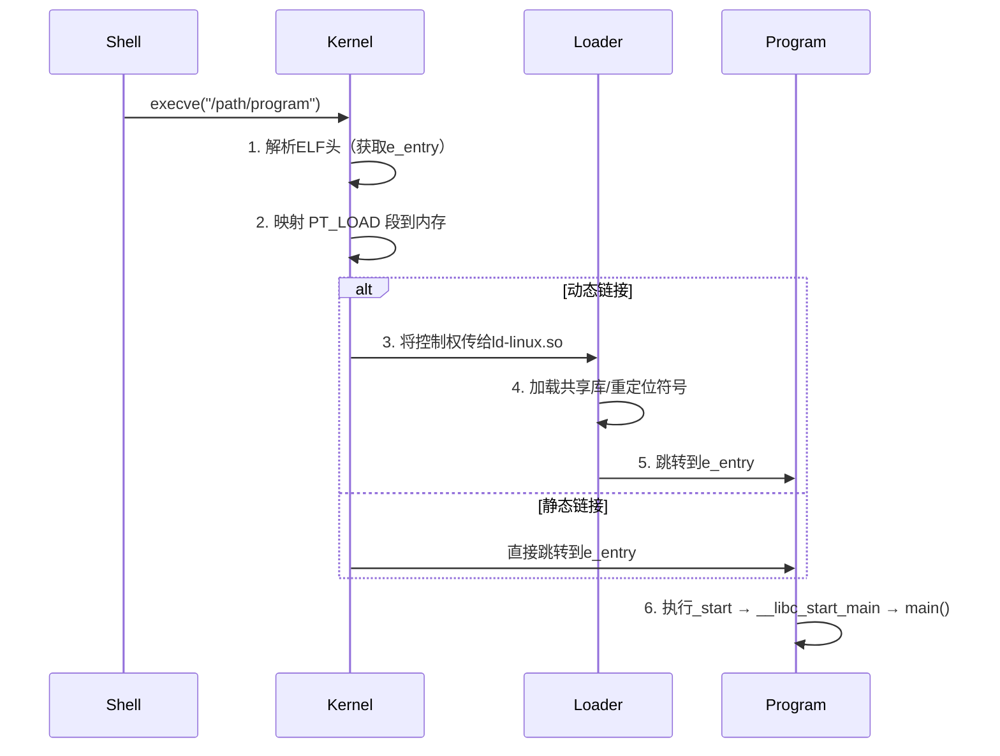
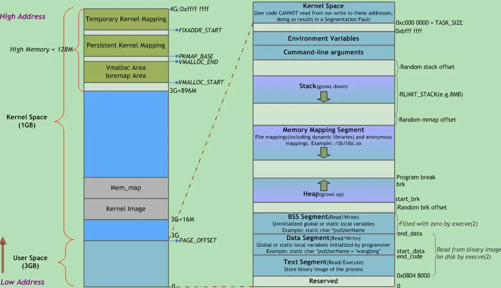

# 程序内存分配

> 整个虚拟地址空间是程序独占的，那程序的虚拟内存布局是由谁决定的？是否可以任意调整？本章将会回答这个问题。


整个虚拟内存只有权限管理，它被设计成如此也是因为程序在内存中运行时，对内存的使用也就是、代码（可执行）、数据（可读写）、只读数据（只读）、堆（可读写）、栈（可读写）这几种用途。操作系统并不关心内存中存的是什么，它只关心这些内存区域的权限和使用方式。

操作系统给应用层提供了虚拟内存空间，如何高效的利用虚拟内存空间涉及的应用层的方方面面。我们的程序本身也需要被加载进内存，我们首先关注它是怎么使用内存的。在本章中我们讨论链接和加载对内存使用相关的部分。了解链接和加载对内存的使用，有助于我们更好地理解内存的使用。

链接器在软件开发中扮演着重要的⻆⾊，其甚至比编译器更早出现，早在只有汇编器的时代就出现了。链接使得分离编译（separatecompilation）成为可能。我们不⽤将⼀个⼤型的应⽤程序组织为⼀个巨⼤的源⽂件，⽽是可以把它分解更⼩、更好管理的模块，可以独⽴地修改和编译这些模块。当我们改变这些模块中的⼀个时，我们只要简单地重新编译它，并将它重新链接到应⽤上，⽽不必重新编译其他⽂件。

Native 程序从源代码到可执行程序的整个流程可以分为:

预处理（C/C++程序有，一些现代程序不再需要）--> 编译（汇编文件 .asm） --> 汇编（可重定位目标文件 .o） --> 链接 （可执行程序/共享库）

我们常说的 C/C++ 编译器 gcc/clang 严格来说应该称为编译驱动程序（compiler driver），因为由它根据需要调用预处理器、编译器、汇编器和链接器等多个工具来完成从源代码到可执行程序的整个过程。我们通常只需要使用 gcc/clang 来完成所有的工作，而不需要单独调用每个工具。

上面的编译流程，在链接前的流程都相同，只有在链接的时候可以生成不同的目标：程序、共享库、静态库。如果了解 Native 程序，我们应该知道还有一个静态库，静态库和其它两种类型存在显著的差别。可执行程序和共享库能够被映射加载进内存的文件、而静态库则是可重定位文件的一个归档（archive）, 它使用 ar 归档，更类似于 tar 这种文件归档工具。

在链接之前、所有编译生成的都是可重定位目标文件。然后链接器根据参数的不同生成可执行目标文件或者共享目标文件。

- 可重定位⽬标⽂件。包含⼆进制代码和数据，其形式可以在编译时与其他可重定位⽬标⽂件合并起来，创建⼀个可执⾏⽬标⽂件。

- 可执⾏⽬标⽂件。包含⼆进制代码和数据，其形式可以被直接拷⻉到存储器并执⾏。

- 享⽬标⽂件：⼀种特殊类型的可重定位⽬标⽂件，可以在加载或者运⾏时，被动态地加载到内存并链接。

链接之后的程序在执行时由加载器加载到内存中执行。加载器负责将可执行文件或者共享库`映射到内存中`，并进行必要的重定位和符号解析。在现代系统中，数据通常不是由加载器直接加载到内存中，而是直到访问时才通过缺页异常机制加载到内存中。

## ELF 文件

从本质上来说，程序全是0和1组成的二进制数据，这些数据有些要被作为指令执行、有些要被作为普通数据读写，甚至有些数据是只读的。将程序这种不同类型的数据聚合在一起，我们将程序分为：代码、数据、只读数据、未初始化数据。编译后的程序数据由不同类型的区域组成，如代码、数据、只读数据、未初始化数据等。为了高效地组织和管理这些数据，现代操作系统采用了 ELF（Executable and Linkable Format）文件格式。ELF 文件通过 Section（节）将不同类型的数据、代码、符号表、重定位信息等细致地分组，便于链接器和加载器进行处理和管理。


Native 类型的程序，都具有如下的内存区域。其它虚拟机程序，也基本是这几种类型的区域。只不过有的叫法不同（例如 Java 把代码区称为方法区，由于 Java 动态加载字节码，其方法区很可能是虚拟机的堆区）。
数据区域用于存放程序全局数据和静态数据，根据细分可以分为：

- 代码区 （.text段）：存放代码（如函数），不允许修改（类似常量存储区），但可以执行（不同于常量存储区）
- 只读数据 .rodata：常量存储区，例如 C++ 的虚函数表就是放在这个区域。
- 数据存储区 .data：存放初始化过的数据
- 未初始化数据区 .bss：存放未初始化的数据（统一初始化为0，不占程序文件的空间）。

全局和静态变量被分配到同一块内存中。在C语言中，未初始化的放在.bss段中，初始化的放在.data段中；在C++里则不区分了。对于未初始化的全局变量和静态变量，因为编译器知道它们的初始值都是 0，因此便不需要再在程序的二进制映像中存放这么多 0 了，只需要记录他们的大小即可，这便是 BSS 段。Block Started by Symbol，但很多人可能更喜欢把它记作 Better Save Space 的缩写。

除了上面所讲的基本内存区域外，**现代应用程序**中还会包含其他的一些内存区域，主要有以下几类：
- **存放加载的共享库的内存空间**：如果一个进程依赖共享库，那对应的，该共享库的代码段、数据段、BSS 段也需要被加载到这个进程的地址空间中。

- **共享内存段**：我们可以通过系统调用映射一块匿名区域作为共享内存，用来进行进程间通信。

- **内存映射文件**：我们也可以将磁盘的文件映射到内存中，用来进行文件编辑或者是类似共享内存的方式进行进程通信。这样我们就初步了解了一个进程内存中需要哪些区域。


> 都是数据，为什么需要分为常量区、初始化、未初始化的分区？
这是因为不同数据保存的内容和需要做的操作不同：

- 对于常量存储区，其值直接编码在可执行文件中，直接加载到内存即可，而且，因为是常量，其页属性可以设置为 `可读不可的`。

- 对于未初始化的全局变量和静态变量，因为不用保存其值，为了减少可执行文件的大小，只需要记录其大小，加载到内存时再申请相应的空间即可。

- 对于初始化的变量，可执行文件保存的也是其值，但是加载到内存中，其页属性需要是 `可读可写`的。

Section 主要用于磁盘上的程序文件组织，而在程序加载到内存时，操作系统会根据权限和用途将多个 Section 合并为 Segment（段），以实现高效的内存映射和访问控制。这样的设计不仅方便了程序的编译、链接和加载，也为调试和扩展提供了灵活性。

对于磁盘的程序，每一个单元结构称为 Section。我们可以通过 readelf -S 的选项，来查看二进制文件中所有的 Section 信息。对于右边的内存镜像，每一个单元结构称为 Segment。我们可以通过 readelf -l 的选项，来查看二进制文件加载到内存之后的 Segment 布局信息。


同时我们也可以看到，往往多个 Section 会对应一个 Segment，例如.text、.rodata 等一些只读的 Section，会被映射到内存的一个只读 / 执行的 Segment 里；而.data、.bss 等一些可读写的 Section，则会被映射到内存的一个具有读写权限的 Segment 里。并且对于磁盘二进制中一些辅助信息的 Section，例如.symtab、.strtab 等，不需要在内存中进行映射。

总的来说，Section 主要是指在磁盘中的程序段，而 Segment 则用来指代内存中的程序段，Segment 是将具有相同权限属性的 Section 集合在一起，系统为它们分配的一块内存空间。

在之前介绍虚拟地址空间的时候，我们已经概述了虚拟地址空间的好处，再次简述一下：

1. 简化链接

2. 简化加载

3. 简化共享

4. 简化内存分配。

虚拟内存的内存分配统一使用映射，我们应该已经明确感觉到虚拟内存一致的简洁统一带给内存分配的简化（一切皆是映射）。有了虚拟内存之后，程序的链接和加载变得简单，链接器的目标是一个线性、一致的独立空间，可以任意使用这些内存地址，无需考虑其它程序的干扰。我们在本节的链接和加载将能看到虚拟内存空间对连接、加载、内存共享带来的便利之处。

链接和加载同样是一个庞大的话题，要详细的讲清楚每个细节将需要宏达的篇幅。这偏离了我们的这里的聚焦点：内存。为了避免偏离主题，我们这里只聚焦链接和加载与内存相关的问题。

物理内存是按照整页分配的，将程序分成过多的小块，因为这些块不可能正好占满 n 页，最后一页不满的内存会被浪费，无法利用。这种浪费称为内部碎片。为了避免内存碎片问题，链接器和加载器都尽量将程序权限相同的节（Section）排列在一起，组成一个段（Segment），这在 ELF 中被称为执⾏视图（ExecutionView），它展现的数据布局就是程序在内存中的排布。而 Section 从“Section”描述的是链接视图。程序加载时只需按照执行视图将段映射到内存即可，根本不用关心 Section。


## 链接

链接的目标就是要将可重定位文件的数据合并，生成能够映射进内存的目标文件，同时需要节省内存空间、满足对齐要求、目标文件尽量小（省磁盘空间）。有这么多要求，注定链接不是一项简单的工作。

- 节省内存空间: 合并为执行视图（Segment）

- 对齐要求：因为内存时按页分配的，链接器需要保证每个 Segment 都是按页对齐的。这也是为什么安卓系统改为 16KB 页大小之后，谷歌要求我们必须重新连接程序生成 16KB 对齐的可执行文件的原因。(如果是 16KB 对齐的程序在 4KB 页大小的系统上运行，是没有问题的，因为 16KB 是 4KB 的整数倍，对齐要求更高一些。)

- 目标文件尽量小：链接器需要尽量减少目标文件的大小，例如未初始化的数据不需要存储在目标文件中，只需要记录大小，加载时再分配内存即可。例如 .BSS。


可被运行的程序、CPU 执行的指令中包含各种内存访问操作、这些操作都需要通过具体的地址来访问、这些地址可以是绝对地址、相对地址、偏移。这些地址是由链接器负责计算得到的。
Native 程序的构建分为-编译-汇编-链接。编译和汇编将模块化的程序编译成**重定位目标代码？** 链接器将多个可重定位目标组合链接成最终的可执行程序。


链接就是编译出的不同模块（通常是一个文件）收集并组成一个最终文件的过程，这个文件可被加载到到内存中执行。链接可以发生在3个阶段：

- 编译时：也就是编译成可执行文件的过程。（静态链接器）
- 加载时：也可以在程序加载到内存后执行。（动态链接器）
- 运行时：程序运行时生成的代码需要。（运行时动态生成的代码）


编译和汇编都是将单个文件生成一个

布局
由于内存采用映射的方式将程序关联到内存，这意味着每一个映射区和其映射的文件数据字节一一对应，这意味着每一个映射块在文件中的存储就是按照其在内存中的样子存储的。由于程序的组成构成以及其在内存中的表现形式、程序的构成可以分为代码、数据、只读数据、堆、栈。其中堆和栈是在程序运行时动态分配的。所以链接器只关注由源文件生成的代码、数据、只读数据。


在开始之前，不得不介绍一下存储目标


### 程序排布

整个虚拟内存空间都是应用独占的，该如何高效的利用内存却是一个问题。假如你是一个早期的操作系统设计者，你会如何设计程序的内存布局呢？

首先，我们需要考虑程序的组成部分，包括代码、数据、堆和栈。为了内存利用更加高效，最显然的一点是将更多的内存空间留给程序运行时的动态分配（堆和栈），代码和数据部分就要紧凑，习惯使然我们将其放在地址空间开始的位置。

有了内存空间，如何高效合理的使用内存空间就成了编码的聚焦点。该如何为程序分配内存空间呢？让我们先来看看程序的构成。程序对内存的使用总体上可以分为4类：代码、（静态）数据、堆、栈。代码和数据的大小在程序运行前我们就知道，可以从头开始顺序排布就行，而堆和栈在运行中大小不断变化，该如何更高效的利用内存空间呢？等比例分配剩余的空间吗？由于栈是需要连续的，很可能就会出现其中一类的空间被用完，另一个的空间还有很大但是却无法继续分配的情况。显然，最理想的情况是将堆和栈放到剩余空间的两头，需要分配新的内存时，两者就想中间不断分配内存，直到全部的内存空间耗尽。

```
堆和栈两者分布两端、新内存申请不断向中间分配。
+--------------------------+
|           代码            |
+--------------------------+
|           数据            |
+--------------------------+
|            堆            |
+--------------------------+
|            ∨             |
|                          |
|           ...            |
|                          |
|            ∧             |
+--------------------------+
|            栈            |
+--------------------------+
```

栈为什么要由高地址向低地址扩展，堆为什么由低地址向高地址扩展？

历史原因：在没有 MMU 的时代，为了最大的利用内存空间，堆和栈被设计为从两端相向生长。人们对数据访问是习惯于从地址小的位置开始，比如你在堆中申请一个数组，是习惯于把低元素放到低地址，把高位放到高地址，所以堆向上生长比较符合习惯,  而栈则对方向不敏感，一般对栈的操作只有 push 和 pop，无所谓向上向下，所以就把堆放在了低端，把栈放在了高端. 但现在已经习惯这样了。这个和处理器设计有关系，目前大多数主流处理器都是这样设计，但 ARM 同时支持这两种增长方式。

到目前还很完美，然而随着程序模块化和多线程的出现，这种完美被打破了。有些例程在很多程序中都可以被用到，他们被抽取成动态库，动态库也有自己的代码和数据，它被设计为独立的，同一个共享库在内存中只保留一份拷贝，dlopen 甚至允许运行时真正需要动态库才加载。加载时不知道已经使用了哪些内存空间，导致无法保证其在不同进程中的地址一致。所以它被设计为可以被加载到任意位置；多线程程序也需要每次创建线程时，动态为线程申请一块空间作为栈使用。这些都导致内存空间的分配变得破碎。

```
User address space
+--------------------------+--------------------------
|       Main Stack         |
+--------------------------+ - - - - - - - - - - - - -
|            |             |
|            ∨             | 
|                          | 
|                          |
|   (unallocated memory)   | <----------- mmap/munmap 
|                          |
|                          |
|                          |
|            ∧             |
|            |             |                    ∧
+--------------------------+< Program Break - brk/sbrk 
|      Main Heap           |                    ∨
+--------------------------+
| Uninitialized data (bss) |
+--------------------------+
|    Initialized data      |
+--------------------------+
|    Text (program code)   |
+--------------------------+--------------------------
```


---------------------------> 到这里了。！！！！！！！！！！！！！！！！！！


虽然应用程序可以像独占内存一样使用全部的内存，链接器对应用程序的内存的布局有一个默认的排布（不是操作系统和链接器精密协作的成果）。想要合理的使用内存，就需要了解应用程序能够使用的内存大小，同时掌握现代应用程序对内存是如何使用的，以及各个区域都有什么性质，如何高效合理的使用这些内存。

这里以 ARM 40bits 的地址空间为例，不同地址空间的内存占用不同，例如，39bits 的用户空间为 256GB，48bits 地址空间时 4 级 4KB 页大小用户空间 256TB，2 级 64KB 页大小用户空间为 4TB。具体平台的实际地址空间使用 `cat  /proc/cpuinfo` 和 `cat /proc/self/maps` 具体分析。**虽然空间大小不同，但实际的布局顺序是一致的**

[40 位地址空间的 64 位 linux 系统的虚拟内存布局。](https://stackoverflow.com/questions/51928583/how-to-intepret-the-virtual-kernel-memory-layout-on-arm64)
```
--------------------> +--------------------------+                           +--------------------------+
ffff:ffff:ffff:ffff   |                          |                          /|    vsyscall,vdso,vva     |
                      |                          |                        /  +--------------------------+<--------------------
                      |                          |                      /    +        main stack        |         Stack
                      |      Kernel (512G)       | <-- PAGE_OFFSET    /      +--------------------------+<--------------------
                      |                          |                  /        |            :             |           ∨
                      |                          |                /          |       mmap + stack       |
ffff:ff80:0000:0000   |                          |              /            |            :             |
--------------------> +--------------------------+            /              |                          |
ffff:ff7f:ffff:ffff   |//////////////////////////|          /                |                          |
                      z //////////////////////// z        /                  |                          |
                      z //////////////////////// z      /                    |                          |
                      z //////////////////////// z    /                      |            :             |            ∧
0000:0080:0000:0000   |//////////////////////////|  /                        +--------------------------+< Program Break - brk/sbrk 
--------------------> +--------------------------+/                          |           heap           |           
0000:007f:ffff:ffff   |                          |                           +--------------------------+
                      |                          |                           |           data           |
                      |                          |                           +--------------------------+
                      |      User (512G)         |                           |           const          |
                      |                          |                           +--------------------------+
                      |                          |                           |           code           |
0000:0000:0000:0000   |                          |                           +--------------------------+
--------------------> +--------------------------+ - - - - - - - - - - - - > +--------------------------+
```


- 需要特别说明的是，现代程序为了防止攻击，会开启随机化地址，这些程序的地址也不会严格从以上的分界线开始，而是有一个随机偏移。

- 有些芯片由于历史原因，地址并不能从 0 开始，例如历史上 X86 芯片将 1M 低地址作为中断和 BIOS 的存储区和终端显示，这部分地址软件就不能够使用。而 ARM 没有这些历史包袱，就能使用。

- 此外，有的 Linux 发行版会有一些快速系统调用的分区。


用户空间各区域的用处和特性，从低地址开始：

- 代码区：该区域存放代码，该区域具有可读可执行权限。

- 常量区：该区域用于存放常量、字面量(字符串等)等仅可读数据。

- 数据区：用于存放可变全局数据，全局变量、静态变量等。

- 堆区（heep）: 堆区用于程序自由申请的空间，这部分的管理交给了应用开发者，也是开发者关注最多的地方。例如 C 中 malloc 和 C++ new 的对象。

- 栈（stack）: 用于实现函数调用结构的内存块。**系统需要为每个线程分配一个栈**（可以设置大小，Linux 一般默认是8M，一般主线程和普通线程也有差别，可通过 ulimit 查看），栈空间是根据约定由编译器生成的代码自动由高地址向低地址增加。 **mmap 和栈的分配是从高地址向低地址的，如果 mmap 先申请，然后创建了线程。则先从高地址分配 mmap 的内存，然后向低地址给栈分配空间。多个栈内存并不一定放在一起。**(验证程序: memory/stack/stack_location.c)

**进程的虚拟地址空间的段分配和 ELF 的段不是完全相同的，进程的段主要考虑权限，权限相同的内容尽量会排在一起，以在分配物理内存时减少碎片。稍后看加载的时候会深入更多细节**

### 内存影像

程序在内存中的布局称为内存影像（memory image）。内存影像描述了程序在内存中的各个部分的布局和组织方式。内存影像通常包括以下几个主要部分：

### 地址计算

程序中的地址是何时确定的？如何计算这些地址？

我们知道了操作系统通过映射来将虚拟内存空间和文件关联，程序生成链接时，就需要。

在虚拟内存出现之前，古早时期程序都是独占内存的，链接不用考虑其他程序的位置，链接出的程序也是独占内存的，跟虚拟空间的程序流程基本一致。到了多任务时期，多个程序需要同时在内存中，

### 链接脚本


上面的规则是按照的紧密排列的规则进行排布程序。实际上会有不同的需求，甚至不同系统、不同架构也有特许的要求。例如、内核开发需要对内核的数据进行细致的管理；x86 程序代码段总是从地址0x08048000处开始。为此，链接器提供了链接脚本（linker script）的功能，允许我们自定义程序的内存布局。而且可以通过 `ld --verbose` 来查看默认的链接脚本内容和位置。

链接脚本用于指导链接器如何将输入文件内的节（Section）放入输出文件内，并控制输出文件内各部分在程序地址空间的布局。链接脚本是一个文本文件，描述了如何将可重定位目标文件链接成可执行文件。它指定了各个段的起始地址、大小、对齐方式等信息。链接器根据链接脚本的指示，将各个目标文件的段合并到一起，生成最终的可执行文件。

是否可以将程序的各个段放在任意地址？理论上是可以的，但是实际操作中需要考虑开始的结束的特殊位置，剩余空间都可以被用于应用程序使用。为了验证这个这些，我们可以使用汇编直接硬编码地址。但是这不是我的强项，而且已经有了更方便的工具：链接脚本。注意：本章是在关注内存，因此只是介绍用到的链接脚本的基础知识。一旦你知道了链接脚本的作用，你就可以查阅更详细的资料来深入学习。


#### 起始位置

- 虚拟内存空间是的起始一段被预留，不允许应用使用，这是为了避免空指针的问题，在空指针时及时抛出错误。Linux 上通常是 0x10000(64K) 系统强制保留，用于避免空指针访问，编译的默认其实地址通常是 0x400000（4M）用于为地址随机化保留足够的空间。

该限制有内核控制，可以通过如下方式查看：
```shell
cat /proc/sys/vm/mmap_min_addr
sysctl vm.mmap_min_addr
```

如果将程序定位的起始位置，加载时就会引发段错误：
```shell
/*
* start_from_0.ld
* ld -o sleep sleep.o -T start_from_0.ld
*/

ENTRY(_start)
SECTIONS {
    . = 0x0;  /* ⚠️ 强制基地址为0 */
    .text : { *(.text) }
    .data : { *(.data) }
    .bss : { *(.bss) }
}
```
```shell
$ ld -o sleep sleep.o -T start_from_0.ld
$ ./sleep
Segmentation fault # 执行立即引发段错误。
```


#### 结束位置

前面讲内存布局的时候我们已经看到了，一般我们把主线程的栈放在地址空间的最末尾。由于栈是在系统运行程序时分配的，是否可以将程序放在末尾其实跟系统相关很大，例如 Arm64 位系统就可以。

```shell
/*
 high.ld 
 gcc -static -nostdlib -T high.ld sleep.s -o high
*/
ENTRY(_start)
SECTIONS {
  /* 尝试接近用户地址空间上限制 */
  . = 0x0000ffffffffffc000;
  .text : { *(.text*) }
  .rodata ALIGN(0x1000) : { *(.rodata*) }
  .data  ALIGN(0x1000) : { *(.data*) }
  .bss (NOLOAD)  : { *(.bss*) *(COMMON) }
}
```

```shell
$ cat /proc/1017/maps
ffff8e26d000-ffff8e271000 r--p 00000000 00:00 0                          [vvar]
ffff8e271000-ffff8e273000 r-xp 00000000 00:00 0                          [vdso]
fffff462a000-fffff464b000 rw-p 00000000 00:00 0                          [stack]
fffffffff000-1000000000000 r-xp 00001000 00:23 444                       /root/code/arm64/sleep
```

## 加载

应用调用 `execve` 来执行一个新程序，最终会调用系统内核的加载器解析 ELF 文件头。程序的加载是一个复杂的过程，它涉及到终止进程中的所有子线程、释放虚拟内存空间、释放页表，以及释放原有程序的各种资源进程关联的所有资源：文件描述符、进程号 (PID)、父子关系、会话、cgroup、现实/有效 UID/GID、umask、工作目录 (cwd)、文件权限掩码、nice 值、rlimit 等。而且需要保证 execve 过程中的原子性，在加载过程中任何一步出错（权限/格式/内存不足等）返回 errno，旧地址空间保持不变（不会半回收）。只有成功才进行替换。

1. 验证与准备
    
    - 读取 ELF 头，核对魔数、类型（ET_EXEC / ET_DYN）、机器架构、权限（可执行位、不可执行挂载）、安全策略（LSM、文件能力、setuid）。
    
    - 创建新的 mm_struct（在成功提交前旧地址空间仍保持）。

2. 解析 Program Header 表

    - 找出各 PT_LOAD、PT_INTERP（若存在，记录解释器路径）、PT_PHDR、PT_TLS、PT_GNU_STACK、PT_GNU_RELRO 等。

    - 决定加载基址（ASLR）：
        - 非 PIE (ET_EXEC)：通常使用文件中指定虚拟地址。
        - PIE (ET_DYN)：选择随机基址，将所有段的 p_vaddr 加基址偏移后成为实际虚拟地址。

3. 建立虚拟内存映射

    - 对每个 PT_LOAD：调用低层 do_mmap 建立 VMA：权限来自 p_flags（R/W/X），映射方式：
        - 文件部分：filesz 范围懒加载文件页。
        - 多出的 memsz - filesz 尾部（典型承载 .bss）：创建匿名（不对应文件）的零填充页区域；页在第一次访问时分配并自然为 0。
    
    - 不主动把整段内容立即读入物理内存。

4. 映射动态链接器（若有 PT_INTERP）
    
    - 同样建立其 PT_LOAD 映射（也按需缺页加载），记录其实际入口地址。

5. 构造用户栈

    - 为栈创建匿名映射（含随机基址或随机偏移，受 ASLR）。
    - 拷贝 argv、envp 字符串与指针，构造 argc。
    - 写入 auxiliary vector 项：
        - AT_PHDR, AT_PHNUM, AT_PHENT（Program Header 元信息）
        - AT_EXECFN（程序路径）
        - AT_ENTRY（主程序 e_entry + 基址）
        - AT_BASE（动态链接器基址，若动态）
        - AT_RANDOM（栈随机化种子）
        - AT_PAGESZ, AT_UID/EUID, AT_FLAGS, AT_SECURE, AT_SYSINFO_EHDR（VDSO）等。

6. 映射 VDSO / VVAR （内核提供快速系统调用辅助页）。

7. 切换到新地址空间

    - 丢弃旧 mm（释放旧页表 / VMA，未引用的物理页回收）。
    - 设置线程为单线程（清理其它线程）。
    - 清理/重置大部分信号处理器（改为默认，某些不可屏蔽保留）。

8. 设置初始寄存器并跳转

    - 静态可执行：IP → 程序 e_entry。
    - 动态可执行：IP → 动态链接器入口；SP 指向新栈顶部。
    - 从此返回用户态。内核的职责到此结束。

注意：内核不做符号重定位、也不解析 DT_NEEDED 列表；也不遍历动态段执行初始化数组

> 用户态动态链接器阶段（仅动态程序）

进入链接器（如 /lib64/ld-linux-x86-64.so.2）后：

1. 读取栈上的 auxiliary vector，获取 AT_PHDR / AT_PHNUM 等来找到主程序的 Program Header 并确认加载基址。

2. 解析主程序的 PT_DYNAMIC 段：定位 DT_NEEDED, DT_SYMTAB, DT_STRTAB, DT_RELA*, DT_JMPREL, DT_GNU_HASH / DT_HASH，DT_INIT_ARRAY 等。

3. 加载依赖共享库：

    - 通过路径搜索（LD_LIBRARY_PATH → RUNPATH/RPATH → 默认系统目录）逐个 open + mmap 库的 PT_LOAD 段。仍是懒加载。

4. 重定位：
    
    - 处理 RELATIVE、GLOB_DAT、JUMP_SLOT、TLS 相关等。
    - 若延迟绑定（lazy binding）启用，JUMP_SLOT 初始指向解析入口（PLT stub）。

5. 设置 TLS 模块列表、分配初始 Thread Control Block（仅主线程）。

6. 应用 GNU RELRO：mprotect 将指定区段（GOT 等）转为只读。

7. 调用各库的初始化函数（DT_INIT / DT_INIT_ARRAY）。

8. 跳转到主程序入口（ELF e_entry，通常是 _start 汇编序列）。

    - _start → __libc_start_main → 调用用户 main。

```
内核解析程序头（Program Headers），将代码/数据载入内存：

1. 为每个 PT_LOAD 段建立映射。

2. 建立堆空间和栈空间

3. 检查程序是否依赖动态库。

4. 不需要，对于静态程序：直接跳转到 e_entry。

4. 若依赖动态库、动态库同样是一个 EFL 文件，流程和普通可执行程序基本一致。：
    4.1 内核将链接器载入内存（通常是 /lib64/ld-linux-x86-64.so.2）。

    2. 将控制权先交给解释器（而非直接到 e_entry）。

        3. 动态链接器完成动态链接后，再跳转到程序入口点。
```

内核加载可执行文件，解析 ELF 文件头，包括入口点地址（Entry Point e_entry 字段：明确指定了第一条指令的虚拟地址（Virtual Address）。）

查看方式：readelf -h /bin/ls | grep "Entry point"

“执行一个程序”时，内核只负责：解析可执行文件头、建立初始地址空间（映射主程序的必要段、栈、辅助向量等）、根据可执行文件的解释器字段（如 ELF 的 PT_INTERP、Mach-O 的 LC_LOAD_DYLINKER）映射“用户态动态链接器（loader）”并跳转过去。
真正加载（map）动态库、做符号解析与重定位、初始化 TLS、调用构造函数、决定延迟/即时绑定策略等，都是用户态的动态链接器（loader）在完成。
后续运行过程中再通过 dlopen（Linux/macOS）或 LoadLibrary（Windows）等用户态调用加载新的动态库；内核只提供底层内存映射与文件 I/O 原语。

因此：主程序的“第一阶段”由内核建立抽象环境；动态库的“批量装载与链接”主要在用户态 loader 完成；物理页实际进内存是按需（缺页中断）由内核负责。

通常，程序的入口并不是 main 函数，而是由静态连机器插入的  _start 函数：
入口点之后的流程
1. _start：初始化栈/寄存器，调用 __libc_start_main。

2. __libc_start_main（在 glibc 中）：

    - 初始化线程本地存储（TLS）

    - 调用全局构造函数（__init）

    - 注册 atexit 析构函数

    - 调用 main() 函数

3. main()：程序员编写的代码开始执行。



## 地址无关代码

PIC（Position Independent Code）：位置无关代码
PIE（Position Independent Executable）：位置无关可执行文件。PIE 程序和动态库一样，代码段可以映射到内存任意位置。

没有 PIE，ASLR（Address Space Layout Randomization）只能随机堆、栈、mmap区域，代码段（.text）和数据段（.data）往往无法随机（因为是绝对地址，不能随意搬动）。PIE 程序和动态库一样，代码段和数据段可以映射到内存任意位置。Linux 将其映射到动态库的映射区。

标准 PIE 程序必须有非零的 e_entry，它表示程序的入口点（如 _start）。另一点需要注意的是链接脚本，不能指定程序段地址了，否则会导致链接输出变为非 PIE。动态加载器加载 PIE 时，会把整个可执行文件映射到一个随机基址（比如 0x7f2e00000000），然后期望 ELF 段的 VMA 是从 0 开始的，这样加上基址就能对齐。

编译是带上 `-fPIE -pie` 参数。

## 地址随机化（Address Space Layout Randomization）

现代系统通过地址随机化来防止基于地址的攻击，比如栈溢出攻击和堆溢出攻击等，Linux在特定段之间使用随机偏移，使段的起始地址是随机值, Linux 系统上的 ASLR 等级可以通过文件 `/proc/sys/kernel/randomize_va_space` 来进行设置，它支持以下取值：

- 0 - 关闭的随机化。每次分配的地址将保持一致。
- 1 - 保守的随机化。共享库、栈、mmap()、VDSO以及堆将被随机化。
- 2 - 完全的随机化。除了上面列举的要素外，通过 brk() 分配得到的内存空间也将被随机化。

可以通过 `sudo sysctl -w kernel.randomize_va_space=val` 的命令来修改设置。

## 最终的总览

[40 位地址空间的 64 位 linux 系统的虚拟内存布局。](https://stackoverflow.com/questions/51928583/how-to-intepret-the-virtual-kernel-memory-layout-on-arm64)
```
--------------------> +--------------------------+                           +--------------------------+
ffff:ffff:ffff:ffff   |                          |                          /|    vsyscall,vdso,vva     |
                      |                          |                        /  +--------------------------+<--------------------
                      |                          |                      /    +        main stack        |         Stack
                      |----- Kernel (512G)-------| <-- PAGE_OFFSET    /      +--------------------------+<--------------------
                      |                          |                  /        |            :             |           ∨
                      |                          |                /          |       mmap + stack       |
ffff:ff80:0000:0000   |                          |              /            |            :             |
--------------------> +--------------------------+            /              |                          |
ffff:ff7f:ffff:ffff   |//////////////////////////|          /                |                          |
                      z //////////////////////// z        /                  |                          |
                      z //////////////////////// z      /                    |                          |
                      z //////////////////////// z    /                      |            :             |            ∧
0000:0080:0000:0000   |//////////////////////////|  /                        +--------------------------+< Program Break - brk/sbrk 
--------------------> +--------------------------+/                          |           heap           |           
0000:007f:ffff:ffff   |                          |                           +--------------------------+
                      |                          |                           |           data           |
                      |                          |                           +--------------------------+
                      |      User (512G)         |                           |           const          |
                      |                          |                           +--------------------------+
                      |                          |                           |           code           |
0000:0000:0000:0000   |                          |                           +--------------------------+
--------------------> +--------------------------+ - - - - - - - - - - - - > +--------------------------+
```

(盗图)更加详细的地址分布：




## 总结

程序的虚拟内存布局由操作系统、编译器和链接器共同决定，但开发者可以通过多种方式进行相当程度的调整。

需要再次强调的是，本章关注的重点是内存，这里涉及到的很多内容（链接器、加载器、链接脚本）都值得用更大的篇幅进行介绍，但他们超出了我们设立设定的目标，不是这篇文章要覆盖的内容，我们知道了这些内容感兴趣的时候自行学习即可。

## 参考资料

https://mropert.github.io/2018/02/02/pic_pie_sanitizers/
https://www.anquanke.com/post/id/177520#h2-4

[Static and Dynamic Libraries](http://nickdesaulniers.github.io/blog/2016/11/20/static-and-dynamic-libraries/)