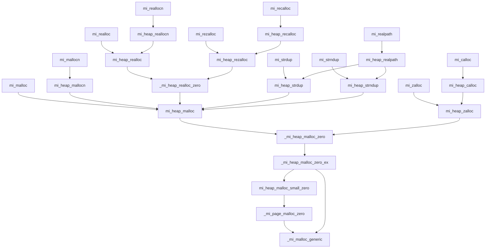
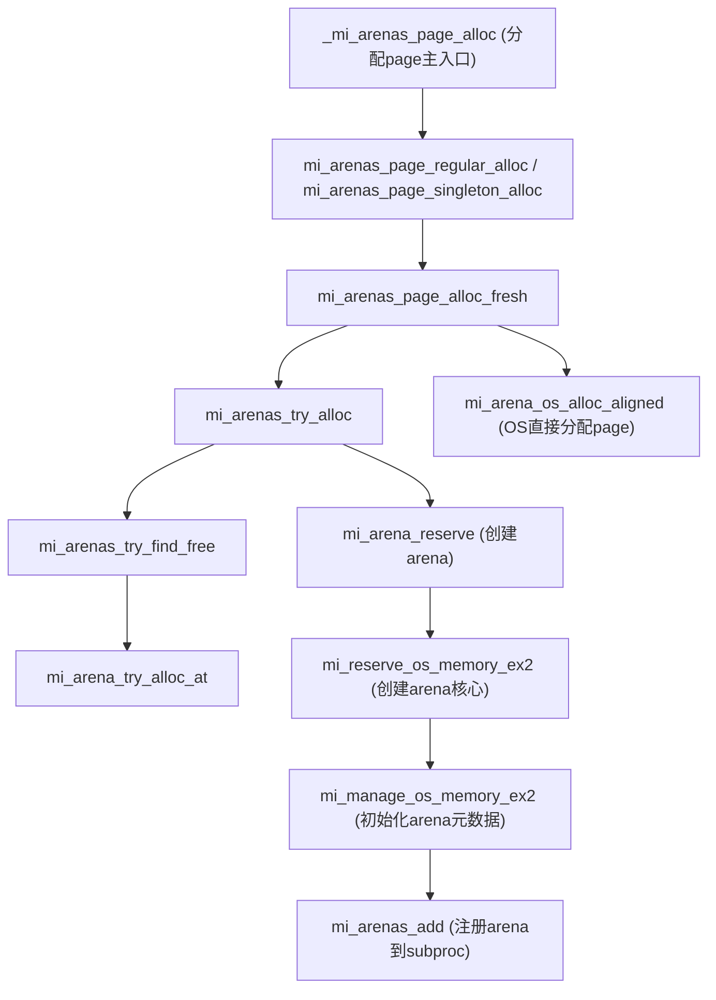

# Mimalloc

[比 tcmalloc 快 43%！mimalloc 高性能背后的 5 大核心技术揭秘](https://mp.weixin.qq.com/s?__biz=MzkwMzcyMTM3OQ==&mid=2247486232&idx=1&sn=61f902de1ac85f02058d38bb3494abfb&chksm=c10dde6f7b608af3a00cc8b913009cf2fdf4c99b95a7b69d76fcda5c8d12a80e264c95331d43&mpshare=1&scene=24&srcid=0619pmMSZTGqktnbmHfaA7U9&sharer_shareinfo=b352d5deefdcac427f561562ece4d957&sharer_shareinfo_first=b352d5deefdcac427f561562ece4d957#rd)
> 将回答如下问题：

1  malloc和free是怎么实现的？

2  malloc 分配多大的内存，就占用多大的物理内存空间吗？

3  free 的内存真的释放了吗（还给 OS ） ?

5  如何查看堆内内存的碎片情况？

6. 如果知道已申请的堆哪些空间被分配了（libc 中整块申请，再细分给用户，可能已经从系统申请，但是还没给用户）？


1. mmap 申请的内存是至少是一页，但程序使用大小往往更小，如何高效分配这些小内存是一个每个程序都面临的问题。
2. mmap/brk/sbrk 是系统调用，会陷入内核切换运行环境，影响程序的性能。而且需要自己考虑内存页的问题，以及处理内存碎片的回收。

于是原生程序的内存分配器出现了，malloc 会一次性向系统申请一块内存空间，在程序使用时逐渐分配给用户，只有在现有的空间不够时才调用 mmap/sbrk 向系统申请内存。

 
You might have noticed that we haven’t been talking about system
calls when discussing malloc() and free(). The reason for this is simple: they are not system calls, but rather library calls. Thus the malloc library manages space within your virtual address space, but itself is built
on top of some system calls which call into the OS to ask for more memory or release some back to the system.
One such system call is called brk, which is used to change the location of the program’s break: the location of the end of the heap. It takes
one argument (the address of the new break), and thus either increases or
decreases the size of the heap based on whether the new break is larger
or smaller than the current break. An additional call sbrk is passed an
increment but otherwise serves a similar purpose.
Note that you should never directly call either brk or sbrk. They
are used by the memory-allocation library; if you try to use them, you
will likely make something go (horribly) wrong. Stick to malloc() and
free() instead.
Finally, you can also obtain memory from the operating system via the
mmap() call. By passing in the correct arguments, mmap() can create an
anonymous memory region within your program — a region which is not
associated with any particular file but rather with swap space, something
we’ll discuss in detail later on in virtual memory. This memory can then
also be treated like a heap and managed as such. Read the manual page
of mmap() for more details.


现代内存分配器不得不平衡性能、安全、并发以及应用使用过程中特定场景的需求。分配器的一个日益增多的用例是作为语言的后端实现，例如Swift和Python，它们使用引用计数来自动释放对象。

首先，它使用内部三个页分离的空闲列表来提高局部性，避免竞争，并支持高度定制的分配和快速释放路径。这些空闲列表还支持时间节奏，允许分配器可预测地离开快速路径以进行常规维护任务，如支持延迟释放、处理来自非本地线程的释放等。这些空闲列表还支持一种节拍：允许分配器可预测地离开快速路径以进行常规维护任务，如支持延迟释放、处理来自非本地线程的释放等。

支持延迟减少引用计数：对于引用计数语言、为了限制在释放大型数据结构时的暂停需要分配器的合作。因为恢复延迟减量的最佳时机是内存压力大的时候。

mimalloc 采用各种新颖的想法来达到出色的性能：

- 主要思想是使用极端的空闲列表(free)分片：相同大小的对象被分成多个 mimalloc page，每个 mimalloc 页面（通常为64KiB）单独一个空闲列表，而不是每类大小有一个大的空闲（未分配内存）列表。这保持了分配的局部性，因为不管堆中其它地方释放了哪些对象，malloc 会在一个页面内分配，直到该页面满为止，。

- 此外，对于其它线程的释放操作 mimalloc 使用单独的线程空闲列表(thread-free)，以避免在 malloc 的快速路径中进行原子操作。这些线程空闲列表也按页面分片，以最小化它们之间的竞争。这些列表会每隔一段时间原子性地移到本地空闲列表，这实际上对远程释放进行了批处理操作（Lietar等人，2019年）。

- 最后，mimalloc 为每个页面使用一个本地空闲列表(local-free)来处理线程本地释放。当分配空闲列表为空时，本地空闲列表成为新的空闲列表。这种设计确保在固定数量的分配后，通用分配路径总是被使用，从而建立了一个时间节奏。这种设计因此可以用来摊销更昂贵的操作：1）执行延迟的引用计数递减的释放操作，2）维护一个确定性心跳，3）收集并发线程空闲列表（thread-free）。使用单独的本地空闲列表使我们能够在快速分配路径中只有一个检查，以通过通用的“回收”例程处理所有上述场景。

- mimalloc 设计者高度优化了常见的分配和释放代码路径，并在其他情况下委托给通用例程。这意味着数据结构需要非常规整，以最小化快速路径中的条件判断。这种一致的设计还减少了特殊情况，提高了代码重用率——从而得到更规整、更简单的代码。核心库小于 3500 行代码，远小于其他工业级分配器的核心（如 tcmalloc 约 20k 行代码和 jemalloc 约 25k 行代码）。

- 没有锁，所有线程交互都使用原子操作完成。它具有有界的最坏情况分配时间，元数据开销约为 0.2%，且分配大小类中的浪费最多为 16.7%（1/8）。

历史上，内存分配器的设计主要关注性能问题，例如减少分配器中的时间消耗、降低内存使用量或扩展到许多并发线程。较少情况下，内存分配器的设计主要动机是提高应用程序的引用局部性。例如，VAM（Feng 和 Berger，2005 年）以及 PHKmalloc 的早期版本也使用空闲列表分片，以确保顺序分配通常来自同一页。mimalloc 也通过实现多线程和添加额外的分片空闲列表来提高应用程序的内存引用局部性，并通过减少争用和支持摊销维护任务来改进 VAM。**mimalloc 的设计表明，专注于提高应用程序内存局部性的内存分配器也可以提供高性能和并发可扩展性。**

## 空闲列表分片

### 分配空闲列表 (Allocation Free List)

### 无位移指针（Bump Pointer、碰撞指针）

### 线程空闲列表（Local Free List）

### 线程空闲列表（Thread Free List）


1. Arena 分配
mi_arena_reserve 
  mi_reserve_os_memory_ex2 内申请内存并设置 meta 数据，meta 数据存在内存的起始位置。

2. Page
_mi_arenas_page_alloc 申请新的 Page. 分两类
  mi_arenas_page_regular_alloc 从 Arena 申请内存
  mi_arenas_page_singleton_alloc 直接从系统申请内存作为 Page.
二者都调用 mi_arenas_page_alloc_fresh 申请内存并初始化。其实际完成从 Arena 或者系统申请一块内存，并将起始位置
作为 Page 的 Meta 信息。

3. Page 内存的 obj 划分，直接使用空闲位置存储下一个空间点。巧妙的利用了空闲空间来存储 meta 数据，不需要额外使用空间。


4. 需要单独申请空间的 Meta 数据
  bitmap 和 page.
  heap
  tls


```C
typedef struct mi_page_s {
  mi_block_t*               free;              // list of available free blocks (`malloc` allocates from this list)
  uint16_t                  used;              // number of blocks in use (including blocks in `thread_free`)
  uint16_t                  capacity;          // number of blocks committed
  uint16_t                  reserved;          // number of blocks reserved in memory
  mi_block_t*               local_free;        // list of deferred free blocks by this thread (migrates to `free`)
  _Atomic(mi_thread_free_t) xthread_free;      // list of deferred free blocks freed by other threads (= `mi_block_t* | (1 if owned)`)
} mi_page_t;
```

## 结构

heap -> alloc -> page -> arena -> os -> prim


系统内存的特性：
1. 最大地址空间。
2. 最大物理内存。
3. 内存分配 overcommit: 内存的 Overcommit（过度承诺） 是允许应用申请超过系统实际可用的物理内存和交换空间之和。这是一种“乐观”的策略，假设大多数应用程序不会真正使用完它们请求的所有内存。而是等到真正内存分配紧张的时候再通过回收策略或者OOM来处理内存分配不足。
4. 是否允许大页。
5. 是否允许懒回收


```
            申请内存
+---------------------------------------------+
|                heap (线程本地缓存)            |
+---------------------------------------------+
              |                           |
              v                           |
+-----------------------------+           |
|    Arena                    |           v
| ├─ Slice                    |      +--------+
| │                           |      |  meta  | 元数据(heap、arena、page...)
| │                           |      +--------+
| ├─ large (大对象)            |<---小----- |
| └─ pa_shard (连续内存块)      |           |
+-----------------------------+           大
              |                           |
              v                           v
+---------------------------------------------+
|                     os                      |
+---------------------------------------------+
|            prim(unix/windows...)            |
+---------------------------------------------+
```
- Slice 是 Arena 分配的单位，一个 Slice 固定 64 KiB (32 KiB on 32-bit)

- Slide 的分配状态使用 Bitmap 记录。Bitmap 分成 n 个 chunk. 一个chunk 是 512 bits (or 256 on 32-bit)，即可以管理 512 个 Slice. 

- 但从 Arena 分配的空间并不是 Slice 数据结构描述的，而是从 Arena 中分配 Page. Page 由 1 到 1 个 Chunck 包含的 Slice 大小，即 512 个 Slice.


当你分配的对象大小 ≤ 1024 字节时，会从 heap 的 small page 分配。
超过 1024 字节则会进入 medium/large page 或更大的分配路径。

```C
// ------------------------------------------------------
// Page kinds
// ------------------------------------------------------

typedef enum mi_page_kind_e {
  MI_PAGE_SMALL,    // small blocks(<= ~8 KiB)go into 64KiB pages
  MI_PAGE_MEDIUM,   // medium blocks(<= 64 KiB) go into 512KiB pages
  MI_PAGE_LARGE,    // larger blocks(<= 512 KiB) go into 4MiB pages (if `MI_ENABLE_LARGE_PAGES==1`)
  MI_PAGE_SINGLETON // page containing a single block.
                    // used for blocks `> MI_LARGE_MAX_OBJ_SIZE`(64/512 KiB) or an aligment `> MI_PAGE_MAX_OVERALLOC_ALIGN(64 KiB, Slice size)`.
} mi_page_kind_t;
```

**大于 slice 的对象直接走 single page 了。（感觉这里可以直接改为大于等于。）**


Arena 最小一个 Chunk：32 MiB (or 8 MiB on 32-bit)，最大可达 16GB。

_mi_arenas_page_alloc：分配一个 Page.
  对齐大于一个 Slice 大小（64KB）的, 或者大于 Arena 允许的 Obj 大小的（默认 64 KiB， 开启了 MI_ENABLE_LARGE_PAGES 时  512KiB ）直接从系统分配（mi_arenas_page_singleton_alloc）。否则从 arena 分配（mi_arenas_page_regular_alloc）


mi_reserve_os_memory_ex2 中申请一个新的 arena
  _mi_os_alloc_aligned 申请内存
  mi_manage_os_memory_ex2 初始化 arena 的数据。arena 的 meta 数据都记录在当前申请的内存块的头部，不需要额外申请空间保存 meta 信息。
    mi_arenas_add 将 arean 添加到 mi_subproc_t 中记录


mi_arenas_page_alloc_fresh 申请一个新的 Page 并初始化。
  page 可以从 arena 申请，也可以直接从系统申请。对齐大于一个 Slice 大小（64KB）的, 或者大于 Arena 允许的 Obj 大小的（默认 64 KiB， 开启了 MI_ENABLE_LARGE_PAGES 时  512KiB ）直接从系统分配


```C
// ------------------------------------------------------
// Page kinds
// ------------------------------------------------------

typedef enum mi_page_kind_e {
  MI_PAGE_SMALL,    // small blocks go into 64KiB pages
  MI_PAGE_MEDIUM,   // medium blocks go into 512KiB pages
  MI_PAGE_LARGE,    // larger blocks go into 4MiB pages (if `MI_ENABLE_LARGE_PAGES==1`)
  MI_PAGE_SINGLETON // page containing a single block.
                    // used for blocks `> MI_LARGE_MAX_OBJ_SIZE` or an aligment `> MI_PAGE_MAX_OVERALLOC_ALIGN`.
} mi_page_kind_t;
```


```C
typedef struct mi_os_mem_config_s {
  size_t  page_size;              // 申请的页大小
  size_t  large_page_size;        // 0 if not supported, usually 2MiB (4MiB on Windows)
  size_t  alloc_granularity;      // 最小分配大小，在 Unix 上通常是页大小，但是 Windows 由于历史原因，最小分配可能会比页大小大。 (usually 4KiB, on Windows 64KiB)
  size_t  physical_memory_in_kib; // 实际物理内存大小，单位 KB.
  size_t  virtual_address_bits;   // 实际使用的虚拟内存位数。usually 48 or 56 bits on 64-bit systems. (used to determine secure randomization)
  bool    has_overcommit;         // 系统是否允许申请超过物理内存和交换空间之和的内存大小？
  bool    has_partial_free;       // 是否支持部分释放申请的虚拟地址空间？ (true for mmap, false for VirtualAlloc)
  bool    has_virtual_reserve;    // 是否支持保存虚拟地址空间但是释放物理内存? (if true we can reserve virtual address space without using commit or physical memory)
} mi_os_mem_config_t;

void _mi_os_init(void); // 初始化实际的值。
```

os 分配内存时，mimalloc 中有个 commit 的概念，如果 commit 为 false, 则 mmap 的权限设置为 `PROT_NONE`, 其行为是为内存预留地址空间，但不允许访问。任何访问尝试立即触发 SIGSEGV。只有在 commit 为 true 时，mmap 的权限才设置为 `PROT_WRITE | PROT_READ`，才会允许内存访问，这样做有两个好处：

1. mimalloc 分配通常会分配一大块内存，然后在分块用于实际的分配。`PROT_NONE` 能够很好的保护内存，防止实际上还未分配就能访问的情况出现，更好的保护了内存的访问。

2. 在不支持 `overcommit` 的系统上，`PROT_WRITE | PROT_READ` 会导致内存预留或者分配。而 `PROT_NONE` 则不预留资源也不配物理页，使用的时候才 commit，真正做到了懒分配。


## 运行
测试容器

```shell
docker run -itd --cap-add=SYS_PTRACE --security-opt seccomp=unconfined --security-opt apparmor=unconfined -v /Users/lim/projects/mimalloc:/root/mimalloc  -w /root/mimalloc --name mimalloc_test ubuntu:25.04 /bin/bash


docker start mimalloc_test

docker exec -it mimalloc_test bash
```

编译
```shell
apt install cmake clang lldb
CC=clang CXX=clang++ cmake -DCMAKE_EXPORT_COMPILE_COMMANDS=1 -DCMAKE_BUILD_TYPE=Debug MI_BUILD_SHARED=ON ../..

make
make install

ldconfig # 更新共享库缓存数据库 /etc/ld.so.cache
```

## 线程本地数据

```C
#define mi_decl_thread          __thread

mi_decl_thread mi_heap_t* _mi_heap_default = (mi_heap_t*)&_mi_heap_empty;
typedef struct mi_heap_s mi_heap_t;

// A heap owns a set of pages.
struct mi_heap_s {
  mi_tld_t*             tld;                                 // thread-local data
  mi_arena_t*           exclusive_arena;                     // if the heap should only allocate from a specific arena (or NULL)
  int                   numa_node;                           // preferred numa node (or -1 for no preference)
  uintptr_t             cookie;                              // random cookie to verify pointers (see `_mi_ptr_cookie`)
  mi_random_ctx_t       random;                              // random number context used for secure allocation
  size_t                page_count;                          // total number of pages in the `pages` queues.
  size_t                page_retired_min;                    // smallest retired index (retired pages are fully free, but still in the page queues)
  size_t                page_retired_max;                    // largest retired index into the `pages` array.
  long                  generic_count;                       // how often is `_mi_malloc_generic` called?
  long                  generic_collect_count;               // how often is `_mi_malloc_generic` called without collecting?
  mi_heap_t*            next;                                // list of heaps per thread
  long                  page_full_retain;                    // how many full pages can be retained per queue (before abondoning them)
  bool                  allow_page_reclaim;                  // `true` if this heap should not reclaim abandoned pages
  bool                  allow_page_abandon;                  // `true` if this heap can abandon pages to reduce memory footprint
  uint8_t               tag;                                 // custom tag, can be used for separating heaps based on the object types
  #if MI_GUARDED
  size_t                guarded_size_min;                    // minimal size for guarded objects
  size_t                guarded_size_max;                    // maximal size for guarded objects
  size_t                guarded_sample_rate;                 // sample rate (set to 0 to disable guarded pages)
  size_t                guarded_sample_count;                // current sample count (counting down to 0)
  #endif
  mi_page_t*            pages_free_direct[MI_PAGES_DIRECT];  // optimize: array where every entry points a page with possibly free blocks in the corresponding queue for that size.
  mi_page_queue_t       pages[MI_BIN_COUNT];                 // queue of pages for each size class (or "bin")
  mi_memid_t            memid;                               // provenance of the heap struct itself (meta or os)
};

```

## 初始化

动态库的加载和卸载会默认调用一个函数，在 Unix 上使用如下标注
```C
__attribute__((constructor))  // 初始化函数
__attribute__((destructor))	// 析构函数
```

```C
// Generic process initialization
#ifndef MI_PRIM_HAS_PROCESS_ATTACH
#if defined(__GNUC__) || defined(__clang__)
  // gcc,clang: use the constructor/destructor attribute
  // which for both seem to run before regular constructors/destructors
  #if defined(__clang__)
    #define mi_attr_constructor __attribute__((constructor(101)))
    #define mi_attr_destructor  __attribute__((destructor(101)))
  #else
    #define mi_attr_constructor __attribute__((constructor))
    #define mi_attr_destructor  __attribute__((destructor))
  #endif
  static void mi_attr_constructor mi_process_attach(void) {
    _mi_auto_process_init();
  }
  static void mi_attr_destructor mi_process_detach(void) {
    _mi_auto_process_done();
  }
#elif defined(__cplusplus)
  // C++: use static initialization to detect process start/end
  // This is not guaranteed to be first/last but the best we can generally do?
  struct mi_init_done_t {
    mi_init_done_t() {
      _mi_auto_process_init();
    }
    ~mi_init_done_t() {
      _mi_auto_process_done();
    }
  };
  static mi_init_done_t mi_init_done;
 #else
  #pragma message("define a way to call _mi_auto_process_init/done on your platform")
#endif
#endif

```
初始化过程中会根据一线选项设置 mimalloc，选项通过静态变量 mi_options 来支持所有的选项。_mi_options_init 从环境变量读取参数设置到 option, 从而影响运行时的策略。所有关于选项设置的代码都在 `src/options.c` 中。

```C
static mi_option_desc_t mi_options[_mi_option_last]
```


C 和 C++ 统一的初始化函数。
```C
// src/init.c
void _mi_auto_process_init(void) {
  mi_heap_main_init();
  #if defined(__APPLE__) || defined(MI_TLS_RECURSE_GUARD)
  volatile mi_heap_t* dummy = _mi_heap_default; // access TLS to allocate it before setting tls_initialized to true;
  if (dummy == NULL) return;                    // use dummy or otherwise the access may get optimized away (issue #697)
  #endif
  os_preloading = false;
  mi_assert_internal(_mi_is_main_thread());
  _mi_options_init();
  mi_process_setup_auto_thread_done();
  mi_process_init();
  if (_mi_is_redirected()) _mi_verbose_message("malloc is redirected.\n");

  // show message from the redirector (if present)
  const char* msg = NULL;
  _mi_allocator_init(&msg);
  if (msg != NULL && (mi_option_is_enabled(mi_option_verbose) || mi_option_is_enabled(mi_option_show_errors))) {
    _mi_fputs(NULL,NULL,NULL,msg);
  }

  // reseed random
  _mi_random_reinit_if_weak(&heap_main.random);
}
```


## TLS

使用 mi_decl_thread 声明一个 tls 变量，mi_decl_thread 屏蔽了多种平台实现的宏定义。

```C
// src/init.c
// the thread-local default heap for allocation
mi_decl_thread mi_heap_t* _mi_heap_default = (mi_heap_t*)&_mi_heap_empty;

// The mimalloc thread local data
mi_decl_thread mi_tld_t* thread_tld = &tld_empty;
```

## Page Map

**第一个动态申请的内存**

Page Map 是一个指向 `mi_page_t*` 的二级数组。

```C
typedef mi_page_t**   mi_submap_t;
extern mi_decl_hidden _Atomic(mi_submap_t)* _mi_page_map;
```
一级数组 `_mi_page_map` 定义成 `mi_page_t**[]` 更好理解，它在 `_mi_page_map_init()` 中被初始化，也是第一个动态申请的内存。
mimalloc 的核心是一个 page, 这里的 page 不是系统的 page, 系统 Page 使用的是 OS page. mimalloc 的 Page 不受系统页大小的影响，只跟系统地址空间大小有关系。

0000 00 55 87c7 0bc0
7f 7cdc 8000  
## heap

heap 定义成一个线程本地数据 `mi_decl_thread mi_heap_t* _mi_heap_default`。

获取：mi_prim_get_default_heap()
设置：_mi_heap_set_default_direct(mi_heap_t* heap)
初始化：_mi_thread_heap_init(), 主线程 _mi_heap_default 被设置为heap_main，是一个全局变量，子线程通过动态申请内存获得。

_mi_thread_heap_init() 在 `mi_thread_init()` 中被调用，主线中在 so 加载就会被初始化，即：_mi_auto_process_init() 就被初始化。而子线程则要等到第一次分配内存在 `_mi_malloc_generic` 才会初始化。

只有用户显式指定 heap 时，分配才会用指定 heap。否则每个线程只有一个默认 heap（_mi_heap_default），所有标准分配都走它。只用 POSIX 标准库接口时，每线程只有一个 heap。
限制: A heap can only be used for (re)allocation in the thread that created this heap! Any allocated blocks can be freed by any other thread though.



**malloc 层的分配分为两个分支，小对象直接从 heap 中分配，走 mi_heap_malloc_small_zero；大对象或者 heap 不足时走 _mi_malloc_generic。**


- **_mi_heap_malloc_zero_ex** 中判断是否为小对象，小于 MI_SMALL_SIZE_MAX 的小对象分配走 mi_heap_malloc_small_zero，否则走 _mi_malloc_generic。

- _mi_malloc_generic 是 page 层的接口了。用户与分配大块对象。

- _mi_heap_realloc_zero
  重分配（realloc）主实现，内部也会调用 mi_heap_malloc 及相关分配路径。

mimalloc 的小对象分配路径非常高效，经过编译器优化和内联后，整个分配流程极其简短快速，例如 _mi_page_malloc_zero 函数仅有约7条指令和一次判断（判断 free list 是否为空），从而保证了分配性能。

每个线程独立的一个 heap, malloc 获取从使用 tls 定义的指针中获取到当前线程的 heap, 获取线程默认的 heap 通过 `mi_prim_get_default_heap()` 获取到当前线程的 heap。最终调用到 `_mi_heap_malloc_zero_ex` 开始实际的分配。
```C
// The main allocation function
extern inline void* _mi_heap_malloc_zero_ex(mi_heap_t* heap, size_t size, bool zero, size_t huge_alignment) mi_attr_noexcept {
  ...
}
```
其中主线程的 heap 是静态分配的，定义的是一个全局变量。以确保在主线程初始化完成之前不会动态申请内存。
```C
// src/init.c
mi_decl_cache_align mi_heap_t heap_main = {
  &tld_main,              // thread local data
  NULL,                   // exclusive arena
  0,                      // preferred numa node
  0,                      // initial cookie
  //{ 0, 0 },               // the key of the main heap can be fixed (unlike page keys that need to be secure!)
  { {0x846ca68b}, {0}, 0, true },  // random
  0,                      // page count
  MI_BIN_FULL, 0,         // page retired min/max
  0, 0,                   // generic count
  NULL,                   // next heap
  2,                      // full page retain
  true,                   // allow page reclaim
  true,                   // allow page abandon
  0,                      // tag
  #if MI_GUARDED
  0, 0, 0, 0,
  #endif
  MI_SMALL_PAGES_EMPTY,
  MI_PAGE_QUEUES_EMPTY,
  MI_MEMID_STATIC
};

static mi_decl_cache_align mi_tld_t tld_main = {
  0,                      // thread_id
  0,                      // thread_seq
  0,                      // numa node
  &subproc_main,          // subproc
  &heap_main,             // heap_backing
  &heap_main,             // heaps list
  0,                      // heartbeat
  false,                  // recurse
  false,                  // is_in_threadpool
  { MI_STAT_VERSION, MI_STATS_NULL },      // stats
  MI_MEMID_STATIC         // memid
};
```

mimalloc 的内存申请单位是机器字的整数倍。当申请一个 size 时，会转为成一个 `machine words` 的倍数
```C
// Align a byte size to a size in _machine words_,
// i.e. byte size == `wsize*sizeof(void*)`.
static inline size_t _mi_wsize_from_size(size_t size) {
  mi_assert_internal(size <= SIZE_MAX - sizeof(uintptr_t));
  return (size + sizeof(uintptr_t) - 1) / sizeof(uintptr_t);
}
```
这个字数是 mi_heap_s 中 `pages_free_direct` 的索引。


1. 对于小内存，mimalloc 采用了 slub 的策略（感觉也是 slab 的一种实现）。，将一大块内存 `page` 分成相同大小的小块 `block` 用于分配。block 大小相同的 page 被组织成一个双向的链表。不同大小的 block 按照 block 的大小，组成一个数组, 存在 `mi_heap_s.page_free_direct[]` 中。

2. 使用 mi_page_s 来描述一个 slub（这里的 page 并不是系统的 page, 系统 page 在 mimalloc 中使用 OS page 描述），的内存使用。为了安全 block 的内存分配并不是顺序的，而是使用空闲链表来记录未分配的内存。 `page->free` 是空闲链表的头指针。

3. 空闲块（block）自身的头部会存储下一个空闲块的指针（即 block->next），这也是为什么 mimalloc 分配的最小单位是指针大小的与原因之一。这种设计叫做单向空闲链表（free list），是内存分配器的常见做法。一旦被分配出去，block 指针就会被弹出。这样节省了存储空间链表需要的内存。

4. block-next 的指针使用了加密技术。

这种设计的优点：
- 节省空间：不需要为每个 block 额外分配元数据区域，直接利用空闲块自身的内存。
- 高效：插入和弹出操作都是 O(1)，实现简单。
- 广泛应用：这是 malloc/free 实现中最常见的 free list 设计。

可能的风险：
- 用户越界写：如果用户写越界，确实可能破坏 free list 元数据，但这属于用户 bug，任何分配器都无法完全防御。
- 双重释放：如果用户 double free，同样可能破坏 free list，但 mimalloc 有安全模式和调试模式可检测此类问题。

## page

分配给当前线程的 page 主要放在 heaps 中的 pages_free_direct 和 pages 字段。
- pages_free_direct 只当前正在用于小对象分配的 page. 在 O(1) 时间取到，用户与加快 heap 分配。
- pages：是一个队列的数组。它是线程 heap 的其它空间的管理，包括：空闲 page、大页（数组倒数第二个），满数据页（全部分配了），数组最后一个。


```C
struct mi_heap_s {
  mi_page_t*            pages_free_direct[MI_PAGES_DIRECT];  // optimize: array where every entry points a page with possibly free blocks in the corresponding queue for that size.
  mi_page_queue_t       pages[MI_BIN_COUNT];                 // queue of pages 
};
```

1. page 是从 arena 或者直接从系统分配的内存。
2. 使用 mi_page_queue_push 将 page 插入到 heaps 的两个数组中。

bin 分组：

1. wsize <= 8 的按照设置的对齐方式计算 bin，默认是 2 word 对齐。
```
0	1	(0 <= 1) 成立
1	1	(1 <= 1) 成立
2	2	(2+1)&<del>1 = 3&</del>1 = 2
3	4	(3+1)&<del>1 = 4&</del>1 = 4
4	4	(4+1)&<del>1 = 5&</del>1 = 4
5	6	(5+1)&<del>1 = 6&</del>1 = 6
6	6	(6+1)&<del>1 = 7&</del>1 = 6
7	8	(7+1)&<del>1 = 8&</del>1 = 8
8	8	(8+1)&<del>1 = 9&</del>1 = 8
```
2. 大于 `MI_LARGE_MAX_OBJ_WSIZE` 返回最大的 bin 73
3. 在 (8, MI_LARGE_MAX_OBJ_WSIZE] 按照 log2(wsize) 进行分组，每个组里按照大小再均分成 4 个 bin。


## arena



```C
// 9
bt
* thread #1, name = 'test_malloc', stop reason = breakpoint
  * frame #0: 0x0000fffff7f82150 libmimalloc-debug.so.3`_mi_prim_alloc(hint_addr=0x0000000000000000, size=1073807360, try_alignment=1, commit=true, allow_large=false, is_large=0x0000ffffffffee8f, is_zero=0x0000ffffffffee8e, addr=0x0000ffffffffecb0) at prim.c:418:3

    frame #1: 0x0000fffff7f77318 libmimalloc-debug.so.3`mi_os_prim_alloc_at(hint_addr=0x0000000000000000, size=1073807360, try_alignment=1, commit=true, allow_large=false, is_large=0x0000ffffffffee8f, is_zero=0x0000ffffffffee8e) at os.c:241:13
    frame #2: 0x0000fffff7f75478 libmimalloc-debug.so.3`mi_os_prim_alloc(size=1073807360, try_alignment=1, commit=true, allow_large=false, is_large=0x0000ffffffffee8f, is_zero=0x0000ffffffffee8e) at os.c:262:10
    frame #3: 0x0000fffff7f75b34 libmimalloc-debug.so.3`mi_os_prim_alloc_aligned(size=1073741824, alignment=65536, commit=true, allow_large=true, is_large=0x0000ffffffffee8f, is_zero=0x0000ffffffffee8e, base=0x0000ffffffffee80) at os.c:322:11
    frame #4: 0x0000fffff7f755ac libmimalloc-debug.so.3`_mi_os_alloc_aligned(size=1073741824, alignment=65536, commit=true, allow_large=true, memid=0x0000ffffffffef30) at os.c:374:13

    frame #5: 0x0000fffff7f60580 libmimalloc-debug.so.3`mi_reserve_os_memory_ex2(subproc=0x0000fffff7fb4c80, size=1073741824, commit=true, allow_large=true, exclusive=false, arena_id=0x0000fffffffff028) at arena.c:1316:17
    frame #6: 0x0000fffff7f62294 libmimalloc-debug.so.3`mi_arena_reserve(subproc=0x0000fffff7fb4c80, req_size=65536, allow_large=true, arena_id=0x0000fffffffff028) at arena.c:311:13
    frame #7: 0x0000fffff7f5cf58 libmimalloc-debug.so.3`mi_arenas_try_alloc(subproc=0x0000fffff7fb4c80, slice_count=1, alignment=65536, commit=true, allow_large=true, req_arena=0x0000000000000000, tseq=0, numa_node=0, memid=0x0000fffffffff160) at arena.c:441:7
    frame #8: 0x0000fffff7f62ed4 libmimalloc-debug.so.3`mi_arenas_page_alloc_fresh(slice_count=1, block_size=32, block_alignment=1, req_arena=0x0000000000000000, numa_node=0, commit=true, tld=0x0000fffff7fb34c0) at arena.c:603:24
    frame #9: 0x0000fffff7f5d624 libmimalloc-debug.so.3`mi_arenas_page_regular_alloc(heap=0x0000fffff7fb0400, slice_count=1, block_size=32) at arena.c:746:10
    frame #10: 0x0000fffff7f5d214 libmimalloc-debug.so.3`_mi_arenas_page_alloc(heap=0x0000fffff7fb0400, block_size=32, block_alignment=0) at arena.c:790:12

    frame #11: 0x0000fffff7f7c198 libmimalloc-debug.so.3`mi_page_fresh_alloc(heap=0x0000fffff7fb0400, pq=0x0000fffff7fb0978, block_size=32, page_alignment=0) at page.c:305:21
    frame #12: 0x0000fffff7f7cb00 libmimalloc-debug.so.3`mi_page_fresh(heap=0x0000fffff7fb0400, pq=0x0000fffff7fb0978) at page.c:333:21
    frame #13: 0x0000fffff7f7c8bc libmimalloc-debug.so.3`mi_page_queue_find_free_ex(heap=0x0000fffff7fb0400, pq=0x0000fffff7fb0978, first_try=true) at page.c:810:12
    frame #14: 0x0000fffff7f7c090 libmimalloc-debug.so.3`mi_find_free_page(heap=0x0000fffff7fb0400, pq=0x0000fffff7fb0978) at page.c:851:12
    frame #15: 0x0000fffff7f7a8e0 libmimalloc-debug.so.3`mi_find_page(heap=0x0000fffff7fb0400, size=17, huge_alignment=0) at page.c:932:12
    frame #16: 0x0000fffff7f7a48c libmimalloc-debug.so.3`_mi_malloc_generic(heap=0x0000fffff7fb0400, size=17, zero=false, huge_alignment=0) at page.c:968:21

    frame #17: 0x0000fffff7f579a0 libmimalloc-debug.so.3`_mi_page_malloc_zero(heap=0x0000fffff7fb0400, page=0x0000fffff7f89880, size=17, zero=false) at alloc.c:42:12
    frame #18: 0x0000fffff7f58250 libmimalloc-debug.so.3`mi_heap_malloc_small_zero(heap=0x0000fffff7fb0400, size=9, zero=false) at alloc.c:151:19
    frame #19: 0x0000fffff7f58360 libmimalloc-debug.so.3`_mi_heap_malloc_zero_ex(heap=0x0000fffff7fb0400, size=9, zero=false, huge_alignment=0) at alloc.c:176:12
    frame #20: 0x0000fffff7f584ac libmimalloc-debug.so.3`_mi_heap_malloc_zero(heap=0x0000fffff7fb0400, size=9, zero=false) at alloc.c:200:10
    frame #21: 0x0000fffff7f584e0 libmimalloc-debug.so.3`mi_heap_malloc(heap=0x0000fffff7fb0400, size=9) at alloc.c:204:10
    frame #22: 0x0000fffff7f564e4 libmimalloc-debug.so.3`mi_malloc(size=9) at alloc.c:208:10


// 1024 + 1
* thread #1, name = 'test_malloc', stop reason = breakpoint
  * 。。。
    frame #11: 0x0000fffff7f7c198 libmimalloc-debug.so.3`mi_page_fresh_alloc(heap=0x0000fffff7fb0400, pq=0x0000fffff7fb0c18, block_size=1280, page_alignment=0) at page.c:305:21
    frame #12: 0x0000fffff7f7cb00 libmimalloc-debug.so.3`mi_page_fresh(heap=0x0000fffff7fb0400, pq=0x0000fffff7fb0c18) at page.c:333:21
    frame #13: 0x0000fffff7f7c8bc libmimalloc-debug.so.3`mi_page_queue_find_free_ex(heap=0x0000fffff7fb0400, pq=0x0000fffff7fb0c18, first_try=true) at page.c:810:12
    frame #14: 0x0000fffff7f7c090 libmimalloc-debug.so.3`mi_find_free_page(heap=0x0000fffff7fb0400, pq=0x0000fffff7fb0c18) at page.c:851:12
    frame #15: 0x0000fffff7f7a8e0 libmimalloc-debug.so.3`mi_find_page(heap=0x0000fffff7fb0400, size=1033, huge_alignment=0) at page.c:932:12
    frame #16: 0x0000fffff7f7a48c libmimalloc-debug.so.3`_mi_malloc_generic(heap=0x0000fffff7fb0400, size=1033, zero=false, huge_alignment=0) at page.c:968:21


    frame #17: 0x0000fffff7f58410 libmimalloc-debug.so.3`_mi_heap_malloc_zero_ex(heap=0x0000fffff7fb0400, size=1025, zero=false, huge_alignment=0) at alloc.c:187:21
  


4KB

* thread #1, name = 'test_malloc', stop reason = breakpoint
  * 。。。
    frame #11: 0x0000fffff7f7c198 libmimalloc-debug.so.3`mi_page_fresh_alloc(heap=0x0000fffff7fb0400, pq=0x0000fffff7fb0d18, block_size=5120, page_alignment=0) at page.c:305:21
    frame #12: 0x0000fffff7f7cb00 libmimalloc-debug.so.3`mi_page_fresh(heap=0x0000fffff7fb0400, pq=0x0000fffff7fb0d18) at page.c:333:21
    frame #13: 0x0000fffff7f7c8bc libmimalloc-debug.so.3`mi_page_queue_find_free_ex(heap=0x0000fffff7fb0400, pq=0x0000fffff7fb0d18, first_try=true) at page.c:810:12
    frame #14: 0x0000fffff7f7c090 libmimalloc-debug.so.3`mi_find_free_page(heap=0x0000fffff7fb0400, pq=0x0000fffff7fb0d18) at page.c:851:12
    frame #15: 0x0000fffff7f7a8e0 libmimalloc-debug.so.3`mi_find_page(heap=0x0000fffff7fb0400, size=4104, huge_alignment=0) at page.c:932:12
    frame #16: 0x0000fffff7f7a48c libmimalloc-debug.so.3`_mi_malloc_generic(heap=0x0000fffff7fb0400, size=4104, zero=false, huge_alignment=0) at page.c:968:21

    frame #17: 0x0000fffff7f58410 libmimalloc-debug.so.3`_mi_heap_malloc_zero_ex(heap=0x0000fffff7fb0400, size=4096, zero=false, huge_alignment=0) at alloc.c:187:21
 

// 32K

* thread #1, name = 'test_malloc', stop reason = breakpoint
  * 。。。
    frame #10: 0x0000fffff7f5d24c libmimalloc-debug.so.3`_mi_arenas_page_alloc(heap=0x0000fffff7fb0400, block_size=40960, block_alignment=0) at arena.c:793:12

    frame #11: 0x0000fffff7f7c198 libmimalloc-debug.so.3`mi_page_fresh_alloc(heap=0x0000fffff7fb0400, pq=0x0000fffff7fb0e98, block_size=40960, page_alignment=0) at page.c:305:21
    frame #12: 0x0000fffff7f7cb00 libmimalloc-debug.so.3`mi_page_fresh(heap=0x0000fffff7fb0400, pq=0x0000fffff7fb0e98) at page.c:333:21
    frame #13: 0x0000fffff7f7c8bc libmimalloc-debug.so.3`mi_page_queue_find_free_ex(heap=0x0000fffff7fb0400, pq=0x0000fffff7fb0e98, first_try=true) at page.c:810:12
    frame #14: 0x0000fffff7f7c090 libmimalloc-debug.so.3`mi_find_free_page(heap=0x0000fffff7fb0400, pq=0x0000fffff7fb0e98) at page.c:851:12
    frame #15: 0x0000fffff7f7a8e0 libmimalloc-debug.so.3`mi_find_page(heap=0x0000fffff7fb0400, size=32776, huge_alignment=0) at page.c:932:12
    frame #16: 0x0000fffff7f7a48c libmimalloc-debug.so.3`_mi_malloc_generic(heap=0x0000fffff7fb0400, size=32776, zero=false, huge_alignment=0) at page.c:968:21

    frame #17: 0x0000fffff7f58410 libmimalloc-debug.so.3`_mi_heap_malloc_zero_ex(heap=0x0000fffff7fb0400, size=32768, zero=false, huge_alignment=0) at alloc.c:187:21


// 2M

* thread #1, name = 'test_malloc', stop reason = breakpoint 29.1
  * 。。。
    frame #9: 0x0000fffff7f5d450 libmimalloc-debug.so.3`mi_arenas_page_singleton_alloc(heap=0x0000fffff7fb0400, block_size=2359296, block_alignment=0) at arena.c:770:21
    frame #10: 0x0000fffff7f5d264 libmimalloc-debug.so.3`_mi_arenas_page_alloc(heap=0x0000fffff7fb0400, block_size=2359296, block_alignment=0) at arena.c:801:12

    frame #11: 0x0000fffff7f7c198 libmimalloc-debug.so.3`mi_page_fresh_alloc(heap=0x0000fffff7fb0400, pq=0x0000fffff7fb1218, block_size=2359296, page_alignment=0) at page.c:305:21
    frame #12: 0x0000fffff7f7beb0 libmimalloc-debug.so.3`mi_huge_page_alloc(heap=0x0000fffff7fb0400, size=2097160, page_alignment=0, pq=0x0000fffff7fb1218) at page.c:897:21
    frame #13: 0x0000fffff7f7a898 libmimalloc-debug.so.3`mi_find_page(heap=0x0000fffff7fb0400, size=2097160, huge_alignment=0) at page.c:925:12
    frame #14: 0x0000fffff7f7a48c libmimalloc-debug.so.3`_mi_malloc_generic(heap=0x0000fffff7fb0400, size=2097160, zero=false, huge_alignment=0) at page.c:968:21

    frame #15: 0x0000fffff7f58410 libmimalloc-debug.so.3`_mi_heap_malloc_zero_ex(heap=0x0000fffff7fb0400, size=2097152, zero=false, huge_alignment=0) at alloc.c:187:21


// 1G

* thread #1, name = 'test_malloc', stop reason = breakpoint
  * 。。。
    frame #5: 0x0000fffff7f5d0d8 libmimalloc-debug.so.3`mi_arena_os_alloc_aligned(size=1078001664, alignment=65536, align_offset=0, commit=true, allow_large=true, req_arena_id=0x0000000000000000, memid=0x0000fffffffff2e0) at arena.c:471:12
    frame #6: 0x0000fffff7f63014 libmimalloc-debug.so.3`mi_arenas_page_alloc_fresh(slice_count=16449, block_size=1077936128, block_alignment=0, req_arena=0x0000000000000000, numa_node=0, commit=true, tld=0x0000fffff7fb34c0) at arena.c:618:26
    frame #7: 0x0000fffff7f5d450 libmimalloc-debug.so.3`mi_arenas_page_singleton_alloc(heap=0x0000fffff7fb0400, block_size=1077936128, block_alignment=0) at arena.c:770:21
    frame #8: 0x0000fffff7f5d264 libmimalloc-debug.so.3`_mi_arenas_page_alloc(heap=0x0000fffff7fb0400, block_size=1077936128, block_alignment=0) at arena.c:801:12

    frame #9: 0x0000fffff7f7c198 libmimalloc-debug.so.3`mi_page_fresh_alloc(heap=0x0000fffff7fb0400, pq=0x0000fffff7fb1218, block_size=1077936128, page_alignment=0) at page.c:305:21
    frame #10: 0x0000fffff7f7beb0 libmimalloc-debug.so.3`mi_huge_page_alloc(heap=0x0000fffff7fb0400, size=1073741832, page_alignment=0, pq=0x0000fffff7fb1218) at page.c:897:21
    frame #11: 0x0000fffff7f7a898 libmimalloc-debug.so.3`mi_find_page(heap=0x0000fffff7fb0400, size=1073741832, huge_alignment=0) at page.c:925:12
    frame #12: 0x0000fffff7f7a48c libmimalloc-debug.so.3`_mi_malloc_generic(heap=0x0000fffff7fb0400, size=1073741832, zero=false, huge_alignment=0) at page.c:968:21

    frame #13: 0x0000fffff7f58410 libmimalloc-debug.so.3`_mi_heap_malloc_zero_ex(heap=0x0000fffff7fb0400, size=1073741824, zero=false, huge_alignment=0) at alloc.c:187:21


// 32G

* thread #1, name = 'test_malloc', stop reason = breakpoint
  * 。。。
    frame #9: 0x0000fffff7f5d624 libmimalloc-debug.so.3`mi_arenas_page_regular_alloc(heap=0x0000fffff7fb0400, slice_count=1, block_size=16) at arena.c:746:10
    frame #10: 0x0000fffff7f5d214 libmimalloc-debug.so.3`_mi_arenas_page_alloc(heap=0x0000fffff7fb0400, block_size=16, block_alignment=0) at arena.c:790:12

    frame #11: 0x0000fffff7f7c198 libmimalloc-debug.so.3`mi_page_fresh_alloc(heap=0x0000fffff7fb0400, pq=0x0000fffff7fb0938, block_size=16, page_alignment=0) at page.c:305:21
    frame #12: 0x0000fffff7f7cb00 libmimalloc-debug.so.3`mi_page_fresh(heap=0x0000fffff7fb0400, pq=0x0000fffff7fb0938) at page.c:333:21
    frame #13: 0x0000fffff7f7c8bc libmimalloc-debug.so.3`mi_page_queue_find_free_ex(heap=0x0000fffff7fb0400, pq=0x0000fffff7fb0938, first_try=true) at page.c:810:12
    frame #14: 0x0000fffff7f7c090 libmimalloc-debug.so.3`mi_find_free_page(heap=0x0000fffff7fb0400, pq=0x0000fffff7fb0938) at page.c:851:12
    frame #15: 0x0000fffff7f7a8e0 libmimalloc-debug.so.3`mi_find_page(heap=0x0000fffff7fb0400, size=9, huge_alignment=0) at page.c:932:12
    frame #16: 0x0000fffff7f7a48c libmimalloc-debug.so.3`_mi_malloc_generic(heap=0x0000fffff7fb0400, size=9, zero=false, huge_alignment=0) at page.c:968:21

    frame #17: 0x0000fffff7f579a0 libmimalloc-debug.so.3`_mi_page_malloc_zero(heap=0x0000fffff7fb0400, page=0x0000fffff7f89880, size=9, zero=false) at alloc.c:42:12
    frame #18: 0x0000fffff7f58250 libmimalloc-debug.so.3`mi_heap_malloc_small_zero(heap=0x0000fffff7fb0400, size=1, zero=false) at alloc.c:151:19
    frame #19: 0x0000fffff7f58360 libmimalloc-debug.so.3`_mi_heap_malloc_zero_ex(heap=0x0000fffff7fb0400, size=1, zero=false, huge_alignment=0) at alloc.c:176:12

```

https://www.cnblogs.com/linkwk7/p/11193728.html
https://zhuanlan.zhihu.com/p/658307892
