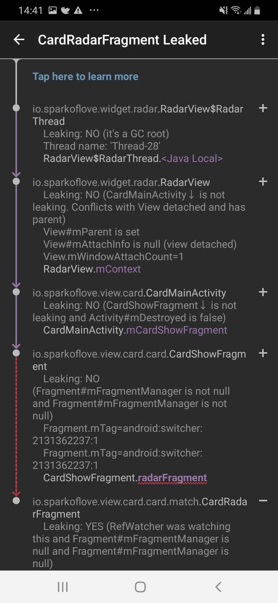

# OOM(内存不足)

[TOC]

Out Of Memory 有的也被翻译为内存溢出。内存不足是一个非常复杂的问题，它涉及到操作系统、硬件、应用程序等多个方面。程序在一台机器上运行良好，可能在另一台机器上就经常出现 OOM。它可能是物理内存不够用了，例如大型的 3D 渲染软件很难跑到老旧的机器上，即使使用各种方法减少内存使用，只会让渲染变得更慢，最直接的办法就是安装更大的内存条。这也是我们最近几十年计算机和手机不断发展的历史。也可能是操作系统的分配算法出现问题，即使有内存可用，但是因为碎片化严重，无法分配出来。

此外，堆内存使用的一大误解是，内存使用越少越好。例如在系统上的检测器上看到内存几乎用尽了，就觉得特别担心内存的用尽了。要知道，之所以引入内存就是为了弥补磁盘访问速度慢的缺陷。**内存的访问速度远大于磁盘，将数据放在内存中能显著增加性能，优秀的系统反而会最大化的利用内存的速度优势来提升系统性能。**应用开发者能做的是，能否弹性的使用内存，在内存充足是多利用内存给程序本身提速；在内存紧张的系统上也能应对让程序正常运行。

内存使用的整体策略：
1. 减小对象的内存占用：能省则省，才能有更多的内存供真正需要的地方使用。
2. 内存对象的重复利用：频繁使用的对象，可以考虑缓存起来，避免重复创建。例如循环中创建，可以外提。函数中创建的，可以缓存。
3. 避免对象的内存泄露：不再使用的对象，应该及时释放。
4. 内存使用策略优化：在内存充足时，多利用内存给程序本身提速；在内存紧张的系统上能够自动少申请内存，对让程序正常运行。


## OOM 与 OOM Killer/LMK

- 软件内存不够用了(OOM)，我的系统是 64 位的，既然可以虚拟内存可以使用超过物理内存的大小，按道理我的程序可以使用 2^64 大小的内存，使用远没有达到这么大，为什么报 OOM？Native 的内存空间足够大，为什么还是会 OOM? 

这是一种误解：
1. OOM 是 JVM 的内存不足表现，Native 程序没有 OOM 的检查，当内存不足时，分配内存会失败，并不表现为像 JVM 的 OOM 异常。malloc 会返回 NULL，new 会抛出 std::bad_alloc 异常。如果你代码里检查了 if (ptr == NULL)，你可以优雅地处理（比如释放缓存、提示用户）。如果你没检查，直接往 NULL 地址写数据，程序会立即触发 Segmentation Fault (段错误)，产生 Native Crash；或者因为系统物理内存不足，被 OOM Killer 杀掉，其表现为静默的死去，没有异常抛出。

2. 虚拟内存空间很大不代表可以使用这么大的内存，程序申请内存空间时，系统只是为程序建立了映射。Linux 等现代系统都支持延迟分配，直到真正访问内存触发缺页中断时，系统才会分配物理内存。此时物理内存不足就会触发 OOM Killer 杀掉进程。这种情况下，程序收不到任何通知，直接从进程列表里消失，表现为闪退。

3. 绝大多数的系统 OOM 都是因为系统 OverCommit 机制导致的。由于延迟分配，应用申请时并未实际分配物理内存，应用可以申请远大于实际内存大小的内存，等到应用使用时，内核无法找到物理内存实现承诺，就会以 OOM 异常杀死某一进程。而虚拟机则是实际使用内存时虚拟机发现超出限制，抛出 OutOfMemoryError 异常。


被 OOM Killer 或 lmkd 杀掉，与 JVM 抛出 OutOfMemoryError 是完全不同的两回事。杀掉的进程会“原地消失”，程序内部收不到任何 OOM 信息。

- SIGKILL 信号是不可被捕获（Catch）或忽略（Ignore）的。

- 虽然收不到 OOM 异常，但 Android 提供了一个“缓刑警告”
    - onTrimMemory(int level)：当系统内存开始紧张时，Android 会回调这个方法。

    - 如果你收到 TRIM_MEMORY_COMPLETE 或 TRIM_MEMORY_RUNNING_CRITICAL，说明你已经排在 lmkd 的“死亡名单”前列了。这时如果你主动释放内存，也许能逃过一劫。

- exit-info 是 Android 11 引入的最强“法医工具”。可以用来追溯一个进程到底是死于 Java 崩溃还是被 LMK 杀掉的。只前的版本只能通过根据包名查看 log，通过日志获取进程被杀死的信息。

- Linux 内核则通过 dmesg 查看被杀死的进程信息。 `dmesg -T| grep -E -i -B100 'killed process'` Where -B100 signifies the number of lines before the kill happened。Omit -T on Mac OS.

为了维护系统整体的运行，系统会在内存不足时，主动杀死一些进程。这就是 OOM Killer/LMK。

VSS vs RSS：Native 分配会导致进程的虚拟耗存 (VSS) 和 驻留内存 (RSS) 飙升。LMK 杀进程时，通常会优先考虑 “内存占用大且优先级低” 的应用。


## 内存限制

JVM 的 OOM 和 Native 的 OOM 的区别：
TODO: native 程序的内存限制， cgroup 或者 ulimit .
?1. 系统限制：例如 JVM 会限制堆内存占用空间，操作系统也可以对进程占用的内存进行限制。
Native 程序一般没有内存限制，出现 OOM 通常是物理内存不够用了，很少出现虚拟地址空间耗尽的情况。而 JVM 的则不同，它限制了 Java 程序的堆空间大小。Jvm 的 OOM 是Java程序的堆空间使用达到上限，导致无法分配内存。

### JVM 的内存限制

Java 虚拟机本质就是一个 native 程序。其使用内存也要符合系统提供的虚拟内存。而 Java 应用程序使用的内存，则是虚拟机向系统申请的内存，也是在虚拟机的地址空间中。Java 虚拟机规范隐藏了地址空间的概念，仅给程序保留了逻辑上的堆、栈等概念。从这方面说，虚拟机代替开发者管理地址，从而让开发者专注于业务逻辑。

Art 虚拟机的实现是为每个 Java 程序单独启动一个独立的虚拟机。（应该所有的虚拟机都是这样，只不 jvm 虚拟机本身的代码因为内存的共享机制，在多个进程之间共享而已。）

为了维持多任务处理运行环境，Android 对每个应用程序的堆大小设置了硬限制。确切的堆大小限制在设备之间有所不同，这取决于设备的总体可用RAM大小。如果你的应用程序已经达到堆容量限制，并试图分配更多的内存，它可以收到一个 OutOfMemoryError。

1. 初始堆大小：dalvik.vm.heapstartsize=8m
2. 最大堆大小：dalvik.vm.heapgrowthlimit=64m 
3. largeHeap 堆大小：dalvik.vm.heapsize=384m  // android:largeHeap="true" 申请开启最大上限时，会使用该值。

注意：heapgrowthlimit 设置普通进程可用最大内存值。在android开发中，如果要使用大堆，需要在manifest中指定android:largeHeap 为 true，这样 dvm heap 最大可达 heapsize。

不同设备，这些个值可以不一样。一般地，厂家针对设备的配置情况都会适当的修改 `/system/build.prop` 文件来调高这个值。随着设备硬件性能的不断提升，从最早的 16M 限制(G1手机)到后来的 24m, 32m，64m等，都遵循 Android 框架对每个应用的最小内存大小限制，参考 http://source.android.com/compatibility/downloads.html 3.7节。

Art 虚拟机采用了分代垃圾回收机制。

Dalvik 不会压缩逻辑堆的大小，这意味着 Android 不会对逻辑堆进行碎片整理以关闭空间。Android 只能在堆末端有未使用的空间时缩小逻辑堆大小。但是，系统仍然可以减少堆使用的物理内存。在垃圾收集之后，Dalvik遍历堆并找到未使用的页面，然后使用 madvise 将这些页面返回给内核。因此，大块的内存的分配和释放调用对应该导致回收所使用的全部(或几乎全部)物理内存。但是，回收小块内存的效率可能要低得多，因为小块内存可能仍然与尚未释放的对象共享内存页。

在某些情况下，可能想知道当前设备上 app 有多大的堆可用——例如，这可以确定在缓存中保存多少数据是安全的。可以使用 ActivityManager 的 getMemoryClass() 函数来查询该值。此方法返回一个整数，表示应用程序可用堆的兆字节数。


读取/编辑文件需要 root 权限，在用户手机上无法获得，可以使用 Android 提供的 API 来获取。

```Kotlin

val activityManager = context.getSystemService(Context.ACTIVITY_SERVICE) as ActivityManager

val stackLimit = activityManager.memoryClass  // 

val largeMemoryClass = activityManager.largeMemoryClass

activityManager.isLowRamDevice() // 判断设备是否为低内存设备。
```

```Java
Runtime.getRuntime().maxMemory();   // heapgrowthlimit 或者 heapsize 定义的值
Runtime.getRuntime().totalMemory(); // 当前已经从系统申请到的堆内存总量（字节）。
Runtime.getRuntime().freeMemory();  // 当前已申请的堆（totalMemory()）中，尚未被使用的空闲内存（字节）。
```

## 避免 OOM

知道了内存的限制之后，就有了避免 OOM 的策略。

OOM （Native 的OOM 和 Jvm 的 OOM）的大类有哪几个？
- 内存泄漏
    - JVM
        - 堆外内存泄漏
        - 堆内内存泄漏
    - Native
- 巨型对象: 根据实际需要创建内存大小，避免没有使用的也申请内存。
- 内存碎片: 频繁创建的小对象缓存。
- 线程耗尽: 使用线程池管理线程，避免线程过多。

内存泄漏是一个大的话题，我们单独一节来讨论。

### 巨型对象

普通对象一般占用内存较小，巨型对象一般是二进制文件等数据，例如：JSON 数据、图片、文件读取等。

> 图片
现在手机图片动辄 10M 以上，但是显示区域一般只有一个小框，为了显示一小片大小加载全量图片数据会造成浪费，合理的做法是根据显示大小对图片进行采样。

```Java
// 1. 只读取图片的尺寸（不加载图片数据）
BitmapFactory.Options options = new BitmapFactory.Options();
options.inJustDecodeBounds = true;
BitmapFactory.decodeResource(res, resId, options); // 此时不占内存

// 2. 计算采样率 inSampleSize
// 采样率必须是 2 的幂（如 2, 4, 8）。如果设置为 4，则宽高各缩小为 1/4，总像素（内存）缩小为 1/16。
public int calculateInSampleSize(BitmapFactory.Options options, int reqWidth, int reqHeight) {
    final int height = options.outHeight;
    final int width = options.outWidth;
    int inSampleSize = 1;

    if (height > reqHeight || width > reqWidth) {
        final int halfHeight = height / 2;
        final int halfWidth = width / 2;
        // 计算最大的 2 的幂次方的采样率
        while ((halfHeight / inSampleSize) >= reqHeight && (halfWidth / inSampleSize) >= reqWidth) {
            inSampleSize *= 2;
        }
    }
    return inSampleSize;
}
options.inSampleSize = calculateInSampleSize(options, reqWidth, reqHeight);
// 3. 加载图片
options.inJustDecodeBounds = false;
// 正式分配内存并加载
Bitmap bitmap = BitmapFactory.decodeResource(res, resId, options);
```

其它的优化还有：
及时回收：不再使用的图片及时调用 `recycle()` 方法回收图片内存，不用等 GC 回收。
色彩通道优化：在配置比较低的机型上，如果图片不需要透明度，改为 RGB_565（每个像素 2 字节），内存直接减半。**但现在更推荐 HARDWARE Configuration (Android 8.0+)，图片直接存储在显存中（Graphic Buffer），且以硬件最喜欢的格式存在。它在 Java 堆中几乎不占内存（只占一个描述符），渲染时零转换成本，速度极快。**
内存复用：在加载新图时，重用旧图占用的内存块（针对相同尺寸），避免频繁 GC 导致的内存抖动。

**优先使用现有的图片加载框架，例如 Glide、Coil等**

安卓中 Bitmap 加载的图片，不调用 recycle就设置位 null 了，图片的内存还能被回收吗？会不会造成内存泄漏？

Bitmap 的像素数据存储位置在 Android 历史上迁徙了三次：

- Android 3.0 以前：像素在 Native 内存，Java GC 完全管不到。不手动调用 recycle()，内存几乎百分之百泄露。
- Android 3.0 - 7.1：像素挪到了 Java 堆(但 decode 仍然在 natvie层进行)。设置为 null 后，GC 扫描到它死了，就会像回收普通对象一样回收像素。
- Android 8.0 至今（当前主流）：像素重回 Native 内存，但引入了 NativeAllocationRegistry 机制（NativeAllocationRegistry底层实际上使用了  Java Cleaner 来清理内存，本质是虚引用实现的。），会在垃圾回收时释放 native 内存。

GC 的延迟：Java GC 的触发是不确定的。如果你在一个循环里加载了 10 张大图，只是简单设为 null，可能 Java 堆还没满（没触发 GC），但 Native 内存已经爆了，导致 App 直接崩溃。


## 内存泄漏（memory leak）

###  内存泄漏场景

**不同于 native 的内存泄露是丢失引用，忘记释放，Java 具有垃圾回收器能够在内存紧张时主动回收内存。Java 内存泄露的原因是持有引用没有释放（以及持有的引用超出了使用的生命周期），导致内存无法被回收**。因此及时释放引用是关键。

#### 常见内存泄漏场景

1. 静态变量引用不释放
    1. 单例，使用时不注意其应该的声明周期，导致不再使用了仍然存在。
2. 常量引用：常量如果不是简单数据类型，而是对象或集合，同样会持有对象。
3. 线程任务完成没有及时结束。
4. 线程声明周期超过了使用其执行任务的 Activity。
5. 长生命周期的对象持有短生命周期的对象
    1. 集合持有的对象，只有添加，没有删除。
    2. 未撤销的监听器/回调：注册了 Listener 但忘记 unregister，导致观察者被被观察者（通常长寿命）强引用。


#### ThreadLocal 导致的内存泄漏

ThreadLocal 是 Java 中用于存储线程局部变量的机制。

## 其它溢出

> java.lang.OutOfMemoryError: PermGen space 或者 java.lang.OutOfMemoryError: Metadata space

Java 类加载区的溢出，通常是类加载过多，或者类加载过于庞大。这种情况下，需要检查类加载器是否正常，是否存在过多的类加载器，是否存在过多的类加载。或者通过 -XX：PermSize 和 -XX：MaxPermSize 修改方法区大小。


> java.lang.StackOverflowError

一般是因为递归导致；如果实在是调用深度太深，通过 -Xss 设置线程栈大小。

## 方法论

1. 内存使用统计

2. Heap Dump
    查看对象 GC Roots 的引用链。分析哪些对象没有被回收，为什么没有被回收。哪些对象创建过多。


3. 火焰图


--------------------------------------》

由于内存管理的差异，Native 和 JVM 的内存泄漏的定义和处理方式不同。Native 的内存泄漏是丢失引用，忘记释放；Java 具有垃圾回收器能够在内存紧张时主动回收内存。Java 内存泄露的原因是持有引用没有释放（以及持有的引用超出了使用的生命周期），导致内存无法被回收。

虚拟内存（Virtual Memory Size，VIRT，VSZ）一直增长到很大，可以认为是内存泄漏吗？

答案是不一定。以下情况并不是泄漏：
- 文件映射：如果应用使用了很大的内存映射文件（例如播放器映射一个2GB的电影文件），虚拟内存会瞬间增长2GB，但物理内存只会加载实际访问的部分；

- 预留地址空间：内存分配器可能会提前预留一大段虚拟地址空间，以备将来分配之用，这会导致VIRT很高，但物理内存使用可能很低；

- 分配了但未使用：在C/C++中，可能会malloc一大块内存但从未真正写入它，这只会增长VIRT，而不会增加物理内存。

以下情况很可能是泄漏：

- 虚拟内存和物理内存同步持续增长：这是最经典的泄漏迹象，泄漏的对象分配在堆上，既占用了虚拟地址，也因写入数据而占用了物理内存；

- 地址空间耗尽：32位系统的虚拟地址空间是有限的，如果VIRT增长到接近极限，即使物理内存不高，也说明进程的虚拟地址空间已经被各种映射塞满，可能发生了泄漏或资源管理异常。虚拟内存增


早期我将其划分为 Native 和带运行时的语言。仔细思考，更应该划分为有内存管理的语言和无内存管理的语言。

### C/C++ 无内存管理的语言

C/C++ 这种没有内存回收机制的语言，必须依赖开发者自己管理内存。内存泄漏通常是由于忘记释放内存导致的。

### Java/Kotlin

但是在 Kotlin 和 Java 的世界中，事情有些许不同。因为这两种语言是运行在 Java 虚拟机 (JVM) 中的。在 JVM 中，有个重要的概念，就是垃圾回收 (GC)。当垃圾回收运行时，虚拟机会首先识别 GC Root。无法从 GC root 访问的对象，则会被认为是垃圾并回收掉。

GCRoots包括：
- 虚拟机栈（线程栈帧中的局部变量）引用的对象。
- 方法区中类静态属性引用的对象。
- 方法区中常量引用的对象。
- native 对象通过 JNI 引用的对象。
- 正在被执行的 native 方法引用的对象。

所以 JVM 中内存泄漏和 C/C++ 不同。在 JVM 中的内存泄漏通常是指: 内存中含有那些再也不会被使用、但是仍然被强引用持有的对象。

#### 1. 不会再使用仍然被持有

即使对象不再被使用，仍然持有引用。例如长期保持某些资源（如Context）的引用，垃圾回收器以为还在使用而无法回收它，当然该对象占用的内存就无法被使用，这就造成内存泄露。

常见的有：
- 静态变量引用不释放（单例等）
- 常量引用
- 线程执行完没有及时结束。


#### 2. 占用内存较多的对象

保存了多个耗用内存过大的对象（如Bitmap）或加载单个超大的图片，造成内存超出限制。

#### 3. 一次创建过多的对象，而使整体占用空间超过了可分配空间。

> (1). 内存的整体使用情况.

要分析 memory leaks, 你需要知道总体的内存使用情况和划分. 以判断内存泄露是发生在user space, kernel space, mulit-media 等使用的memory, 从而进一步去判断具体的 memory leaks.

user space 使用的 memory 即通常包括从进程直接申请的memory, 比如 malloc: 先 mmap/sbrk 整体申请大块Memory 后再malloc 细分使用, 比如stack memory, 直接通过mmap 从系统申请; 以及因user space 进程打开文件所使用的page cache, 以及使用ZRAM 压缩 user space memory 存储所占用的memory.

kernel space 使用的 memory 通常包括 kernel stack, slub, page table, vmalloc, shmem 等.

mulit-media 使用的memory 通常使用的方式包括 ion, gpu 等.

其他方式的memory 使用, 此类一般直接从buddy system 中申请出以page 为单位的memory, android 中比较常见如ashmem.

而从进程的角度来讲, 通常情况下进程所使用的 memory, 都会通过mmap 映射到进程空间后访问使用(注: 也会一些非常特别异常的流程, 没有mmap 到进程空间), 所以进程的memory maps 资讯是至关重要的. 对应在AEE DB 里面的file 是 PROCESS_MAPS


## Android 中的内存泄漏

    - 比如，在Activity.onDestroy()被调用之后，view树以及相关的bitmap都应该被垃圾回收。如果一个正在运行的后台线程继续持有这个Activity的引用，那么相关的内存将不会被回收，这最终将导致OutOfMemoryError崩溃。 重复进入会再次创建，最终会导致内存溢出。

    - 内部类 handle 延时发送 message 而在关闭 activity 后 context 仍被 messgeQueue 中的 handler 锁引用。无法被销毁所引发泄漏。Handler应该申明为静态对象， 并在其内部类中保存一个对外部类的弱引用。
    - 或者 Activity 中 AsynTask 内部类在 Activity 销毁后还在执行。

    - 内部类的变量被定义为了 static，而没有清空。

    - 资源对象没关闭，如Cursor，File等资源。他们会在finalize中关闭，但这样效率太低。容易造成内存泄漏

    - 使用 Adapter时，没有使用系统缓存的 converView

    - 没有即时调用recycle()释放不再使用的bitmap

    - 静态变量或者单例模式中的变量引用了 Activity.

    - 广播注册没取消造成内存泄露

    - 注册的系统服务监听，眉头在结束时取消监听。SensorManager sensorManager = (SensorManager) getSystemService(SENSOR_SERVICE);

2. 占用内存较多的对象

    - 不经缩放的加载 bitmap 对象的溢出，显示像素过高或图片尺寸远远大于显示空间的尺寸时，通常都要将其缩放，减小占用内存。

    - Bitmap 的特殊性：在 Android 8.0 之后，Bitmap 的像素数据被移到了 Native 堆，但为了防止开发者滥用，Bitmap 占用的 Native 内存会被计入 Java OOM 的判定逻辑中（虽然物理上在 Native，但逻辑上受控）。

3. 一次创建过多的对象

    - SQLiteCurost,当数据量大的时候容易泄漏

### 静态变量

用 static 来修饰成员变量时，该变量就属于该类，而不是该类实例。它的回收周期和该类一致，该类被回收，静态变量才会被回收。对于对象类型的静态变量，应该在不使用时及时的设置为 null。（简单数据类型用不用都会分配内存，也不参与垃圾回收，不影响。）


### 内部类

在使用过程中，内部类本身持有外部类的引用，所以才可以调用外部类的非静态方法。如果内部类的生命周期比外部类长，就会导致外部类占用的内存无法释放。Java 中内部类默认是非静态的，引用更普遍，在 Kotlin 做了改进，默认是静态内部类。

```Java
public class CardMainActivity extends BaseActivity {
    public class CardMainHandler extends Handler {
        @Override
        public void handleMessage(Message msg) {
            // 不用声明变量，内部类就持有外部类的引用，所以才能自由访问外部类的非静态变量和方法。
            mViewModel.getMatchUsers(null);
        }
    }
```

此时 `CardMainHandler` 是非静态的，自然而然持有外部对象的引用。 此时如果内部类生命周期比外部类长，外部类就无法释放。

```Java
//registerNetReceiver();
((DatingApplication) getApplication()).setCardMainHandler(new CardMainHandler());
```

解决方案： 使用 Activity 销毁时自动解绑的 LiveData 或者 EventBus 处理页面直接的事件传递。禁止使用全局 application 传递事件。

### 静态内部类

静态内部类虽然没有外部类对象的引用，但是却有类的引用，用于访问外部类的静态方法。此时如果外部类声明了静态变量，在静态内部中使用了，也不容易释放掉。这种方式是：1，没有明确的包含关系，少用内部类。2，谨慎使用静态变量，甚至是常量和单例，如果其生命周期不是和 APP 一样长，应该避免使用，或者至少应该及时释放。




### 自定义线程

无论是多线程还是多进程，在编程中都是一个难点。在页面退出后，线程没有销毁非常普遍。

关于自定义线程解决的方法多种多样，不同的场景需要使用不同的方式。这里进列举现在遇到的。

1. 一个常见的使用线程的地方就是动画，动画需要在单独的线程计算，然后在 UI 线程中更新 UI。 关于动画的部分，建议使用 Android 更好封装的属性动画。它会在 UI 销毁时，及时的销毁，而不必关心终止问题。

下面是 RadarView 的线程计算动画执行过程

```Java
private static class RadarThread extends Thread {
    private WeakReference<RadarView> weakReference;

    public RadarThread(RadarView radarView) {
        weakReference = new WeakReference<>(radarView);
    }

    @Override
    public void run() {
        super.run();

        RadarView radarView = weakReference.get();
        if (radarView != null) {
            radarView.beginRunning();
        }
    }
}

/**
 * 开始运行
 */
private void beginRunning() {
    while (threadIsRunning) {
        RadarView.this.post(new Runnable() {
            @Override
            public void run() {
                start = start + 1;
                matrix.setRotate(start, 0, 0); //因为我对画笔进行了平移，0，0表示绕圆的中心点转动
                RadarView.this.invalidate();
            }
        });
        try {
            Thread.sleep(5);
        } catch (InterruptedException e) {
            e.printStackTrace();
        }
    }
}
```

改为系统组件更简单，而且可调节的更多。会在 UI 销毁时，将其一块销毁。

```Java
public void start() {
    if (mRotateAnim != null && mRotateAnim.isRunning()) {
        return;
    }
    mRotateAnim = ObjectAnimator.ofInt(this, "rotate", start + 360) // 360 度
            .setDuration(2000);
    mRotateAnim.setRepeatMode(ValueAnimator.RESTART);
    mRotateAnim.setRepeatCount(Animation.INFINITE);
    mRotateAnim.setInterpolator(new LinearInterpolator());
    mRotateAnim.start();
}
```

2. 在 View 组件销毁的时候，将线程终止掉。很麻烦的一点是， Java 的线程没有提供直接终止的方法，一般是单独设置一个标志位，在线程中判断标志位，终止执行。

```Java
private static class RadarThread extends Thread {
    @Override
    public void run() {
        if (continue) { // 要判断的标志位
            // ...
        }
    }
}
```

这种方式并不太好，能不直接使用线程还是避免使用线程，太原始了。深入掌握线程非常重要，但不一定非要处处使用，仿佛一下从机械时代回到了农耕时代。

### JNI

**Java 对象在 Native 层被“引用”后没有释放，导致 JVM 的垃圾回收器（GC）无法回收这些对象。**

#### 1. 哪些操作会导致引用不释放（导致内存泄漏）？

##### A. 局部引用溢出（Local Reference Overflow）**

当你调用返回 Java 对象的 JNI 函数（如 NewObject、FindClass、GetObjectField）时，会产生一个局部引用。

- **陷阱：** 虽然局部引用在 Native 方法返回后会自动释放，但局部引用表是有大小限制的（通常是 512 个）。如果你在循环里创建了数千个对象且没有手动释放，就会导致表溢出，程序崩溃或内存持续增长。

- **对策：** 在循环内部显式调用 DeleteLocalRef。

##### B. 全局引用未删除（Static/Global Reference）

如果你想让一个 Java 对象在多个 JNI 调用之间一直存在（例如保存一个 Callback 对象），必须使用全局引用。

- **陷阱：** 调用了 NewGlobalRef 但从未调用 DeleteGlobalRef。

- **后果：** 只要这个全局引用存在，该 Java 对象及其引用的整个对象树就永远不会被 GC 回收，是典型的永久性内存泄漏。
后果： 只要这个全局引用存在，该 Java 对象及其引用的整个对象树就永远不会被 GC 回收，是典型的永久性内存泄漏。

##### C. 字符串和数组

这些调用涉及 Native 层和 JVM 之间的内存“握手”，如果漏掉“结束”调用，会导致原生堆内存泄漏或系统死锁。

**字符串操作**：Get 与 Release。 访问 Java 字符串时，JNI 通常会创建一份副本。如果不 Release，JNI 为该字符串分配的 C 风格缓冲区将永远留在内存中。

- GetStringUTFChars -> ReleaseStringUTFChars
- GetStringChars -> ReleaseStringChars

**数组操作**：Get 与 Release。访问基本类型数组（如 byte[]）时，需要释放来解除“钉住（Pinning）”状态或将修改同步回 Java 堆。

- Get<Type>ArrayElements -> Release<Type>ArrayElements
- GetPrimitiveArrayCritical -> ReleasePrimitiveArrayCritical

**严重性**： Critical 版本的方法在调用期间会禁止 GC 运行。如果不 Release，会导致整个 JVM 挂起甚至系统死锁。

#### JNI 调用必须成对使用的速查表（不调用必漏）？

| 开始函数 | 结束函数（必须对齐） | 不释放会泄露什么？ |
| - | - | - |
| NewGlobalRef | DeleteGlobalRef | Java 对象本身（GC 无法回收） |
| GetStringUTFChars | ReleaseStringUTFChars | Native 字符串缓冲区（原生堆） |
| Get[Type]ArrayElements | Release[Type]ArrayElements | 数组副本/缓冲区（原生堆） |
| NewObject (在循环内) | DeleteLocalRef | 局部引用表槽位（导致崩溃或内存慢增） |
| GetCritical 系列 | ReleaseCritical 系列 | 系统卡死（因为 GC 被永久挂起） |

> 特别注意：FieldID 和 MethodID 会泄露吗？

结论： 不会。这些 ID 本质上是整数/指针，在类被卸载前都是有效的。你不需要手动“释放”它们，但为了性能，建议将它们缓存在全局变量中，避免重复查找。

## 内存压测

虽然内存压力问题在高端设备上不太常见，但它们仍然会给低 ram 设备上的用户带来问题，比如运行Android (Go版)的设备。尝试重现这种内存紧张的环境是很重要的，这样你就可以编写检测来验证应用程序的行为，并改善低内存设备上用户的体验。

## 检测

Heap dump 或者 


[Android 内存大小限制]https://blog.csdn.net/weixin_39793420/article/details/117498032
[穿越二十年：Android Native内存泄漏检测的进化之路](https://mp.weixin.qq.com/s/fWBabV6YsQe8_GT01D-JGg)
[Protetto 快速定位安卓内存泄漏的方法](https://mp.weixin.qq.com/s/RNN0A-VJ_oJesOcdn6C0HQ)
