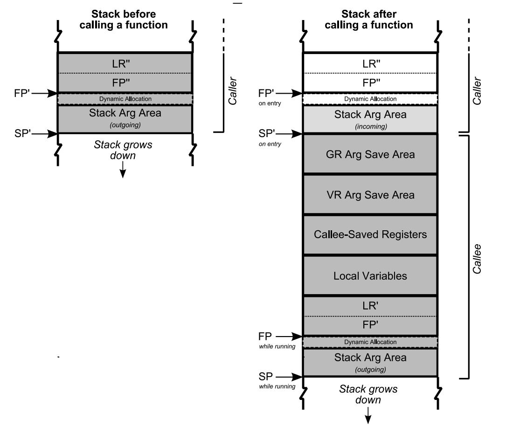

# Stack

1. 调用和返回
    - 如何跳到被调用的函数执行？
    - 如何从被调用函数返回调用者？
2. 传递参数
    - 如何传递参数给被调用函数
3. 局部变量
    - 被调用函数如何存储局部变量？
4. 返回值
    - 被调用函数如何将值返回给调用者？
    - 调用者如何获得返回的值？
5. 优化
    - 调用者和被调用函数如何做到最小的内存占用？

## 栈空间大小


Linux 上栈空间的大小默认是 8MB，对于主线程的栈和其它线程还有点细微差别。

#### 主线程栈大小

对于主线程，系统并没有一开始就申请 8MB 的地址空间，而是只有 132KM。

```
prompt> cat /proc/4150/maps
...
7fbbd2318000-7fbbd2319000 rw-p 00000000 00:00 0
7ffd457b0000-7ffd457d1000 rw-p 00000000 00:00 0                          [stack]    # 132KB
7ffd457d1000-7ffd457d5000 r--p 00000000 00:00 0                          [vvar]
7ffd457d5000-7ffd457d7000 r-xp 00000000 00:00 0                          [vdso]
ffffffffff600000-ffffffffff601000 r-xp 00000000 00:00 0                  [vsyscall]
```
可以看到栈的大小只有 132KB，这并不是说该进程的栈只有 132KB，从地址分配上可以看到，栈的地址段低地址的下一个段的结束地址 `7fbbd2319000` 有很大一个空间，而且没有给主线程的栈分配栈溢出保护段。这是因为 Linux 默认先分配 132 KB 的内存，随着已分配的栈区域耗尽，将触发一个缺页异常进入内核。通过异常陷入内核态后，异常会被内核的 expand_stack() 函数处理，进而调用 acct_stack_growth() 来检查是否还有合适的地方用于栈的增长。


如果栈的大小低于 RLIMIT_STACK（通常为8MB），那么一般情况下栈会被加长，程序继续执行，感觉不到发生了什么事情，这是一种将栈扩展到所需大小的常规机制。然而，如果达到了最大栈空间的大小，就会发生栈溢出（stack overflow），进程将会收到内核发出的段错误（segmentation fault） 信号。

动态栈增长是唯一一种访问未映射内存区域而被允许的情形，其他任何对未映射内存区域的访问都会触发页错误，从而导致段错误。一些被映射的区域是只读的，因此企图写这些区域也会导致段错误。

但是在 Android 系统上，其栈大小为 `8188KB`，加上栈溢出的保护段 `4KB`，恰好 8MB。不知道是不是内核版本的不同，还是谷歌修改了限制。）。**安卓的主线程后面也保留了很大一块地址空间，应该也能增加吧。**

```shell
prompt> adb shell
prompt> ps | grep <app 的包名>  # 查看进程的 id
prompt> run-as <app 的包名>   # 获取沙盒权限，查看该进程的 maps 文件。
prompt> cat /proc/<pid>/maps
...
7873d0e000-7873d0f000 r--p 00000000 00:00 0                              [anon:.bss]
7873d0f000-7873d15000 rw-p 00000000 00:00 0                              [anon:.bss]
7fdff55000-7fdff56000 ---p 00000000 00:00 0                                          # 4KB 的保护
7fdff56000-7fe0755000 rw-p 00000000 00:00 0                              [stack]     # 8188KB 的栈
```

#### 子线程栈大小

***对于非主线程的栈大小，在不超过系统限制的情况下，其大小由线程库决定。*** 例如，我的 PC Linux 的线程的栈大小为 8MB

Android 的标准库不是 glibc，而是 bionic。其子线程的栈大小小于 1MB。 

```
//java thread
797eae5000-797eae7000 ---p 00000000 00:00 0 
797eae7000-797eae8000 ---p 00000000 00:00 0                              [anon:stack_and_tls:11512]
797eae8000-797ebef000 rw-p 00000000 00:00 0                              [anon:stack_and_tls:11512]
797ebef000-797ebf1000 ---p 00000000 00:00 0                                                         # 8KB
797ebf1000-797ebf2000 ---p 00000000 00:00 0                              [anon:stack_and_tls:11511] # 4KB
797ebf2000-797ecf9000 rw-p 00000000 00:00 0                              [anon:stack_and_tls:11511] # 1M + 28KB = 1052KB  为什么会大于 1MB?

native thread?
//native thread
```
具体到不同版本的修改可以查看：https://zhuanlan.zhihu.com/p/33562383

每个栈结束都会有一个不可读写的页，用于栈的溢出保护。(为什么 stack guard 之后还有两页的保护？ < java thread 在art 里面还会再隔离一个page, 判断收到的SIGSEGV 是否为StackOverflowError.> 这个说法是真的吗? native stack 没有？)

如何找到线程的栈？

maps 输出的信息 `anon:stack_and_tls:11511` 的数字其实是线程 id, 我们可以查看进程下的所有线程来找到线程对应的栈地址。如果你有 root 的安卓系统，可以使用 `adb shell debuggerd -b PID` 可查看当前进程的所有线程。然后找到对应 tid 的堆栈。否则使用 `adb shell ps -T | grep <pid>`

```
$ adb shell ps -T | grep 11482
u0_a555       11482 11482    798 5727320 151356 0                   0 S .yaowen.android
...
u0_a555       11482 11511    798 5727320 151356 0                   0 S thread1
u0_a555       11482 11512    798 5727320 151356 0                   0 S thread2
...
```

#### 实际可使用大小

然而并不意味着可使用的空间能达到 8M，例如在栈上申请 8M 的空间则会发生段错误
```C
void* runing(void* p){
    char tack_stack[ 8 * 1024 * 1024 - 2 * sizeof(void*)] = {}; // 减去参数和返回值占用的空间，虽然返回值有时采用寄存器返回
}
```

或者我们打印线程栈的入口地址
```C
void* runing(void* p){
    printf("stack bottom addr: %p\n", &p + sizeof(void*)); // 形参没有入栈的位置。或者打印栈底寄存器更准确。
}
```
可以发现其输出和 maps 给出的地址并不相同。也可实际获取的地址不同。

```C
// 获取栈大小和位置。
int main()
{
  foobar(4);
  // Declare variable for thread's ID:
  pthread_t id;
  int err = 0, count = 0;
  pthread_attr_t attr;

  while (count < 4) {
    err = pthread_create(&id, NULL, runing, (void *)count);
    pthread_getattr_np(id, &attr);
    size_t stack_size, guard_size;
    void *stack_addr;
    int s;
    char *prefix = "";
    s = pthread_attr_getguardsize(&attr, &guard_size);
    printf("%sGuard size          = %zu bytes\n", prefix, guard_size);

    s = pthread_attr_getstack(&attr, &stack_addr, &stack_size);

    printf("%sStack address       = %p", prefix, stack_addr);
    if (stack_size > 0)
       printf(" (EOS = %p)", (char *) stack_addr + stack_size);
    printf("\n");
    printf("%sStack size          = %#zx (%zu) bytes\n",
                   prefix, stack_size, stack_size);
    printf("count = %d\n", count);
    count++;
  }
  printf("Entry any key to finish program.");
  getchar();
  return 0;
}
```

```
Guard size          = 4096 bytes
Stack address       = 0x7fd546f65000 (EOS = 0x7fd547765000)
Stack size          = 0x800000 (8388608) bytes
stack bottom addr: 0x7fd547763eec
```

线程的入口函数帧地址 `0x7fd547763eec` 距分配空间的栈底 `0x7fd547765000` 还有 `4372` 字节的大小。这部分局域用于存放线程相关的数据以及 TLS(Thread Local Storage) 数据。因此实际可用的空间不足 8MB。

```
...
7f54affec000-7f54affed000 ---p 00000000 00:00 0
7f54affed000-7f54b07ed000 rw-p 00000000 00:00 0    # 8MB
7f54b07ed000-7f54b07ee000 ---p 00000000 00:00 0
7f54b07ee000-7f54b0fee000 rw-p 00000000 00:00 0    # 8MB
7f54b0fee000-7f54b0fef000 ---p 00000000 00:00 0
7f54b0fef000-7f54b17ef000 rw-p 00000000 00:00 0    # 8MB
7f54b17ef000-7f54b17f0000 ---p 00000000 00:00 0
7f54b17f0000-7f54b1ff3000 rw-p 00000000 00:00 0    # 8204KB 第一个创建的线程的 maps 输出并不是 8MB。 Way?
...

root@573a3d572e1d:/# ps -aux
USER       PID %CPU %MEM    VSZ   RSS TTY      STAT START   TIME COMMAND
root         1  0.0  0.0   4248  3376 pts/0    Ss+  03:37   0:00 /bin/bash
root        13  0.0  0.0   4248  3612 pts/1    Ss   03:37   0:00 /bin/bash
root        26  0.0  0.0   4248  3596 pts/2    Ss   03:37   0:00 /bin/bash
root     15394  0.0  0.0  35452   644 pts/1    Sl+  15:31   0:00 ./a.out
root     15399  0.0  0.0   5904  2940 pts/2    R+   15:31   0:00 ps -aux
root@573a3d572e1d:/# cat /proc/15394/maps
00400000-00401000 r--p 00000000 00:90 7785369                            /opt/webrtc/a.out
00401000-00402000 r-xp 00001000 00:90 7785369                            /opt/webrtc/a.out
00402000-00403000 r--p 00002000 00:90 7785369                            /opt/webrtc/a.out
00403000-00404000 r--p 00002000 00:90 7785369                            /opt/webrtc/a.out
00404000-00405000 rw-p 00003000 00:90 7785369                            /opt/webrtc/a.out
018d2000-018f3000 rw-p 00000000 00:00 0                                  [heap]
7fd545761000-7fd545762000 ---p 00000000 00:00 0
7fd545762000-7fd545f62000 rw-p 00000000 00:00 0
7fd545f62000-7fd545f63000 ---p 00000000 00:00 0
7fd545f63000-7fd546763000 rw-p 00000000 00:00 0
7fd546763000-7fd546764000 ---p 00000000 00:00 0
7fd546764000-7fd546f64000 rw-p 00000000 00:00 0
7fd546f64000-7fd546f65000 ---p 00000000 00:00 0
7fd546f65000-7fd547768000 rw-p 00000000 00:00 0
7fd547768000-7fd54778d000 r--p 00000000 fe:01 1835895                    /usr/lib/x86_64-linux-gnu/libc-2.31.so
7fd54778d000-7fd547905000 r-xp 00025000 fe:01 1835895                    /usr/lib/x86_64-linux-gnu/libc-2.31.so
7fd547905000-7fd54794f000 r--p 0019d000 fe:01 1835895                    /usr/lib/x86_64-linux-gnu/libc-2.31.so
7fd54794f000-7fd547950000 ---p 001e7000 fe:01 1835895                    /usr/lib/x86_64-linux-gnu/libc-2.31.so
7fd547950000-7fd547953000 r--p 001e7000 fe:01 1835895                    /usr/lib/x86_64-linux-gnu/libc-2.31.so
7fd547953000-7fd547956000 rw-p 001ea000 fe:01 1835895                    /usr/lib/x86_64-linux-gnu/libc-2.31.so
7fd547956000-7fd54795a000 rw-p 00000000 00:00 0
7fd54795a000-7fd547961000 r--p 00000000 fe:01 1836102                    /usr/lib/x86_64-linux-gnu/libpthread-2.31.so
7fd547961000-7fd547972000 r-xp 00007000 fe:01 1836102                    /usr/lib/x86_64-linux-gnu/libpthread-2.31.so
7fd547972000-7fd547977000 r--p 00018000 fe:01 1836102                    /usr/lib/x86_64-linux-gnu/libpthread-2.31.so
7fd547977000-7fd547978000 r--p 0001c000 fe:01 1836102                    /usr/lib/x86_64-linux-gnu/libpthread-2.31.so
7fd547978000-7fd547979000 rw-p 0001d000 fe:01 1836102                    /usr/lib/x86_64-linux-gnu/libpthread-2.31.so
7fd547979000-7fd54797d000 rw-p 00000000 00:00 0
7fd547982000-7fd547983000 r--p 00000000 00:90 7672748                    /opt/webrtc/lib.so
7fd547983000-7fd547984000 r-xp 00001000 00:90 7672748                    /opt/webrtc/lib.so
7fd547984000-7fd547985000 r--p 00002000 00:90 7672748                    /opt/webrtc/lib.so
7fd547985000-7fd547986000 r--p 00002000 00:90 7672748                    /opt/webrtc/lib.so
7fd547986000-7fd547987000 rw-p 00003000 00:90 7672748                    /opt/webrtc/lib.so
7fd547987000-7fd547989000 rw-p 00000000 00:00 0
7fd547989000-7fd54798a000 r--p 00000000 fe:01 1835702                    /usr/lib/x86_64-linux-gnu/ld-2.31.so
7fd54798a000-7fd5479ad000 r-xp 00001000 fe:01 1835702                    /usr/lib/x86_64-linux-gnu/ld-2.31.so
7fd5479ad000-7fd5479b5000 r--p 00024000 fe:01 1835702                    /usr/lib/x86_64-linux-gnu/ld-2.31.so
7fd5479b6000-7fd5479b7000 r--p 0002c000 fe:01 1835702                    /usr/lib/x86_64-linux-gnu/ld-2.31.so
7fd5479b7000-7fd5479b8000 rw-p 0002d000 fe:01 1835702                    /usr/lib/x86_64-linux-gnu/ld-2.31.so
7fd5479b8000-7fd5479b9000 rw-p 00000000 00:00 0
7ffd09d7b000-7ffd09d9c000 rw-p 00000000 00:00 0                          [stack]
7ffd09da2000-7ffd09da6000 r--p 00000000 00:00 0                          [vvar]
7ffd09da6000-7ffd09da8000 r-xp 00000000 00:00 0                          [vdso]
ffffffffff600000-ffffffffff601000 r-xp 00000000 00:00 0                  [vsyscall]


root@573a3d572e1d:/opt/webrtc# ./a.out

Guard size          = 4096 bytes
Stack address       = 0x7fd546f65000 (EOS = 0x7fd547765000)
Stack size          = 0x800000 (8388608) bytes
stack 0 bottom value: 0x7fd547763eec


Guard size          = 4096 bytes
Stack address       = 0x7fd546764000 (EOS = 0x7fd546f64000)
Stack size          = 0x800000 (8388608) bytes
stack 1 bottom value: 0x7fd546f62eec

Guard size          = 4096 bytes
Stack address       = 0x7fd545f63000 (EOS = 0x7fd546763000)
Stack size          = 0x800000 (8388608) bytes
stack 2 bottom value: 0x7fd546761eec


Guard size          = 4096 bytes
Stack address       = 0x7fd545762000 (EOS = 0x7fd545f62000)
Stack size          = 0x800000 (8388608) bytes
stack 3 bottom value: 0x7fd545f60eec
```

### 修改默认栈大小

#### 主线程

我们可以使用 `getrlimit` 获取栈的大小限制，可以使用 `setrlimit` 增加内存大小限制，甚至超过 `ulimit` 的大小限制。

```C
// 该程序来自 https://stackoverflow.com/questions/2279052/increase-stack-size-in-linux-with-setrlimit
#include <sys/resource.h>
#include <stdio.h>

int main (int argc, char **argv)
{
    const rlim_t kStackSize = 64L * 1024L * 1024L;   // min stack size = 64 Mb
    struct rlimit rl;
    int result;

    result = getrlimit(RLIMIT_STACK, &rl);
    if (result == 0)
    {
        if (rl.rlim_cur < kStackSize)
        {
            rl.rlim_cur = kStackSize;
            result = setrlimit(RLIMIT_STACK, &rl);
            if (result != 0)
            {
                fprintf(stderr, "setrlimit returned result = %d\n", result);
            }
        }
    }

    // ...

    return 0;
}
```
运行该程序，查看该进程的内存限制。

```shell
prompt> cat /proc/139/limits
Limit                     Soft Limit           Hard Limit           Units
...
Max stack size            67108864             unlimited            bytes
...
```
`67108864 / 1024 / 1024 = 64MB`，看一下系统的限制仍然是 8MB.

```shell
prompt> ulimit -s
8192
```

#### 子线程

线程栈在创建线程的时候由线程库确定，想要修改只能重新创建线程。使用 `pthread_attr_setstack` 来设置不超过限制的栈大小。

```C
#include <pthread.h>

#define PAGE_SIZE 4096
#define STK_SIZE (10 * PAGE_SIZE)

void *stack;
pthread_t thread;
pthread_attr_t attr;

void *dowork(void *arg)
{
 int data[2*STK_SIZE];
 int i = 0;
 for(i = 0; i < 2*STK_SIZE; i++) {
   data[i] = i;
 }
}

int main(int argc, char **argv)
{
  //pthread_attr_t *attr_ptr = &attr;
  posix_memalign(&stack,PAGE_SIZE,STK_SIZE);
  pthread_attr_init(&attr);
  pthread_attr_setstack(&attr,&stack,STK_SIZE);
  pthread_create(&thread,&attr,dowork,NULL);
  pthread_exit(0);
}
pthread_create(&thread, &attr, dowork, NULL);
```


## Linux 可以创建多少线程？

这些问题有两方面的限制：

**进程的虚拟内存空间大小**，这个很好理解，虚拟地址空间越大，能够使用的地址资源越多，限制也就越少。

**系统参数限制**，虽然 Linux 并没有内核参数来控制单个进程创建的最大线程个数，但是有系统级别的参数来控制整个系统的最大线程个数。


假如使用 Linux 默认的设置，栈的大限制为 8M，在 32 位系统中，用户空间占 3GB， `3GB / 8MB = 384`，除掉代码段和数据段占用，以及随机地址偏移（导致具体数字不可预测），应该能创建 300 多个线程。

调整栈的大小，则会改变创建线程的数量，比如调整为 512k：

```shell
prompt> ulimit -s 512
```

对于 64 位系统 48位地址的系统为例，用户的地址空间可以达到 128T，`128T / 8MB = 16777216`，可以达到一千六百万左右。其还有系统的限制。

```shell
prompt> cat /proc/sys/kernel/threads-max # 表示系统支持的最大线程数
61929

prompt> cat proc/sys/kernel/pid_max # 全局的 PID 号数值的限制，每一个进程或线程都有 ID，ID 的值超过这个数，进程或线程就会创建失败
99999

prompt> cat /proc/sys/vm/max_map_count # 表示限制一个进程可以拥有的VMA(虚拟内存区域)的数量，虚拟内存区域是一个连续的虚拟地址空间区域。maps 输出的就是就是 VMA 的列表。每创建一个栈占一个，不同栈之间因为随机地址偏移而不连续。
262144
```

修改这三个参数都会影响系统实际创建线程的数量。更详细的测试可以看这个博客：https://www.jianshu.com/p/c4bb6457e4a9 

### 1. 调用和返回

ARM 使用 BL 指令作为函数调用，该指令在执行时将跳转地址加载到 CP 寄存器的同时，会将下一条指令地址加载到 X30 寄存器。调用 ret 指令从函数返回时同时将 `X30` 恢复到 SP 寄存器。


函数调用的参数和局部数据都会放在栈中。首先看参数传递：


[栈的使用涉及到以下几个方面](https://www.cs.princeton.edu/courses/archive/spr19/cos217/lectures/15_AssemblyFunctions.pdf)

以计算两个数字绝对值的和为例：
```C
int test() {
    return testCall(2, 4);
}

test:
	stp	x29, x30, [sp, #-16]! // SP = SP - 16; PUSH FP, LR
	mov	x29, sp               // FP = SP
	mov	w0, #2
	mov	w1, #4
	bl	testCall              // JUMP testCall; LR = .bl_ret
.bl_ret:
	ldp	x29, x30, [sp], #16   //
	ret
```

#### 1. 调用和返回

如何从调用者次跳到被调用函数？即，跳到被调用者第一条指令的地址。

被调用方法如何跳转回调用者的正确位置？即跳到执行跳转到被调用方法的指令后面最近的指令。

> 栈空间大小

系统的栈空间并不是一个统一的值（特别是不同系统，或者不同 CPU 平台），但是也有一般的


BL: 绝对跳转 #imm，并将返回地址（下一跳指令的地址）保存到 LR(x30)

```
stp x29, x30 ,[sp, #-0x10]! 加 “！” 的作用相当于：
sub sp, sp, #0x10
stp x29, x30, [sp]
```




#### 2. 传递参数

通用的做法是入栈，而 ARM 的做法稍有不同：

- 前 8 个参数（integer or address）保存在寄存器中，以提高效率。
    - X0..X7（64 位） and/or W0..W7（32 位）
- 多余 8 个参数或者非简单数据类型放到栈中

被调用函数
- 将寄存器传入的参数保存到栈中或者直接使用（优化）。
- 被调用函数通过 `SP+正偏移` 获取参数。


Observation: Accessing memory is expensive
• More expensive than accessing registers
• For efficiency, want to store parameters and local variables in
registers (and not in memory) when possible
Observation: Registers are a finite resource
• In principle: Each function should have its own registers
• In reality: All functions share same small set of registers
Problem: How do caller and callee use same set of registers
without interference?
• Callee may use register that the caller also is using
• When callee returns control to caller, old register contents
may have been lost
• Caller function cannot continue where it left off

#### ARM Solution: Register Conventions

1. 优先使用寄存器保存数据，而不是内存。

使用 X0~X7 传递参数，
- 多余八个使用栈存储。
- 结构体使用栈


2. 返回值：
- 整数和地址使用 X0
- 浮点数使用浮点数寄存器
- 结构体使用内存保存，使用 X8 保存。

被调用者负责的寄存器：
- X19..X29 (or W19..W29)
- 被调用 **必须保存** 其内容
- 如果需要使用
    - 在函数开始保存其内容。
    - 在函数结束恢复其内容。

调用者需要保存的寄存器
- X8..X18 (or W8..W18) – 加上用于保存参数的 X0..X7
- 被调用者 **可能修改** 其内容。
- 如果用到了这些寄存器：
    - 将其放到 X19~X29 之中，否则
    - 在调用函数前将其保存到栈中。
    - 在调用结束后恢复其内容。

使用 X0 返回普通数据类型，

**这意味着很多函数不用再保存数据到栈中，函数能够在 X0~X18 寄存器就能处理自己的逻辑，就没有必要存储数据到寄存器。在调用函数时，也可以将数据保存到 X19~X29 中，被调用如果没有调用函数，就不必保存 X19~X29 寄存器，这就减少了很多的内存的操作。**

**上面的描述太多分散，不便于理解，让我们聚焦于一个函数。一个函数一定是一个被调用者，同时也可能调用其它函数，作为被调用者，其可以任意使用 X0~X18，除非逻辑需要而不必考虑保存数据。而当其需要调用函数时，在函数调用之后仍然需要使用到的局部变量，不必保存到内存，只需要将其移到 X19~X29 寄存器中。注意要先保存用到的寄存器再使用（因为自己也是一个被调用者）。如果子程序可能用不到 X19~X29 寄存器，就会入栈的操作，从而达到了优化的目的。其实这种规则主要明确了由谁保存寄存器的问题，而不会出现同一个寄存器在调用者和被调用者中重复保存的问题。**


#### 3. 局部变量


**在不同语言的编译器中，调用参数压栈的顺序，参数栈的弹出，名字修饰是不同的。例如 c/c++ 的参数是从由右向左开始压栈，由调用方负责弹出，命名修饰使用 `下划线 + 函数名`**

#### 栈攻击

由上面栈内存布局可以看出，栈很容易被破坏和攻击，通过栈缓冲器溢出攻击，用攻击代码首地址来替换函数帧的返回地址，当子函数返回时，便跳转到攻击代码处执行,获取系统的控制权，所以操作系统和编译器采用了一些常用的防攻击的方法：

- ASLR(地址空间布局随机化)：操作系统可以将函数调用栈的起始地址设为随机化（这种技术被称为内存布局随机化，即Address Space Layout Randomization (ASLR) ），加大了查找函数地址及返回地址的难度。

- Cannary

[clang/gcc 的编译参数](https://clang.llvm.org/docs/ClangCommandLineReference.html#cmdoption-clang-fstack-protector-strong)

| 编译参数                                 |  作用                                                       |
| -                                       | -                                                          |
| -fstack-protector, -fno-stack-protector | 开启或者关闭栈保护，只有带有 char 数组局部变量的函数才会插入保护代码。|
| -fstack-protector-all                   | 对所有函数开启堆栈保护                                         |
| -fstack-protector-strong                | 和 -fstack-protector 一样，增加对函数内有数组定义，对局部站上地址引用的函数的保护 |

开启Canary之后，函数开始时在ebp和临时变量之间插入一个随机值，函数结束时验证这个值。如果不相等（也就是这个值被其他值覆盖了），就会调用 _stackchk_fail函数，终止进程。对应GCC编译选项-fno-stack-protector解除该保护。

- NX.
  NX 即 No-eXecute（不可执行）的意思，NX（DEP）的基本原理是将数据所在内存页标识为不可执行，当程序溢出成功转入shellcode时，程序会尝试在数据页面上执行指令，此时CPU就会抛出异常，而不是去执行恶意指令。gcc编译器默认开启了NX选项，如果需要关闭NX选项，可以给gcc编译器添加 `-z execstack`参数。 `-z` 其实是将 `execstack` 传给连接器，clang 的连接器并没有使用该选项。


```C
int testCall(int a) {
    return a + 5;
}

// -fstack-protector-all

testCall(int):                           // @testCall(int)
        sub     sp, sp, #32                     // =32
        stp     x29, x30, [sp, #16]             // 16-byte Folded Spill
        add     x29, sp, #16                    // =16
        adrp    x8, __stack_chk_guard
        ldr     x8, [x8, :lo12:__stack_chk_guard]

        str     x8, [sp, #8]
        str     w0, [sp, #4]
        ldr     w9, [sp, #4]
        add     w0, w9, #5                      // =5

        adrp    x8, __stack_chk_guard
        ldr     x8, [x8, :lo12:__stack_chk_guard]
        ldr     x10, [sp, #8]
        subs    x8, x8, x10
        str     w0, [sp]                        // 4-byte Folded Spill
        b.ne    .LBB0_2
        ldr     w0, [sp]                        // 4-byte Folded Reload
        ldp     x29, x30, [sp, #16]             // 16-byte Folded Reload
        add     sp, sp, #32                     // =32
        ret
.LBB0_2:
        bl      __stack_chk_fail
```

## 栈帧

栈帧: 一个函数调用所使用的栈空间被称为一个栈帧。栈帧的概念在各种调试器和 backtrack 中使用到，这也是调试器用于解析函数局部变量的地方。理解栈帧能更方便准确的定位问题。

```
Low                   |                          |
                      +--------------------------+
SP -----------------> |          ARGS            |
                      |          ARGS            |
                      |          ARGS            |
                      +==========================+
FP -----------------> |           FP'            |
                      +--------------------------+
                      |           IR'            |
High                  |                          |
```

例如：
```C
#include <math.h>
long test(long);
long absadd(long a, long b)
{
    long absA, absB, sum;
    absA = test(a);
    absB = test(b);
    sum = absA + absB;
    return sum;
}
```
编译后为：
```assembly
absadd(long, long):                             // 进入函数，此时 FP(x29)指向当前栈的栈底。由于该函数没有参数通过栈传递，SP 和 FP 指向同一个位置。
        stp     x29, x30, [sp, #-32]!           // 增加栈空间，保存 FP, IR
        stp     x20, x19, [sp, #16]             // 需要用到 X20,X19，先保存 X20,X19 变量
        mov     x29, sp                         // 要调用函数了，FP 指向 test 的栈底。
        mov     x19, x1                         // 保存 x1 内容到 x19
        bl      test(long)                      // 调到 test 执行是 FP 已经指向了新的栈底，bl 会保存返回地址到 LR(x30)。
        mov     x20, x0
        mov     x0, x19
        bl      test(long)
        add     x0, x0, x20
        ldp     x20, x19, [sp, #16]             // 恢复 x20, x19 的内容
        ldp     x29, x30, [sp], #32             // 恢复 FP 和 LR
        ret
```
从这个示例中我们可以看到：

- 一个函数中 FP 不一定一直指向栈底，其在调用子函数是会指向栈顶。即子哈数的栈底。

- 栈大小不是固定的，在函数内部会根据需要变化。例如这里为了保存 `x29, x30, x20, x19` 增加了 32 字节。

- 当没有参数通过栈传递时，SP 和 FP 指向同一个位置。


BP: 栈底指针
LR(Link Register): 函数返回地址 (arm: x30, )
FP(Frame Pointer): 栈帧指针 (arm: r29, x86: rbp)
SP(Stak Pointer):  栈顶指针 （arm：sp）


#### 栈异常处理

一个函数（或方法）抛出异常，那么它首先将当前栈上的变量全部清空(unwinding)，如果变量是类目标的话，将调用其析构函数，接着，异常来到call stack的上一层，做相同操作，直到遇到catch语句。

**指针是一个普通的变量，不是类目标，所以在清空call stack时，指针指向资源的析构函数将不会调用。** 需要格外注意。


## unwind

如何获取寄存器和堆栈调用信息？即如何生成 backtrace？我们通常把生成 backtrace 的过程叫作 unwind，unwind 看似和我们平时开发并没有什么关系，但其实很多功能都是依赖 unwind 的。举个例子，比如你要绘制火焰图或者是在崩溃发生时得到 backtrace，都需要依赖 unwind。


### backtrace 

**backtrace 中的 pc 指是堆栈中函数返回要执行的指令的地址。**不同的堆栈解析程序输出的结果可能不同，对于动态库，Android 输出的是一个相对地址，如果执行当前指令出错了，此时的 PC 正是这个 Frame 0 中地址在内存中的绝对地址。PC 减去 Frame0 中PC 的相对地址，就是动态库的加载地址。

由于 backtrace 的地址在指向函数中某个指令，而不是函数的起始地址。想要知道调用的函数是什么，需要找到地址前最近的一个函数。

1. 如何根据地址快速找到函数？
2. 如何反汇编单个函数？

对于带有调试信息的目标文件，给 addr2line 添加 `-f -demangle=true` 参数。
```shell
addr2line -f -demangle=true -e <bin file> <addr ...>               # 同时输出函数名
llvm-nm -SC <bin file> | grep '<symbol name>'                      # 获取函数名的地址和大小
```
例如：
```shell
$ llvm-addr2line -f -demangle=true -e libtest_jni.so 0000000000003674
Bar::g()
/Users/lim/Project/android/AndroidTest/app/app/src/main/cpp/test_jni.cpp:78

$ llvm-nm -SC libtest_jni.so | grep "Bar::g()"
0000000000003640 000000000000004c W Bar::g()

$ objdump -d libtest_jni.so --start-address=0x0000000000003640 --stop-address=0x000000000000368c

libtest_jni.so:	file format elf64-littleaarch64

Disassembly of section .text:

0000000000003640 <_ZN3Bar1gEv>:
    3640: ff 83 00 d1  	sub	sp, sp, #32
    3644: fd 7b 01 a9  	stp	x29, x30, [sp, #16]
    3648: fd 43 00 91  	add	x29, sp, #16
    364c: e0 07 00 f9  	str	x0, [sp, #8]
    3650: c0 00 80 52  	mov	w0, #6
    3654: e1 ff ff d0  	adrp	x1, 0x1000 <_ZN3Bar1gEv+0xc>
    3658: 21 fc 2f 91  	add	x1, x1, #3071
    365c: e2 ff ff d0  	adrp	x2, 0x1000 <_ZN3Bar1gEv+0x14>
    3660: 42 04 22 91  	add	x2, x2, #2177
    3664: a3 0f 00 94  	bl	0x74f0 <__android_log_print@plt>
    3668: ff 03 00 f9  	str	xzr, [sp]
    366c: e9 03 40 f9  	ldr	x9, [sp]
    3670: a8 00 80 52  	mov	w8, #5
    3674: 28 01 00 b9  	str	w8, [x9]
    3678: e8 03 40 f9  	ldr	x8, [sp]
    367c: 00 01 40 b9  	ldr	w0, [x8]
    3680: fd 7b 41 a9  	ldp	x29, x30, [sp, #16]
    3684: ff 83 00 91  	add	sp, sp, #32
    3688: c0 03 5f d6  	ret
```

对于没有调试信息的二进制文件，使用 objdump 直接使用符号名反汇编？

```
$ objdump -d <bin file> --start-address=<start> --stop-address=<end> # 根据地址反汇编函数

$ objdump ---disassemble-symbols=<symbole> <input object files>
```

带有符号表的情况下，还能通过增加 `--demangle` 参数，从而使用解析过的原始符号时。没有符号表就只能使用编译后的符号。

查看符号的起始地址：

```
llvm-objdump --dynamic-syms libtest_jni.so
```

### 1、获取程序的调用栈

在Linux上的C/C++编程环境下，我们可以通过如下三个函数来获取程序的调用栈信息。
```C
#include <execinfo.h>
 
/* Store up to SIZE return address of the current program state in
   ARRAY and return the exact number of values stored.  */
int backtrace(void **array, int size);
 
/* Return names of functions from the backtrace list in ARRAY in a newly
   malloc()ed memory block.  */
char **backtrace_symbols(void *const *array, int size);
 
/* This function is similar to backtrace_symbols() but it writes the result
   immediately to a file.  */
void backtrace_symbols_fd(void *const *array, int size, int fd);
它们由GNU C Library提供，关于它们更详细的介绍可参考Linux Programmer’s Manual中关于backtrack相关函数的介绍。
```

## C函数调用栈约定

在函数调用时，需要将函数的参数放到栈上，一个函数调用使用到的栈，被称为一个栈帧。不同语言的压栈方式不同，例如 C 语言参数从后向前压栈。


参考：

https://www.phpgolang.com/archives/833
https://blog.csdn.net/jinking01/article/details/126564672